<div align="center">

<picture>
  <source media="(prefers-color-scheme: dark)" srcset="docs/media/logo-dark.svg">
  
</picture>

### Chat in a brief. Get a narrated motion-graphics explainer.

Open-source AI explainer videos: exact type, real charts, generated vector art, FLUX 3 Klein stills,<br>
LTX-2.5 motion plates and Kokoro narration, rendered deterministically with Remotion.

[](LICENSE)
[](#requirements)
[](pipeline-py/)
[](https://github.com/comfyanonymous/ComfyUI)
[](https://www.remotion.dev)
[](#hackathon)

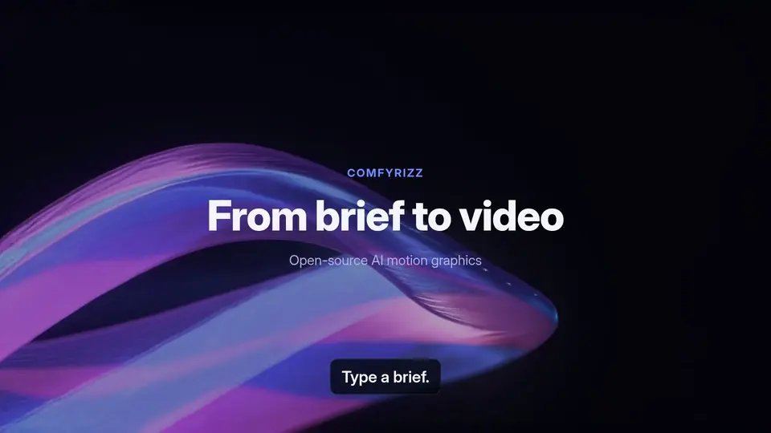

<sub>Every frame above came out of Comfyrizz: nine example videos from one Google Colab G4 session. Labels, numbers and captions are drawn by code, never by the image model.</sub>

[Quickstart](#quickstart) · [Features](#features) · [How it works](#how-it-works) · [Configuration](#configuration) · [Roadmap](#roadmap) · [Spec](docs/SPEC.md)

</div>

---

## What it does

1. **Brief.** Describe a talk, launch or lesson in chat. In Plan mode the agent asks up to three chip questions (each with *Decide for me*), then shows an editable brief with a script-first outline, a style preset and an optional brand kit.
2. **Package.** A model-agnostic agent turns the brief into a `comfyrizz.package/v1`: scenes, copy, charts from your CSV, sanitised SVG art, and planned FLUX 3 Klein / LTX-2.5 jobs.
3. **Generate.** GPU jobs run through the Comfy SDK on a **Google Colab** G4 runtime that Comfyrizz starts, runs, collects and verifiably stops, or on **your own ComfyUI**. Nothing is spent without a spend card you approve.
4. **Render.** Remotion renders a 1080p MP4 on CPU with Kokoro narration and sentence captions, then exports a bundle: `video.mp4`, `captions.srt/.vtt`, `CREDITS.md` and a rights-filtered `package.zip`.

No GPU? The whole loop (brief → package → SVG art → preview → MP4 → bundle) runs on CPU with procedural fallbacks and a scripted agent. No API key needed.

## Screenshots

<table>
  <tr>
    <td width="50%">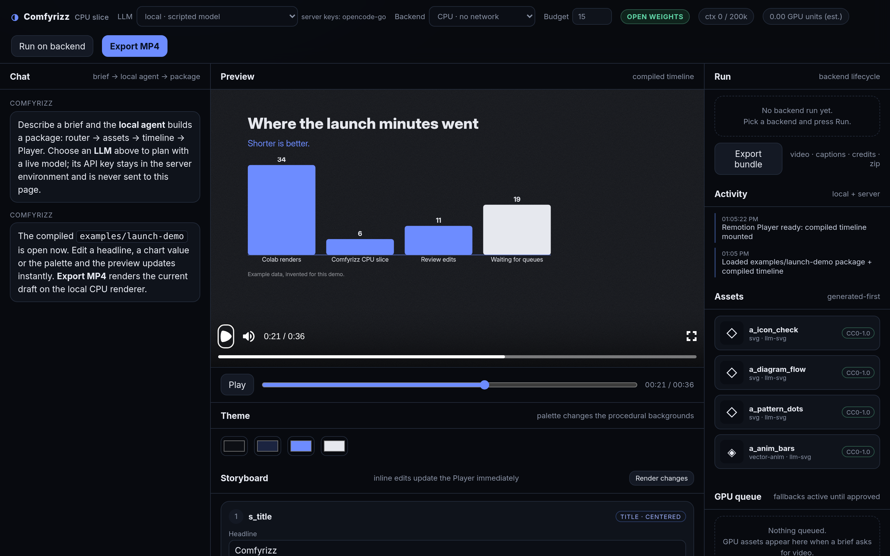<br><sub><b>Workspace.</b> Chat, the live Remotion Player, the run panel and the generated-first asset list.</sub></td>
    <td width="50%">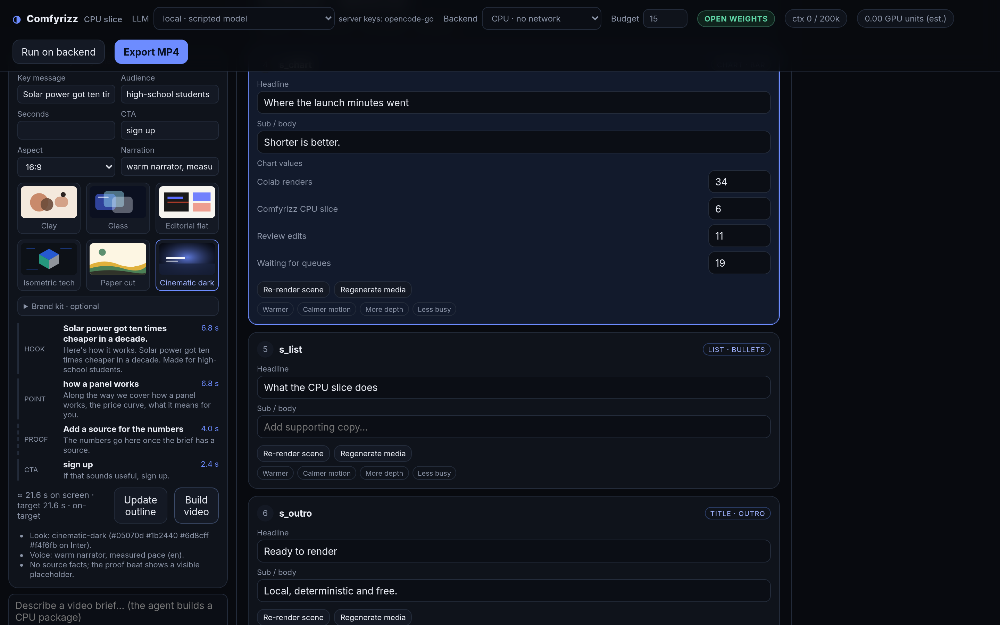<br><sub><b>Plan mode.</b> The editable brief: six style presets, brand kit, and a hook/point/proof/CTA outline with per-beat seconds.</sub></td>
  </tr>
  <tr>
    <td width="50%">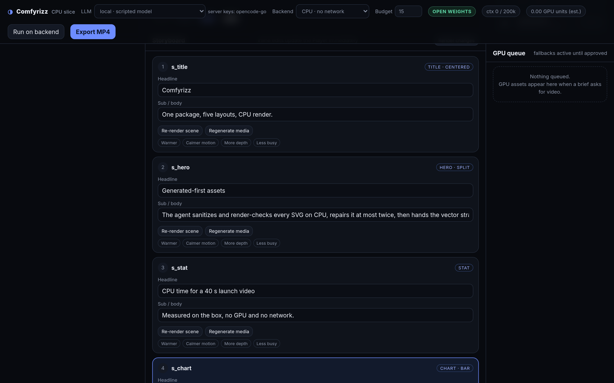<br><sub><b>Storyboard.</b> Inline edits update the Player instantly; each scene can be re-rendered or regenerated on its own.</sub></td>
    <td width="50%">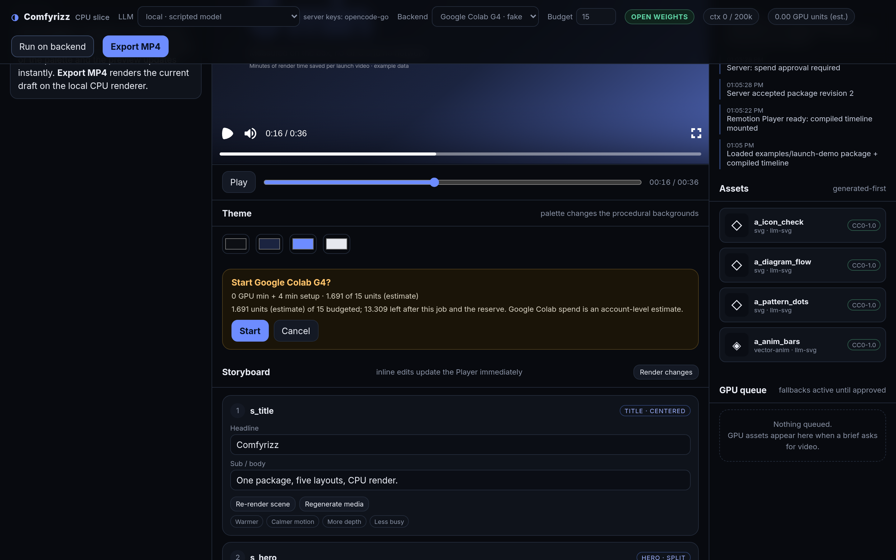<br><sub><b>Spend card.</b> GPU minutes, setup and units against your budget. Nothing starts until you press Start.</sub></td>
  </tr>
  <tr>
    <td colspan="2">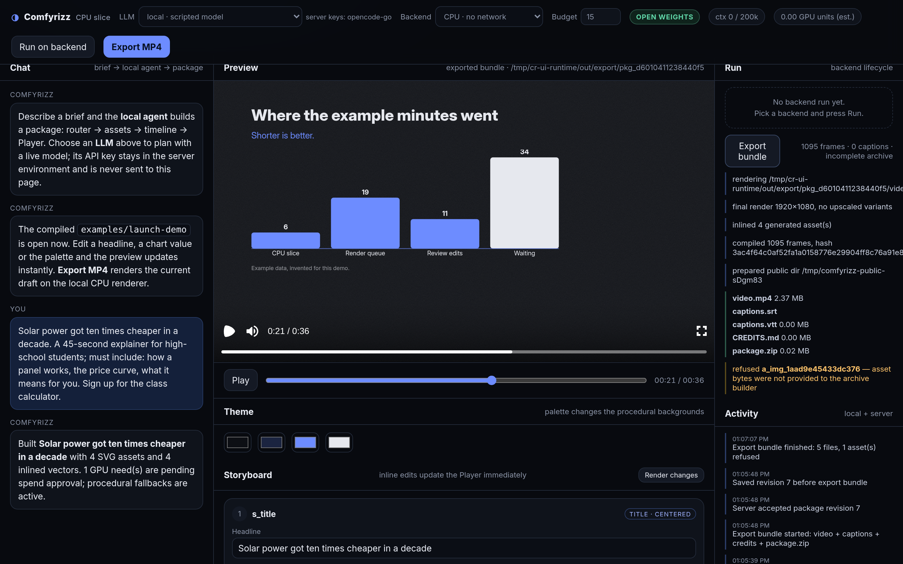<br><sub><b>Export bundle.</b> A brief built by the agent and exported on CPU: MP4, captions, credits and a <code>package.zip</code> that refuses any asset whose licence doesn't allow redistribution.</sub></td>
  </tr>
</table>

## Gallery

Stills from example videos rendered with Comfyrizz (FLUX 3 Klein stills and reference edits, LTX-2.5 plates, Kokoro narration, Remotion type and charts).

<table>
  <tr>
    <td width="33%">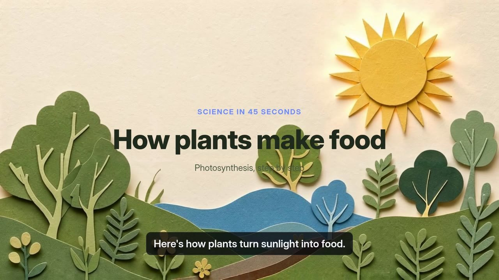<br><sub>Paper-cut science explainer</sub></td>
    <td width="33%">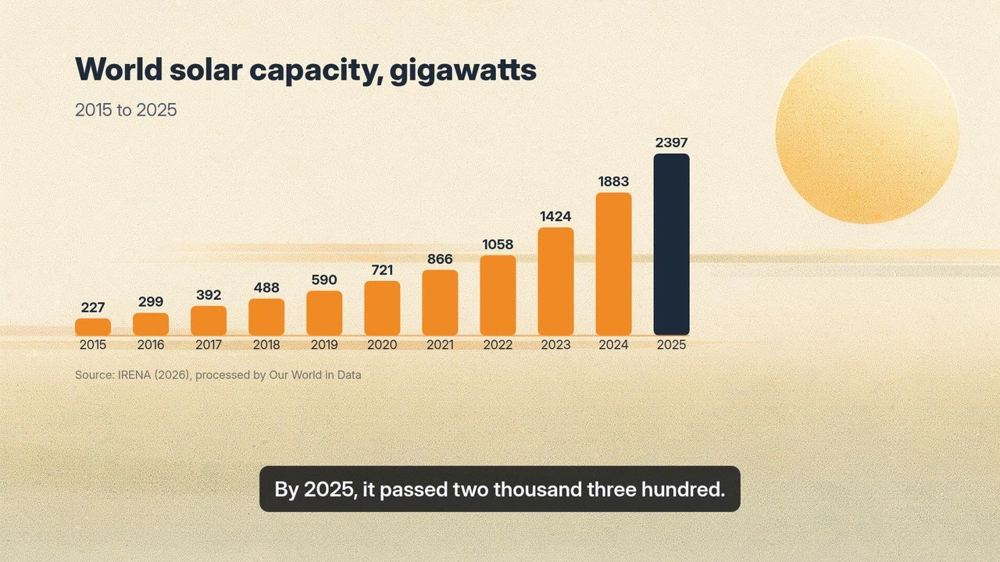<br><sub>Data story from real CSV data</sub></td>
    <td width="33%"><br><sub>Product ad (fictional product)</sub></td>
  </tr>
  <tr>
    <td width="33%">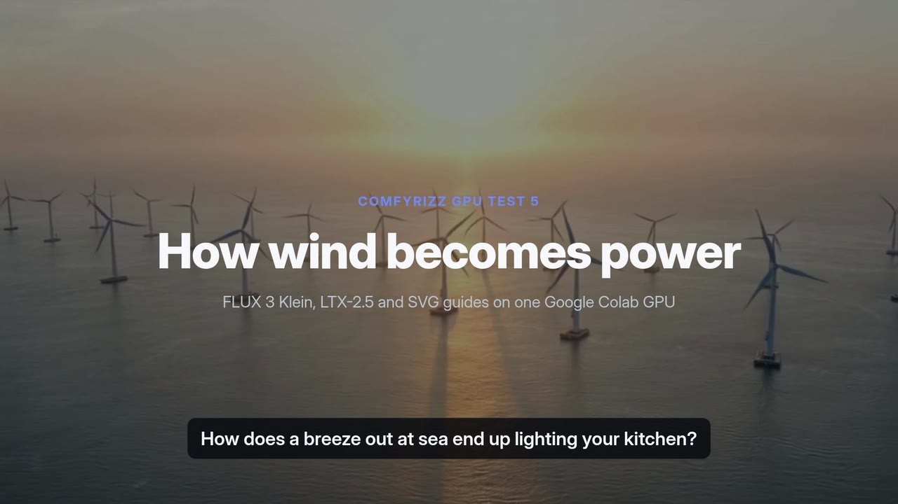<br><sub>LTX-2.5 plate under Remotion type</sub></td>
    <td width="33%">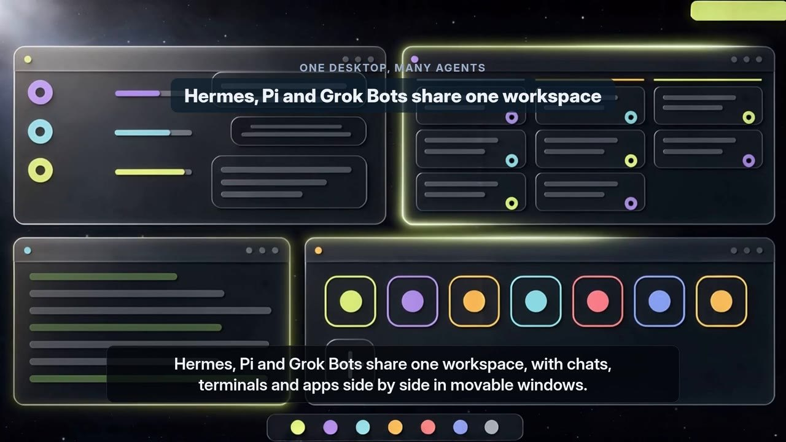<br><sub>Software explainer from SVG mockups</sub></td>
    <td width="33%" align="center"><br><sub>9:16 kids' short</sub></td>
  </tr>
</table>

## Features

| | |
|---|---|
| 💬 **Chat-first agent** | Plan or Express mode, chip questions with *Decide for me*, editable brief and script-first outline. Bounded tool loop with zod-validated tools and a repair loop. |
| 🔌 **Model-agnostic LLM** | Any OpenAI-compatible endpoint, OpenRouter, or OpenCode Go (e.g. DeepSeek v4.1). Keys stay in the server environment; the browser only sees "configured: yes/no". |
| 🎨 **Style presets + brand kit** | Clay, Glass, Editorial flat, Isometric tech, Paper cut, Cinematic dark, with CPU/SVG thumbnails. Brand palette, fonts (licence-checked), tone and logo. |
| 📐 **Generated-first vector art** | The agent writes SVG for icons, diagrams, patterns and animated parts. Every SVG is sanitised, rasterised with resvg and render-checked, with up to two automatic repairs. |
| ✏️ **Sketch to render** | An agent-drawn SVG layout becomes the reference image for a FLUX 3 Klein edit, so the styled still keeps the composition. |
| 🎞️ **LTX-2.5 plates** | Text-to-video and image-to-video moving backgrounds, trimmed, looped and retimed to the 30 fps timeline. |
| 📊 **Charts from CSV** | Paste, upload or fetch a CSV; the exact values become chart, stat and list scenes with the source on screen. Missing numbers stay visible placeholders, never invented. |
| 🗣️ **Kokoro narration + captions** | Per-sentence synthesis on CPU, measured durations drive the timeline, loudness-normalised mix, burned-in captions plus SRT/VTT. |
| 🌍 **Multilingual + aspect variants** | Export per-language and 16:9 / 9:16 / 1:1 variants with re-flowed layouts. |
| ☁️ **Google Colab backend** | Spins up a G4, bootstraps ComfyUI with pinned models, runs batches, downloads results and stops the runtime, verified against `colab sessions`. Watchdog, budget formula and `stop_unconfirmed` reporting. |
| 🖥️ **Bring your own ComfyUI** | Point the same jobs at your own ComfyUI (plus `comfy-api-proxy`). Not metered, never called free. |
| 🔁 **Per-scene re-render** | Re-render one scene or regenerate one scene's media; ×2 upscale for final plates. |
| 📦 **Rights-aware export** | `CREDITS.md` and a `package.zip` that ships only assets whose licence allows it and lists every refusal with its reason. |
| 🧪 **Deterministic render** | Frame = f(timeline, local assets, frame number). No network in compositions; copy that doesn't fit fails visibly instead of clipping. |

## How it works

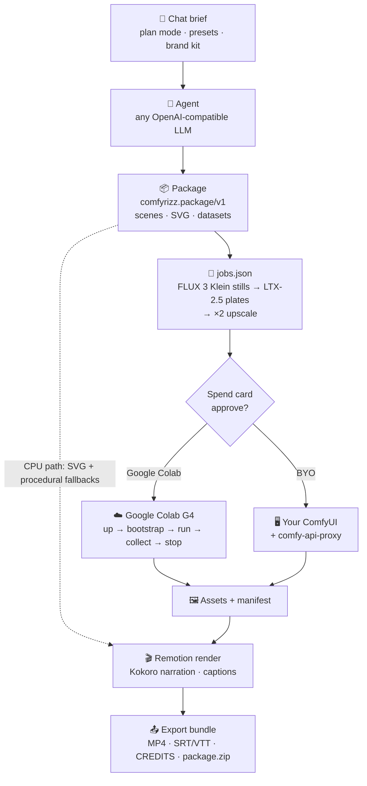

- **The package is the contract.** `packages/schema` holds the JSON Schema plus TS and Python validators. Paths are relative, ids resolve, model licences are tracked separately from output licences.
- **The agent.** `packages/agent` runs a bounded tool loop (`storyboard.propose`, `storyboard.edit`, `assets.route`, `assets.generate_svg`, `assets.generate_image`, `assets.sketch_to_render`). An asset router picks SVG for icons, diagrams and charts, FLUX for illustrations and textures, and sketch-to-render for styled heroes. Invalid tool arguments go back to the model (max two repairs); partial streamed arguments never execute. GPU work is only ever *planned* by the agent. It runs after you approve the spend card.
- **The pipeline.** `packages/jobs` turns a package into an ordered, hashed `jobs.json` (stills before plates, LTX sizes in multiples of 64 and 8n+1 frames). `pipeline-py` submits the jobs with the Comfy SDK, writes an attempt record *before* each submit, and treats an atomic `out/manifest.json` as the only proof of success. A lost submission is reconciled, never blindly resubmitted.
- **The timeline.** `packages/planner` compiles the package plus measured narration into integer-frame `timeline.json` at 30 fps, with transition overlaps, plate retiming and sentence-level caption cues.
- **The render.** `apps/renderer` (Remotion) has five layout families (Title, Hero, Stat, Chart, List), motion tokens and procedural backgrounds when no plate exists.

## Quickstart

### Requirements

- **Node.js 22** (`engines` is `>=20`; 20.19 is also tested), **pnpm** 10, **ffmpeg**/**ffprobe**
- **Chrome or Chromium** for Remotion. Scripts default to `/usr/bin/google-chrome`; override with `REMOTION_BROWSER=/path/to/chrome`
- **Python 3.10+** for the GPU pipeline and Kokoro narration (optional for the CPU demo)

### 1. CPU-only demo (no GPU, no API key)

```bash
git clone https://github.com/mojomast/comfyrizz && cd comfyrizz
pnpm install                       # no lockfile is committed yet, so this resolves fresh
pnpm -r --if-present run build     # packages/* dist + apps/web dist

cd apps/server && npm start        # builds, then serves http://127.0.0.1:4319/#token=…
```

Open the printed URL. The bundled `examples/launch-demo` loads in the Player. Edit a headline or a chart value, send a brief in **Plan** mode with the *local · scripted model*, then press **Export MP4** or **Export bundle**. Everything runs locally on CPU.

Render the bundled example straight from the CLI, with an ffprobe frame check:

```bash
pnpm --filter @comfyrizz/renderer render:example   # → examples/launch-demo/out/launch-demo.mp4
pnpm --filter @comfyrizz/renderer studio           # Remotion Studio
```

The whole fresh-clone path (clone → install → build → serve → brief → MP4 → bundle → ffprobe) runs non-interactively as one script:

```bash
bash apps/server/scripts/clean-clone-e2e.sh        # KEEP=1 to inspect the temp dir
```

Optional narration (Kokoro-82M on CPU):

```bash
python3 -m venv .venv && .venv/bin/pip install -r packages/tts/py/requirements.txt
packages/tts/scripts/fetch-models.sh               # kokoro-v1.0.onnx + voices (not committed)
```

### 2. Google Colab (G4 GPU)

1. Install and sign in to the `google-colab-cli` (`colab`). Comfyrizz finds it via `COMFYRIZZ_COLAB_BIN`, then `~/.local/bin/colab`, then `PATH`.
2. On Hugging Face, accept the **FLUX 3 Image Klein** and **LTX-2.5** licences (both repos are gated), create a **read** token, and store it in a file only you can read:
   ```bash
   install -m 600 /dev/null ~/.config/comfyrizz-hf-token && $EDITOR ~/.config/comfyrizz-hf-token
   export COMFYRIZZ_HF_TOKEN_FILE=~/.config/comfyrizz-hf-token
   ```
   The token is uploaded as a 0600 file, used, and deleted from the VM before it stops. It is never passed with `--env` and never printed.
3. Start the server, pick **Google Colab G4** as the backend, set a unit **Budget** and press **Run on backend**. Review the spend card (GPU minutes, setup, units against budget) and press **Start**.

Comfyrizz creates one runtime, bootstraps ComfyUI with the models pinned in `colab/models.lock.json`, runs the batches, downloads the results, applies them to the package, re-renders, and stops the runtime. The stop is verified, and anything else is reported as `stop_unconfirmed`. A detached watchdog stops the runtime if the app dies. The full path was run end to end on a real G4 runtime on Oct 18, 2026 (GPU test 5).

> Google Colab is for your own interactive compute. Don't use the Google Colab backend to serve other people.

### 3. Bring your own ComfyUI

```bash
scripts/setup-local-comfy.sh --dry-run             # see the plan first
hf auth login                                      # gated model repos
scripts/setup-local-comfy.sh --comfyui-ref v0.41.3
```

Run ComfyUI and `comfy-api-proxy`, then pick **BYO ComfyUI** in the app (default `http://127.0.0.1:8188`), or drive the pipeline from the CLI. See [`packages/backends/BYO-COMFYUI.md`](packages/backends/BYO-COMFYUI.md) for health checks and `plan-jobs` → `comfyrizz_pipeline.runner`.

## Configuration

All configuration is environment variables read by the local server. Nothing secret is sent to the browser.

| Variable | Purpose |
|---|---|
| `OPENROUTER_API_KEY` | OpenRouter preset |
| `OPENCODE_API_KEY` (or `OPENCODE_GO_API_KEY`) | OpenCode Go preset, e.g. DeepSeek v4.1 |
| `COMFYRIZZ_CUSTOM_BASE_URL`, `COMFYRIZZ_CUSTOM_API_KEY` | Any OpenAI-compatible endpoint (vLLM, Ollama, a proxy). Default base URL `http://127.0.0.1:8000/v1` |
| `COMFYRIZZ_HF_TOKEN_FILE` | Path to a 0600 file holding a Hugging Face **read** token for the gated FLUX 3 Klein and LTX-2.5 repos |
| `COMFYRIZZ_COLAB_BIN` | Path to the `colab` CLI if it isn't on `PATH` |
| `COMFYRIZZ_PORT` | Server port (default `4319`, loopback only) |
| `COMFYRIZZ_RUNTIME` | State directory (default `apps/server/.runtime`, git-ignored) |
| `COMFYRIZZ_TOKEN` | Fix the URL-fragment session token (tests). Otherwise one is generated into `.runtime/server-token` (0600) |
| `REMOTION_BROWSER` | Chrome/Chromium used for rendering |

Check that a model can actually call tools before you rely on it: `pnpm --filter @comfyrizz/llm probe` refuses text-only models. It reads the key from the environment and never prints it.

> **Never commit secrets.** Keys live in your shell environment, the HF token lives in a 0600 file outside the repo, and `.env`, `.runtime/`, `out/` and `runs/` are git-ignored. The server binds to `127.0.0.1`, keeps its token in the URL fragment, and checks Host and Origin on every request.

## Repo layout

```
apps/
  web/          Vite + TypeScript UI: chat, brief card, Remotion Player, storyboard, run/export panels
  server/       Loopback HTTP server: packages + revisions, agent, run controller, render, export, SSE
  renderer/     Remotion project: layouts, motion tokens, captions, CLI render scripts
packages/
  schema/       comfyrizz.package/v1 + jobs/v1 JSON Schemas, TS + Python validators, motion lint
  agent/        Tool loop, asset router, brief extractor, style presets, brand kit, CSV scenes
  llm/          OpenAI-compatible adapter: OpenRouter, OpenCode Go, custom presets + probe
  planner/      Timeline compiler (integer frames, transitions, caption cues)
  jobs/         package → ordered, hashed jobs.json (stills → plates → upscale)
  backends/     Google Colab lifecycle + BYO ComfyUI, budget, watchdog
  vector/       SVG sanitiser, resvg render-check, auto-fix loop
  tts/          Kokoro narration, measured cues, SRT/VTT, loudness
  sources/      Openverse search, uploads, licence policy, CREDITS + package.zip filter
pipeline-py/    Comfy SDK runner, attempt records, manifest, reconcile, health; SVG-guided eval
colab/          Scripts the Google Colab backend uploads to the VM (bootstrap, health, run, reconcile)
workflows/      ComfyUI API-format graphs + params (FLUX 3 Klein t2i/img2img/ref-edit, LTX-2.5 t2v/i2v)
examples/       Bundled packages (launch-demo, narrated-demo, product-explainer, csv-charts, …)
docs/           SPEC, PLAN, GPU test reports, UI notes, media
```

## Testing

```bash
pnpm test             # every workspace package's node:test suite (builds what it needs first)
pnpm run test:py      # pipeline-py pytest; needs .venv (see pipeline-py/requirements-dev.txt)
pnpm run test:all     # both
```

GPU paths are tested against a **fake `colab` CLI** and a **fake Comfy v2 server**, so the suites start no runtime and spend nothing. Useful extras:

```bash
python3 -m venv .venv && .venv/bin/pip install -r pipeline-py/requirements-dev.txt
node packages/schema/bin/comfyrizz-validate.mjs examples/launch-demo/package.json
node packages/jobs/bin/plan-jobs.mjs examples/launch-demo/package.json --out out/jobs.json
node scripts/gpu4/g4_dryrun.mjs        # whole Google Colab run against loopback fakes
pnpm --filter @comfyrizz/renderer layout:check
```

## Roadmap

Working now: everything under [Features](#features). In progress or planned:

- [ ] **Qwen3-TTS voices** alongside Kokoro
- [ ] **Open in ComfyUI**: open any generated asset's exact graph and parameters in ComfyUI
- [ ] **Music bed and SFX** in the mix
- [ ] **Motion transitions** (blur, push, zoom, iris): schema vocabulary and motion lint landed, renderer support in progress
- [ ] Committed `pnpm-lock.yaml` for reproducible installs
- [ ] SVG-guided generation defaults from the sweep in `workflows/svg-guided/` (experimental)

## Credits and licences

**Comfyrizz is MIT-licensed.** See [LICENSE](LICENSE) and [NOTICE](NOTICE).

- **Motion timing.** Easing and timing values are re-expressed from [whaleyxbt/claude-motion](https://github.com/whaleyxbt/claude-motion) (MIT) and HeyGen's HyperFrames motion skills (Apache-2.0). Numbers only, no code copied.
- **Orbit.** Portions derive from Orbit (mojomast/orbitdesktop), relicensed MIT by its owner.
- **Built on.** [ComfyUI](https://github.com/comfyanonymous/ComfyUI) (GPL-3.0, not vendored; cloned at runtime), the Comfy SDK and `comfy-api-proxy` (MIT), `google-colab-cli` (Apache-2.0, invoked as an external command), the Vercel AI SDK (Apache-2.0) and resvg (MPL-2.0).
- **Remotion** is source-available under the [Remotion License](https://www.remotion.dev/license), which is not OSI. It is free for individuals and organisations of up to 3 people; larger companies need a Company License.

**Models are not distributed with this repository.** Each user downloads them under the model's own licence:

| Model | Used for | Licence |
|---|---|---|
| FLUX 3 Image Klein | stills, reference edits, sketch-to-render | FLUX Kommunity License v1.0 (gated on Hugging Face) |
| LTX-2.5 | text/image-to-video plates, ×2 upscale | LTX-2.x Community License (gated on Hugging Face) |
| Kokoro-82M | narration | see the model card and NOTICE |

Your generated videos are yours, but check each model's licence for commercial use before you publish.

## Hackathon

Comfyrizz is Kyle Durepos's entry for **Comfy's Open Source Higgsfield hackathon** (submissions due Oct 30, 2026). It's open source on purpose. The whole loop runs on open weights (FLUX 3 Klein, LTX-2.5, Kokoro) through ComfyUI, on a GPU you rent by the minute on Google Colab or on one you already own.

## Contributing

Issues and PRs are welcome. The short version:

- Read [`docs/SPEC.md`](docs/SPEC.md) for the design and [`docs/PLAN.md`](docs/PLAN.md) for the milestone plan.
- Keep changes small, keep `pnpm test` (and `pnpm run test:py` for Python) green, and add a test with each fix.
- The package schema is the contract. If you change `package-v1.schema.json`, regenerate the types (`pnpm --filter @comfyrizz/schema gen:types`).
- No secrets in code, fixtures or logs. Tests must never start a real Google Colab runtime.
- Write "Google Colab" in prose and UI copy.

<div align="center"><sub>Made with ComfyUI, Remotion and a lot of SVG.</sub></div>
