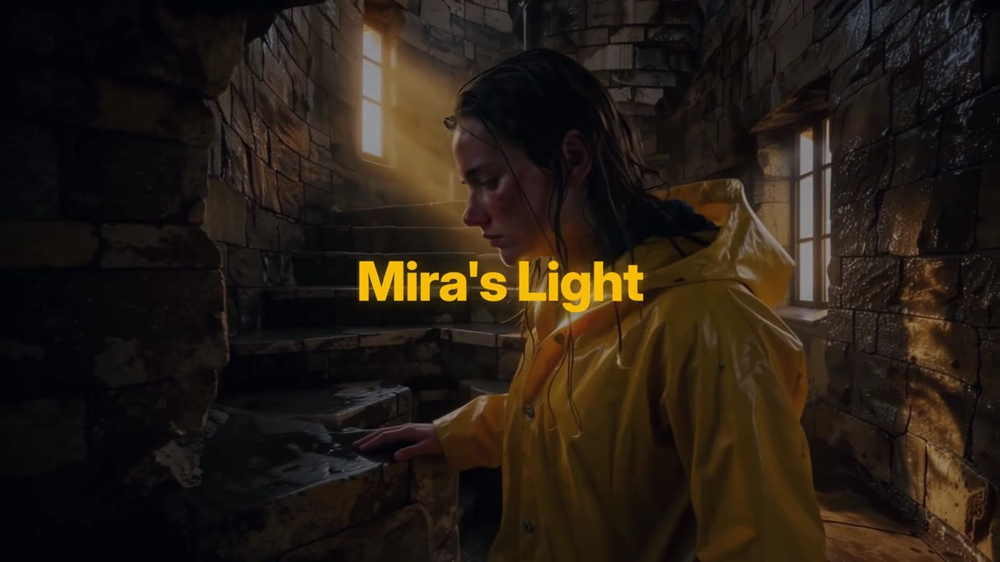
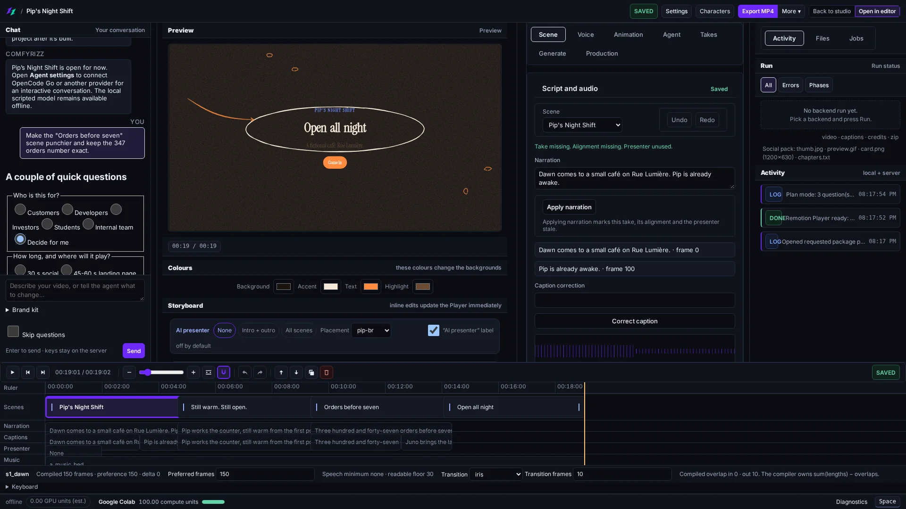
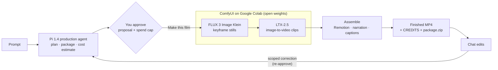

<div align="center">

<picture>
  <source media="(prefers-color-scheme: dark)" srcset="brand/comfyrizz-logo-dark.svg">
  <source media="(prefers-color-scheme: light)" srcset="brand/comfyrizz-logo-light.svg">
  
</picture>

### One prompt in. A finished film out. Refine it by chatting with the agent.

**Comfyrizz** is an open-source film studio. A Pi agent plans the film, you approve it, ComfyUI on
Google Colab generates **FLUX 3 Image Klein** stills and **LTX-2.5** video (open weights), and
code assembles the final MP4. Then you edit it by chatting. No local GPU required.

[](LICENSE)
[](#quickstart)
[](packages/agent/)
[](https://github.com/comfyanonymous/ComfyUI)
[](#google-colab-setup)
[](#models--licenses)
[](#hackathon-compliance)
[](#hackathon-compliance)

<a href="demo/submission-video/film/DEMO_DRAFT.mp4"></a>

**▶ [Watch the 1:57 demo](demo/submission-video/film/DEMO_DRAFT.mp4)** · [Marketing site](https://comfy.rizz.click) · [Docs](docs/README.md) · [Write-up](docs/submission/WRITEUP.md)

</div>

---

**Jump to:** [Watch the demo](#watch-the-demo) · [What it does](#what-it-does) · [How it works](#how-it-works) · [Quickstart](#quickstart) · [Google Colab](#google-colab-setup) · [Models & licenses](#models--licenses) · [Compliance](#hackathon-compliance) · [Hermes plugin](#hermes-plugin) · [Hosted invite demo](#hosted-invite-demo) · [Repo map](#architecture--repo-map) · [Testing](#testing) · [Limitations](#roadmap--known-limitations) · [Credits](#credits)

## Watch the demo

<a href="demo/submission-video/film/DEMO_DRAFT.mp4"></a>

**[`demo/submission-video/film/DEMO_DRAFT.mp4`](demo/submission-video/film/DEMO_DRAFT.mp4)** (1:57, 1920×1080, v5 cut). It shows **"Mira's Light"**:
one prompt in **Super Easy** → a short proposal → **Make this film** → Klein stills and LTX-2.5 clips
landing live in the gallery (ComfyUI on Google Colab) → the finished 24-second film → a chat edit
that re-runs shot 4 on Google Colab → before/after.

- The UI footage, the 9 Klein stills, the 4 LTX-2.5 clips and the shot-4 retake were **generated live** (2.67 Google Colab compute units in total).
- **Disclosed edits:** the chat panel text was redrawn to describe what the real shot-4 retake changed. Title and end cards, captions and the Kokoro voice-over were added in post. Details, the EDL and provenance are in [demo/submission-video/README.md](demo/submission-video/README.md).

## What it does

| Mode | For | What you get |
| --- | --- | --- |
| **Super Easy** (default) | Anyone | Pick **Auto**, **H3**, **LTX** or **Klein only**, type one prompt, press **Generate**. Review a short proposal (title, logline, look, duration, soundtrack) and choose **Make this film**. Assets appear in a live gallery, and the MP4 ends with Download, an agent composer for changes and **Advanced mode**. See [docs/ui/SUPER_EASY.md](docs/ui/SUPER_EASY.md). |
| **Easy** (Easy Studio) | More control | **I want more control** opens a seven-step flow: **Idea → Characters → Iteration level → Plan → Generate → Review → Export**. |
| **Studio** (Advanced) | Editors | Chat agent, Remotion preview, frame-accurate timeline, takes, inspectors and runs (**Open in editor** or **Ctrl/Cmd+Shift+A**). See [docs/features/interface.md](docs/features/interface.md). |

- **Approval before spend.** The agent *proposes* plan cards. Only work you approve is dispatched, under a Google Colab spend cap you set ([iteration levels](docs/ITERATION_LEVELS.md)).
- **Exact text.** Headlines, numbers, charts and captions are drawn by code (Remotion), never by the image model.
- **Chat edits on the same project.** Ask for a change and the agent proposes a scoped correction, such as re-running one shot.
- **Durations** come as 15/30/60/90-second presets or any exact length from 1 to 120 seconds.
- **Record this run** films the run itself for a demo ([procedure capture](docs/ui/PROCEDURE_CAPTURE.md)).
- **Rights-aware export.** Every asset carries its source and licence. `CREDITS.md` and a rights-filtered `package.zip` ship only what may be redistributed.
- **Characters, references, voice:** a reusable [character library](docs/features/characters.md), a [references panel](docs/REFERENCE_ASSETS.md) and [voice](docs/features/voice.md) (local Kokoro, or native model audio where supported).



## How it works



1. **Plan.** The [Pi 1.4](packages/agent/) agent (`@earendil-works/pi-agent-core` 1.4.0) runs a bounded tool loop against any OpenAI-compatible endpoint (OpenRouter, OpenCode Go or your own server). It writes a validated package ([`packages/schema`](packages/schema/)).
2. **Approve.** Nothing paid runs until you accept the proposal. A per-production spend cap and budget ledger guard every dispatch.
3. **Generate.** [`pipeline-py`](pipeline-py/) submits hashed, API-format ComfyUI [workflows](workflows/) (e.g. `flux3_klein_t2i`, `ltx25_i2v_2stage`). Comfyrizz starts a Google Colab GPU, installs pinned models ([`colab/models.lock.json`](colab/models.lock.json)), runs the jobs, collects the outputs and stops the VM. It reports the stop only after the Google Colab CLI confirms it. Bring your own ComfyUI instead with **My ComfyUI URL**.
4. **Assemble.** [`apps/renderer`](apps/renderer/) renders deterministically with Remotion. A final gate requires visibly used ComfyUI output with trusted generation and render receipts.
5. **Edit.** Chat proposes a correction, such as re-running shot 4 with a new seed. You approve it, and only that work runs again.

Full design: [docs/SPEC.md](docs/SPEC.md).

## Quickstart

**Requirements:** Node.js **≥ 22.19.0** (required by Pi 1.4), **pnpm 10**, **ffmpeg**, Chrome/Chromium for Remotion (`REMOTION_BROWSER` overrides it), and Python 3.12 for the doctor, the pipeline and Kokoro (`COMFYRIZZ_PYTHON`, default `python3`).

```bash
git clone https://github.com/mojomast/comfyrizz
cd comfyrizz
pnpm install --frozen-lockfile
pnpm -r --if-present run build
pnpm run doctor --offline     # setup preflight (use `pnpm run doctor`, not bare `pnpm doctor`)
cd apps/server && npm start
```

Open the URL the server prints (`http://127.0.0.1:4319/#token=…`). **Super Easy** opens. The built-in **local · scripted model** works offline for planning and editing rehearsals. Real generation needs the one-time [agent / Google Colab / Hugging Face setup](docs/ONE_PROMPT.md) (Linux and native Windows).

More ways in:

```bash
pnpm --filter @comfyrizz/renderer render:example   # CPU render of the bundled example → examples/launch-demo/out/launch-demo.mp4
pnpm capture:procedure                             # headless recording of a scripted run (no Google Colab spend)
```

- **No-server demo page:** `apps/web/demo.html?fixture=1` ([runbook](docs/DEMO_WEBAPP_RUNBOOK.md)).
- **Offline replay:** recorded agent sessions replay with no key or network ([cassettes](docs/AGENT_CASSETTE.md)).

  ```bash
  COMFYRIZZ_LLM_CASSETTE=play:$PWD/scripts/cassette/fixtures/launch-brief.cassette.json \
    npm --prefix apps/server run start
  ```

## Google Colab setup

Google Colab is the default managed GPU path. Your laptop runs the app, and Google Colab runs the inference. Comfyrizz drives **your own** Google Colab account through the official `google-colab-cli` ([scripts in `colab/`](colab/)).

1. In the app, open **Set up AI & Google Colab** ([guide](docs/ONE_PROMPT.md)) and pick **Google Colab** as the backend. **Test connection** checks that the CLI is installed and signed in.
2. Accept the FLUX 3 Image Klein and LTX-2.5 licences on Hugging Face and save a read token through setup. For environment-based setup, point `COMFYRIZZ_HF_TOKEN_FILE` at a private `0600` file. Never commit it.
3. Set a credit ceiling and approve the proposal. Comfyrizz allocates the GPU, bootstraps ComfyUI and the pinned models, runs the workflows, collects verified outputs and stops the VM.
4. Optional: render on the same VM (`renderLocation: 'colab'`, see [docs/COMPOSITIONS.md](docs/COMPOSITIONS.md#google-colab-remote-render)).

Compute units pay for runtime, including setup and model downloads. The demo film plus its retake used **2.67 CU**. Lifecycle and budget details: [docs/features/google-colab.md](docs/features/google-colab.md) · efficiency measurements: [docs/COLAB_EFFICIENCY_RESULTS.md](docs/COLAB_EFFICIENCY_RESULTS.md). A dry run against loopback fakes: `node scripts/gpu4/g4_dryrun.mjs`.

## Models & licenses

No weights are in this repository. Each user downloads them under their own licences (see [NOTICE](NOTICE) and [LICENSE_AUDIT.md](docs/submission/LICENSE_AUDIT.md)).

| Model | Role in Comfyrizz | Weights | Licence |
| --- | --- | --- | --- |
| **FLUX 3 Image Klein** (`black-forest-labs/flux-3-image-klein`) | Keyframe stills, reference edits | Open (gated download) | FLUX Kommunity License v1.0 |
| Qwen3-VL-4B-Instruct | Klein text encoder | Open | Apache-2.0 |
| **LTX-2.5** (`Lightricks/LTX-2.5`, 22B distilled) | Image/text-to-video clips, ×2 upscale | Open (gated download) | LTX-2.x Community License |
| Gemma 4 12B | LTX-2.5 text encoder | Open (in LTX pack) | Gemma terms *(unverified in repo)* |
| MiniMax H3 Omni (`FastVideo/FastH3-Omni-Comfy`) | Optional H3/Auto routes: character acting + native audio | Open | MiniMax-H3 Community License |
| Kokoro-82M | Local CPU narration (demo VO voice `af_heart`) | Open | Apache-2.0 *(marked unverified in repo)* |
| Qwen3-TTS / ASR / ForcedAligner | Optional narration and QA | Open | Apache-2.0 *(marked unverified in repo)* |
| ComfyUI | Inference engine | — | GPL-3.0, cloned at runtime, not vendored |

The demo film uses the **Klein → LTX-2.5** route. All workflows use core ComfyUI nodes, with no partner nodes.

## Hackathon compliance

Entry by Kyle Durepos for the **Open Source Higgsfield hackathon** (deadline Oct 30, 2026, 12:00 PM Toronto time).

| Requirement / bonus | Status | Evidence |
| --- | --- | --- |
| Open-source repo + setup | ✅ MIT | [LICENSE](LICENSE), [Quickstart](#quickstart) |
| **Open Weights Only (OWO)** | ✅ image/video/voice path · ⚠️ agent depends on configuration | Every generation model above is open weights, and the workflows have no partner nodes or closed APIs. The agent is model-agnostic: point it at an open-weights model to keep the whole critical path open. The shipped hosted presets *can* be closed APIs, so they are not OWO-eligible ([audit §3](docs/submission/LICENSE_AUDIT.md)). |
| **Built with FLUX** | ✅ core of the demo | Every keyframe in the demo is a FLUX 3 Image Klein still, and LTX-2.5 animates those keyframes. ComfyUI workflow JSON for each still: [`demo/submission-video/stills/`](demo/submission-video/stills/). |
| Requirement tracker | — | [CHECKLIST.md](docs/submission/CHECKLIST.md) · [WRITEUP.md](docs/submission/WRITEUP.md) · [DEADLINE_HANDOFF.md](docs/submission/DEADLINE_HANDOFF.md) |

## Hermes plugin

Comfyrizz runs as a chat-first film pipeline inside **Nous Hermes Agent**:
brief → plan in chat → revise → explicit accept → generate → assemble → export → granular retake.

- **Portable plugin:** [mojomast/comfyrizz-hermes](https://github.com/mojomast/comfyrizz-hermes) (MIT; MCP + skill). It is listed in the Hermes plugin catalog via [NousResearch/hermes-agent#146230](https://github.com/NousResearch/hermes-agent/pull/146230) (merged Oct 29, 2026).
- **In-repo plugin:** [`plugins/comfyrizz`](plugins/comfyrizz/README.md) (skill `comfyrizz-film`) plus the MCP server [`packages/comfyrizz-mcp`](packages/comfyrizz-mcp). The same server works in Cursor and other MCP clients ([docs/hermes-plugin.md](docs/hermes-plugin.md)).
- Spend always needs explicit acceptance: the tools return `APPROVAL_REQUIRED` until you accept the spend card.

## Hosted invite demo

Judges and friends can try it without any setup through **hosted invite links** (merged in [PR #59](https://github.com/mojomast/comfyrizz/pull/59)). Each link has its **own Google Colab CU budget and film limit**.

- The owner mints a link: `COMFYRIZZ_TOKEN=… node scripts/invites/mint.mjs --cu 2 --ttlDays 7 --label friend`.
- Guests land in Super Easy with **host-configured planning** (no API keys or Google Colab setup). Runs are forced to Google Colab, and budgets are capped to the link's remaining CU. Server-side admission, concurrency and film limits apply.
- A shared gallery shows completed guest films with their prompts and models. **Edit with agent** works on a private copy. CPU work and agent edits keep working after a link's credits run out.
- **Honest accounting:** the Google Colab CLI gives no per-session CU receipt, so hosted runs keep their CU **reserved (usage indeterminate)** until they are reconciled. They are never shown as free.

Design, API and deployment notes: [docs/HOSTED_COLAB_INVITE_DEMO.md](docs/HOSTED_COLAB_INVITE_DEMO.md). The marketing site is at **[comfy.rizz.click](https://comfy.rizz.click)**.

## Architecture & repo map

```
apps/
  web/          Vite + TS UI: Super Easy, Easy Studio, Studio (chat, Remotion Player, timeline); demo.html
  server/       Loopback HTTP server: agent runner, productions (journal, ledger), takes, pipeline, render, export, invites
  renderer/     Remotion project: layouts, transitions, finishing layer, CLI renders
packages/
  agent/        Pi 1.4 production runtime, tools, motion-model routing, skills, style recipes
  schema/       comfyrizz.package/v1 + jobs schemas, TS + Python validators
  llm/          OpenAI-compatible adapter (OpenRouter, OpenCode Go, custom)
  planner/      Timeline compiler (integer frames, transitions, caption cues)
  jobs/         package → ordered, hashed jobs.json; model-contribution checks
  backends/     Google Colab lifecycle + BYO ComfyUI, budget, watchdog, session accounting
  tts/          Kokoro + Qwen3-TTS adapters, SRT/VTT
  sources/      Openverse, uploads, licence policy, CREDITS + package.zip filter
  comfyrizz-mcp/ MCP server used by the Hermes plugin
  vector/ compositions/ pi-title-runner/
pipeline-py/    Comfy SDK runner, manifests, reconcile
colab/          Scripts the Google Colab VM runs; models.lock.json pins
workflows/      ComfyUI API-format graphs (FLUX 3 Klein, LTX-2.5, FastH3)
plugins/        Hermes plugin (comfyrizz)
qa/             Fail-closed fixtures, acceptance baselines, planning-stress suite
scripts/        doctor, cassette, capture-procedure, invites, release scan, gpu dry runs
demo/           Submission video sources (EDL, cards, stills, VO, scripts)
deploy/         nginx config for the hosted invite demo
docs/           SPEC, guides, submission/, media
```

## Testing

> **Shared machines:** do not run the full suites (`pnpm test`, `pnpm run check`, `pnpm run test:all`, browser acceptance) on a shared box. They are large (the server suite alone is ~2,400 tests). Run focused package suites instead. No suite starts a real Google Colab runtime or spends anything, because GPU paths use a fake `colab` CLI and a fake Comfy server.

```bash
pnpm --filter @comfyrizz/agent test     # focused: agent tools, guardrails, planner
pnpm --filter @comfyrizz/server test    # server (large)
pnpm --filter @comfyrizz/web test       # web unit suite (+ `typecheck`)
pnpm test:qa                            # QA fixtures + baselines (fail-closed egress)
pnpm run test:scan                      # release scan: no personal paths or secrets
pnpm run test:py                        # pipeline-py pytest
pnpm test                               # everything (builds libs first) — not on shared boxes
```

- **Planning stress suite** ([`qa/planning-stress/`](qa/planning-stress/PLAN.md)): 36 fixtures (30 positive, 6 expected failures) that cover all routes, timing, aspect and contradictory briefs. It is **plan-only** and never calls `/api/run` or a GPU. It uses isolated loopback workers but calls a **live planning model**, so it costs provider tokens: `node qa/planning-stress/run.mjs`.
- **Run recording:** `pnpm capture:procedure` writes `out/procedure-capture/<stamp>/procedure.mp4` with chapters ([guide](docs/ui/PROCEDURE_CAPTURE.md)).
- Latest recorded results: web 1,756 passed / 1 skipped, server 2,436 passed / 8 skipped ([docs/DEMO_READINESS.md](docs/DEMO_READINESS.md)). More: [docs/features/testing.md](docs/features/testing.md).

## Roadmap / known limitations

- **Chat edits re-animate, they don't re-paint.** A shot correction re-runs LTX-2.5 from the *existing* Klein keyframe. Changes to colour or wardrobe (such as "make the coat red") need a Klein keyframe regeneration or a ref-edit step before LTX. That is next.
- **Hosted CU accounting** is reserved, not settled per session, until the Google Colab backend can produce session-attributable receipts.
- **OWO for the agent** depends on the provider you configure, and strict open-weights demo evidence for the agent is not yet in the repo.
- **Licence details** marked *unverified* above (Gemma encoder, Kokoro, Qwen) still need one authoritative statement.
- **In progress (branches, not on `main`):** agent self-review and repair (`feat/agent-self-review-and-repair`), and Pi + Google Colab production hardening (`feat/pi-colab-production-hardening`).

## Credits

Built by **Kyle Durepos** ([@mojomast](https://github.com/mojomast)). Built on [ComfyUI](https://github.com/comfyanonymous/ComfyUI), the Comfy SDK, [Pi](packages/agent/), [Remotion](https://www.remotion.dev) (source-available [Remotion License](https://www.remotion.dev/license), not OSI), `google-colab-cli`, HyperFrames, resvg, Kokoro, and the open weights of Black Forest Labs (FLUX 3 Image Klein) and Lightricks (LTX-2.5). Assets: [CREDITS.md](CREDITS.md). Third-party notices: [NOTICE](NOTICE) and [THIRD_PARTY_LICENSES.md](THIRD_PARTY_LICENSES.md). Fonts are SIL OFL 1.1 ([`apps/renderer/public/fonts/`](apps/renderer/public/fonts/)).

Contributions are welcome. See [CONTRIBUTING.md](CONTRIBUTING.md).

## License

[MIT](LICENSE) © 2026 Kyle Durepos. Model weights are not included and are governed by their own licences.
