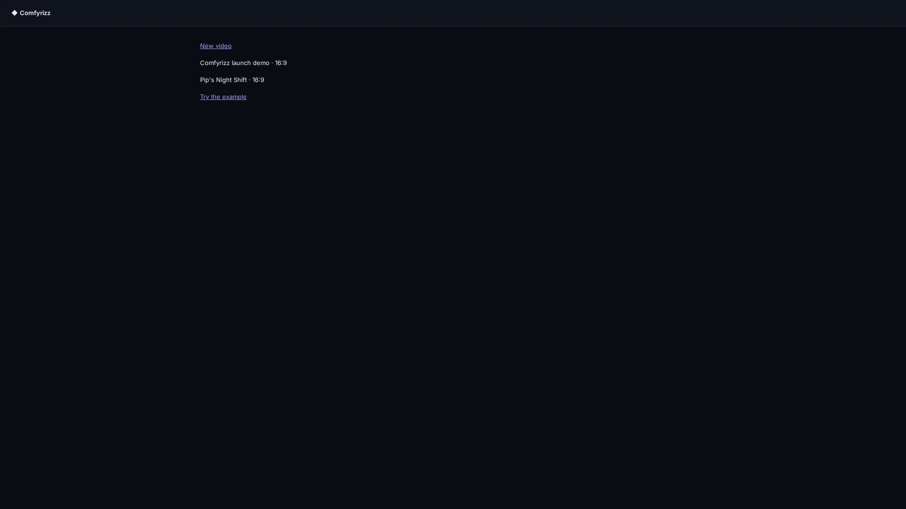
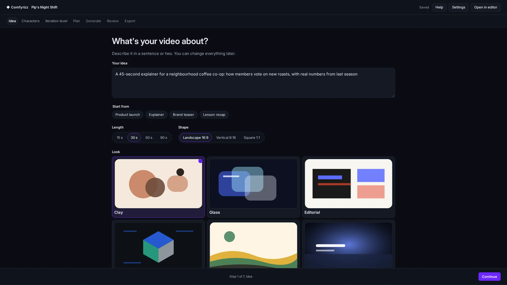
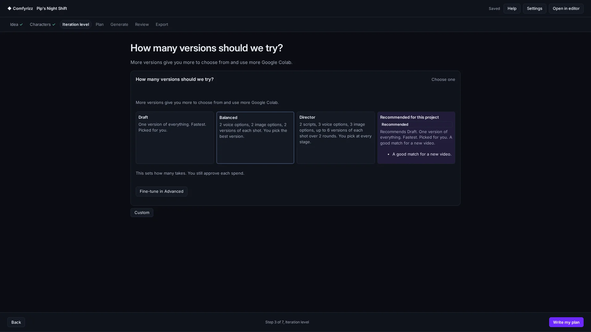
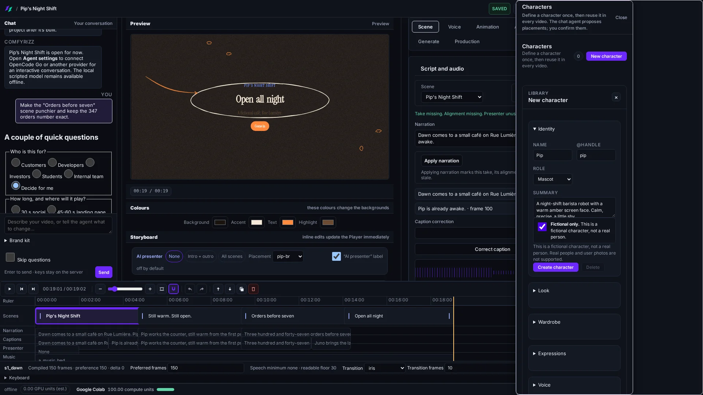
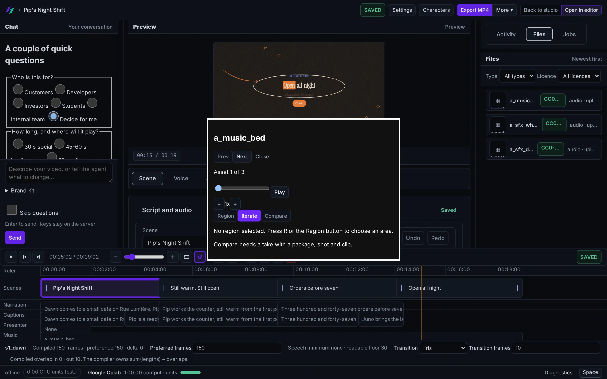
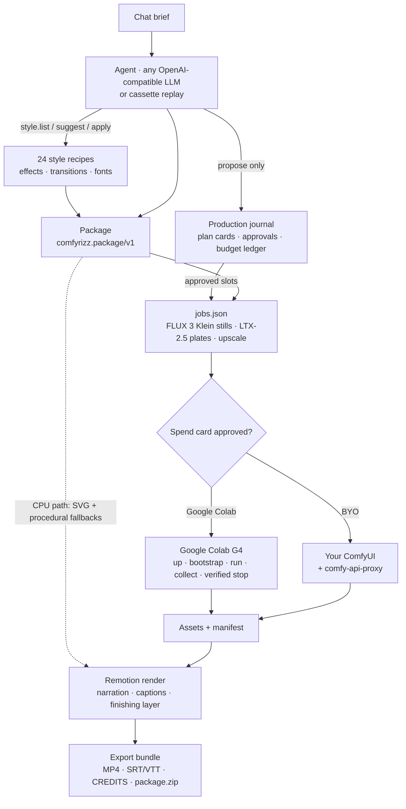

<div align="center">

<picture>
  <source media="(prefers-color-scheme: dark)" srcset="brand/comfyrizz-logo-dark.svg">
  <source media="(prefers-color-scheme: light)" srcset="brand/comfyrizz-logo-light.svg">
  
</picture>

### One prompt in. Watch your film come together. Change anything with the agent.

ComfyRizz turns a short brief into a narrated motion-graphics explainer or a generated short film.
The default flow plans, generates, finishes and plays the result without per-shot approval dialogs.
Characters, shots and audio appear in a live gallery as they land; the finished MP4 can be downloaded
or revised in place through the agent and Advanced editor. Type, charts and captions are exact
because code draws them. FLUX 3 Klein stills and LTX-2.5 motion plates are generated through the
Comfy SDK on a Google Colab GPU that Comfyrizz starts and stops for you, or on your own ComfyUI. MIT licensed.

**[One-prompt setup for Linux and native Windows](docs/ONE_PROMPT.md)** ·
**[Product contract](docs/submission/ONE_PROMPT_PRODUCT_SPEC.md)**

[](LICENSE)
[](#quick-start)
[](https://github.com/comfyanonymous/ComfyUI)
[](https://www.remotion.dev)
[](#hackathon-submission)


<sub>Every frame above came out of Comfyrizz. Labels, numbers and captions are drawn by code, never by the image model.</sub>

[Why it's different](#why-its-different) · [Docs](docs/README.md) · [Tour](#feature-tour) · [Quick start](#quick-start) · [Offline demo](#offline-demo-with-a-cassette) · [Google Colab](#google-colab) · [Architecture](#architecture) · [Submission](#hackathon-submission)

</div>

---

## Why it's different

- **A model-agnostic agent.** The chat agent runs a bounded tool loop against any OpenAI-compatible
  endpoint: OpenRouter, OpenCode Go or your own server. A built-in scripted model runs the whole CPU
  path offline, and recorded cassettes replay a real session under a different model.
- **ComfyUI as a plate generator, not the whole product.** Generated pixels go through the Comfy SDK
  as API-format workflows. Headlines, statistics, charts and captions are rendered by Remotion, so
  an image model never invents a number or misspells a title.
- **Google Colab automation with honest teardown.** Comfyrizz allocates a G4, bootstraps pinned
  models, runs the jobs, collects results and stops the VM, behind a spend card and budget check.
  It reports "VM stopped" only after the Google Colab CLI confirms it.
- **Rights-aware export.** Every asset carries its source, creator and licence. `CREDITS.md` and a
  rights-filtered `package.zip` ship only what may be redistributed.

## Feature tour

### Super Easy, Easy home and the seven-step flow

**Super Easy** is the default entry: type what your video is about and press **Generate**. It uses
Draft for you and starts on **This computer**, so a first run needs no Google Colab. **I want more
control** opens **Easy Studio** (the seven-step flow below), and **Open in editor** in Easy Studio
opens **Advanced** for the full timeline. See [docs/ui/SUPER_EASY.md](docs/ui/SUPER_EASY.md).
Tick **Record this run** to film the run itself for a demo
([docs/ui/PROCEDURE_CAPTURE.md](docs/ui/PROCEDURE_CAPTURE.md)).

<table>
<tr>
<td width="50%"></td>
<td width="50%"></td>
</tr>
<tr>
<td>A first bare visit opens <b>Super Easy</b>; <b>I want more control</b> opens <b>Easy home</b>: <b>New video</b>, your recent videos and <b>Try the example</b>.</td>
<td>A new video walks through seven steps: <b>Idea</b>, <b>Characters</b>, <b>Iteration level</b>, <b>Plan</b>, <b>Generate</b>, <b>Review</b> and <b>Export</b>.</td>
</tr>
</table>

**Easy Studio** hides advanced controls; **Open in editor** (or **Ctrl/Cmd+Shift+A**) switches to
**Advanced**. See [docs/features/interface.md](docs/features/interface.md).

### Iteration levels, chosen before anything is paid for



Before a production can spend Google Colab units you pick **Draft**, **Balanced**, **Director** or
**Custom**: how many scripts, voice and image options and shot takes to try. Each level shows a
low/expected/high unit estimate. Choosing a level is **never spend approval**: every paid plan still
needs its own approval against its reservation ceiling, and the agent can read the level but never
set or raise it. See [docs/ITERATION_LEVELS.md](docs/ITERATION_LEVELS.md).

### Studio: chat agent, preview and timeline


The chat agent plans with you (up to three questions in **Plan** mode), writes the copy and
storyboard, and edits the same project afterwards. The Remotion Player and frame-accurate timeline
(scenes, narration, captions, presenter, music) sit in the middle; runs, files and jobs on the right.
Work is journaled as a **production**: the agent proposes **plan cards**, you approve them, and only
approved, scoped work is dispatched, under a per-production Google Colab spend cap you set. Every
generated clip becomes a **take**: automatic selection and technical checks stay separate from the
human review verdict, and the final gate keeps an unreviewed take visible as unreviewed. Captured
offline with the **local · scripted model**. See
[production agent](docs/features/production-agent.md),
[chat agent](docs/features/chat-agent.md) and
[timeline review](docs/features/timeline-review-and-export.md).

**What is actually mounted.** [UX-RESULTS capability status](docs/ui/UX_RESULTS.md) keeps generated,
auto-selected, technically checked and human-reviewed results separate. The mounted production
executor drains a committed dispatch and reaches the same executor from a committed production or
action cancel; background failures surface as `production.execution_error`. The page also names the
features that are component-only (native-transfer continuity and reopened export after reload) so
they are not read as finished journeys.

### Characters



A library of people and mascots reused across projects: name, `@handle`, role, look, wardrobe,
voice and bible, with reference images. Adding one to a project pins a revision; `@handle` in chat
autocompletes to the project cast. The editor creates fictional characters only. See
[docs/features/characters.md](docs/features/characters.md).

### Asset viewer



Open any image, video, audio or text asset from the file list, the timeline or a take. Scrub, step
frames, mark a region or time range and ask the agent to iterate on just that element. Opening the
viewer or selecting a region never approves work or spend. See
[docs/ASSET_VIEWER.md](docs/ASSET_VIEWER.md).

### Voice

Characters speak with the video model's **native voice** when its profile declares that capability
(for example MiniMax); otherwise they use a local **Kokoro** voice, which can be auditioned free.
Voice cloning is not supported. See [docs/features/voice.md](docs/features/voice.md).

### More

- **References panel**: upload images and short videos, give each a role and note, confirm placements ([guide](docs/REFERENCE_ASSETS.md)).
- **Research**: **Use my URLs** or **Search for me**; fetched text is untrusted data ([research](docs/features/research.md)).
- **Google Colab progress, rates and cancel**: live VM gauges, per-accelerator pricing, balance check and verified stop ([observability](docs/PIPELINE_OBSERVABILITY.md)).
- **24 style recipes**, 37 effects and 25 transitions, with a [motion gallery](docs/motion-gallery/index.html) ([guide](docs/MOTION_STYLES.md)).
- **Quality checks** before the render: `node scripts/quality/cli.mjs` ([guide](docs/QUALITY_PIPELINE.md)) — technical evidence, never a substitute for human review ([capability status](docs/ui/UX_RESULTS.md)).
- **Default project** Pip's Night Shift, a finished motion-graphics project to play and export ([guide](docs/DEFAULT_PROJECT.md)).
- **Two-minute demo page** `apps/web/demo.html?fixture=1`, no server or GPU ([runbook](docs/DEMO_WEBAPP_RUNBOOK.md)).
- **Setup preflight** `pnpm run doctor` ([guide](docs/DOCTOR.md)).

## Quick start

Requirements: **Node.js 22.6+**, **pnpm 10**, **ffmpeg** and Chrome or Chromium
for Remotion (`REMOTION_BROWSER` overrides discovery; without it Remotion can manage a browser).
Python 3.12 is used by the setup doctor, GPU pipeline and Kokoro narration. The primary one-prompt
path supports Linux and native Windows; see [platform notes](docs/ONE_PROMPT.md#platform-notes-and-current-limits)
for current validation limits. Set `COMFYRIZZ_PYTHON` to the Python interpreter with the pipeline
dependencies (for example `.venv/bin/python`); it defaults to `python3`.

```bash
git clone https://github.com/mojomast/comfyrizz
cd comfyrizz
pnpm install --frozen-lockfile
pnpm -r --if-present run build
pnpm run doctor --offline
cd apps/server && npm start
```

Open the URL the server prints (`http://127.0.0.1:4319/#token=…`). **Super Easy** opens: describe the
video and press **Generate**. Choose **I want more control** for **Easy home**, where **New video**
and **Try the example** (Pip's Night Shift, `examples/pip-night-shift`) live. With the **local ·
scripted model** and the CPU backend you can plan, edit a headline or a chart value, then **Export
MP4** or **Export bundle** with no GPU and no API key.

> Use `pnpm run doctor`, not bare `pnpm doctor`: the bare form runs pnpm's own built-in command.

Render the bundled example from the command line (about 90 seconds on CPU):

```bash
pnpm --filter @comfyrizz/renderer render:example   # → examples/launch-demo/out/launch-demo.mp4
```

The full clean-clone check is in [docs/RELEASE_CHECK.md](docs/RELEASE_CHECK.md).

## Offline demo with a cassette

A cassette (`comfyrizz.cassette/v1`) records one agent session's LLM traffic with credentials
redacted. Replay needs no key and no network, and because the request key ignores the model, the
same session replays under any model.

```bash
node scripts/cassette/cli.mjs validate scripts/cassette/fixtures/launch-brief.cassette.json
node scripts/cassette/cli.mjs stats scripts/cassette/fixtures/launch-brief.cassette.json

# serve the app with the agent answering from the cassette (use an absolute path)
COMFYRIZZ_LLM_CASSETTE=play:$PWD/scripts/cassette/fixtures/launch-brief.cassette.json \
  npm --prefix apps/server run start
```

Recording with a free provider, replaying under a second model and the `diff --md` comparison table
are covered in [docs/AGENT_CASSETTE.md](docs/AGENT_CASSETTE.md).

## Google Colab

Comfyrizz drives your own Google Colab account through the official `google-colab-cli`
(`python3 -m pip install --user google-colab-cli`, then sign in with the CLI).

1. In the app, pick **Google Colab** as the backend. The status card shows whether the CLI is
   installed and signed in; **Test connection** checks it.
2. FLUX 3 Klein and LTX-2.5 are gated on Hugging Face. Accept both licences, put a read token in a
   `0600` file and point `COMFYRIZZ_HF_TOKEN_FILE` at it.
3. Approve the spend card. Comfyrizz allocates a G4, runs the scripts in [`colab/`](colab/)
   (bootstrap, health, run, collect) and stops the VM, confirming the stop before it says so.
4. Optionally render the final video on the same held VM (`renderLocation: 'colab'`), including
   HyperFrames composition scenes. See [docs/COMPOSITIONS.md](docs/COMPOSITIONS.md#google-colab-remote-render).

The suites never start a real runtime: `node scripts/gpu4/g4_dryrun.mjs` runs a whole Google Colab
job against loopback fakes. Efficiency measurements are in
[docs/COLAB_EFFICIENCY_RESULTS.md](docs/COLAB_EFFICIENCY_RESULTS.md). To use a GPU you already
have, choose **My ComfyUI URL** instead.

## Architecture



- **The package is the contract.** [packages/schema](packages/schema/) holds the JSON Schema and
  TypeScript and Python validators. Model licences are tracked separately from output licences.
- **Workflows through the Comfy SDK.** [pipeline-py](pipeline-py/) submits the ordered, hashed jobs
  in [workflows](workflows/). Each generated asset keeps the API-format graph it was made with
  (seed, prompt, models), with secrets removed, so you can open it in ComfyUI.
- **Deterministic rendering.** [apps/renderer](apps/renderer/) computes each frame from the
  timeline, local assets and the frame number, with no network calls. Copy that doesn't fit fails
  visibly instead of clipping.

The full design is in [docs/SPEC.md](docs/SPEC.md).

## Configuration

| Setting | What it does |
| --- | --- |
| **Agent settings** (in the app) | Add an OpenRouter, OpenCode Go or custom OpenAI-compatible profile, fetch models and test tool calling. Saved to `<runtime>/provider-settings.json` (mode `0600`, git-ignored). |
| `OPENROUTER_API_KEY`, `OPENCODE_API_KEY` / `OPENCODE_GO_API_KEY`, `COMFYRIZZ_CUSTOM_API_KEY` + `COMFYRIZZ_CUSTOM_BASE_URL` | Provider keys from the environment; saved keys take precedence. |
| `COMFYRIZZ_PORT` | Server port (default `4319`). |
| `COMFYRIZZ_RUNTIME` | Runtime directory (default `apps/server/.runtime`). |
| `COMFYRIZZ_LLM_CASSETTE` | `record:<file>` or `play:<file>` for agent cassettes. Off by default. |
| `COMFYRIZZ_HF_TOKEN_FILE` | Path to a `0600` Hugging Face read token file for the gated models. |
| `COMFYRIZZ_COLAB_BIN` | Path to the `colab` CLI, if it isn't in `~/.local/bin` or on `PATH`. |
| `COMFYRIZZ_PYTHON` | Python interpreter for the pipeline (default `python3`). |
| `COMFYRIZZ_EVAL_CASSETTE` | Alternative cassette for the production-agent eval. |
| `COMFYRIZZ_COLAB_PROGRESS_DIR`, `COMFYRIZZ_COLAB_RENDER_ALLOWANCE_MINUTES` | Google Colab progress-file directory and remote-render time allowance. |
| `COMFYRIZZ_QWEN_TTS_PYTHON`, `COMFYRIZZ_QWEN_ASR_PYTHON`, `COMFYRIZZ_QWEN_DEVICE`, `COMFYRIZZ_QWEN_MODELS` | Optional local Qwen3-TTS and ASR environments. |
| `REMOTION_BROWSER` | Chrome or Chromium used for rendering. |

Provider details: [docs/AGENT_PROVIDERS.md](docs/AGENT_PROVIDERS.md).

## Project structure

```
apps/
  web/          Vite + TypeScript UI: chat, brief, Remotion Player, timeline, inspectors; demo.html
  server/       Loopback HTTP server: packages, agent, productions (journal, coordinator, ledger),
                characters, takes, pipeline, render, export, SSE, cassette hook
  renderer/     Remotion project: layouts, transitions, storytelling recipes, finishing layer, CLI renders
packages/
  schema/       comfyrizz.package/v1 + jobs/v1 schemas, TS + Python validators, motion lint
  agent/        Tool loop, asset router, brief extractor, skills (including motion-style), style recipes
  llm/          OpenAI-compatible adapter: OpenRouter, OpenCode Go, custom presets
  planner/      Timeline compiler (integer frames, transitions, caption cues)
  jobs/         package → ordered, hashed jobs.json
  backends/     Google Colab lifecycle + BYO ComfyUI, budget, watchdog
  vector/       SVG sanitiser, resvg render check, auto-fix loop
  tts/          Kokoro + Qwen3-TTS adapters, measured cues, SRT/VTT
  sources/      Openverse search, uploads, licence policy, CREDITS + package.zip filter
  compositions/ Native HTML/SVG composition templates
pipeline-py/    Comfy SDK runner, attempt records, manifest, reconcile
colab/          Scripts the Google Colab backend runs on the VM
workflows/      ComfyUI API-format graphs (FLUX 3 Klein, LTX-2.5)
scripts/        doctor/, cassette/, motionkit/, release scan, credits audit, gallery
examples/       Bundled packages: Pip's Night Shift (default), launch-demo, hook-20s, csv-charts, licensing-demo, …
docs/           SPEC, guides, specs/, submission/, media
```

## Testing

```bash
pnpm test                      # every workspace package's node:test suite (builds libraries first)
pnpm run test:py               # pipeline-py pytest; needs .venv (pipeline-py/requirements-dev.txt)
pnpm run test:scan             # release scan: no personal paths or secrets
node --test scripts/doctor/*.test.mjs scripts/cassette/*.test.mjs
pnpm --filter @comfyrizz/server test    # server suite only (productions, characters, takes, ...)
pnpm --filter @comfyrizz/agent test     # agent suite only (tools, production guardrails, planner)
pnpm --filter @comfyrizz/web test       # web unit suite (plus `typecheck`)
pnpm --filter @comfyrizz/web test:e2e   # Playwright (Chromium, loopback only)
pnpm run check                 # test + web typecheck + release scan
node packages/agent/scripts/eval-production.mjs     # production-agent evals (replays the committed cassette)
node packages/agent/scripts/eval-conversation.mjs   # conversation evals
```

The eval scripts need `pnpm --filter @comfyrizz/agent build` first. More in
[docs/features/testing.md](docs/features/testing.md).

GPU paths are tested against a fake `colab` CLI and a fake Comfy server, so no suite starts a
runtime or spends anything. Backend and pipeline tests honour `COMFYRIZZ_PYTHON` for the pipeline
interpreter and keep scratch files under `os.tmpdir()`. The motion library's tests are listed in
[docs/MOTION_STYLES.md](docs/MOTION_STYLES.md#every-command).

## Hackathon submission

Comfyrizz is Kyle Durepos's entry for **Comfy's Open Source Higgsfield hackathon**. Submissions are
due **Oct 30, 2026, 12:00 PM Toronto time (9:00 AM PT)**.

| Document | What it covers |
| --- | --- |
| [WRITEUP.md](docs/submission/WRITEUP.md) | The entry: what it is, how it's built, why it's innovative, and the categories it targets |
| [DEMO_SCRIPT.md](docs/submission/DEMO_SCRIPT.md) | The two-minute demo video shot list |
| [CHECKLIST.md](docs/submission/CHECKLIST.md) | Each official requirement with status and evidence |
| [LICENSE_AUDIT.md](docs/submission/LICENSE_AUDIT.md) | Repository licence, model weights and the Open Weights Only check |
| [Gallery](docs/gallery/index.html) | Every bundled example package, with rendered videos once you produce them locally |

## Credits and licences

**Comfyrizz is MIT-licensed.** See [LICENSE](LICENSE) and [NOTICE](NOTICE).

- **Assets.** Every bundled asset is listed with source, creator and licence in [CREDITS.md](CREDITS.md); third-party notices are in [NOTICE](NOTICE).
- **Fonts.** The style recipes use fonts under the SIL Open Font License 1.1. Bundled font files ship with their OFL text in [`apps/renderer/public/fonts/`](apps/renderer/public/fonts/).
- **Models.** Not distributed with this repository. FLUX 3 Klein (FLUX Kommunity License), LTX-2.5 (LTX-2.x Community License), Kokoro-82M and Qwen3-TTS are downloaded by each user under their own licences.
- **Remotion** is source-available under the [Remotion License](https://www.remotion.dev/license), which is not OSI: free for individuals and organisations of up to 3 people.
- **Built on** [ComfyUI](https://github.com/comfyanonymous/ComfyUI) (GPL-3.0, cloned at runtime, not vendored), the Comfy SDK and `comfy-api-proxy`, `google-colab-cli` (invoked as an external command), HyperFrames (Apache-2.0) and resvg.

Full details: [THIRD_PARTY_LICENSES.md](THIRD_PARTY_LICENSES.md).

## Contributing

Issues and PRs are welcome. Setup, asset rules and the licence policy are in
[CONTRIBUTING.md](CONTRIBUTING.md). In short: run `pnpm run doctor`, keep `pnpm test` green, add a
test with each fix, never commit secrets, and write "Google Colab" in prose and UI copy.

<div align="center"><sub>Made with ComfyUI, Remotion and a lot of SVG.</sub></div>
