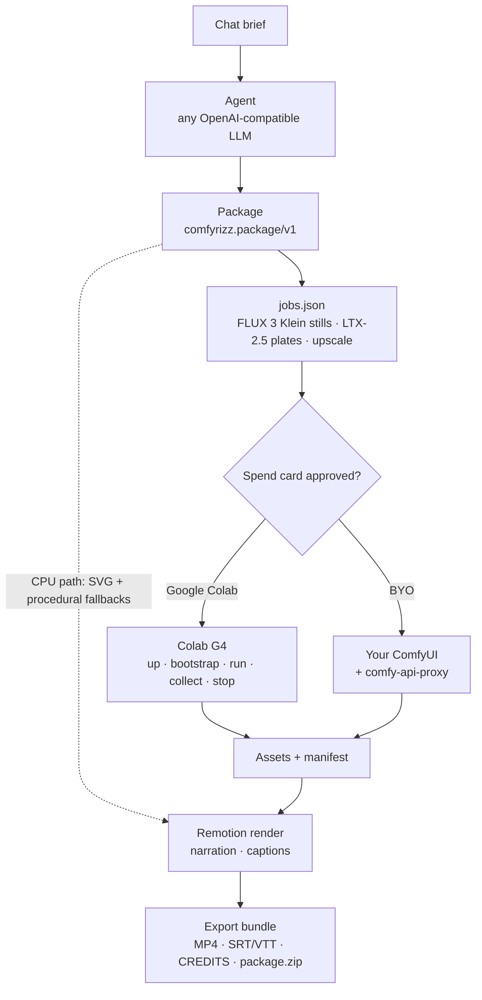

<div align="center">

<picture>
  <source media="(prefers-color-scheme: dark)" srcset="docs/media/logo-dark.svg">
  
</picture>

### Chat in a brief. Get a narrated motion-graphics explainer.

Comfyrizz turns a short brief into a narrated motion-graphics video: exact type, real charts,
generated vector art, FLUX 3 Klein stills, LTX-2.5 motion plates and Kokoro or Qwen3-TTS
narration, cut on a frame-accurate timeline and rendered deterministically with Remotion.
MIT licensed.

[](LICENSE)
[](#quick-start)
[](pipeline-py/)
[](https://github.com/comfyanonymous/ComfyUI)
[](https://www.remotion.dev)
[](#hackathon)


<sub>Every frame above came out of Comfyrizz. Labels, numbers and captions are drawn by code, never by the image model.</sub>

[20-second hook](#20-second-hook) · [Quick start](#quick-start) · [Demo](#demo) · [Gallery](#gallery) · [How it is built](#how-it-is-built) · [Hackathon submission](#hackathon-submission-links) · [Licence](#licence)

</div>

---

## 20-second hook

The 20-second launch hook is [examples/hook-20s](examples/hook-20s): 566 frames at 30 fps
(18.867 s), 1920×1080, with procedural backgrounds, first-party SVG assets and measured Kokoro
narration. It carries no GPU media, so it exports on CPU from a clean clone:

```bash
pnpm --filter @comfyrizz/renderer render:package -- --example examples/hook-20s
```

Output: `examples/hook-20s/out/hook-20s.mp4` (git-ignored).

## Quick start

Requirements: **Node.js 22**, **pnpm** 10, **ffmpeg**/**ffprobe**, and Chrome or Chromium for
Remotion (`REMOTION_BROWSER` overrides the default `/usr/bin/google-chrome`). Python 3.10+ is
optional and only needed for the GPU pipeline and Kokoro narration.

```bash
git clone https://github.com/mojomast/comfyrizz
cd comfyrizz
pnpm install --frozen-lockfile
pnpm -r --if-present run build
cd apps/server && npm start
```

Open the URL the server prints (`http://127.0.0.1:4319/#token=…`). The bundled
`examples/launch-demo` loads in the Player: edit a headline or chart value, send a brief in
**Plan** mode with the *local · scripted model*, then **Export MP4** or **Export bundle**.
This CPU path needs no GPU and no API key.

Render the bundled example straight from the CLI:

```bash
pnpm --filter @comfyrizz/renderer render:example   # → examples/launch-demo/out/launch-demo.mp4
```

For tests and the full clean-clone check, see [docs/RELEASE_CHECK.md](docs/RELEASE_CHECK.md).
Agent providers are documented in [docs/AGENT_PROVIDERS.md](docs/AGENT_PROVIDERS.md).

## Demo

[docs/submission/DEMO_SCRIPT.md](docs/submission/DEMO_SCRIPT.md) is the two-minute shot list for
the submission video, mapped to the beats in [docs/SPEC.md](docs/SPEC.md) section 11. The live demo
is the local editor served by Quick start ([apps/web](apps/web/)); the standalone demo page is
specified in [docs/specs/DEMO_WEBAPP.md](docs/specs/DEMO_WEBAPP.md).

## Gallery

The static, dependency-free page is [docs/gallery/index.html](docs/gallery/index.html), rendered
from [gallery.json](docs/gallery/gallery.json). It lists every `examples/*` package with its title,
description and duration; rendered videos appear once you produce them locally, because `out/` is
git-ignored. The public long-form collection is documented in
[docs/GITHUB_PAGES.md](docs/GITHUB_PAGES.md).

## Features

- **Chat-first agent.** A bounded tool loop turns a brief into a `comfyrizz.package/v1` project.
  The LLM is model-agnostic: OpenRouter, OpenCode Go, or any OpenAI-compatible endpoint; an offline
  scripted model runs the CPU demo.
- **CPU-only path.** SVG art, procedural fallbacks, timeline editing, preview, MP4 render, captions
  and the export bundle all run locally without a GPU or API key.
- **Two GPU backends.** Google Colab G4 (start, bootstrap, run, collect, verified stop) or your own
  ComfyUI, behind a spend card and budget check. Jobs are submitted through the Comfy SDK.
- **Exact information.** Eight layouts, charts from real CSV data, measured narration, SRT/VTT
  captions and six frame-driven storytelling recipes. Chart values never come from an image model.
- **Rights-aware export.** Every asset records source, creator and licence; `CREDITS.md` and a
  rights-filtered `package.zip` ship only assets whose licence allows it.

## How it is built



- **The package is the contract.** [packages/schema](packages/schema/) holds the JSON Schema plus
  TypeScript and Python validators. Paths are relative, ids resolve, and model licences are tracked
  separately from output licences.
- **Workflows through the Comfy SDK.** [pipeline-py](pipeline-py/) submits the ordered, hashed jobs
  in [workflows](workflows/) through the Comfy SDK. The graphs cover FLUX 3 Klein stills and
  reference edits, LTX-2.5 text/image-to-video plates and an LTX ×2 upscale.
- **Remotion for exact text and charts.** [apps/renderer](apps/renderer/) is deterministic:
  frame = f(timeline, local assets, frame number). Compositions make no network calls, and copy that
  does not fit fails visibly instead of clipping.
- **A model-agnostic agent.** [packages/agent](packages/agent/) runs a bounded tool loop and routes
  asset requests: SVG for icons, diagrams and charts, FLUX for illustrations, sketch-to-render for
  styled heroes. GPU work is only planned; it runs after you approve a spend card.

See [docs/SPEC.md](docs/SPEC.md) for the full design and [docs/PLAN.md](docs/PLAN.md) for the
milestone plan.

## Open in ComfyUI

Every generated still and plate keeps the API-format workflow that was submitted, with its seed,
prompt, models and parameters, next to the asset and inside `package.zip`. Tokens, API keys and
signed URLs are removed before the file is written. The graph is the API format, not a drag-and-drop
UI workflow; replay it on a ComfyUI that has the same models. See [docs/SPEC.md](docs/SPEC.md).

## Hackathon submission links

Comfyrizz is the entry for **Comfy's Open Source Higgsfield hackathon**; submissions are due
**Oct 30, 2026, 9:00 AM PT**.

| Document | What it covers |
| --- | --- |
| [WRITEUP.md](docs/submission/WRITEUP.md) | The entry: what it is, how it is built, why it is innovative, and the categories and bonuses it targets. |
| [CHECKLIST.md](docs/submission/CHECKLIST.md) | Each official requirement with status, evidence and owner. |
| [LICENSE_AUDIT.md](docs/submission/LICENSE_AUDIT.md) | Repository licence, model weights, partner nodes and the Open Weights Only check. |
| [CREDITS.md](CREDITS.md) | Every bundled asset with source, creator, licence and approval. |
| [THIRD_PARTY_LICENSES.md](THIRD_PARTY_LICENSES.md) | Models, fonts and key dependencies, with what the repo states. |

Contributor setup and asset rules are in [CONTRIBUTING.md](CONTRIBUTING.md).

## Licence

**Comfyrizz is MIT-licensed.** See [LICENSE](LICENSE) and [NOTICE](NOTICE).

Models are not distributed with this repository; each user downloads them under the model's own
licence (FLUX 3 Klein, LTX-2.5 and Kokoro-82M are gated or separately licensed). **Remotion** is
source-available under the [Remotion License](https://www.remotion.dev/license), which is not OSI;
it is free for individuals and organisations of up to 3 people, and larger companies need a Company
License. Details and the full dependency list are in
[THIRD_PARTY_LICENSES.md](THIRD_PARTY_LICENSES.md).

## Repo layout

```
apps/
  web/          Vite + TypeScript UI: chat, brief card, Remotion Player, scene timeline, script/audio/media inspector, animation and voice production panels
  server/       Loopback HTTP server: packages + revisions, agent, compile, media tickets, nine-stage pipeline, render, export, SSE
  renderer/     Remotion project: eight layouts, motion transitions, six storytelling recipes, captions, CLI render scripts
packages/
  schema/       comfyrizz.package/v1 + jobs/v1 JSON Schemas, TS + Python validators, motion lint
  agent/        Tool loop, asset router, brief extractor, style presets, brand kit, CSV scenes
  llm/          OpenAI-compatible adapter: OpenRouter, OpenCode Go, custom presets + probe
  planner/      Timeline compiler (integer frames, transitions, caption cues, motion cue provenance)
  jobs/         package → ordered, hashed jobs.json (stills → plates → upscale)
  backends/     Google Colab lifecycle + BYO ComfyUI, budget, watchdog
  vector/       SVG sanitiser, resvg render-check, auto-fix loop
  tts/          Kokoro + Qwen3-TTS adapters, measured cues, SRT/VTT, loudness
  sources/      Openverse search, uploads, licence policy, CREDITS + package.zip filter
pipeline-py/    Comfy SDK runner, attempt records, manifest, reconcile, health; SVG-guided eval
colab/          Scripts the Google Colab backend uploads to the VM (bootstrap, health, run, reconcile)
workflows/      ComfyUI API-format graphs + params (FLUX 3 Klein t2i/img2img/ref-edit, LTX-2.5 t2v/i2v)
examples/       Bundled packages (launch-demo, narrated-demo, product-explainer, csv-charts, …)
docs/           SPEC, PLAN, GPU reports, editor notes, voice and pipeline contracts, media
```

## Testing

```bash
pnpm test             # every workspace package's node:test suite (builds what it needs first)
pnpm run test:py      # pipeline-py pytest; needs .venv (see pipeline-py/requirements-dev.txt)
pnpm run test:all     # both
```

GPU paths are tested against a **fake `colab` CLI** and a **fake Comfy v2 server**, so the suites start no runtime and spend nothing. Useful extras:

```bash
python3 -m venv .venv && .venv/bin/pip install -r pipeline-py/requirements-dev.txt
node packages/schema/bin/comfyrizz-validate.mjs examples/launch-demo/package.json
node packages/jobs/bin/plan-jobs.mjs examples/launch-demo/package.json --out out/jobs.json
node scripts/gpu4/g4_dryrun.mjs        # whole Google Colab run against loopback fakes
pnpm --filter @comfyrizz/renderer layout:check
```

## Roadmap

Working now: everything under [Features](#features). Delivered for this integration:

- [x] **Qwen3-TTS voices** alongside Kokoro: Quick presets, VoiceDesign → Base cloning, nine directed CustomVoice speakers, Kokoro blends and per-scene delivery, with strict no-fallback execution and managed Colab or isolated local runtimes.
- [x] **Music, ambience and SFX** in the export mix, with ducking under narration and session-only mute/solo audition.
- [x] **Motion transitions** (`blur`, `slide`, `push`, `wipe`, `zoom`, `iris`) and storytelling reveals (`paper-reveal`, `draw-reveal`, `shape-reveal`) in the renderer, with schema vocabulary and motion lint.
- [x] **Integrated timeline editor** with undo/redo, trim-floor feedback, narration/caption corrections, take splits, source media ranges, waveform, animation inspector and voice production.
- [x] **Open in ComfyUI**: each generated still and plate keeps the submitted API-format graph next to the asset, in `package.zip`, and behind **Open in ComfyUI** in the asset view. Drag-and-drop UI format is not generated; see [Open in ComfyUI](#open-in-comfyui).

Still in progress or planned:

- [ ] **Combined paid nine-stage Colab run**: the nine-stage CPU path and individual GPU stages are verified; a paid end-to-end run of the combined pipeline remains outstanding.
- [x] Committed `pnpm-lock.yaml` for reproducible installs
- [ ] SVG-guided generation defaults from the sweep in `workflows/svg-guided/` (experimental)

Deferred until after the hackathon:

- [ ] **Lottie/dotLottie assets, true shared-element handoffs, Three.js/shader scenes and Motion Canvas/Manim adapters**. These need dedicated adapters and render benchmarks; they are not part of the current CPU recipe contract.
- [ ] **Comfy Cloud backend**: run the same open-weights graphs on Comfy Cloud through the Comfy SDK (bring your own Comfy API key), behind the same `runPackage()` as Google Colab and your own ComfyUI. LTX-2.5 already runs there unchanged. FLUX 3 Klein isn't on Cloud yet, so Klein stills would fall back to Google Colab or your own ComfyUI. This needs a Comfy account card, a spend card in credits, and a check before each run that the models are available. Research notes are in `docs/research/COMFY_SERVICES.md`.
- [ ] **Comfy partner nodes and Comfy Router** as optional hosted models, kept separate from the open-weights path
- [ ] **Qwen Image 2.1** as an opt-in second image model for transparent cutouts, ControlNet-guided SVG renders and text inside the scene, after a quality test against FLUX 3 Klein. Its weights are open but licensed for non-commercial use only, so it would stay off by default and be flagged in exports. Research notes are in `docs/research/QWEN_IMAGE.md`.

## Credits and licences

**Comfyrizz is MIT-licensed.** See [LICENSE](LICENSE) and [NOTICE](NOTICE).

- **Motion timing.** Easing and timing values are re-expressed from [whaleyxbt/claude-motion](https://github.com/whaleyxbt/claude-motion) (MIT) and HeyGen's HyperFrames motion skills (Apache-2.0). Numbers only, no code copied.
- **Orbit.** Portions derive from Orbit (mojomast/orbitdesktop), relicensed MIT by its owner.
- **Built on.** [ComfyUI](https://github.com/comfyanonymous/ComfyUI) (GPL-3.0, not vendored; cloned at runtime), the Comfy SDK and `comfy-api-proxy` (MIT), `google-colab-cli` (Apache-2.0, invoked as an external command), the Vercel AI SDK (Apache-2.0) and resvg (MPL-2.0).
- **Remotion** is source-available under the [Remotion License](https://www.remotion.dev/license), which is not OSI. It is free for individuals and organisations of up to 3 people; larger companies need a Company License.

**Models are not distributed with this repository.** Each user downloads them under the model's own licence:

| Model | Used for | Licence |
|---|---|---|
| FLUX 3 Image Klein | stills, reference edits, sketch-to-render | FLUX Kommunity License v1.0 (gated on Hugging Face) |
| LTX-2.5 | text/image-to-video plates, ×2 upscale | LTX-2.x Community License (gated on Hugging Face) |
| Kokoro-82M | narration | see the model card and NOTICE |
| Qwen3-TTS 1.7B (VoiceDesign / Base) | designed, cloned and directed Qwen narration | Apache-2.0 [unverified]; see NOTICE |

Your generated videos are yours, but check each model's licence for commercial use before you publish.

## Hackathon

Comfyrizz is Kyle Durepos's entry for **Comfy's Open Source Higgsfield hackathon** (submissions due Oct 30, 2026). It's open source on purpose. The whole loop runs on open weights (FLUX 3 Klein, LTX-2.5, Kokoro or Qwen3-TTS) through ComfyUI, on a GPU you rent by the minute on Google Colab or on one you already own.

## Contributing

Issues and PRs are welcome. The short version:

- Read [`docs/SPEC.md`](docs/SPEC.md) for the design and [`docs/PLAN.md`](docs/PLAN.md) for the milestone plan.
- Keep changes small, keep `pnpm test` (and `pnpm run test:py` for Python) green, and add a test with each fix.
- The package schema is the contract. If you change `package-v1.schema.json`, regenerate the types (`pnpm --filter @comfyrizz/schema gen:types`).
- No secrets in code, fixtures or logs. Tests must never start a real Google Colab runtime.
- Write "Google Colab" in prose and UI copy.

<div align="center"><sub>Made with ComfyUI, Remotion and a lot of SVG.</sub></div>
