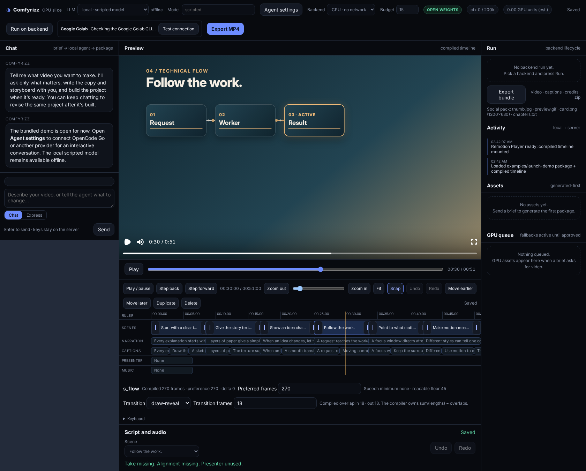
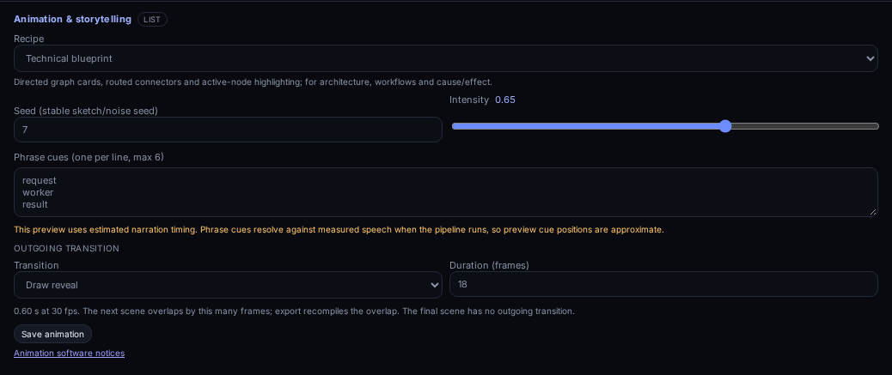
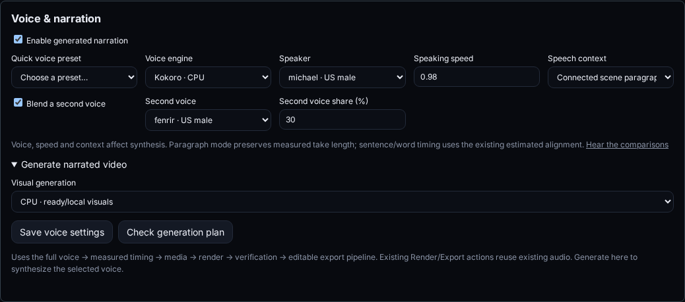
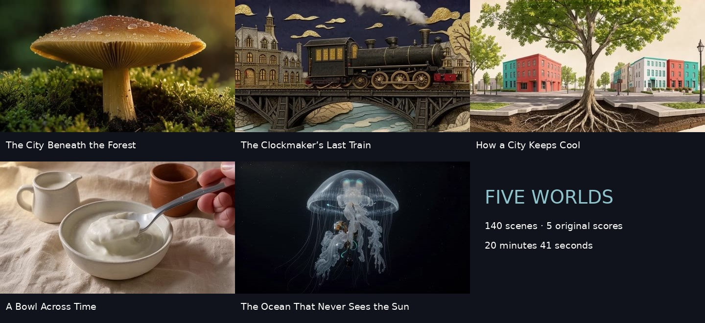
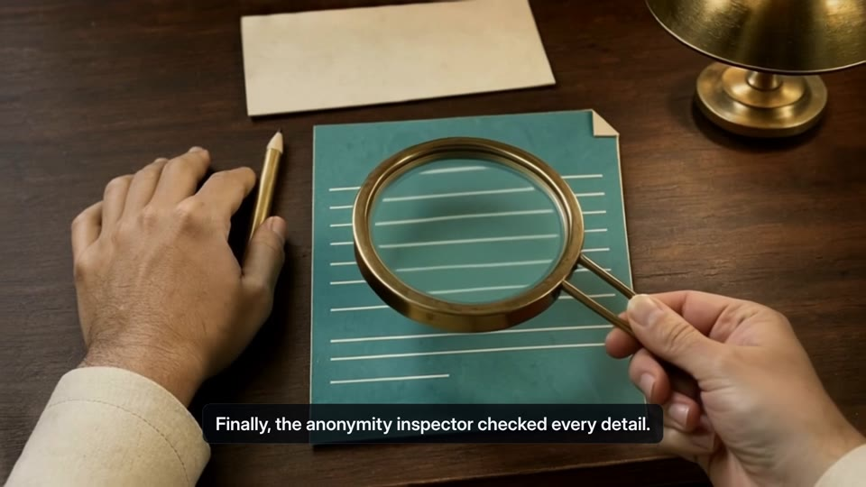
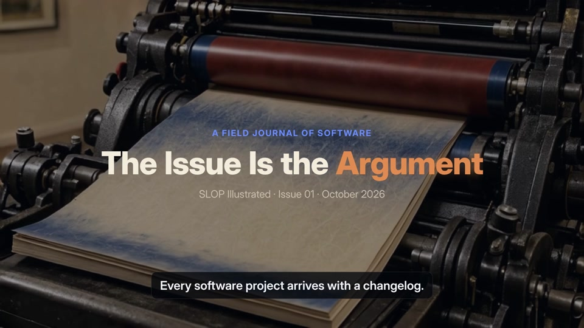
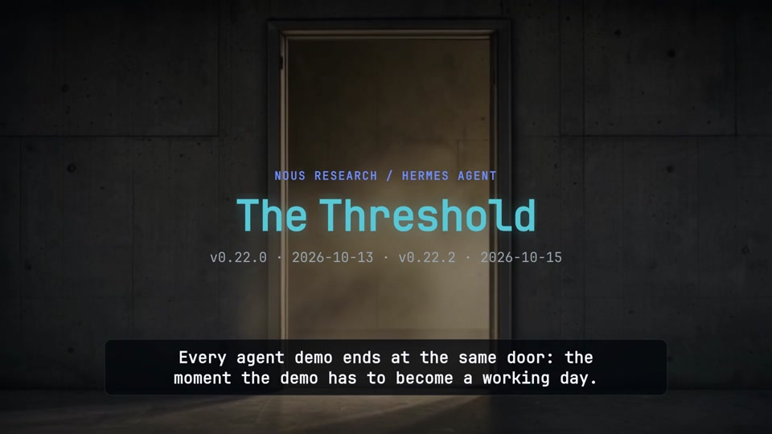
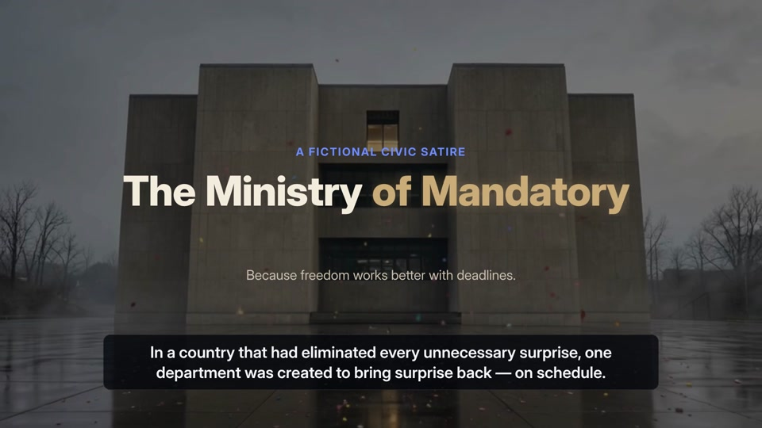
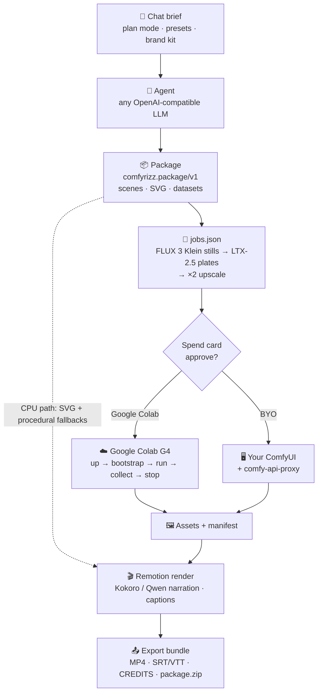

<div align="center">

<picture>
  <source media="(prefers-color-scheme: dark)" srcset="docs/media/logo-dark.svg">
  
</picture>

### Chat in a brief. Get a narrated motion-graphics explainer.

Open-source AI explainer videos: exact type, real charts, generated vector art, FLUX 3 Klein stills,<br>
LTX-2.5 motion plates and Kokoro or Qwen3-TTS narration, cut on a frame-accurate timeline<br>
and rendered deterministically with Remotion.

[](LICENSE)
[](#requirements)
[](pipeline-py/)
[](https://github.com/comfyanonymous/ComfyUI)
[](https://www.remotion.dev)
[](#hackathon)


<sub>Every frame above came out of Comfyrizz: nine example videos from one Google Colab G4 session. Labels, numbers and captions are drawn by code, never by the image model.</sub>

[Quickstart](#quickstart) · [Features](#features) · [How it works](#how-it-works) · [Configuration](#configuration) · [Roadmap](#roadmap) · [Spec](docs/SPEC.md)

</div>

---

## What it does

1. **Brief.** Describe a talk, launch or lesson in chat. With a live provider, the agent writes the copy, narration script and storyboard. Brainstorm, review a draft, ask for corrections, then build an editable project and keep revising it. Express mode favors reasonable defaults. The offline scripted flow also offers chip questions and an editable brief.
2. **Package.** A model-agnostic agent turns the brief into a `comfyrizz.package/v1`: scenes, copy, charts from your CSV, sanitised SVG art, and planned FLUX 3 Klein / LTX-2.5 jobs.
3. **Generate.** GPU jobs run through the Comfy SDK on a **Google Colab** G4 runtime that Comfyrizz starts, runs, collects and verifiably stops, or on **your own ComfyUI**. Nothing is spent without a spend card you approve.
4. **Refine.** A scene timeline and script panel share one undo/redo store. Trim or reorder scenes, correct captions, split narration takes, set source media ranges, audition the mix, and tune each scene's animation recipe and the project voice. A trim below the measured speech or layout floor is accepted as a preference and floored by the compiler. The animation inspector and voice panel write through the same revision-checked autosave.
5. **Render.** Remotion renders a 1080p MP4 on CPU with measured narration and captions, then exports a bundle: `video.mp4`, `captions.srt/.vtt`, `CREDITS.md` and a rights-filtered `package.zip`. Kokoro is the default CPU voice; optional Qwen3-TTS adds designed, cloned or directed preset voices. **Generate narrated video** runs the complete nine-stage production pipeline from a saved revision and refuses to start unless autosave is confirmed.

No GPU? The whole loop (brief → package → SVG art → timeline edits → preview → MP4 → bundle) runs on CPU with procedural fallbacks and a scripted agent. No API key needed.

## Screenshots

<table>
  <tr>
    <td width="50%"><br><sub><b>Timeline.</b> Trim, reorder, snap and zoom scenes at project fps. Narration, caption, presenter and music lanes stay linked and read-only; undo/redo covers every edit, and a trim below the speech floor reports the requested and effective length.</sub></td>
    <td width="50%"><br><sub><b>Animation inspector.</b> Six frame-deterministic recipes, seed and intensity, focus rectangles, bounded morph shapes, reveal transitions, and narration phrase cues with explicit-second precedence.</sub></td>
  </tr>
  <tr>
    <td colspan="2"><br><sub><b>Voice production.</b> Kokoro voices and blends, Qwen designed and directed custom voices, ten quick presets, per-scene delivery, and the nine-stage production run. The panel refuses to plan or start unless the latest edit is saved.</sub></td>
  </tr>
</table>

## Gallery

### Five worlds — long-form collection



**[Watch all five films](https://mojomast.github.io/comfyrizz/)** —
20 minutes 41 seconds across fungal ecology, a fictional railway mystery, urban
cooling, fermentation and deep-sea life. Each film has its own visual direction,
narrator and original score. The 140-scene collection uses 98 selected generated
motion shots and 42 authored animated inserts, with captions, chapter navigation,
MP4s and editable downloads. The 202-job generation batch used **8.40 credits**.
See [production details, individual links and verification](docs/LONGFORM_COLLECTION.md).
The public gallery uses [GitHub Pages](docs/GITHUB_PAGES.md), with 720p web playback
and original 1080p/project downloads in GitHub Releases.

### Anonymous, in Triplicate — quality follow-up



A 62.5-second fictional Ministry short follows one teal form through a bureaucratic
paradox. **8 fresh stills, 11 normal-speed motion shots, 5 editable SVG inserts**, and
a scene-aware original score apply the updated direction guidance. Narration was
measured before GPU shot lengths were planned; the 19-job batch used **0.74 credits**.
See the [film, production decisions and reproduction guide](docs/ANONYMOUS_DEMO.md).
[Watch the published short](https://<your-host>/rich-anonymous/index.html)
or [download the MP4](https://<your-host>/rich-anonymous/video.mp4).

### Rich storytelling collection

Three twelve-scene films combine **21 fresh generated stills, 17 LTX motion
plates, original SVG artwork, all eight layouts and six animation recipes**.
Each film has measured Kokoro narration, captions, an original instrumental
score, and an editable project export. The shared GPU batch used **1.48 Colab
credits** and was verifiably stopped before CPU rendering.

<table>
  <tr>
    <td width="33%"><br><sub><b>ussy.host — Slop Illustrated.</b> Software stories with a point of view and source receipts.</sub></td>
    <td width="33%"><br><sub><b>Hermes Agent — The Threshold.</b> A sourced tour of the stable release and its practical capabilities.</sub></td>
    <td width="33%"><br><sub><b>Mandatory Spontaneity.</b> A deadpan institution requires citizens to schedule their surprises.</sub></td>
  </tr>
</table>

See the [collection, production evidence and reproduction guide](docs/DEMO_COLLECTION.md)
and [complete scripts and source ledger](scripts/demos/STORYBOARDS.md).

### Earlier examples

Stills from example videos rendered with Comfyrizz (FLUX 3 Klein stills and reference edits, LTX-2.5 plates, Kokoro narration, Remotion type and charts).

<table>
  <tr>
    <td width="33%"><br><sub>Paper-cut science explainer</sub></td>
    <td width="33%"><br><sub>Data story from real CSV data</sub></td>
    <td width="33%"><br><sub>Product ad (fictional product)</sub></td>
  </tr>
  <tr>
    <td width="33%"><br><sub>LTX-2.5 plate under Remotion type</sub></td>
    <td width="33%"><br><sub>Software explainer from SVG mockups</sub></td>
    <td width="33%" align="center"><br><sub>9:16 kids' short</sub></td>
  </tr>
</table>

## Features

| | |
|---|---|
| 💬 **Chat-first agent** | Chat or Express mode, persistent conversations, reviewable drafts and focused revisions. Four compact skills guide briefing, scripting, storyboarding and revision; validated tools preserve manual edits. See [conversation skills and evaluations](docs/CONVERSATION_AGENT.md). |
| 🔌 **Model-agnostic LLM** | Configure OpenCode Go, OpenRouter, or named OpenAI-compatible connections in **Agent settings**. Discover or enter model IDs and test tool calling. Saved keys stay on the server. |
| 🎛️ **Frame-accurate timeline** | Drag to trim or reorder scenes at project fps, with snap, zoom, keyboard control and undo/redo. Narration, caption, presenter and music lanes are linked read-only projections. Trims below the speech or layout floor are accepted as preferences and floored by the compiler, with the requested and effective lengths shown. See [Phase 0 decisions](docs/editor/PHASE0.md). |
| ✏️ **Script, caption and media edits** | Edit narration, store display-only caption corrections, split takes at a frame, trim source media ranges and inspect the narration waveform. Every edit shares one command history, revision-aware autosave and save status. |
| 🎚️ **Mix audition** | Music, ambience and SFX export buses with ducking under narration, plus session-only mute/solo audition controls. The panel reads the same mix numbers as the MP4. See [audio mix](docs/editor/AUDIO_MIX.md). |
| 🎨 **Style presets + brand kit** | Clay, Glass, Editorial flat, Isometric tech, Paper cut, Cinematic dark, with CPU/SVG thumbnails. Brand palette, fonts (licence-checked), tone and logo. |
| 📐 **Generated-first vector art** | The agent writes SVG for icons, diagrams, patterns and animated parts. Every SVG is sanitised, rasterised with resvg and render-checked, with up to two automatic repairs. |
| ✏️ **Sketch to render** | An agent-drawn SVG layout becomes the reference image for a FLUX 3 Klein edit, so the styled still keeps the composition. |
| 🎞️ **LTX-2.5 plates** | Text-to-video and image-to-video moving backgrounds, trimmed, looped and retimed to the 30 fps timeline. |
| 📊 **Charts from CSV** | Paste, upload or fetch a CSV; the exact values become chart, stat and list scenes with the source on screen. Missing numbers stay visible placeholders, never invented. |
| 🗣️ **Kokoro narration + captions** | 29 selectable voices, speed, sentence or connected-paragraph delivery and two-voice blends. Per-sentence synthesis runs on CPU; measured durations drive the timeline, the loudness-normalised mix, burned-in captions and SRT/VTT. |
| 🎙️ **Qwen3-TTS presets + design** | Ten quick presets, including Kokoro blends and directed Qwen voices. Qwen offers VoiceDesign → Base cloning, nine CustomVoice speakers, language and full-text conditioning, and per-scene delivery directions. Strict mode refuses silent fallback. Run on a managed Colab allocation or isolated local TTS/ASR environments. See [voice production](docs/VOICE_GENERATION.md) and [setup](packages/tts/README.md#optional-qwen3-tts-r3). |
| 🔗 **Animated diagrams** | Editable flow and hub cards with scene-local cue times, animated connections and caption-safe landscape layouts. See [renderer motion diagrams](apps/renderer/README.md#motion-diagrams). |
| 🎬 **Storytelling recipes + eight layouts** | The animation inspector edits six frame-deterministic recipes: sketch, paper-cut, morph, technical-flow, focus and kinetic. Controls cover seed, intensity, focus rectangles, bounded morph shapes and paper/draw/shape reveal transitions. Narration phrase cues resolve after timing; explicit seconds win, and known aligner versus estimated Kokoro timing keeps its provenance. Conversation authoring covers all eight layouts: title, hero, stat, chart, list, split, compare and code. See the [animation pack guide](docs/ANIMATION_STORYTELLING.md). |
| 🌍 **Multilingual + aspect variants** | Export per-language and 16:9 / 9:16 / 1:1 variants with re-flowed layouts. |
| ☁️ **Google Colab backend** | Spins up a G4, bootstraps ComfyUI with pinned models, runs batches, downloads results and stops the runtime, verified against `colab sessions`. Watchdog, budget formula and `stop_unconfirmed` reporting. |
| 🖥️ **Bring your own ComfyUI** | Point the same jobs at your own ComfyUI (plus `comfy-api-proxy`). Not metered, never called free. |
| 🔍 **Open in ComfyUI** | Every generated still and plate keeps the API-format graph that was submitted (seed, prompt, models, parameters). Download it from the asset view. Drag-and-drop UI format is not generated; see [Open in ComfyUI](#open-in-comfyui). |
| 🔁 **Per-scene re-render** | Re-render one scene or regenerate one scene's media; ×2 upscale for final plates. |
| 🚀 **Nine-stage generation** | **Generate narrated video** plans against the saved revision, then runs preflight → voice/alignment → timing → presenter inputs → media → presenter sync → render → verify → export. Metered plans require approval; a pending, offline, conflict or rejected save refuses plan and start. Each result is an isolated, revision-bound cut. See the [pipeline contract](docs/PIPELINE_OBSERVABILITY.md). |
| 🔐 **Token-free media** | Preview and waveform reads use authenticated byte ranges or short-lived `POST /api/media-ticket` URLs. The session token is never placed in a media URL, editor sidecar or exported file. |
| 📦 **Rights-aware export** | `CREDITS.md` and a `package.zip` that ships only assets whose licence allows it and lists every refusal with its reason. |
| 🧪 **Deterministic render** | Frame = f(timeline, local assets, frame number). No network in compositions; copy that doesn't fit fails visibly instead of clipping. |

## How it works



- **The package is the contract.** `packages/schema` holds the JSON Schema plus TS and Python validators. Paths are relative, ids resolve, model licences are tracked separately from output licences.
- **The agent.** `packages/agent` runs a bounded tool loop (`storyboard.propose`, `storyboard.edit`, `assets.route`, `assets.generate_svg`, `assets.generate_image`, `assets.sketch_to_render`). An asset router picks SVG for icons, diagrams and charts, FLUX for illustrations and textures, and sketch-to-render for styled heroes. Conversation authoring covers all eight layouts — title, hero, stat, chart, list, split, compare and code — including dataset provenance, paired plates and real code content. Invalid tool arguments go back to the model (max two repairs); partial streamed arguments never execute. GPU work is only ever *planned* by the agent. It runs after you approve the spend card.
- **The jobs.** `packages/jobs` turns a package into an ordered, hashed `jobs.json` (stills before plates, LTX sizes in multiples of 64 and 8n+1 frames). `pipeline-py` submits the jobs with the Comfy SDK, writes an attempt record *before* each submit, and treats an atomic `out/manifest.json` as the only proof of success. A lost submission is reconciled, never blindly resubmitted.
- **The timeline.** `packages/planner` compiles the package plus measured narration into integer-frame `timeline.json` at `floor(format.fps)` (30 fps by default), with transition overlaps, plate retiming, sentence-level caption cues and speech-anchored motion cues. Explicit `cue_seconds` win over phrase matching; resolved anchors keep source and estimated-timing provenance, and missing or ambiguous cues become diagnostics and pipeline warnings.
- **The editor.** A custom scene timeline and script/audio/media inspector share one `EditorStore`. Every edit is a command with undo/redo, revision-aware autosave and a save status of `saved`, `pending`, `offline`, `conflict` or `rejected`. Trims below the speech or layout minimum stay as preferences and are floored by the compiler with visible feedback. Caption-text overrides are display-only and do not move spoken narration cues. See [Phase 0 decisions](docs/editor/PHASE0.md) and [audio mix](docs/editor/AUDIO_MIX.md).
- **The animation inspector.** Six frame-driven recipes keep editable scene copy and media: sketch, paper-cut, morph, technical-flow, focus and kinetic. Seed and intensity, focus rectangles, bounded morph shapes and reveal transitions are validated; locked scenes stay read-only and the final scene has no outgoing transition. Recipe timing resolves against spoken narration/captions, not caption corrections.
- **The production pipeline.** The voice panel plans against the saved revision and runs nine ordered stages: preflight, narration, timing, presenter inputs, media, presenter sync, render, verify and export. Autosave is authoritative: any save status other than `saved` refuses planning and generation. Metered compute requires an approved plan hash, and generated results stay isolated from edits made during the run. See the [pipeline contract](docs/PIPELINE_OBSERVABILITY.md).
- **Media delivery.** The Player uses authenticated byte ranges where it can send the API header; native media and waveform playback use short-lived `/api/media/<ticket>` URLs. API tokens and tickets are not written into editor sidecars or exports.
- **The render.** `apps/renderer` (Remotion) supports Title, Hero, Stat, Chart, List, Split, Compare and Code layouts, motion tokens, the six storytelling recipes, animated diagrams, motion transitions and procedural backgrounds when no plate exists. Measured speech can extend a scene beyond its default visual pacing limit.

See the [animation and storytelling research (19 October 2026)](docs/research/ANIMATION_STORYTELLING_2026.md) for the current capability audit, MIT-library shortlist, proposed visual styles and prioritized integration plan.
The [content-quality research and skill updates (20 October 2026)](docs/CONTENT_QUALITY_RESEARCH.md) connect demo findings to worked-example storytelling, shot coverage, caption-aware direction and evidence-based agent evaluation.
The shipped CPU pack, agent usage and verification are documented in the [animation guide](docs/ANIMATION_STORYTELLING.md); agents combining branches should use the [integration handoff](docs/handoffs/ANIMATION_INTEGRATION.md). [Production voice options](docs/VOICE_GENERATION.md) covers presets, blends, Qwen modes and delivery; the [pipeline contract](docs/PIPELINE_OBSERVABILITY.md) documents the nine stages and recovery.

## Quickstart

### Requirements

- **Node.js 22** (`engines` is `>=20`; 20.19 is also tested), **pnpm** 10, **ffmpeg**/**ffprobe**
- **Chrome or Chromium** for Remotion. Scripts default to `/usr/bin/google-chrome`; override with `REMOTION_BROWSER=/path/to/chrome`
- **Python 3.10+** for the GPU pipeline and Kokoro narration (optional for the CPU demo)

### 1. CPU-only demo (no GPU, no API key)

```bash
git clone https://github.com/mojomast/comfyrizz && cd comfyrizz
pnpm install                       # no lockfile is committed yet, so this resolves fresh
pnpm -r --if-present run build     # packages/* dist + apps/web dist

cd apps/server && npm start        # builds, then serves http://127.0.0.1:4319/#token=…
```

Open the printed URL. The bundled `examples/launch-demo` loads in the Player. Edit a headline or a chart value, trim a scene on the timeline, send a brief in **Plan** mode with the *local · scripted model*, then press **Export MP4** or **Export bundle**. Everything runs locally on CPU.

Render the bundled example straight from the CLI, with an ffprobe frame check:

```bash
pnpm --filter @comfyrizz/renderer render:example   # → examples/launch-demo/out/launch-demo.mp4
pnpm --filter @comfyrizz/renderer studio           # Remotion Studio
```

The whole fresh-clone path (clone → install → build → serve → brief → MP4 → bundle → ffprobe) runs non-interactively as one script:

```bash
bash apps/server/scripts/clean-clone-e2e.sh        # KEEP=1 to inspect the temp dir
```

Optional narration (Kokoro-82M on CPU):

```bash
python3 -m venv .venv && .venv/bin/pip install -r packages/tts/py/requirements.txt
packages/tts/scripts/fetch-models.sh               # kokoro-v1.0.onnx + voices (not committed)
```

For **Qwen3-TTS 1.7B**, choose a Qwen preset or designed voice in **Voice & narration**. The integrated pipeline can run Qwen on a managed Colab allocation or in isolated local TTS/ASR environments; select `voice.engine: "qwen3-tts"` and `voice.strict: true`, and keep `voice.speed: 1` because Qwen uses natural-language delivery for pacing. The pinned TTS and ASR packages require different Transformers versions, so they run in separate Python environments. The standalone `scripts/tts/qwen_colab.mjs` workflow remains available for synthesis/QA outside the app, but it is not required for in-app generation. See the [separate-environment setup and Colab commands](packages/tts/README.md#optional-qwen3-tts-r3) and [voice production options](docs/VOICE_GENERATION.md).

Recent production evidence:

- [Comfyrizz full-pipeline test](docs/COMFYRIZZ_FULL_PIPELINE_TEST.md): delivered 29.2-second Kokoro/GPU example.
- [Hermes video status and verification](docs/HERMES_VIDEO_STATUS.md): longer Qwen-narrated example and current checks.
- [Hermes research and implementation decisions](docs/HERMES_VIDEO_RESEARCH.md): primary release sources, voice setup and presenter synchronization.

### 2. Google Colab (G4 GPU)

1. Install and sign in to the `google-colab-cli` (`colab`). Comfyrizz finds it via `COMFYRIZZ_COLAB_BIN`, then `~/.local/bin/colab`, then `PATH`.
2. On Hugging Face, accept the **FLUX 3 Image Klein** and **LTX-2.5** licences (both repos are gated), create a **read** token, and store it in a file only you can read:
   ```bash
   install -m 600 /dev/null ~/.config/comfyrizz-hf-token && $EDITOR ~/.config/comfyrizz-hf-token
   export COMFYRIZZ_HF_TOKEN_FILE=~/.config/comfyrizz-hf-token
   ```
   The token is uploaded as a 0600 file, used, and deleted from the VM before it stops. It is never passed with `--env` and never printed.
3. Start the server, pick **Google Colab G4** as the backend, set a unit **Budget** and press **Run on backend**. Review the spend card (GPU minutes, setup, units against budget) and press **Start**.

Comfyrizz creates one runtime, bootstraps ComfyUI with the models pinned in `colab/models.lock.json`, runs the batches, downloads the results, applies them to the package, re-renders, and stops the runtime. The stop is verified, and anything else is reported as `stop_unconfirmed`. A detached watchdog stops the runtime if the app dies. The media path was run end to end on a real G4 runtime on Oct 18, 2026 (GPU test 5). The full nine-stage CPU production path has also completed all applicable stages with measured narration, rendering and verification; a combined paid nine-stage Colab run remains an explicit roadmap check.

> Google Colab is for your own interactive compute. Don't use the Google Colab backend to serve other people.

### 3. Bring your own ComfyUI

```bash
scripts/setup-local-comfy.sh --dry-run             # see the plan first
hf auth login                                      # gated model repos
scripts/setup-local-comfy.sh --comfyui-ref v0.41.3
```

Run ComfyUI and `comfy-api-proxy`, then pick **BYO ComfyUI** in the app (default `http://127.0.0.1:8188`), or drive the pipeline from the CLI. See [`packages/backends/BYO-COMFYUI.md`](packages/backends/BYO-COMFYUI.md) for health checks and `plan-jobs` → `comfyrizz_pipeline.runner`.

## Open in ComfyUI

When a still, plate or ×2 upscale finishes, Comfyrizz writes the API-format workflow that was actually submitted next to the file:

- `assets/<id>.workflow.api.json` (a plate under `out/intermediates/` uses that same stem)
- `assets/<id>.workflow.md` explains how to replay it

The graph includes the seed, prompt, model filenames and parameters. Tokens, API keys and signed URLs are removed before the file is written. The same files are copied into `package.zip` (`OPEN-IN-COMFYUI.md` in the archive is the short version).

ComfyUI's drag-and-drop Load button expects the UI workflow format (`nodes`, `links`, and widget values in each node's own order). The API graph does not record that order — it comes from the running install's node definitions — so a converted file would open as a broken graph. Comfyrizz does not generate one. Replay the API file on a ComfyUI that has the same models:

```bash
curl -sS http://127.0.0.1:8188/prompt \
  -H 'content-type: application/json' \
  --data-binary @- <<EOF
{"prompt": $(cat assets/your-still.workflow.api.json)}
EOF
```

The same JSON is the `workflow` body of a Comfy API v2 job (`POST /api/v2/jobs`). In the app, a generated still or plate has **Open in ComfyUI** (downloads the API graph) and **How to open**. `GET /api/package/<id>/assets/<assetId>/workflow` serves the file; `?format=readme` serves the instructions; `?variant=upscaled` serves the ×2 graph.

## Configuration

Open **Agent settings** in the top bar to add provider connections, save an API key,
choose a model, and test tool calling. OpenCode Go and OpenRouter have presets;
**+ Add provider** supports additional named OpenAI-compatible connections.
Settings persist server-side and take effect immediately. Saved keys are never
returned to the browser. See [Agent provider settings](docs/AGENT_PROVIDERS.md).

Environment variables are also supported by the local server:

| Variable | Purpose |
|---|---|
| `OPENROUTER_API_KEY` | OpenRouter preset |
| `OPENCODE_API_KEY` (or `OPENCODE_GO_API_KEY`) | OpenCode Go preset, e.g. DeepSeek v4.1 |
| `COMFYRIZZ_CUSTOM_BASE_URL`, `COMFYRIZZ_CUSTOM_API_KEY` | Any OpenAI-compatible endpoint (vLLM, Ollama, a proxy). Default base URL `http://127.0.0.1:8000/v1` |
| `COMFYRIZZ_HF_TOKEN_FILE` | Path to a 0600 file holding a Hugging Face **read** token for the gated FLUX 3 Klein and LTX-2.5 repos |
| `COMFYRIZZ_PYTHON` | Host Python with narration, NumPy and pipeline dependencies |
| `COMFYRIZZ_QWEN_TTS_PYTHON`, `COMFYRIZZ_QWEN_ASR_PYTHON` | Isolated local Qwen TTS and QA environments for `narrationRuntime: local`; managed Colab creates its pinned environments in the VM |
| `COMFYRIZZ_SYNCNET_PYTHON`, `COMFYRIZZ_SYNCNET_DIR` | Installed SyncNet environment and checkout containing `syncnet_v2.model`, used for presenter timing checks |
| `COMFYRIZZ_COLAB_BIN` | Path to the `colab` CLI if it isn't on `PATH` |
| `COMFYRIZZ_PORT` | Server port (default `4319`, loopback only) |
| `COMFYRIZZ_RUNTIME` | State directory (default `apps/server/.runtime`, git-ignored) |
| `COMFYRIZZ_TOKEN` | Fix the URL-fragment session token (tests). Otherwise one is generated into `.runtime/server-token` (0600) |
| `REMOTION_BROWSER` | Chrome/Chromium used for rendering |

Check that a model can actually call tools before you rely on it: `pnpm --filter @comfyrizz/llm probe` refuses text-only models. It reads the key from the environment and never prints it.

> **Never commit secrets.** Keys live in your shell environment, the HF token lives in a 0600 file outside the repo, and `.env`, `.runtime/`, `out/` and `runs/` are git-ignored. The server binds to `127.0.0.1`, keeps its token in the URL fragment, and checks Host and Origin on every request.

## Repo layout

```
apps/
  web/          Vite + TypeScript UI: chat, brief card, Remotion Player, scene timeline, script/audio/media inspector, animation and voice production panels
  server/       Loopback HTTP server: packages + revisions, agent, compile, media tickets, nine-stage pipeline, render, export, SSE
  renderer/     Remotion project: eight layouts, motion transitions, six storytelling recipes, captions, CLI render scripts
packages/
  schema/       comfyrizz.package/v1 + jobs/v1 JSON Schemas, TS + Python validators, motion lint
  agent/        Tool loop, asset router, brief extractor, style presets, brand kit, CSV scenes
  llm/          OpenAI-compatible adapter: OpenRouter, OpenCode Go, custom presets + probe
  planner/      Timeline compiler (integer frames, transitions, caption cues, motion cue provenance)
  jobs/         package → ordered, hashed jobs.json (stills → plates → upscale)
  backends/     Google Colab lifecycle + BYO ComfyUI, budget, watchdog
  vector/       SVG sanitiser, resvg render-check, auto-fix loop
  tts/          Kokoro + Qwen3-TTS adapters, measured cues, SRT/VTT, loudness
  sources/      Openverse search, uploads, licence policy, CREDITS + package.zip filter
pipeline-py/    Comfy SDK runner, attempt records, manifest, reconcile, health; SVG-guided eval
colab/          Scripts the Google Colab backend uploads to the VM (bootstrap, health, run, reconcile)
workflows/      ComfyUI API-format graphs + params (FLUX 3 Klein t2i/img2img/ref-edit, LTX-2.5 t2v/i2v)
examples/       Bundled packages (launch-demo, narrated-demo, product-explainer, csv-charts, …)
docs/           SPEC, PLAN, GPU reports, editor notes, voice and pipeline contracts, media
```

## Testing

```bash
pnpm test             # every workspace package's node:test suite (builds what it needs first)
pnpm run test:py      # pipeline-py pytest; needs .venv (see pipeline-py/requirements-dev.txt)
pnpm run test:all     # both
```

GPU paths are tested against a **fake `colab` CLI** and a **fake Comfy v2 server**, so the suites start no runtime and spend nothing. Useful extras:

```bash
python3 -m venv .venv && .venv/bin/pip install -r pipeline-py/requirements-dev.txt
node packages/schema/bin/comfyrizz-validate.mjs examples/launch-demo/package.json
node packages/jobs/bin/plan-jobs.mjs examples/launch-demo/package.json --out out/jobs.json
node scripts/gpu4/g4_dryrun.mjs        # whole Google Colab run against loopback fakes
pnpm --filter @comfyrizz/renderer layout:check
```

## Roadmap

Working now: everything under [Features](#features). Delivered for this integration:

- [x] **Qwen3-TTS voices** alongside Kokoro: Quick presets, VoiceDesign → Base cloning, nine directed CustomVoice speakers, Kokoro blends and per-scene delivery, with strict no-fallback execution and managed Colab or isolated local runtimes.
- [x] **Music, ambience and SFX** in the export mix, with ducking under narration and session-only mute/solo audition.
- [x] **Motion transitions** (`blur`, `slide`, `push`, `wipe`, `zoom`, `iris`) and storytelling reveals (`paper-reveal`, `draw-reveal`, `shape-reveal`) in the renderer, with schema vocabulary and motion lint.
- [x] **Integrated timeline editor** with undo/redo, trim-floor feedback, narration/caption corrections, take splits, source media ranges, waveform, animation inspector and voice production.
- [x] **Open in ComfyUI**: each generated still and plate keeps the submitted API-format graph next to the asset, in `package.zip`, and behind **Open in ComfyUI** in the asset view. Drag-and-drop UI format is not generated; see [Open in ComfyUI](#open-in-comfyui).

Still in progress or planned:

- [ ] **Combined paid nine-stage Colab run**: the nine-stage CPU path and individual GPU stages are verified; a paid end-to-end run of the combined pipeline remains outstanding.
- [ ] Committed `pnpm-lock.yaml` for reproducible installs
- [ ] SVG-guided generation defaults from the sweep in `workflows/svg-guided/` (experimental)

Deferred until after the hackathon:

- [ ] **Lottie/dotLottie assets, true shared-element handoffs, Three.js/shader scenes and Motion Canvas/Manim adapters**. These need dedicated adapters and render benchmarks; they are not part of the current CPU recipe contract.
- [ ] **Comfy Cloud backend**: run the same open-weights graphs on Comfy Cloud through the Comfy SDK (bring your own Comfy API key), behind the same `runPackage()` as Google Colab and your own ComfyUI. LTX-2.5 already runs there unchanged. FLUX 3 Klein isn't on Cloud yet, so Klein stills would fall back to Google Colab or your own ComfyUI. This needs a Comfy account card, a spend card in credits, and a check before each run that the models are available. Research notes are in `docs/research/COMFY_SERVICES.md`.
- [ ] **Comfy partner nodes and Comfy Router** as optional hosted models, kept separate from the open-weights path
- [ ] **Qwen Image 2.1** as an opt-in second image model for transparent cutouts, ControlNet-guided SVG renders and text inside the scene, after a quality test against FLUX 3 Klein. Its weights are open but licensed for non-commercial use only, so it would stay off by default and be flagged in exports. Research notes are in `docs/research/QWEN_IMAGE.md`.

## Credits and licences

**Comfyrizz is MIT-licensed.** See [LICENSE](LICENSE) and [NOTICE](NOTICE).

- **Motion timing.** Easing and timing values are re-expressed from [whaleyxbt/claude-motion](https://github.com/whaleyxbt/claude-motion) (MIT) and HeyGen's HyperFrames motion skills (Apache-2.0). Numbers only, no code copied.
- **Orbit.** Portions derive from Orbit (mojomast/orbitdesktop), relicensed MIT by its owner.
- **Built on.** [ComfyUI](https://github.com/comfyanonymous/ComfyUI) (GPL-3.0, not vendored; cloned at runtime), the Comfy SDK and `comfy-api-proxy` (MIT), `google-colab-cli` (Apache-2.0, invoked as an external command), the Vercel AI SDK (Apache-2.0) and resvg (MPL-2.0).
- **Remotion** is source-available under the [Remotion License](https://www.remotion.dev/license), which is not OSI. It is free for individuals and organisations of up to 3 people; larger companies need a Company License.

**Models are not distributed with this repository.** Each user downloads them under the model's own licence:

| Model | Used for | Licence |
|---|---|---|
| FLUX 3 Image Klein | stills, reference edits, sketch-to-render | FLUX Kommunity License v1.0 (gated on Hugging Face) |
| LTX-2.5 | text/image-to-video plates, ×2 upscale | LTX-2.x Community License (gated on Hugging Face) |
| Kokoro-82M | narration | see the model card and NOTICE |
| Qwen3-TTS 1.7B (VoiceDesign / Base) | designed, cloned and directed Qwen narration | Apache-2.0 [unverified]; see NOTICE |

Your generated videos are yours, but check each model's licence for commercial use before you publish.

## Hackathon

Comfyrizz is Kyle Durepos's entry for **Comfy's Open Source Higgsfield hackathon** (submissions due Oct 30, 2026). It's open source on purpose. The whole loop runs on open weights (FLUX 3 Klein, LTX-2.5, Kokoro or Qwen3-TTS) through ComfyUI, on a GPU you rent by the minute on Google Colab or on one you already own.

## Contributing

Issues and PRs are welcome. The short version:

- Read [`docs/SPEC.md`](docs/SPEC.md) for the design and [`docs/PLAN.md`](docs/PLAN.md) for the milestone plan.
- Keep changes small, keep `pnpm test` (and `pnpm run test:py` for Python) green, and add a test with each fix.
- The package schema is the contract. If you change `package-v1.schema.json`, regenerate the types (`pnpm --filter @comfyrizz/schema gen:types`).
- No secrets in code, fixtures or logs. Tests must never start a real Google Colab runtime.
- Write "Google Colab" in prose and UI copy.

<div align="center"><sub>Made with ComfyUI, Remotion and a lot of SVG.</sub></div>
