<div align="center">

<picture>
  <source media="(prefers-color-scheme: dark)" srcset="docs/media/logo-dark.svg">
  
</picture>

### Chat in a brief. Get a narrated motion-graphics explainer, rendered on open weights.

Comfyrizz is a chat agent that turns a short brief into a 30–90 second narrated motion-graphics
video. Type, charts and captions are exact because code draws them. FLUX 3 Klein stills and LTX-2.5
motion plates are generated through the Comfy SDK on a Google Colab GPU that Comfyrizz starts and
stops for you, or on your own ComfyUI. MIT licensed.

[](LICENSE)
[](#quick-start)
[](https://github.com/comfyanonymous/ComfyUI)
[](https://www.remotion.dev)
[](#hackathon-submission)


<sub>Every frame above came out of Comfyrizz. Labels, numbers and captions are drawn by code, never by the image model.</sub>

[Why it's different](#why-its-different) · [Tour](#feature-tour) · [Quick start](#quick-start) · [Offline demo](#offline-demo-with-a-cassette) · [Google Colab](#google-colab) · [Architecture](#architecture) · [Submission](#hackathon-submission)

</div>

---

## Why it's different

- **A model-agnostic agent.** The chat agent runs a bounded tool loop against any OpenAI-compatible
  endpoint: OpenRouter, OpenCode Go or your own server. A built-in scripted model runs the whole CPU
  path offline, and recorded cassettes replay a real session under a different model.
- **ComfyUI as a plate generator, not the whole product.** Generated pixels go through the Comfy SDK
  as API-format workflows. Headlines, statistics, charts and captions are rendered by Remotion, so
  an image model never invents a number or misspells a title.
- **Google Colab automation with honest teardown.** Comfyrizz allocates a G4, bootstraps pinned
  models, runs the jobs, collects results and stops the VM, behind a spend card and budget check.
  It reports "VM stopped" only after the Google Colab CLI confirms it.
- **Rights-aware export.** Every asset carries its source, creator and licence. `CREDITS.md` and a
  rights-filtered `package.zip` ship only what may be redistributed.

## Feature tour

### Chat agent and editor

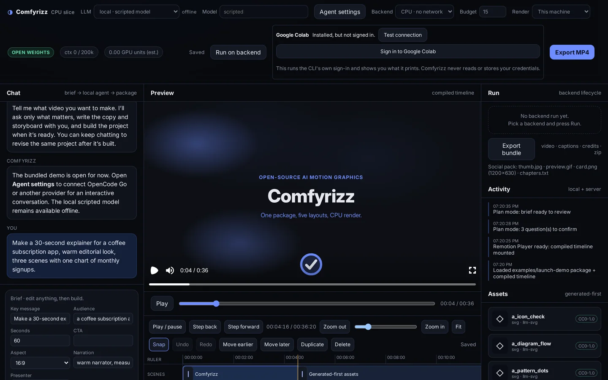

The local app: chat on the left, the Remotion Player and frame-accurate timeline in the middle,
backend runs, export and assets on the right. Captured offline with the **local · scripted model**
and the CPU backend.

<table>
<tr>
<td width="50%">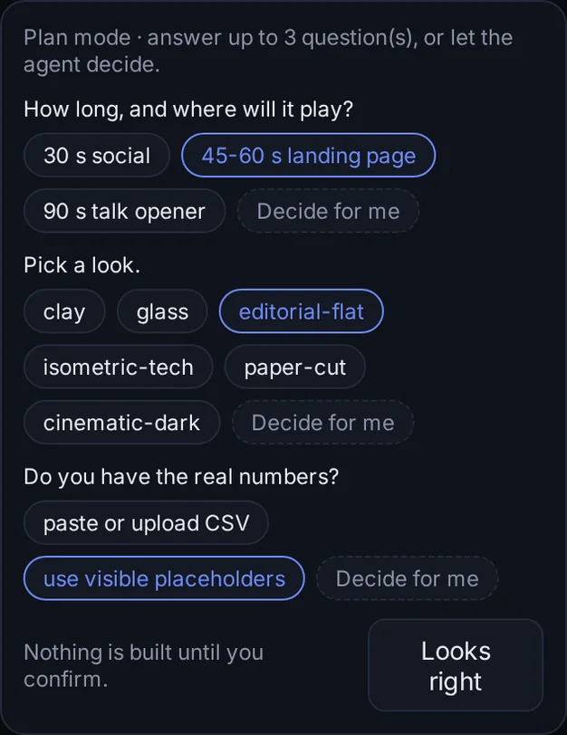</td>
<td width="50%">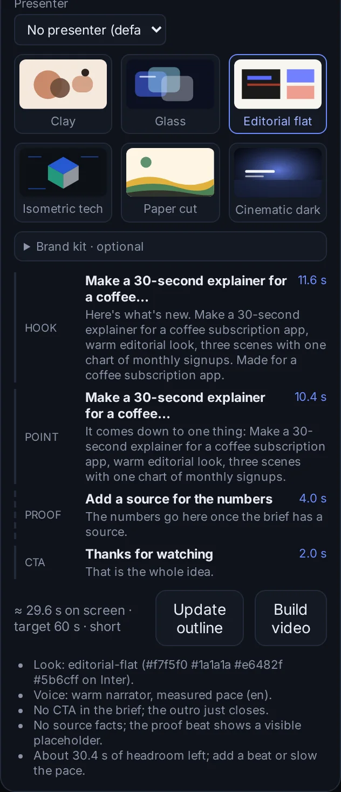</td>
</tr>
<tr>
<td><b>Plan mode</b> asks up to three questions (length, look, real numbers) and builds nothing until you confirm.</td>
<td><b>Editable brief</b>: pick a look, check the hook / point / proof / CTA outline and its timing, then build.</td>
</tr>
</table>

### 24 named style recipes

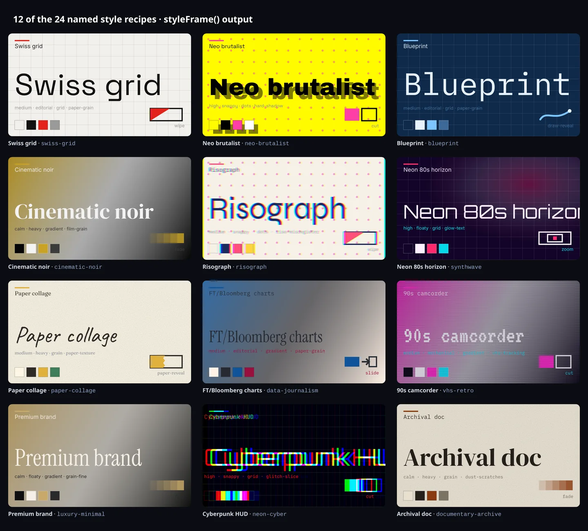

Each look is a `comfyrizz.recipe/v1` file that binds a palette, a type pairing, an easing
personality, entries, a transition grammar, a background pattern and a finishing stack. The agent's
motion-style skill lists, suggests and applies them (`style.list`, `style.suggest`, `style.apply`).
A seeded variety engine avoids repeating recent looks, and a look score checks the result.

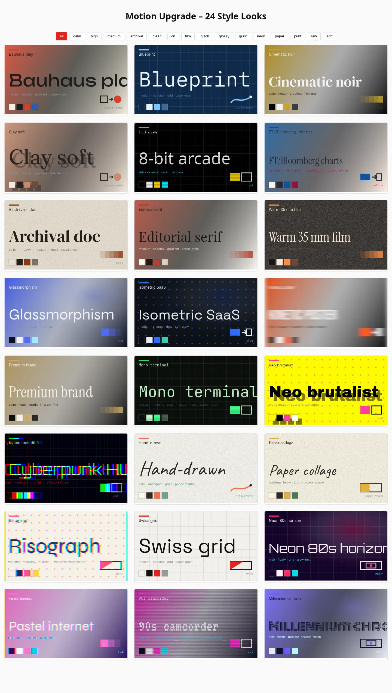

The full gallery (`node scripts/motionkit/gallery.mjs` → [`docs/motion-gallery/index.html`](docs/motion-gallery/index.html))
renders every recipe through the same `styleFrame` code the agent uses, with energy and finish filters.

- **24 recipes** in [`scripts/motionkit/data/recipes/`](scripts/motionkit/data/recipes/), from Swiss grid and Blueprint to Cinematic noir, Risograph and VHS retro
- **37 effects** ([`effects.json`](scripts/motionkit/data/effects.json)) and **25 transitions** ([`transitions.json`](scripts/motionkit/data/transitions.json)), each with a CPU fallback
- **16 OFL-1.1 fonts** catalogued in [`assets.json`](scripts/motionkit/data/assets.json) and fetched with `node scripts/motionkit/fetch-assets.mjs`
- A renderer finishing layer ([`look-layer.tsx`](apps/renderer/src/look-layer.tsx)) and a style gallery at [`docs/motion-gallery/index.html`](docs/motion-gallery/index.html)

The frames above are `styleFrame()` output for 12 of the recipes. The full guide is
[docs/MOTION_STYLES.md](docs/MOTION_STYLES.md).

### Two-minute demo page

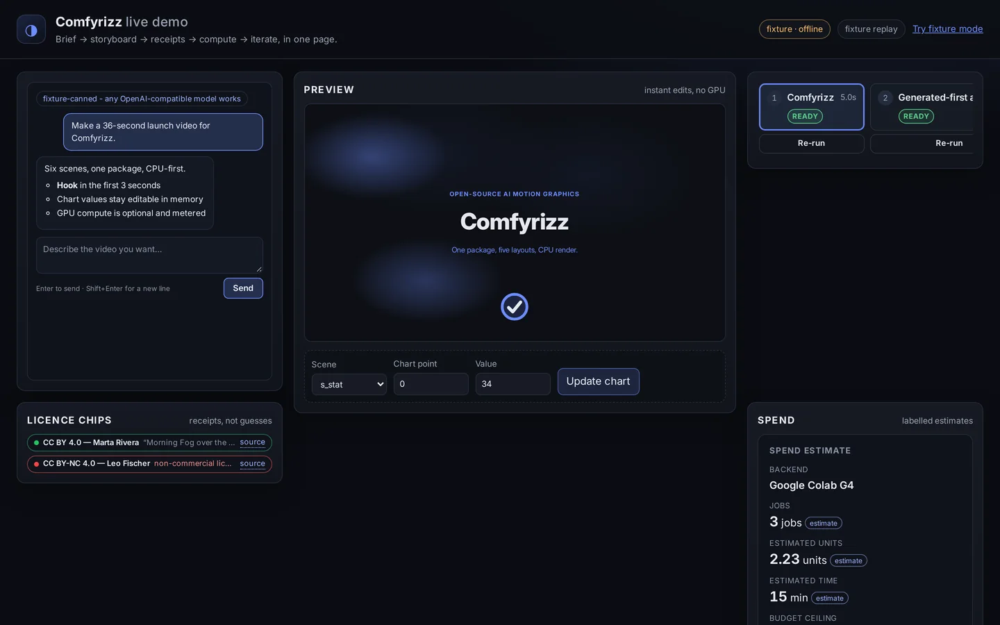

`apps/web/demo.html` walks the whole loop on one page: brief, storyboard, licence receipts, a spend
estimate, the Google Colab run and iteration. Fixture mode (`?fixture=1`) needs no server, token, GPU
or network. See [docs/DEMO_WEBAPP_RUNBOOK.md](docs/DEMO_WEBAPP_RUNBOOK.md).

### Setup preflight

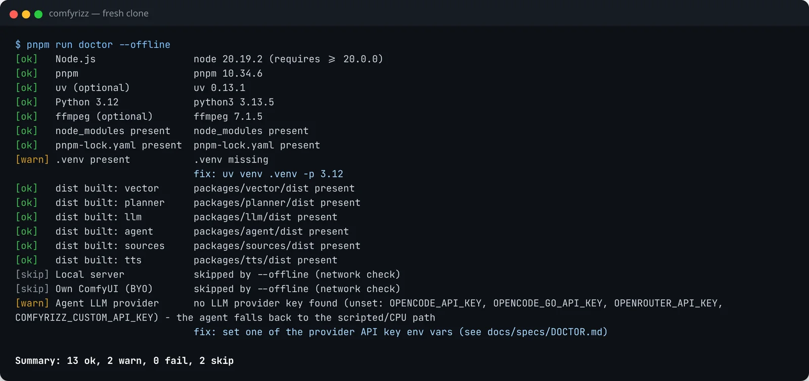

`pnpm run doctor` checks every prerequisite in one screen and prints a fix command for each
problem. It is read-only and never prints secret values. See [docs/DOCTOR.md](docs/DOCTOR.md).

### Landing next

These features are on their branches and not yet merged to `main`. The previews below were
captured from those branches.

| Feature | Branch | Preview |
| --- | --- | --- |
| Live Google Colab progress gauges: model download, sampler, nodes, frame render and encode | `feat/colab-progress` | 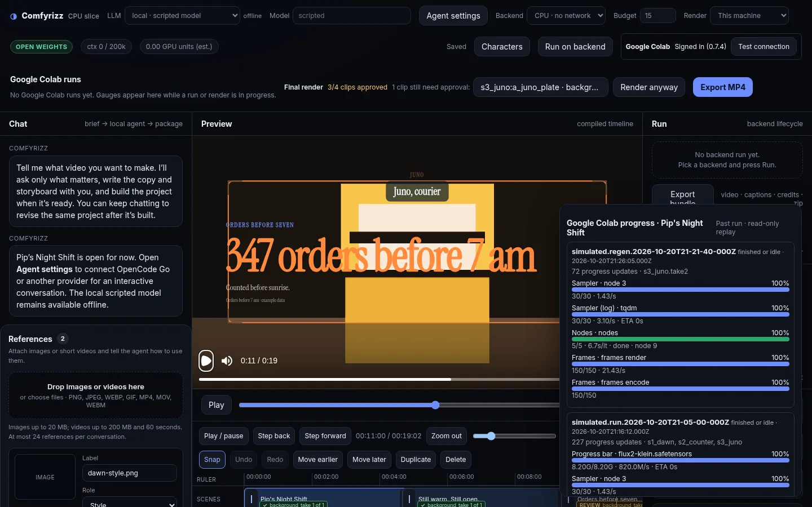 |
| Quality QA CLI: story beat lint, caption reading rate and splitting, Foley cue sheets, motion review | `feat/quality-fixes` | 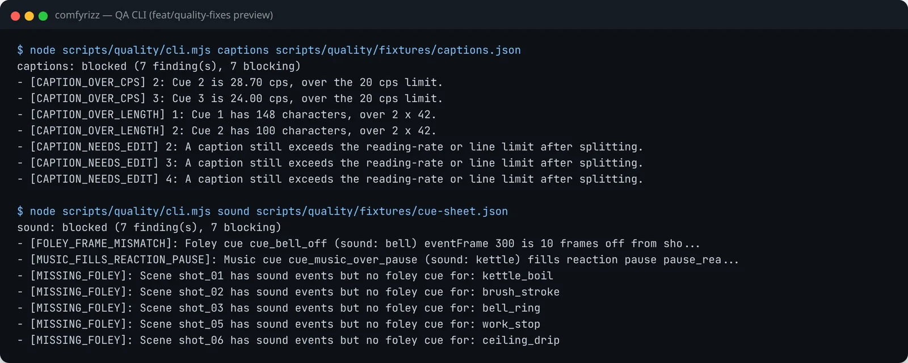 |
| References panel: uploads, per-asset notes and roles, agent placement proposals | `feat/reference-assets` | <!-- TODO(screenshot): References panel; capture after feat/reference-assets merges (the panel is not mounted in the app on the branch yet) --> _Screenshot to follow after merge._ |

## Quick start

Requirements: **Node.js 22.6+**, **pnpm 10**, **ffmpeg** and Chrome or Chromium
for Remotion (`REMOTION_BROWSER` overrides the default `/usr/bin/google-chrome`). Python 3.10+ is
needed only for the GPU pipeline and Kokoro narration. Supported operating systems: Linux and
macOS, or WSL on Windows. Set `COMFYRIZZ_PYTHON` to the Python interpreter with the pipeline
dependencies (for example `.venv/bin/python`); it defaults to `python3`.

```bash
git clone https://github.com/mojomast/comfyrizz
cd comfyrizz
pnpm install --frozen-lockfile
pnpm -r --if-present run build
pnpm run doctor --offline
cd apps/server && npm start
```

Open the URL the server prints (`http://127.0.0.1:4319/#token=…`). The bundled
`examples/launch-demo` loads in the Player. Send a brief in **Plan** mode with the
**local · scripted model**, edit a headline or a chart value, then **Export MP4** or
**Export bundle**. This path needs no GPU and no API key.

> Use `pnpm run doctor`, not bare `pnpm doctor`: the bare form runs pnpm's own built-in command.

Render the bundled example from the command line (about 90 seconds on CPU):

```bash
pnpm --filter @comfyrizz/renderer render:example   # → examples/launch-demo/out/launch-demo.mp4
```

The full clean-clone check is in [docs/RELEASE_CHECK.md](docs/RELEASE_CHECK.md).

## Offline demo with a cassette

A cassette (`comfyrizz.cassette/v1`) records one agent session's LLM traffic with credentials
redacted. Replay needs no key and no network, and because the request key ignores the model, the
same session replays under any model.

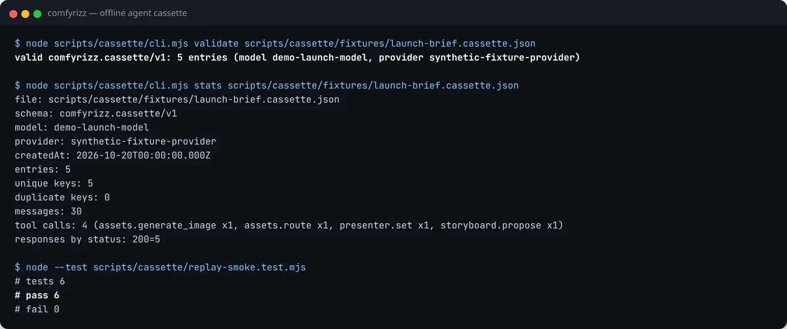

```bash
node scripts/cassette/cli.mjs validate scripts/cassette/fixtures/launch-brief.cassette.json
node scripts/cassette/cli.mjs stats scripts/cassette/fixtures/launch-brief.cassette.json

# serve the app with the agent answering from the cassette (use an absolute path)
COMFYRIZZ_LLM_CASSETTE=play:$PWD/scripts/cassette/fixtures/launch-brief.cassette.json \
  npm --prefix apps/server run start
```

Recording with a free provider, replaying under a second model and the `diff --md` comparison table
are covered in [docs/AGENT_CASSETTE.md](docs/AGENT_CASSETTE.md).

## Google Colab

Comfyrizz drives your own Google Colab account through the official `google-colab-cli`
(`python3 -m pip install --user google-colab-cli`, then sign in with the CLI).

1. In the app, pick **Google Colab** as the backend. The status card shows whether the CLI is
   installed and signed in; **Test connection** checks it.
2. FLUX 3 Klein and LTX-2.5 are gated on Hugging Face. Accept both licences, put a read token in a
   `0600` file and point `COMFYRIZZ_HF_TOKEN_FILE` at it.
3. Approve the spend card. Comfyrizz allocates a G4, runs the scripts in [`colab/`](colab/)
   (bootstrap, health, run, collect) and stops the VM, confirming the stop before it says so.
4. Optionally render the final video on the same held VM (`renderLocation: 'colab'`), including
   HyperFrames composition scenes. See [docs/COMPOSITIONS.md](docs/COMPOSITIONS.md#google-colab-remote-render).

The suites never start a real runtime: `node scripts/gpu4/g4_dryrun.mjs` runs a whole Google Colab
job against loopback fakes. Efficiency measurements are in
[docs/COLAB_EFFICIENCY_RESULTS.md](docs/COLAB_EFFICIENCY_RESULTS.md). To use a GPU you already
have, choose **My ComfyUI URL** instead.

## Architecture

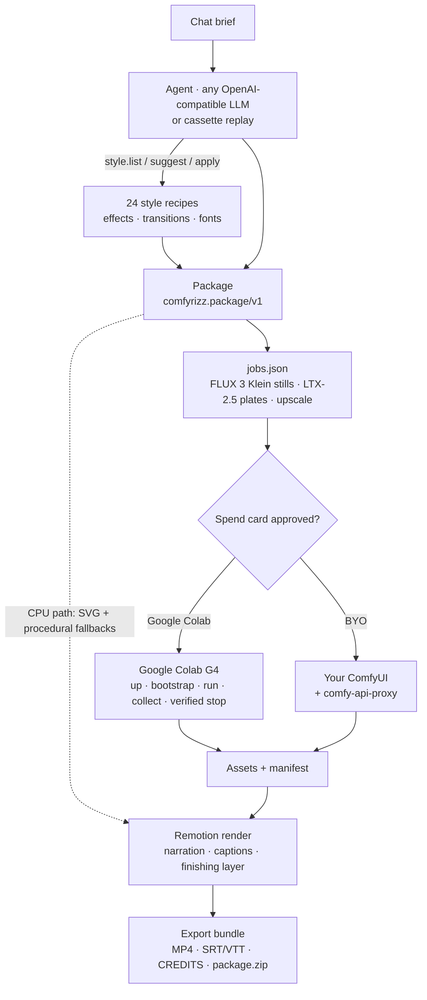

- **The package is the contract.** [packages/schema](packages/schema/) holds the JSON Schema and
  TypeScript and Python validators. Model licences are tracked separately from output licences.
- **Workflows through the Comfy SDK.** [pipeline-py](pipeline-py/) submits the ordered, hashed jobs
  in [workflows](workflows/). Each generated asset keeps the API-format graph it was made with
  (seed, prompt, models), with secrets removed, so you can open it in ComfyUI.
- **Deterministic rendering.** [apps/renderer](apps/renderer/) computes each frame from the
  timeline, local assets and the frame number, with no network calls. Copy that doesn't fit fails
  visibly instead of clipping.

The full design is in [docs/SPEC.md](docs/SPEC.md).

## Configuration

| Setting | What it does |
| --- | --- |
| **Agent settings** (in the app) | Add an OpenRouter, OpenCode Go or custom OpenAI-compatible profile, fetch models and test tool calling. Saved to `<runtime>/provider-settings.json` (mode `0600`, git-ignored). |
| `OPENROUTER_API_KEY`, `OPENCODE_API_KEY` / `OPENCODE_GO_API_KEY`, `COMFYRIZZ_CUSTOM_API_KEY` + `COMFYRIZZ_CUSTOM_BASE_URL` | Provider keys from the environment; saved keys take precedence. |
| `COMFYRIZZ_PORT` | Server port (default `4319`). |
| `COMFYRIZZ_RUNTIME` | Runtime directory (default `apps/server/.runtime`). |
| `COMFYRIZZ_LLM_CASSETTE` | `record:<file>` or `play:<file>` for agent cassettes. Off by default. |
| `COMFYRIZZ_HF_TOKEN_FILE` | Path to a `0600` Hugging Face read token file for the gated models. |
| `COMFYRIZZ_COLAB_BIN` | Path to the `colab` CLI, if it isn't in `~/.local/bin` or on `PATH`. |
| `REMOTION_BROWSER` | Chrome or Chromium used for rendering. |

Provider details: [docs/AGENT_PROVIDERS.md](docs/AGENT_PROVIDERS.md).

## Project structure

```
apps/
  web/          Vite + TypeScript UI: chat, brief, Remotion Player, timeline, inspectors; demo.html
  server/       Loopback HTTP server: packages, agent, pipeline, render, export, SSE, cassette hook
  renderer/     Remotion project: layouts, transitions, storytelling recipes, finishing layer, CLI renders
packages/
  schema/       comfyrizz.package/v1 + jobs/v1 schemas, TS + Python validators, motion lint
  agent/        Tool loop, asset router, brief extractor, skills (including motion-style), style recipes
  llm/          OpenAI-compatible adapter: OpenRouter, OpenCode Go, custom presets
  planner/      Timeline compiler (integer frames, transitions, caption cues)
  jobs/         package → ordered, hashed jobs.json
  backends/     Google Colab lifecycle + BYO ComfyUI, budget, watchdog
  vector/       SVG sanitiser, resvg render check, auto-fix loop
  tts/          Kokoro + Qwen3-TTS adapters, measured cues, SRT/VTT
  sources/      Openverse search, uploads, licence policy, CREDITS + package.zip filter
  compositions/ Native HTML/SVG composition templates
pipeline-py/    Comfy SDK runner, attempt records, manifest, reconcile
colab/          Scripts the Google Colab backend runs on the VM
workflows/      ComfyUI API-format graphs (FLUX 3 Klein, LTX-2.5)
scripts/        doctor/, cassette/, motionkit/, release scan, credits audit, gallery
examples/       Bundled packages (launch-demo, hook-20s, csv-charts, licensing-demo, …)
docs/           SPEC, guides, specs/, submission/, media
```

## Testing

```bash
pnpm test                      # every workspace package's node:test suite (builds libraries first)
pnpm run test:py               # pipeline-py pytest; needs .venv (pipeline-py/requirements-dev.txt)
pnpm run test:scan             # release scan: no personal paths or secrets
node --test scripts/doctor/*.test.mjs scripts/cassette/*.test.mjs
pnpm --filter @comfyrizz/web test:e2e   # Playwright (Chromium, loopback only)
```

GPU paths are tested against a fake `colab` CLI and a fake Comfy server, so no suite starts a
runtime or spends anything. The motion library's tests are listed in
[docs/MOTION_STYLES.md](docs/MOTION_STYLES.md#every-command).

## Hackathon submission

Comfyrizz is Kyle Durepos's entry for **Comfy's Open Source Higgsfield hackathon**. Submissions are
due **Oct 30, 2026, 12:00 PM Toronto time (9:00 AM PT)**.

| Document | What it covers |
| --- | --- |
| [WRITEUP.md](docs/submission/WRITEUP.md) | The entry: what it is, how it's built, why it's innovative, and the categories it targets |
| [DEMO_SCRIPT.md](docs/submission/DEMO_SCRIPT.md) | The two-minute demo video shot list |
| [CHECKLIST.md](docs/submission/CHECKLIST.md) | Each official requirement with status and evidence |
| [LICENSE_AUDIT.md](docs/submission/LICENSE_AUDIT.md) | Repository licence, model weights and the Open Weights Only check |
| [Gallery](docs/gallery/index.html) | Every bundled example package, with rendered videos once you produce them locally |

## Credits and licences

**Comfyrizz is MIT-licensed.** See [LICENSE](LICENSE) and [NOTICE](NOTICE).

- **Assets.** Every bundled asset is listed with source, creator and licence in [CREDITS.md](CREDITS.md); third-party notices are in [NOTICE](NOTICE).
- **Fonts.** The style recipes use fonts under the SIL Open Font License 1.1. Bundled font files ship with their OFL text in [`apps/renderer/public/fonts/`](apps/renderer/public/fonts/).
- **Models.** Not distributed with this repository. FLUX 3 Klein (FLUX Kommunity License), LTX-2.5 (LTX-2.x Community License), Kokoro-82M and Qwen3-TTS are downloaded by each user under their own licences.
- **Remotion** is source-available under the [Remotion License](https://www.remotion.dev/license), which is not OSI: free for individuals and organisations of up to 3 people.
- **Built on** [ComfyUI](https://github.com/comfyanonymous/ComfyUI) (GPL-3.0, cloned at runtime, not vendored), the Comfy SDK and `comfy-api-proxy`, `google-colab-cli` (invoked as an external command), HyperFrames (Apache-2.0) and resvg.

Full details: [THIRD_PARTY_LICENSES.md](THIRD_PARTY_LICENSES.md).

## Contributing

Issues and PRs are welcome. Setup, asset rules and the licence policy are in
[CONTRIBUTING.md](CONTRIBUTING.md). In short: run `pnpm run doctor`, keep `pnpm test` green, add a
test with each fix, never commit secrets, and write "Google Colab" in prose and UI copy.

<div align="center"><sub>Made with ComfyUI, Remotion and a lot of SVG.</sub></div>
