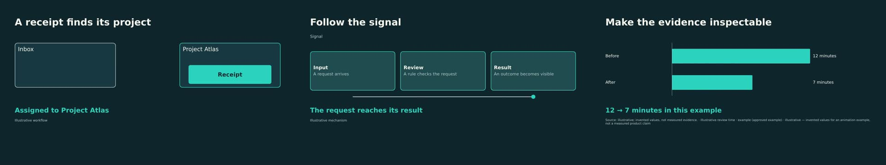

# Authoring composition scenes

Compositions add three parameterized visual stories to an ordinary v1 package:
**object-transfer**, **mechanism-journey**, and **evidence-reveal**. Author them by
editing package JSON and `compositions/manifest.json`. The compiler generates
HTML/SVG with native JavaScript frame functions; it does not load GSAP. HyperFrames
is an optional external CPU worker that checks and renders those generated scenes
to opaque, silent video plates. Comfyrizz retains the final timeline, captions,
narration, audio mix and scene transitions.

This is a source-authoring workflow. There is no composition authoring inspector,
embedded HyperFrames Studio, arbitrary element/keyframe editor, or live HTML editor
integration yet. Existing native scenes continue to use the normal renderer.



## Quick start

From the repository root, with the normal workspace dependencies already available:

```bash
pnpm --filter @comfyrizz/planner build
node scripts/compositions/build.mjs examples/composition-stories --check
```

`--check` validates the package and manifest, compiles the planner timeline using
`audio/durations.json` when present, and compiles each composition. It prints JSON
with scene IDs, source hashes, exact frame counts, dimensions, fps and compiler
diagnostics. It writes no files and needs neither HyperFrames nor its browser.
This is **compile validation**, not a rendered visual check.

For materialization, provision the optional external **`hyperframes@0.8.181` CLI**
and a **Node 22+** runtime separately from the application. Comfyrizz's application
Node 20 floor is retained. Pin the external installation and browser; do not use a
floating `npx hyperframes` in an automated run.

```bash
npm install --prefix /tmp/opencode/composition-tools --save-exact \
  --no-audit --no-fund hyperframes@0.8.181
export COMFYRIZZ_HYPERFRAMES_CLI=/tmp/opencode/composition-tools/node_modules/hyperframes/bin/hyperframes.mjs
export COMFYRIZZ_HYPERFRAMES_NODE=/absolute/path/to/node22
export HYPERFRAMES_BROWSER_PATH=/absolute/path/to/chrome-headless-shell
node scripts/compositions/build.mjs examples/composition-stories \
  --out /tmp/opencode/composition-stories-built
```

`COMFYRIZZ_HYPERFRAMES_CLI` identifies the pinned external CLI entry.
`COMFYRIZZ_HYPERFRAMES_NODE` selects the external runtime when needed; see worker
errors for executable/version problems. The default destination is a fresh sibling
directory, `examples/composition-stories.composed`. An explicit destination must
have an existing parent directory, be outside the source package, and not exist.
The CLI refuses to reuse output, so choose a new destination for another build.

### What the build writes

```text
<out>/package.json                 original authoring package
<out>/compositions/manifest.json   original composition parameters
<out>/assets/…                    declared media and derived plates
<out>/audio/…                     declared/measured narration inputs, if present
<out>/fonts/…                     declared custom fonts, if present
<out>/composition-check.json      compile/timeline summary
<out>/composition-report.json     worker checks, render and cache report
<out>/rendered-package.json       materialized package for the render pipeline
```

The CLI materializes scenes; it does not export the final assembled movie. Pass
`<out>/rendered-package.json` to the existing package render pipeline. For example:

```bash
export REMOTION_BROWSER="$HYPERFRAMES_BROWSER_PATH"
node --input-type=module -e '
  import {renderPipeline} from "./apps/renderer/scripts/render-pipeline.mjs";
  console.log(await renderPipeline(process.argv[1], process.argv[2]));
' /tmp/opencode/composition-stories-built/rendered-package.json \
  /tmp/opencode/composition-stories-built/video.mp4
```

Its plates
use ordinary ready-video assets and media-only playback. Keep `<out>/package.json`
and its manifest as the editable source. Building again from the source will
regenerate the plates using the current measured timeline.

Only declared asset files/variants, declared theme fonts, the manifest and measured
narration files are copied, plus verified worker-owned composition cache companions
when rebuilding an extracted/materialized project. Arbitrary HTML files are not
copied. Media paths must be under `assets/`, `audio/` or
`fonts/` and have a supported media/font extension. Absolute paths, traversal,
backslashes, hidden path segments, symlinks and special files are rejected.
Undeclared files, `.env`, caches, logs, render props and unrelated artifacts are
not directory-copied. Credential-free package metadata is part of the source
contract: do not store secrets in package fields, dataset notes or labels.

If a build fails after creating its destination, the partial directory remains
available for diagnosis. A successful build writes `rendered-package.json` only
after materialization and package validation complete. Use a new destination when
retrying. Ctrl-C/SIGTERM is forwarded as cancellation to the worker.

## Source contract

The sidecar is deliberately separate from the package schema:

- Standalone package directories use `compositions/manifest.json`.
- Shared server package directories use `compositions/<package-id>/manifest.json`.
  A matching scoped manifest takes precedence; manifests belonging to other
  package IDs are ignored. Use the scoped form in a shared store so one project's
  source cannot be mistaken for another project's source.
- Export and pipeline staging preserve whichever validated relative path was used.

```json
{
  "version": 1,
  "scenes": [
    {
      "sceneId": "s_transfer",
      "component": "object-transfer",
      "params": {
        "title": "A receipt finds its project",
        "objectLabel": "Receipt",
        "fromLabel": "Inbox",
        "toLabel": "Project Atlas",
        "resultLabel": "Assigned"
      },
      "cues": { "action": { "frame": 24 }, "result": { "frame": 90 } }
    }
  ]
}
```

Each entry refers to an existing scene ID. `params` supplies component-specific
labels and data references. Optional `cues` binds semantic action/result
beats to the resolved scene timeline; the result remains visible for inspection.
Use the example manifest as the concrete
parameter reference and compiler errors as validation of supported inputs.

| Component | Authored story | Required content |
|---|---|---|
| `object-transfer` | A visible object moves from input to destination, then a changed state holds | `title`, `objectLabel`, `fromLabel`, `toLabel`, `resultLabel` |
| `mechanism-journey` | A signal travels through a sequence of stages to an observable consequence | `title`, `signalLabel`, 2–4 `stations: [{label, detail}]`, `resultLabel` |
| `evidence-reveal` | Supplied values reveal a finding, then hold for inspection | `title`, `dataset` ID, 2–6 exact `rows` labels, `resultLabel` |

All components accept an optional visible `qualifier`. Unknown parameter keys are
rejected. Evidence values come from the referenced dataset, not manifest numbers.

The example uses v1 dataset structure: `unit`, `values: [{label, value}]`, and
`source: "example"`. The schema's `source` enum does not include `"illustrative"`;
that word is instead made explicit in the dataset note and visible source citation.
Its values (Before: 12 minutes, After: 7 minutes) are invented for this example and
approved only as illustrative animation content, not as a factual product claim.
Replace both values and provenance together when using real evidence. A component
must not silently substitute catalog demo data for a missing dataset.

## Timing, narration and holds

The planner is authoritative. The compiler receives `timelineScene.durationInFrames`
and `timeline.fps`; the plate must contain exactly **N decoded frames** at **F fps**,
with duration **N/F**, at the resolved output dimensions. The animation's last tween
does not define the scene's duration. The worker verifies the result before adding
the ready asset. A narration edit that changes scene length requires rematerializing;
stretching an old clip changes action/cue timing.

Each `cues.action`/`cues.result` accepts a **scene-local integer `frame`** or a
`phrase`; an explicit `frame` wins if both are supplied. Result must follow action
and both must be within the scene. Phrase cues resolve from planner motion cues or
caption/word timing. Absolute planner cue frames become scene-local time using
`(cueFrame - timelineScene.from) / timeline.fps`. Native planner
`motion.cue_seconds` takes precedence over `motion.cue_phrases` when resolving
those native motion cues; manifest frame cues remain their own explicit binding.
Preserve cue provenance: estimated word
positions are not forced alignment. With narration enabled, this CLI requires
measured, non-provisional timing before accepting a composition build.

The source-only example disables narration and uses hard cuts: 150, 180 and 150
frames at 30 fps (5, 6 and 5 seconds; 480 frames total). Action/result/inspection
beats leave a quiet ending for reading: the example results appear at frames 90,
138 and 90, leaving 60, 42 and 60 frames respectively. Inspection holds are intentional; constant
movement is not a quality requirement. Keep important labels out of caption space,
and review the final Remotion captions over the baked plates. The plate itself is
silent and must not duplicate the final caption/audio/transition layers.

## Visual diagnostics and cache

Compilation catches source/parameter/timing problems. The worker runs HyperFrames
browser layout, motion and contrast checks. The templates reserve bottom space for
captions and include reveal-order assertions; the final caption/plate composite
still needs review. Inspect off-frame text, clipping, caption collisions and
intended result holds in a contact sheet and final video. Additional review should
include exact cue frames and transition seams.
HyperFrames checks are sampled evidence, not proof about every rendered frame or
the truth of the story. Native compile diagnostics and browser findings have
different coverage; a clean `--check` is not a visual approval.

Derived plates are content-addressed by the worker. Source, parameters, data,
dimensions and resolved frame/cue timing contribute to invalidation; worker
renderer/runtime version checks are also important when upgrading the external
tool. Do not rename a stale plate to make a failed build appear current. The
worker report records materialization/cache outcomes. This CLI always creates a
fresh destination, so it does not promise cross-build cache reuse; pipeline runs
that retain worker-owned derived assets can use the worker's validated cache.

## Editable source round-trip

Keep the source package and `compositions/manifest.json` alongside derived media.
To round-trip manually, copy those source files plus declared media/fonts and
measured narration to a new package directory, edit the labels/dataset/cues, run
`--check`, and build into a new output directory. `rendered-package.json` is a
derived view; editing only a baked MP4 does not update its source.

The application's exporter includes the validated manifest in `package.zip`, along
with ordinary redistributable derived assets and their verified generated HTML,
motion specs and portable cache receipts. Runtime absolute paths and diagnostic
snapshot references are removed from those receipts. Pipeline snapshots copy the
same allowlisted source/cache files. Extract the ZIP into a project directory to recover this
parameterized source; freeform HTML import and an editor inspector are not part of
this format. The templates are provided by the installed Comfyrizz compiler.
The manifest remains authoritative; editing cached HTML directly invalidates its
receipt and the compiler regenerates it rather than executing that edit.

Full pipeline and legacy package renders prepare compositions automatically.
Composition-bearing incremental renders use the full renderer to keep the source
and final pictures consistent. Export reuse is fingerprinted against source,
timeline, actual media/font bytes and `media.json`; a missing or changed manifest,
or a corrupted cached video, invalidates the prior composition export. Preparation
updates an isolated pipeline snapshot or temporary export package rather than the
saved authoring package.

Aspect/cutdown variant exports stage the base source into an isolated directory,
retain only entries for surviving scenes, and archive it under the variant's own
package namespace. Template labels are literal: language variants do not
automatically translate those labels. Invalid phrase bindings or missing measured
variant narration fail explicitly.

## Implementation and licensing

The shared compiler lives at `packages/compositions/src/index.mjs`; the external
adapter is `apps/renderer/scripts/composition-worker.mjs`. No HyperFrames or GSAP
dependency is added by this CLI. The three components use independently authored
native frame functions. Adding arbitrary executable HTML dependencies or a full
animation editor is a separate integration task.

HyperFrames is Apache-2.0; third-party runtime/font/media terms remain separate.
Original template geometry is MIT-licensed. Complete project ZIPs include
`licenses/MIT.txt` with the supplied attribution and full MIT terms for included
assets and their compiled source companions; they are not relabeled CC0. Supplied
text/data retain their source rights.
The GSAP research is not product-specific consent for Comfyrizz. These native
components require no GSAP library, and this feature makes no claim that a future
GSAP-backed freeform authoring tool has been licensed or approved.

Background: [HyperFrames research](research/HYPERFRAMES_2026.md) and
[GSAP licensing assessment](research/GSAP_LICENSING_2026.md).

CLI path/copy checks:

```bash
node --test scripts/compositions/build.test.mjs
```

## Verification — October 20, 2026

- Nine component/aspect combinations passed HyperFrames lint, runtime, layout,
  motion and contrast checks without findings (landscape, portrait and square).
- The three-scene example passed a real assembled Comfyrizz export at **1280×720,
  30 fps, 480 frames / 16 seconds**. The source package stayed unchanged.
- Repeating the export reused its verified video. Extracting its complete ZIP and
  rendering again gave three composition cache hits. Staging that extracted project
  into an isolated pipeline snapshot also gave three hits.
- The ZIP included editable source, derived plates, portable cache companions and
  full MIT notices. Portable receipts contained no runtime absolute paths.
- A scoped **720×1280 portrait cutdown** exported **150 frames / 5 seconds** and
  retained the correct one-scene manifest under its variant package namespace.
- Existing Chromium editor E2E passed **30/30**. Web and renderer typechecks passed.
- Final compiler tests passed **15/15**, composition renderer/CLI tests **27/27**,
  server tests **191/191**, web tests **82/82**, and Python **357 passed / 1 skipped**.
  Shared package suites passed sequentially; the renderer regression suite passed
  during integration, with the expanded worker suite rerun after final changes.

The [machine-readable evidence](research/composition-implementation-20261020.json)
records versions, frames, archive/video hashes and evidence limits. Raw evidence is
retained outside the repository under
`~/comfyrizz-gpu-tests/composition-implementation-20261020/`.
All renders used local CPU resources and spent **zero Colab credits**.

## Google Colab remote render

The opt-in Google Colab final render (`renderLocation: 'colab'`) does not carry the
composition/HyperFrames worker. When a run package has composition scenes, the
pipeline collects the generated media, stops the held Colab VM, emits a
`REMOTE_RENDER_COMPOSITIONS` warning and renders the final video locally.
