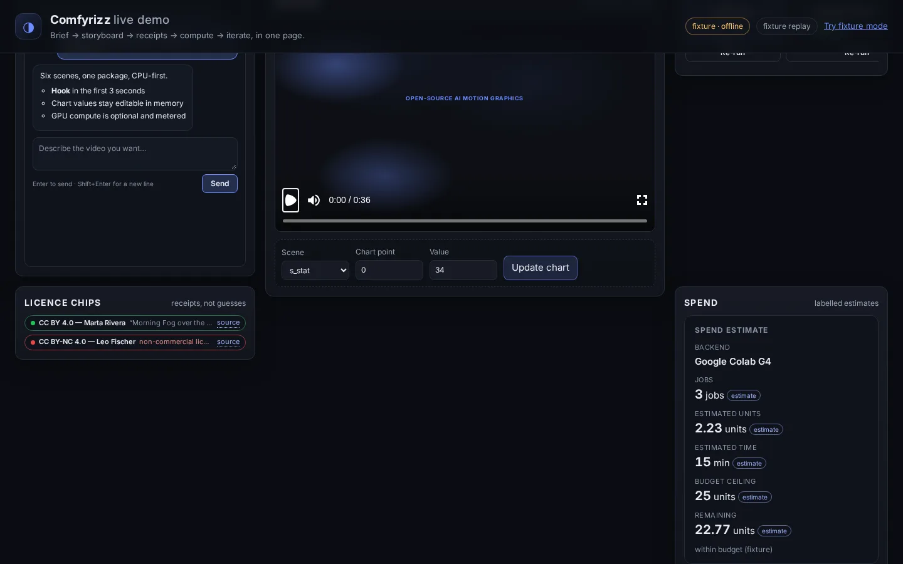

# End-to-end pipeline and frontend progress contract

Date: 2026-10-21. Updated for PO-3 (per-accelerator rates and the teardown
reserve) and PO-4 (cancellation and reconciliation) as merged on `main`.
Companion to [the editor plan](FRONTEND_EDITOR_PLAN.md).

## Handoff to the frontend agents

The initial change added the backend API and worker. The subsequent
[voice-generation integration](VOICE_GENERATION.md) adds a small storyboard
panel using this API in the current web shell. Integrate the same contract into
the redesigned frontend work in progress; the existing `/api/run` remains the
legacy media-only flow. A frontend still calling `/api/run` does not acquire the
voice/sync/export stages automatically.

The new endpoint accepts a **saved package revision** and processes it through
voice generation, measured timing, generated media, presenter diagnostics and
bounded correction, rendering, verification and an editable export. The final
MP4 is rendered on this machine by default. `renderLocation: "colab"` opts in
to assembling it on the Google Colab VM that just generated the media. There
are no manual shell steps between these stages. Server model/runtime configuration
is still required, and reported in preflight or the failing stage.

Generated cuts are isolated snapshots. They never overwrite edits made while the
run was active. Use the result package and its asset URLs to show the generated
cut; label its source revision. The editable ZIP includes the generated assets
and measured narration. Import/adopt behavior in the redesigned project store is
a frontend/backend follow-up decision; do not PATCH returned relative asset paths
blindly into the original project's shared media directory.

## Audit: did we have enough observability?

**Previously, no.** There was useful GPU telemetry but no reliable end-to-end
application-level state model.

| Area | Previous behavior | Added behavior / remaining precision limit |
|---|---|---|
| Orchestration | Media generation followed by rendering; Qwen/sync were production scripts | One isolated worker drives nine ordered application stages |
| History | In-memory run map and 200-event SSE ring | Atomic per-run snapshot and durable sequence-numbered JSONL journal |
| GPU progress | Job/attempt/progress/output events existed | Preserved and mapped to task snapshots; split transport records no longer disappear |
| Voice | Final summary and raw logs | Voice-design/setup phases, per-scene synthesis and alignment start/completion |
| Model downloads | Quiet setup periods or terminal text | Named download/setup phase and diagnostic tail; byte percentage is unavailable |
| Collection | Aggregate tree completion | Successfully collected/reused files versus total listed files |
| Presenter | Manual SyncNet and FFmpeg | Per-presenter measurement, bounded correction, remeasurement and confidence/offset diagnostics |
| Render | Synchronous server call, no frame counts | Worker uses Remotion's actual rendered/encoded frame counters and renderer progress |
| Final audio | Production-only mix comparison | Normalization plus stream, duration and narration-envelope checks |
| Completion | Could report media done despite render failure | Completed only after all required stages, verified artifacts and a clean worker exit |
| Cancellation | Controller discarded its AbortController | Cancel request, visible cleanup state, local process termination and managed runtime teardown |
| Restart | Run state disappeared | Interrupted state, outputs retained, shutdown marked unconfirmed, explicit reconciliation |
| Cost | GPU estimate around one media run | Separate voice/media allocations, measured account balance deltas, unknown cost remains null |
| Concurrency | An edit could conflict with generated result application | Immutable input hash/revision; result cut retained separately |

The legacy controller also now reports a render failure as a failed request,
instead of publishing a successful finish after rendering failed.

## Stage IDs and semantics

| ID | Display label | Progress the frontend can use |
|---|---|---|
| `preflight` | Check project and inputs | Indeterminate checks; never imply GPU allocation |
| `narration` | Generate voice and align captions | Setup/design phases, synthesized scenes, separately aligned scenes |
| `timing` | Assemble narration and measure timing | Indeterminate assembly, then measured scene count |
| `presenter_inputs` | Prepare presenter audio | Scene ID; exact source window and native frame lattice |
| `media` | Generate and collect visual media | Dependency/job list, active attempts, reported ComfyUI progress, collected files, teardown |
| `presenter_sync` | Check and correct presenter timing | Scene ID, correction frames, verified presenters, offset/confidence |
| `render` | Render video | Bundling, rendered/encoded frames, encoding/muxing, audio normalization. Google Colab mode also reports preparing, uploading, bootstrapping, and collecting the MP4 |
| `verify` | Verify video and audio | Indeterminate technical inspection, then pass/fail |
| `export` | Package editable project | Packaging milestones, then ZIP integrity and asset-hash validation |

Optional stages emit `skipped`. Stage states are `pending`, `running`, `completed`,
`skipped`, `failed`, `cancelled`, `interrupted`, or `blocked` by an earlier failure.
Do not animate a spinner on `pending`/`blocked` stages after a terminal failure.

Run states: `running`, `cancelling`, `completed`, `failed`, `cancelled`,
`interrupted`, `reconciling`. A cancellation request is **not** shutdown proof.
Runtime records independently report `allocating`, `running` (a VM held for a
Google Colab render), `stopped`, or `stop_unconfirmed` (and backend-specific
non-success states). External ComfyUI ownership is explicit; stopping its local
proxy does not shut down the user's GPU.

## HTTP API

All routes use the existing local-server authentication and origin rules.
Use the frontend's authenticated API client. Native media/SSE can use the existing
token-query mechanism where required; keep those credentials out of exported
documents, telemetry and copied links.

### Plan and start

`POST /api/pipeline/plan`:

```json
{
  "packageId": "pkg_example0001",
  "baseRevision": 4,
  "backendId": "colab",
  "budgetUnits": 6,
  "narrationRuntime": "colab",
  "narrationUnits": 2,
  "renderLocation": "local"
}
```

- `backendId`: `cpu`, `colab`, `byo-comfyui`.
- `narrationRuntime`: `local` or `colab`; remote voice currently supports Qwen.
- `renderLocation`: `local` (default) or `colab`. `colab` renders the MP4 on the
  Google Colab VM after visual generation, then stops that VM. It requires
  `backendId: "colab"` and a generated-media session. A backend other than Google Colab
  returns issue `REMOTE_RENDER_REQUIRES_GOOGLE_COLAB` and `ready: false`. A
  Google Colab plan with nothing to generate stays ready and renders locally,
  with `remoteRenderNote` explaining why.
- `comfyuiUrl`: optional HTTP(S) URL for the external backend; no embedded credentials.
- `budgetUnits`: whole-run allocation ceiling. `narrationUnits`: Qwen's portion,
  at most 4 units. The remaining allocation belongs to Google Colab visual media.
- An unchanged ready visual asset is reused. Enabled voice is synthesized for
  the run; regenerated voice invalidates its conditioned presenter clips.

Response includes `version`, `planHash`, `inputHash`, `baseRevision`, `stages`,
`jobs`, `reusableAssets`, `budget`, `requiresApproval`, `ready` and `issues[]` with
`code/message/action`. Allocation ceilings are **not predicted charges**.
The detailed media estimate is recalculated after real narration fixes the clip
lengths; if it exceeds the allocation, the pipeline stops before media allocation.
`planHash` includes `renderLocation`. Changing it requires a fresh approval.

`POST /api/pipeline` uses the same body, adding `approvedPlanHash` when metered
compute is required. Approval binds the entire input package and options, including
voice and budget. Changed text/revisions/options require a fresh plan. Returns
HTTP **202** with `{status:202, run}` after staging; **409** for revision/busy/
approval conflicts; **422** for reported readiness issues. Invalid inputs return
400. Staging copies ready file-backed assets and validates declared hashes.

The implementation admits one pipeline at a time. Legacy run/render/export
requests are refused while it is active so they cannot block progress delivery.
Ordinary project edits and chat remain available.

### Google Colab final render

When the plan's `remoteRender` is true, the media stage keeps the VM (`teardownMode: "never"`)
and collects only `manifest.json`, `health.json`, `ready.json`, and `attempts/`.
The runtime event stays `running` with the note `Held for the Google Colab render`.
Presenter clips needed for local SyncNet correction are downloaded by name; the
corrected files travel back inside the project archive.

The render stage then uploads three files: the renderer bundle, a project archive
(package, compiled timeline, narration, and files already on the host, including
editor edits and animation timing), and `job.json`. The VM installs Node.js,
renderer dependencies, ffmpeg, and a headless browser into
`/content/comfyrizz/render-cache` when they are not already there, links generated
plates that are still on the VM, runs Remotion, normalizes loudness, and runs the
same mix verification as the host (`scripts/tts/verify_mix.py`, exit 0 or 2 must
agree with a fresh `passed` boolean). Progress phases include `bundling`,
`preparing`, `uploading`, `bootstrapping`, `rendering`, `normalizing`, `verify`,
and `collecting`.

Two archives come back: `results.zip` (MP4, `render.json`, `verification.json`,
loudness and props) and `media.zip` (named assets so the editable export can
still hash them). The VM is stopped before the host repeats verification and
export. `result.renderLocation` is `colab`.

If the remote render fails, the worker logs warning `REMOTE_RENDER_FALLBACK`,
collects the generated media, and confirms the VM is `stopped` before rendering
locally. The warning text is `Google Colab render failed (…). Falling back to the
local render after the VM is stopped.` An unconfirmed shutdown does not start
the local render; the warning says the shutdown is unconfirmed. Cancellation
does not fall back. A failure after the MP4 is already local does not fall back
either. Tokens are not passed with `--env`.

### Google Colab spend and rates



*Placeholder image: the spend card should show the accelerator, the rate and
where it came from, the account balance, the allocation ceiling and the teardown
reserve separately.*

Every allocation is priced per accelerator, not with one global figure.
`packages/backends/src/budget.mjs` keeps the table `COLAB_RATE_TABLE`:

| Accelerator | Units per hour | Basis |
|---|---|---|
| G4 | 8.9 | measured, `docs/COLAB_EFFICIENCY_RESULTS.md` (GPU test 3 saw 8.14/h, so 8.9 is the pessimistic figure) |
| L4 | 4.8 | conservative, unmeasured; the 1.54/h in that document is a marginal rate, so check it with `colab usage` while only an L4 runs |
| CPU | 0.08 | `docs/DIPSY_SWARM.md` (`colab usage` reported 0.08/h) |

`DEFAULT_GPU` is `G4`; `DEFAULT_RATE_PER_HOUR` is the G4 entry. H100 and A100
are listed fallbacks but have no measured rate in the repo, so they have no table
entry.

#### How the rate is chosen

`rateForGpu(gpu)` takes the first value present in this order:

1. an explicit rate passed by the caller;
2. `COMFYRIZZ_COLAB_RATE_PER_HOUR_<GPU>`, where the accelerator is uppercased
   and every character outside `A-Z0-9` becomes `_` (for example
   `COMFYRIZZ_COLAB_RATE_PER_HOUR_G4` or `..._H100`);
3. `COMFYRIZZ_COLAB_RATE_PER_HOUR`, kept for compatibility and applied to G4 only;
4. the table entry for that accelerator.

An empty environment value counts as unset. A non-numeric, zero or negative
value is refused with `Google Colab rate per hour must be a positive number`.
An accelerator with no table entry is refused unless an explicit rate or its
variable prices it:
`No Google Colab rate is known for accelerator <GPU>; set
COMFYRIZZ_COLAB_RATE_PER_HOUR_<GPU> to its units/hour.` An override below the
table rate is also refused, because pricing low lets a run outspend its ceiling.
For a table accelerator the floor is its own rate; for an accelerator with no
entry the floor is the highest table rate (`HIGHEST_TABLE_RATE`, 8.9 units/h).
`COMFYRIZZ_COLAB_ALLOW_LOW_RATE=1` makes either below-floor override deliberate;
any other value leaves the refusal in place.

Before the media VM is allocated, the media stage calls `colab usage` and takes its
`ratePerHour` as the account's existing burn when it is finite and greater than
zero (0.00/h is treated as no reading). The run is priced at
`max(planned rate, measured rate)`: another session already spending can raise
the price, but an idle account or a CPU session cannot lower a G4 run below the
G4 rate. That run rate drives the backend, admission, the watchdog, the
wall-clock cap and `reserveUnitsFor`. `media_plan` and `media_spend_ceiling`
record its source as `table`, `configured` or `measured`.

The balance check is deliberately stricter. The existing burn keeps draining
while this run spends, so the balance must cover the run at
`planned rate + measured rate`, not `max()`. In the worker, `balanceRatePerHour`
is that sum rounded to three decimals; the run rate and the balance rate are
reported separately.

#### Teardown reserve and deadlines

There is one reserve rule: `COLLECT_AND_STOP_RESERVE_MINUTES`, a constant of
**6** (not an environment variable), converted at the rate being used.
`reserveUnitsFor(rate)` turns those minutes into units and rounds to three
decimals: 0.89 units on G4, 0.48 on L4, 0.008 on CPU.
`spendingMinutes(units, rate)` subtracts the reserve and returns
`max(1, floor((units - reserve) / rate * 60))`, so a too-small allocation is
still bounded at one minute instead of becoming unbounded.

The same six minutes enter:

- the whole-media admission (`assessBudget`) before `media_plan`, at the run rate;
- the backend's per-batch admission during the run, at the run rate;
- the media watchdog and the wall-clock cap (both `deadlineMinutes`), at the run rate;
- the Qwen watchdog, from the narration allocation;
- the balance check, at `balanceRatePerHour`, because that is the rate the
  account is draining at while the run spends.

Admission uses `spent estimate + committed estimate + next-job upper estimate +
reserve <= media ceiling`. The next-job upper estimate is the point estimate at
that rate plus the 35% measurement margin (`NEXT_JOB_MARGIN`). It warns at 80% of
the ceiling and refuses when the reserve-inclusive requirement would exceed it.
The worker's first whole-media admission has no spent or committed amount yet;
the backend tracks those per batch.

When the VM is held for a Google Colab render, its media watchdog is re-armed
for a bounded render allowance (`COMFYRIZZ_COLAB_RENDER_ALLOWANCE_MINUTES`,
default **15**) plus the same 6-minute reserve, so the default is 21 minutes.
The `render_watchdog` event records the minutes, the allowance, the estimated
units and whether the watchdog was armed.

#### Pre-allocation ceiling check and refusal

The media stage resolves the rate, reads `colab usage`, runs backend preflight,
estimates the jobs, and runs whole-media admission. If admission would exceed
the media ceiling, the stage fails with the admission message plus
`Re-plan with a larger media allocation.` Nothing has been allocated at this
point.

Immediately before `backend.runPackage`, the worker emits `media_spend_ceiling`
and checks the account balance. Its `required` is the next-job upper estimate at
`balanceRatePerHour` plus `reserveUnitsFor(balanceRatePerHour)`; `reserveUnits`
in that event is the run-rate reserve used by admission and the watchdog. The
event also carries `gpu`, `ratePerHour`, `rateSource`, `balanceRatePerHour` and
`balance`. It is emitted before either refusal, so a refused run still records
what it required and what it read.

- If the balance is not a finite number, the worker refuses the run:

  ```text
  The Google Colab account balance could not be read, so this run cannot be shown to fit it. Nothing was allocated; check `colab usage` and try again.
  ```

  Preflight also refuses an unparsable `colab usage` reading, so the check is
  never skipped.
- If `required` is not finite, or the balance is below it, the worker refuses:

  ```text
  The account balance (<balance> units) does not cover the estimated <required> units for this run at <balanceRate> units/h on <GPU> (planned <planned> + the account's current <measured>), which includes the <reserve>-unit collect-and-stop reserve (6 min at <balanceRate> units/h). Nothing was allocated; reduce the media allocation or top the account up.
  ```

In both cases the `media` stage fails, the worker never calls `runPackage`, and
no VM is created. The failure is a refusal, not a warning, and there is no
automatic retry or smaller allocation.

On media teardown, or when a held VM is released, the media runtime event
reports its teardown state (normally `stopped` or `stop_unconfirmed`),
`spentUnits` from the account balance delta (rounded to three decimals, or null
when either reading is unavailable) and
`costSource: "account_balance_delta"`. That is an account-wide estimate, not
per-session billing. When the media VM is not held for a Google Colab render and
the delta exceeds the media ceiling, the worker stops further work with
`Media spend exceeded its allocation; no further work will start`; the outputs
already collected are retained.

#### Events for an audited run

| Event | Where | Fields relevant to spend |
|---|---|---|
| `media_plan` | task detail, `media` stage, before allocation | `estimate`, `admission`, and `spend` with `gpu`, `ratePerHour`, `rateSource`, `tableRatePerHour`, `measuredRatePerHour`, `deadlineMinutes`, `reserveUnits`, `reserveMinutes` |
| `media_spend_ceiling` | task detail, immediately before `runPackage` | `gpu`, `ratePerHour`, `rateSource`, `balanceRatePerHour`, `required`, `reserveUnits`, `balance` |
| `render_watchdog` | task detail, after a held VM is re-armed for the render | `minutes`, `allowanceMinutes`, `estimatedUnits`, `armed` |
| `qwen_plan` | task detail, narration | `unitsCeiling`, `watchdogMinutes`, `ratePerHour`, `reserveUnits`, `scenes`, `dryRun` |
| `runtime` (`media`) | runtimes | `allocating`, then `running` while held for the render, then normally `stopped` or `stop_unconfirmed`; `spentUnits` and `costSource` on completion |
| `qwen_finished` | task detail and runtime (`narration`) | teardown `state` and `spentUnits`; any non-stopped state blocks a new run |

### Status and events

- `GET /api/pipeline`: `{runs:[...]}` retained run snapshots.
- `GET /api/pipeline/:runId`: `{run}` full snapshot.
- `GET /api/pipeline/:runId/events?after=123`: up to 500 durable events with
  `nextSequence` and `hasMore`. Fetch further pages until `hasMore` is false.
- Existing `GET /api/events`: live SSE event type **`pipeline.event`**.

Example event:

```json
{
  "version": 1,
  "type": "pipeline.event",
  "kind": "progress",
  "runId": "pipe_0123456789abcdef0123456789abcdef",
  "packageId": "pkg_example0001",
  "baseRevision": 4,
  "sequence": 38,
  "at": "2026-10-19T20:00:00.000Z",
  "stageId": "render",
  "message": "encoding",
  "progress": {
    "mode": "measured",
    "completed": 820,
    "total": 5700,
    "unit": "frames",
    "encodedFrames": 790,
    "fraction": 0.14,
    "source": "remotion"
  }
}
```

Kinds include `started`, `stage`, `progress`, `task`, `runtime`, `artifacts`,
`warning`, `diagnostic`, `heartbeat`, `result`, terminal states and reconciliation
events. Source job/attempt details are under `task.detail`; snapshots keep the
latest tasks keyed by `stageId:id`. `media_plan` supplies asset IDs, affected scene
IDs (including dependent jobs), batch and dependencies. `artifacts` adds available
local asset URLs after collection.

**Reconnect recipe:** subscribe to SSE and buffer events; fetch the run snapshot;
apply buffered events whose per-run `sequence` exceeds the snapshot's sequence.
On any sequence gap/reconnect, use the durable endpoint or fetch a fresh snapshot.
Deduplicate by `(runId, sequence)`. SSE's outer `id` belongs to the global
in-memory stream and is not the per-run sequence. A server restart resets the
global ring; it does not erase durable pipeline history.

Heartbeats are emitted every 10 seconds while the worker event loop is responsive.
They are liveness evidence, not progress. Frame/job progress is throttled to
approximately two updates per second; diagnostic previews to one per second.
Significant stage and scene boundaries are not throttled. The underlying backend
retains its redacted step logs locally.

## Cancel and recovery

- `POST /api/pipeline/:runId/cancel` with `{}` requests cancellation and returns
  the run record. A cancellation request is not shutdown proof: runtimes report
  their own teardown state (`stopped`, `stop_unconfirmed`, or a backend-specific
  non-success state).
- `POST /api/pipeline/:runId/reconcile` with `{}` checks the persisted owned
  runtime identities and verifies or stops them. It does not regenerate assets
  or start a new allocation.

### What cancel does at each stage

An active run moves to `cancelling` and emits `cancelling` with
`Stopping work and verifying runtime shutdown. This may take several minutes.`
The controller sends `{kind: "cancel"}` to the worker. The worker aborts its
signal, checks it at every stage boundary, and passes it to local commands and
backend calls. A terminal run is returned unchanged. Cancelling a reconcile
stops the reconcile, not the run (see below).

| Point in the run | What happens |
|---|---|
| `preflight`, local narration, `timing`, `presenter_inputs` | The current local subprocess group receives `SIGTERM`, then `SIGKILL` after three seconds. No Google Colab session is involved. |
| Remote Qwen narration | The abort reaches `runQwenColab`; its Google Colab steps and `ensureUp` observe the signal, and its `finally` block tears the session down and reports `qwen_finished` with the teardown state. Any non-stopped runtime state is recorded and blocks a new run. |
| Rate resolution, media preflight, estimate, admission | These calls are not individually aborted. The signal is observed before `runPackage`; nothing has been allocated at this point. |
| `colab new` allocation | `ensureUp` writes a provisional ownership record before starting `colab new`, so a VM that the request created is still ours. The abort kills the CLI. A bounded cleanup loop calls `colab sessions` (six checks by default), runs `colab stop` with a 90-second wall when the session is listed, and requires two consecutive clean listings before calling it gone. If it cannot confirm that, ownership is retained and the detached watchdog is armed; the run does not report clean unless a later teardown verifies the stop. |
| Bootstrap, media generation, collection | The abort reaches the `colab exec` CLI. A kernel cell can outlive that CLI, so `runPackage` performs verified teardown and the VM is not reported stopped unless `colab sessions` confirms the session is gone. Media batches already collected remain on disk. |
| Held VM during the Google Colab render | Cancellation does not fall back to a local render. `releaseHeld` stops the owned VM; an unconfirmed stop is reported as `stop_unconfirmed`, and the run is cancelled but still blocks a new run until reconciliation. |
| `presenter_sync`, local render, verify, export | A presenter-clip download already in flight from a held VM is allowed to finish. Local subprocess groups are then terminated as above. A partial file may remain, but the stage is not reported complete and the run produces no success result. |
| Reconcile | The reconcile worker is cancelled, not the run. A teardown that has already started is allowed to finish; a runtime whose teardown had not started keeps its recorded state. |

Allocation or control requests already in flight may finish before cancellation
reaches cleanup. A cancelled run can therefore take minutes to settle while it
verifies teardown.

### Reconcile: bounded, cancellable and durable

Reconcile is for a run that has ended or been interrupted, normally with a
managed runtime still not confirmed stopped. The controller refuses it with
**409** while another run is starting or active (or while the pipeline is
otherwise busy).

The reconcile worker is launched with `action: "reconcile"` and the run's
persisted `runtimes`. It does not call the pipeline stages. For each managed
runtime that is not already `stopped`:

- external runtimes are skipped; they are the user's own compute;
- `colab sessions` is read and checked for this run's session;
- only a positively clean listing (the output parsed, our session absent and no
  unnamed orphan row) counts as `stopped`;
- if our session is listed, `colab stop` runs and the listing is checked again;
- otherwise the runtime is reported `stop_unconfirmed`, with the evidence,
  unnamed orphans and the manual stop command for the session.

The run's previous status is restored after reconciliation; reconciling a failed
run never makes the video look successful. A managed runtime that is still not
stopped leaves the run unsettled, and a new pipeline start is refused with
**409** `runtime shutdown needs reconciliation` plus the reconcile URL.

The deadline is `COMFYRIZZ_RECONCILE_TIMEOUT_MS`, default **360000 ms (6
minutes)**. At the deadline the controller:

1. sets `reconcile.timedOut`, emits a diagnostic and asks the reconcile worker to
   stop;
2. waits `COMFYRIZZ_RECONCILE_STOP_GRACE_MS` before sending `SIGKILL`. That value
   defaults to **120000 ms (2 minutes)** and is clamped to at least **90000 ms
   (90 seconds)**, enough for one bounded `colab stop` plus its sessions check;
3. settles the reconcile as unconfirmed if the worker did not confirm shutdown.
   The runtime keeps its last recorded non-stopped state (often
   `stop_unconfirmed`), any detached watchdog stays armed, and a later reconcile
   can try again.

`POST /api/pipeline/:runId/cancel` while `reconciling` sets
`reconcile.cancelled`, emits a diagnostic and cancels the reconcile worker. The
run's own status is not changed to `cancelled`; any runtime it had not confirmed
stopped still blocks a new run.

The durable outcome is on the run record: `reconcile.confirmed`,
`reconcile.timedOut`, `reconcile.cancelled`, `reconcile.startedAt`,
`reconcile.finishedAt` and `reconcile.message`, plus the `reconciling` and
`reconciled` events. `confirmed` is true only when the worker exits 0 and no
managed runtime remains unsettled. An unanswered CLI therefore cannot leave the
pipeline busy forever, and a killed reconcile is never recorded as a clean stop.

### One owner per runtime directory

One runtime directory serves one server process. `pipelines/owner.json` is
created with mode `0600` and records `pid`, `host`, `startedAt` and
`heartbeatAt`. A second server on the same directory is refused with an
explanation instead of silently sharing runs and journals. A controller created
again by the same process (a supervisor or a test) is accepted as the same
owner.

A lock is stale, and is taken over, when:

- it is on this host and its pid no longer exists (a dead pid is stale
  immediately);
- its `heartbeatAt` is older than `COMFYRIZZ_OWNER_STALE_MINUTES` (default
  **10** minutes), on any host;
- it has no usable heartbeat or start time.

A pid on another host cannot be checked, so a foreign lock is held until its
heartbeat ages out. `COMFYRIZZ_TAKE_OVER=1` or `--take-over` overrides a live
lock. The owner refreshes `heartbeatAt` every 60 seconds; a server that finds
the lock taken over stops refreshing it. Shutdown removes the lock it owns.

### What stays durable

Each run keeps `pipelines/<runId>/state.json`, `events.jsonl` and `spec.json`;
a reconcile adds `reconcile.json` with the runtime snapshot it works from.
`state.json` is replaced atomically (temporary file, then rename) and the event
journal is append-only, with a per-run sequence number. Cancellation and
reconciliation do not delete outputs: collected media, audio, render props,
verification reports, the generated package and completed exports stay on disk.

On server restart, a non-terminal run becomes `interrupted` with code
`SERVER_RESTART`; its running stages become `interrupted`, pending stages become
`blocked`, and any non-stopped runtime is marked `stop_unconfirmed`. A managed
runtime in that state blocks a new run until reconcile. Event replay reads only
the bytes appended since the previous poll, ignores an unterminated final line
until it is closed, and heartbeats update the in-memory record (persisted at most
once a minute) instead of adding a journal line every ten seconds.

### Downloads and retry

- `GET /api/pipeline/:runId/assets/:assetId`: authenticated, byte-range-capable
  collected assets, when listed in the snapshot's `artifacts`.
- Completed `result.files[]` supplies download URLs and sizes for the MP4,
  captions, credits and editable ZIP.
- `result.packageUrl` returns the generated cut's package; `verificationUrl`
  returns its technical verification. Final artifacts are served only after
  the run reaches `completed`.

Retry is an explicit fresh plan/start, with a new run ID and approval where
needed. There is no automatic paid retry or automatic restart replay. Previous
outputs and diagnostics are retained for recovery; partial-result resume is not
implemented in this version.

## Recommended visual treatment

1. Persistent run card: project/revision, current stage, elapsed time, cancel.
2. Expandable nine-stage stepper, with clear skipped/blocked/failed states.
3. Narration rows keyed by scene: synthesizing, aligning, ready, review flagged.
4. Media rows keyed by job: dependency waiting, running attempt, progress if
   reported, reused, collected. Show an asset preview only after its URL exists.
5. Separate “Stopping GPU” state. Do not show the whole job as done while video
   rendering or export continues after the GPU has stopped.
6. Render counter plus encoding/muxing substate. Completed picture frames can
   reach the total before encoding and audio normalization finish.
7. Cost card: allocation ceilings, estimated media requirements, measured account
   deltas, unknown/external cost. Account-wide deltas are not per-session billing.
8. Error card: affected stage/scene/job, reason, retained outputs, shutdown state,
   appropriate re-plan/reconcile action, expandable diagnostics.
9. Completed card: playable video, captions, editable project and technical report.

**Avoid a synthetic whole-run percentage or guessed ETA.** Stage duration varies
with model downloads, voice length, batch size and hardware. Use a stage stepper
and real stage-local counters. Null progress means indeterminate, not zero.
Humanize phase identifiers; keep raw diagnostics collapsed by default. Do not
announce every frame to screen readers; announce stage changes and milestones.

## Runtime configuration

Server environment:

- `COMFYRIZZ_PYTHON`: host Python with local TTS/NumPy and pipeline dependencies.
- `COMFYRIZZ_HF_TOKEN_FILE`: protected model-access token file for Google Colab graphics.
- `COMFYRIZZ_COLAB_BIN`: optional `colab` CLI executable override.
- `COMFYRIZZ_QWEN_TTS_PYTHON` / `COMFYRIZZ_QWEN_ASR_PYTHON`: isolated local Qwen
  environments when `narrationRuntime: local`; Google Colab creates its pinned environments.
- `COMFYRIZZ_SYNCNET_PYTHON` / `COMFYRIZZ_SYNCNET_DIR`: installed SyncNet environment
  and checkout containing `syncnet_v2.model` for presenter generation.
- `REMOTION_BROWSER`: installed headless browser executable.
- `COMFYRIZZ_COLAB_RATE_PER_HOUR_<GPU>`: per-accelerator rate override. Unset
  uses `COLAB_RATE_TABLE`; an accelerator with no table entry requires it.
- `COMFYRIZZ_COLAB_RATE_PER_HOUR`: legacy G4-only rate override. Unset uses the
  table rate.
- `COMFYRIZZ_COLAB_ALLOW_LOW_RATE=1`: permit a below-table override. Unset (or
  any other value) refuses it.
- `COMFYRIZZ_COLAB_RENDER_ALLOWANCE_MINUTES`: render-hold allowance added to the
  teardown reserve. Default **15**.
- `COMFYRIZZ_RECONCILE_TIMEOUT_MS`: reconcile deadline before asking the worker
  to stop. Default **360000** (6 minutes).
- `COMFYRIZZ_RECONCILE_STOP_GRACE_MS`: wait after that request before `SIGKILL`.
  Default **120000** (2 minutes) and never below **90000** (90 seconds).
- `COMFYRIZZ_OWNER_STALE_MINUTES`: age after which a runtime-directory lock is
  stale. Default **10**.
- `COMFYRIZZ_TAKE_OVER=1`: take over a live `owner.json` lock; equivalent to
  `--take-over`.

Presenter correction uses the measured source frame rate. It requires confidence
at least 3 and absolute offset at most 400 ms, shifts the picture at native speed,
preserves frame count, then remeasures against the exact narration. The final
diagnostic must meet the existing 80-ms/3-confidence gate. Low confidence or a
failed correction stops the stage with a regeneration/review message. No extra
GPU retry occurs. This is a timing diagnostic, not a guarantee of naturalness.

## Verification and remaining limits

Automated coverage includes revision/approval binding, start races, durable
replay, restart interruption, cancellation cleanup state, secret redaction,
authenticated range downloads, stage ordering, failed generation and failed sync.
An actual CPU narration → timing → Remotion → audio verification → editable ZIP
smoke run exercises the production worker. Existing backend tests use a fake Google Colab
CLI and ComfyUI; no new paid allocation is needed for these tests.

Evidence on this host: a real **151-frame** Kokoro-narrated CPU run completed all
applicable stages and produced 12 measured render-progress updates. Automatic
SyncNet correction was also run against both original Hermes presenter clips:
the pipeline independently applied **3/4 native frames**, then measured **0 ms**
for both, with confidence **9.292/9.818**. Exact presenter-input preparation
produced **305/369 frames at 24 fps** and two valid, workflow-hashed jobs.
No new Google Colab allocation was used: the account balance was unchanged, usage was
**0.00/hr** and active assignments were **0**. A live paid run of the newly
combined API remains unverified; its provider components were previously
exercised during production.

A full-HD version of the short CPU smoke test was also published to the private
test deployment (the URL is not recorded here), with MP4, captions and editable
ZIP artifacts. It is 151 frames at 30 fps, with local
Kokoro narration. The original 360p test exposed fixed-pixel caption sizing in
`apps/renderer/src/captions.tsx`; technical checks passed but captions were too
large at that resolution. This is a remaining low-resolution layout issue for
the preview/editor integration. The published example uses the normal 1080p
composition size and has been checked with a sampled frame.

Remaining instrumentation limits are explicit: no truthful byte-level model
download percentage, no reliable overall ETA, and no automatic perception score
for generated imagery or natural speech. Local model loading and ZIP creation
remain indeterminate substages. The app exposes technical outcomes and ASR review
flags; continuous audiovisual review still matters.

Durable files are under `<runtime>/pipelines/<runId>/`: `state.json`,
`events.jsonl`, immutable input specification, staged/generated package, audio,
runtime logs, sync reports, render props, verification and exports. These files
are runtime data, not repository fixtures. The repository does not include model
weights, credentials or production media.
