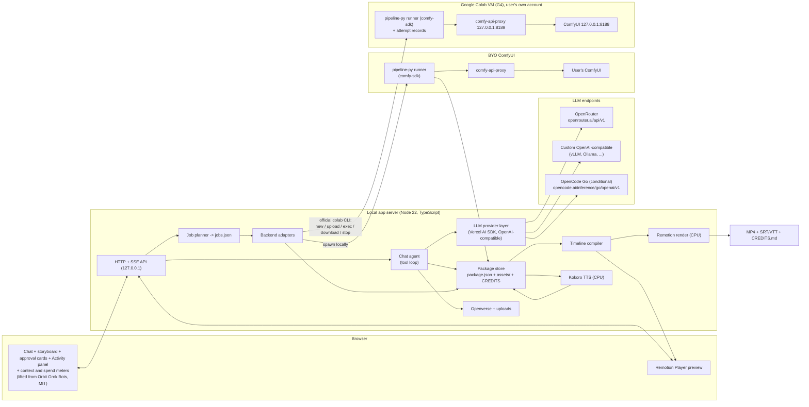

# Comfyrizz: open-source AI motion graphics and presentation videos

*First-draft spec, revision 4 (Oct 17, 2026, America/Toronto). Author: Kyle Durepos. License: MIT. Status: draft for review.*

**Changelog, revision 4** (merges selected points from ChatGPT's review of revision 2, approved by Kyle, and trims the scope for one person):
- **Scope trimmed**: 5 layouts (was 8); Openverse plus user uploads only. Pexels, Wikimedia Commons, 9:16 and the HTML deck move to §12. The SSH live link stays as Kyle's dev tool. A user opt-in ships only if it costs nothing extra.
- **CPU first**: a bundled example opens, edits, previews and exports with no LLM or GPU. The CPU vertical slice is now Day 2 (§3, §10).
- **OpenCode Go preset fixed**: new `inference/go/openai/v1` endpoint, own User-Agent, `x-opencode-session` header. OpenRouter and custom are the baseline, and OpenCode Go is conditional because Go is aimed at coding-agent traffic (§5.4).
- **FLUX 3 Klein**: prompt expansion through the agent LLM, plus the official VRAM figures (§6.4).
- **LTX-2.5**: dimensions must be multiples of 32 and frame counts 8n+1. The plan is 960×544 → ×2 latent upscale → crop to 1920×1080. Audio is muted afterwards, and the assumption that both models stay loaded is dropped (§6.4).
- **Execution truth**: no secrets via `--env` (the CLI writes it into its history). The result manifest decides success, not the exit code. Adds a remote attempt record, `submission_unknown` and `stop_unconfirmed` (§6.4, §6.7).
- **Budget**: a reserve formula is checked before each job. Google Colab spend is labelled an account-level estimate (§6.6).
- **New §6.8 Timeline compiler** with sentence-level captions.
- **Fixes**: positioning (Higgsfield already does infographics and kinetic typography, §1); the BYO proxy auth boundary (§6.5); "G4 requires Pro+" in §6.7.1 (the Oct 16 test showed it doesn't); export rights for Pexels originals and BY-SA (§6.10, §8.5).
- **Still open** (§9): unverified BYO auth claims, and whether a strict open-weights LLM can run on vLLM on the same G4. Model size was measured on Oct 17 (60.0 GB, fits; see `test/GPU_TEST_1.md`).

**Revision 4a (Oct 17, Kyle's direction)**: generated-first assets. An asset-type router prefers LLM-written procedural SVG (icons, diagrams, patterns, animated vector parts; sanitized and render-checked on CPU with resvg, auto-fix loop), then batched FLUX 3 Klein images (illustrations, textures, backgrounds, transparent cutouts where feasible), with Openverse and uploads as the fallback (§5.5, §6.2). §10 now points to the compressed parallel plan in `PLAN.md`. New §6.11: experimental SVG-guided generation (SVG raster as structure guidance for Klein and LTX).

Revision 3 added the Google Colab test results (`test/COLAB_TEST.md`). Revision 2 added Kyle's decisions: the name, MIT, a model-agnostic agent (generic OpenAI-compatible endpoint, OpenRouter, OpenCode Go; no OAuth providers) and the hackathon backends (Google Colab plus "bring your own ComfyUI URL"). Paid providers wait until after the hackathon (§12).

Notation: **[verified]** means checked against a primary source or this box (source given). **[unverified]** means inferred, from a secondary source, or untested.

Deadline: **Oct 30, 2026, 9:00 am PT = 12:00 pm Toronto time (UTC-4)**. Plan to submit on the evening of Oct 29 (Toronto time).

---

## 1. Overview and pitch

**One line:** describe a talk, a launch or a lesson in chat and get a 30 to 90 second motion-graphics video with on-brand type, charts, AI-generated looping backgrounds and narration. It is rendered on a Google Colab GPU that the app starts and stops for you, or on any ComfyUI you already run.

**Positioning.** Higgsfield already sells "AI Motion Design": data-driven infographics, kinetic typography, logo reveals, and editing of text, colours and timing (https://higgsfield.ai/ai-motion-design **[verified Oct 16]**). So we don't claim a new category. Comfyrizz is the **open version of that product**:
- open-weights models (FLUX 3 Image Klein, LTX-2.5, Kokoro) running in **inspectable ComfyUI workflows**;
- **your compute** (your Google Colab units or your own ComfyUI) and **any OpenAI-compatible LLM**;
- a **portable project file** with exact copy, data and a licence receipt for every asset.

The heavy pixels (backgrounds, hero stills, looping plates) come from ComfyUI. Anything that must be exact (text, numbers, charts, timing) is rendered deterministically on CPU with Remotion. Editing a headline or a chart value never needs a GPU. We promise to render *validated, user-approved* content faithfully. We never claim that generated facts are true: a missing statistic stays a visible placeholder.

What makes it more than a workflow export:
1. **A model-agnostic chat agent that builds a "package"**: a storyboard JSON plus licensed or generated assets, with the provenance and licence of every asset recorded.
2. **One pipeline built on the Comfy SDK** that runs the same API-format workflows on your own ComfyUI or on an auto-managed Google Colab VM (spin up, run, collect, tear down, within a unit budget).
3. **A deterministic renderer** (Remotion) that composites the plates with text, charts and transitions and exports MP4.

## 2. Prize targets

Rules recap (https://comfy.org/open-source-higgsfield/ **[verified]**): each entry can win one main prize and one model-provider bonus, and every entry is considered for Best Overall.

| Category | Target? | Why |
|---|---|---|
| **Open Weights Only** (RTX 5090) | **Primary main prize** | All image, video and TTS models are open weights: FLUX 3 Image Klein, LTX-2.5 distilled, Kokoro. No partner nodes. Both backends run our own workflows. The agent LLM is the open question (§8.3). |
| Best Overall ($10k) | Automatic | Depends on UX polish and output quality. |
| Most Innovative | Secondary | ComfyUI as a plate generator inside a deterministic motion-graphics engine, plus a licence-tracking agent and a self-tearing-down Google Colab backend. The demo must explain the innovation (rule). |
| Most Viral | Weak | Productivity tool. (9:16 is deferred to §12.) |
| **Bonus: VFX Workflow Built with LTX** ($2,000 cash) | **Primary bonus** | LTX-2.5 makes the generated moving plates. **[unverified]** whether judges count motion-graphics plates as "VFX". Frame them as VFX (animated backgrounds, parallax hero shots, title reveals) and ask in the Comfy Discord. |
| Bonus: Built with FLUX | Fallback | FLUX 3 Klein makes every still. Only one bonus can be won, and LTX's is worth more. **[unverified]** whether Klein counts as "FLUX 3". |
| Bonus: MiniMax H3 | No | Not in our stack. |

## 3. User flow

The web app has two surfaces for one video. **Easy** is the studio: Idea, Characters, Iteration level, Plan, Generate, Review, Export. **Advanced** is the editor: chat, preview, inspector and timeline. The studio header offers **Open in editor**. The editor top bar offers **Back to studio**. Words used here match the studio and editor vocabulary: Video, Idea, Character, Iteration level, Plan, Shot, Version, Keep, Try again, Generate, Export, This computer, Google Colab, spend cap and AI provider.

1. **First open (no setup)**: a finished **bundled example** (`examples/launch-demo/`) plays in the Remotion Player beside its editable shots. The user can change text, colours and chart values, scrub, and **Export** an MP4 on **This computer** before entering any key. An **AI provider** is configured only when chat is first used, and **Google Colab** only when **Generate** is first requested.
2. **Setup when needed**: pick an **AI provider** (OpenRouter, a custom OpenAI-compatible endpoint, or OpenCode Go) and where the video is made (**This computer**, **Google Colab**, or My ComfyUI). The wizard probes each one: lists what that AI provider can call, makes one tool call and checks the follow-up; runs `colab usage`, or checks the ComfyUI URL. It also checks the Hugging Face token and gated access (§6.7.2). On the studio **Iteration level** step the user chooses Draft, Balanced, Director or Custom, and sets the **spend cap** when the video will use Google Colab.
3. **Idea**: "Make a 45-second launch video for our open-source CLI, dark theme, 3 stats, calm narration." The agent asks at most 3 clarifying questions, and only when the answers change the result. A **Character** (a person, mascot or narrator) is optional.
4. **Plan**: N shots, each using one of the **5 layouts** (§6.3), with copy, preferred length, a visual plan (an image to make, an Openverse search, or an upload) and a narration line. The plan also states what will be made and the most it can cost. The user edits inline or tells the chat what to change. The preview updates immediately with procedural backgrounds.
5. **Assets**: the agent searches **Openverse** and shows candidates with licence chips, or drafts a FLUX prompt. The user can also upload their own files. The user **Keeps** each candidate. Only CC0, PDM and CC BY pass by default (§8.5).
6. **Generate**: FLUX stills at 1024 px, LTX plates at 960×544 (stage 1 only), Kokoro narration on This computer, and a Remotion Player preview. Progress shows in the **Activity panel**.
   - On Google Colab, the user confirms the spend first (the Google Colab runtime, live units per hour, about 5 minutes of setup, and the spend cap; machine details are in §6.7). The VM starts only after that confirmation. Asset picking and composition editing continue while it boots.
   - On This computer the motion graphics are free and use no network.
7. **Review**: "Make shot 3 warmer" makes another **version** of that shot (the saved diff and the hash cache). **Keep** chooses the version that stays in the video. **Try again** makes another version of one shot. Text, colour, chart and layout edits do not start Google Colab or ComfyUI work.
8. **Export**: stage-2 plates (×2 upscale, cropped to 1920×1080), timeline compile (§6.8), then the MP4, plus captions (SRT/VTT), `CREDITS.md` and `package.zip`.
9. **Teardown**: the Google Colab VM stops when the confirmed batch is collected, after N idle minutes, when the spend cap reserve is reached, or on error. The UI shows "VM stopped" only after it is verified (§6.7.2). Otherwise it shows a loud `stop_unconfirmed` banner. "Video ready" does not mean the VM has stopped.

## 4. Architecture



Design rules:
- **Every GPU job is an API-format ComfyUI workflow run by one Python runner (`pipeline-py`, built on `comfy-sdk`)** that talks to Comfy API v2. Locally it runs as a subprocess of the app server. On Google Colab the same runner runs *on the VM*. One runner means no TS/Python twin.
- **Google Colab transport = no tunnel.** The host only uses the official CLI (§6.7). The SSH live link (§6.7.1, option a) is Kyle's development tool.
- **One timeline compiler**: the Player and the export consume the same compiled timeline (§6.8).

## 5. Research findings

### 5.1 Comfy SDK and comfy-api-proxy **[verified, docs.comfy.org]**
- `comfy-sdk` (PyPI, Python ≥ 3.10, sync and async) and `@comfyorg/sdk` (npm, Node ≥ 22) at 0.5.0 are clients for **Comfy API v2** (versioned; changes within v2 are additive). Features: lazy, content-addressed asset uploads; `submit()`/`run()` with an Idempotency-Key; `job.events()` SSE (Progress, Preview, OutputReady, StatusChange) with a polling fallback; outputs to file, bytes or a signed URL; typed errors; cancel. Not supported yet: saved workflows, model library, node introspection, named workflow parameters. https://docs.comfy.org/development/api-development/sdks
- **Works against any ComfyUI**: `COMFY_BASE_URL` can point at a self-hosted ComfyUI through **comfy-api-proxy** (MIT, `pip install comfy-api-proxy`). It proxies `127.0.0.1:8188` and serves v2 on `127.0.0.1:8189`; `--comfyui` and `--port` change these; it is loopback-only by default. https://docs.comfy.org/development/comfyui-server/api-proxy , https://github.com/Comfy-Org/comfy-api-proxy
- **Auth boundary**: the proxy's optional static bearer `--token` protects calls *into the proxy*. It does **not** authenticate the proxy to an upstream ComfyUI (per the proxy CLI source, cited in ChatGPT's review **[unverified by us; check `cli.py` on Day 6]**). So we don't promise upstream basic auth, cookies or path prefixes (§6.5).
- Gotchas: the idempotency key is **reject-on-duplicate**, so a naive retry double-bills, and a key whose `job_id` never came back cannot be recovered from the key alone (§6.4). The SDK's SSE is live-only, so reconcile by polling. Job labels don't work on the proxy. `COMFY_BASE_URL` is read whenever a client is constructed, which is fine because we use one runner process per backend.
- Rule fit: the hackathon requires building on the Comfy Developer Platform (Comfy API, Router and/or SDK). **The Comfy SDK on its own satisfies this** (per the rules summary in the brief).

### 5.2 Existing Google Colab automation on this box (read-only review)
- **Orbit (PR #18 and follow-ups, `integ/live-tree-oct14`)**: `server/colab-orchestrator.mjs` (872 lines), `server/colab-plan.mjs` (432 lines, pure planning and parsing), `server/colab-job-worker.mjs` (50 lines, detached worker), `docs/COLAB_ORCHESTRATOR.md`. It wraps the official `colab` CLI with argv arrays and a fresh child environment. It has SSE log streaming, a restart-safe job registry, `redactSecrets` and a blocklist of local paths.
  - **Lifted into Comfyrizz** (Kyle owns Orbit and **relicenses the lifted pieces as MIT**; NOTICE in the repo): the parsing helpers in `colab-plan.mjs` (`parseUsage`, `parseSessions`, `parseStatus`, `parseLs`, `parseNvidiaSmi`, `catalogFromHelp`, `redactSecrets`, `blockedLocalPath`, argv planning, warning copy) and the detached-worker and job-log pattern.
- **Official `google-colab-cli` 0.7.4** (`~/.local/bin/colab`, **Apache-2.0** [verified, package metadata], https://github.com/googlecolab/google-colab-cli). Linux and macOS only; needs Python ≥ 3.12 on the host. Commands: `new`, `run`, `exec` (`--timeout` is a quiet period, default 30 s; `--env KEY=VALUE`), `upload`, `download`, `ls`, `rm`, `install`, `drivemount`, `auth`, `ssh`, `console`, `status`, `sessions`, `usage`, `stop`, `log`, `url`, `restart-kernel`, `repl`.
  - **Kernel state and background processes persist across `colab exec` calls [verified by the Oct 16 test]**: ComfyUI and comfy-api-proxy started with `Popen(start_new_session=True)` were alive and answering in a separate later exec.
  - **`--env` is not secret-safe [verified, `commands/execution.py`]**: the CLI turns `--env` into Python source (`os.environ[...] = ...`) prepended to the code, and logs that code to its local history (`state.history.log_event(..., {"code": code, ...})`). The values also appear in the host's argv. Never pass a token this way.
  - **The exit status isn't proof [verified, same file]**: the exec loop prints kernel output and doesn't raise on a kernel error, and `runtime.stop()` closes the client without killing the kernel. Our result manifest decides success (§6.4).
  - **`colab usage` is account-wide [verified, `consumption.py`]**: balance, total hourly rate and assignment count. It gives no per-session or per-project spend (§6.6).
  - Auth: `oauth2` by default (refresh token cached at `~/.config/colab-cli/token.json`), or `adc`. **Each user signs in with their own Google account** and uses their own Google Colab plan and units. Comfyrizz never reads the token; it shells out to the user's signed-in CLI.
- **G4 facts [verified, Oct 16 test]**: NVIDIA RTX PRO 6000 Blackwell Server Edition, about 96 GB VRAM, 176 GB RAM, 48 vCPUs, 194 GB free disk, Python 3.13, torch 2.11.0+cu130 preinstalled. **Available on Kyle's plan without Pro+**, observed rate **8.90 units/h**. Kyle has about 386 units, which is roughly 43 G4 hours.
- **colab-mcp** drives a notebook open in the browser, so it isn't needed.

### 5.3 Orbit Grok Bots frontend (read-only review)
- A single file, `apps/grokbots/index.html` (about 105 KB, `grokbots@11`): vanilla JS and inline CSS, no build step, capability key in the URL fragment.
- **Lift (relicensed MIT by Kyle)**: chat layout and CSS, `md()` and `esc()` (keep Markdown sanitised), the composer with its draft queue, **approval/inline cards** (`cardEl`, confirm-twice for "always"), the **Activity panel** (status chips, filter, jump to first failure), the **context meter** (`showMeter`), collapsible tool cards, `redactFull`, and the upload limits and store pattern.
- **Leave behind**: multi-provider roster, group rooms, Orbit bridge, Pi and Hermes controls, conversation library.

### 5.4 LLM providers (hackathon scope: three, chat-completions only)
| Provider | Base URL | Auth | Notes |
|---|---|---|---|
| **OpenRouter** (baseline) | `https://openrouter.ai/api/v1` | Bearer key | OpenAI-compatible chat completions with `tools`; optional `HTTP-Referer` and `X-Title` headers. **[not re-checked this session]** |
| **Custom OpenAI-compatible** (baseline) | user-supplied | optional Bearer key | Self-hosted vLLM, Ollama, LM Studio, llama.cpp server, etc. Allow a manual model ID when `/models` is missing. The clean option for Open Weights Only. |
| **OpenCode Go** (conditional; Kyle's dev setup) | `https://opencode.ai/inference/go/openai/v1` (chat completions); models list at `https://opencode.ai/inference/go/v1/models` **[verified, https://opencode.ai/v2/docs/console/go/, Oct 16]** | Bearer key from the OpenCode console | Go $10/month, Go Plus $40/month. DeepSeek V4.1 Flash is `deepseek-v4.1-flash` (chat completions, `@ai-sdk/openai-compatible`). Other models use `/anthropic/v1/messages` or `/openai/v1/responses`, so the picker filters to chat-completions models. **Client rules**: send our own User-Agent (`comfyrizz/<version>`), never a generic SDK name and never another client's identity, and send a stable `x-opencode-session` header per conversation. **Fit**: Go "is designed for OpenCode and other coding agents that produce similar types of requests" and asks for "typical coding agent traffic". A creative app may not fit, so it is a conditional preset, not the README default. The old `opencode.ai/zen/go/v1` base (still in Pi's config on this box) is not used. |

Comfyrizz keeps its own provider config and does **not** read Pi's or Hermes' key files. *Post-hackathon (one line): native presets for other providers and OAuth sign-in where a provider allows it for third-party apps (not researched).*

### 5.5 Asset sources (hackathon: generated first, then Openverse + user uploads)
Order of preference (Kyle, Oct 17): **(1) LLM-written procedural SVG/vector** (free, licence-clean, CPU-checked), **(2) FLUX 3 Klein images** batched per package, **(3) LTX-2.5 plates** for motion, **(4) Openverse or uploads** as the fallback below.

| Source | Licences | API / auth | Key terms |
|---|---|---|---|
| **Openverse** (https://api.openverse.org/v1/) | CC licences and PD; `license` and `license_type=commercial,modification` filters | Anonymous (low limit) or OAuth2 client credentials; 429 when over the limit | Results carry `license`, `creator`, `attribution`, `foreign_landing_url`. Openverse does not guarantee licences, so keep the source-page evidence. https://docs.openverse.org/api/reference/authentication_and_throttling.html |
| **User uploads** | User asserts rights (and whether they may be shared in `package.zip`) | Local | Probed in a bounded subprocess. SVG is rasterised; no active HTML. |

Deferred to §12: Wikimedia Commons, Pexels (the custom licence bans standalone redistribution, which affects `package.zip`), and Unsplash (its hotlinking requirement conflicts with a rendered MP4).

## 6. Components

### 6.1 Frontend (`apps/web`)
- Vanilla TS + Vite, styled from Grok Bots, with a React island only for the Remotion Player. Keep **one** state store on the vanilla side; the island only receives the compiled timeline and playhead. Panes: **chat**, **storyboard + asset board**, **Activity**. The top bar holds the LLM picker, the backend picker, the open-weights badge, the **context meter** and the **spend meter** (estimated Google Colab units against the budget).
- Cards: asset approval (thumbnail, source, licence chip, attribution; Approve / Swap / Generate instead), spend approval ("Start G4 on Google Colab, about 8.90 units/h, setup about 5 min, budget 15 units: Start / Cancel"), teardown result (stopped / `stop_unconfirmed`), render done.
- Literal controls beside the chat: headline and copy, chart values, palette, layout variant, voice on/off, asset lock. A locked asset or scene is never changed by the agent.
- Local server API (bound to 127.0.0.1, random token in the URL fragment, strict Host/Origin checks, like Grok Bots): `POST /api/chat` (SSE: tokens, tool calls, cards), `POST /api/card`, `GET`/`PATCH /api/package/:id` (with base revision; stale edits get a conflict, not a silent overwrite), `POST /api/render`, `GET /api/events` (SSE with replay from the last event ID), `GET`/`POST /api/settings`. Keys are stored server-side in `~/.config/comfyrizz/` with mode 0600 and never sent back to the browser.

### 6.2 Chat agent and LLM provider layer
- **Library: Vercel AI SDK** (`ai` + `@ai-sdk/openai-compatible`; Apache-2.0 **[unverified this session]**). It gives streaming, a multi-step tool loop, zod tool schemas and abort. One code path covers all three providers, because all three use chat completions. (`@earendil-works/pi-ai` 1.2.0, MIT, stays a fallback only if non-chat-completions models are needed; see §9.)
- Provider preset shape (`~/.config/comfyrizz/providers.json`, 0600):
  ```jsonc
  { "providers": {
      "openrouter":  { "baseUrl": "https://openrouter.ai/api/v1", "apiKeyEnv": "OPENROUTER_API_KEY", "headers": { "X-Title": "Comfyrizz" } },
      "custom":      { "baseUrl": "http://127.0.0.1:8000/v1", "apiKey": null, "model": "…" },
      "opencode-go": { "baseUrl": "https://opencode.ai/inference/go/openai/v1",
                       "modelsUrl": "https://opencode.ai/inference/go/v1/models",
                       "apiKeyEnv": "OPENCODE_API_KEY", "defaultModel": "deepseek-v4.1-flash",
                       "headers": { "User-Agent": "comfyrizz/0.1" }, "sessionHeader": "x-opencode-session",
                       "status": "conditional" } },
    "active": { "provider": "openrouter", "model": "…" } }
  ```
  The adapter sets `x-opencode-session` to the conversation ID on every request to that provider.
- Interface (thin wrapper so the agent never sees provider details):
  ```ts
  interface ChatModel {
    id: string; contextWindow?: number;
    stream(req: { system: string; messages: Msg[]; tools: ToolDef[]; signal: AbortSignal; sessionId: string }):
      AsyncIterable<{ type: "text"; delta: string } | { type: "tool_call"; id: string; name: string; args: unknown }
                  | { type: "usage"; input: number; output: number } | { type: "error"; code: string } | { type: "done" }>;
  }
  ```
  Capability probe at setup: list models (or accept a manual ID), run a 1-tool test call, then check the model's follow-up after the tool result. Refuse models that can't call tools. A missing usage report shows as "usage unavailable", not zero.
- Robustness for open models: validate every tool call's arguments with zod, return validation errors to the model (max 2 repairs), cap agent steps, never execute partial streamed arguments, honour `Retry-After`, and keep package-write tools idempotent (JSON patch + base revision + operation ID). If chat fails, manual editing still works.
- Tools:
  | Tool | Effect | Approval card? |
  |---|---|---|
  | `storyboard.propose(brief)` / `storyboard.edit(scene_id, patch)` | Create or patch scenes (unprovided numbers become labelled placeholders) | No |
  | `assets.route(scene_id, need)` | Asset-type router: picks `generate_svg` (default for icons, diagrams, simple charts, patterns, animated vector parts), `generate_image` (FLUX: illustrative or photo-like art, textures, backgrounds), `search_openverse` or `upload` (fallbacks) | No |
  | `assets.generate_svg(scene_id, kind, intent, palette)` | LLM writes SVG / keyframed vector JSON; sanitize → resvg render-check on CPU → auto-fix (max 2 repairs); recorded `origin: generated`, `generator: llm-svg`, CC0 output | No (free, no GPU) |
  | `assets.search(query, orientation, license_policy)` | Openverse candidates (fallback) with licence metadata | No |
  | `assets.attach(scene_id, candidate_id)` | Download, then record provenance, hash and licence | **Yes** |
  | `assets.generate(scene_id, kind, intent, seed, refs[], cutout?)` (a.k.a. `generate_image`) | Plan a FLUX or LTX job, including the expanded caption for FLUX (§6.4); jobs are batched per package (all stills first); optional transparent-PNG cutout **[unverified node]**; doesn't run it | No |
  | `assets.upload_ref(file)` | User's file; user asserts rights and shareability | **Yes** |
  | `voice.draft(scene_id, text, voice)` | Kokoro line | No |
  | `pipeline.estimate(mode)` | Jobs, GPU-minutes, units, reserve check | No |
  | `pipeline.run(mode, scenes?)` | Submit through the backend | **Yes** on Google Colab (spend) |
  | `render.preview()` / `render.final()` | Timeline compile + Remotion | No |
  | `compliance.check()` | Licences, attributions, open-weights status, SFW lint | No |
- The agent can't approve its own spending, run a shell, install nodes or write JSX/workflow code. Stock metadata, uploaded documents and model output are untrusted data, never instructions.
- SFW and likeness: the user confirms on asset cards; output review on stills. A candidate classifier is `Falconsai/nsfw_image_detection` (the FLUX reference CLI loads it) **[licence unverified]**. A blanket brand denylist would block legitimate launch videos, so instead warn on real-person names and require owned branding.

### 6.3 Package format (`package.json`, schema `comfyrizz.package/v1`)
**5 layouts**: `title` (variants: centered, outro), `hero` (full-bleed or split image/plate + text), `stat`, `chart` (bar, zero baseline), `list` (variants: bullets, quote).
```jsonc
{
  "$schema": "https://github.com/<owner>/comfyrizz/schema/package-v1.json", // placeholder
  "schemaVersion": 1, "revision": 7,
  "id": "pkg_01J…",
  "title": "Orbit CLI launch",
  "format": { "width": 1920, "height": 1080, "fps": 30 },
  "duration": { "mode": "target", "targetFrames": 1350 },          // target | flexible (§6.8)
  "theme": { "palette": ["#0d0f14", "#6d8cff", "#e6e8ee"], "font": "Inter", "logo_asset": "a_logo" },
  "voice": { "enabled": true, "engine": "kokoro", "voice": "af_heart", "speed": 1.0 },
  "datasets": { "d_stars": { "unit": "stars", "values": [{ "label": "2025", "value": 1200 }], "source": "user", "approved": true } },
  "scenes": [{
    "id": "s1", "layout": "title", "variant": "centered", "preferredFrames": 120,
    "copy": { "headline": "Meet Orbit", "sub": "An agent-shaped desktop" },
    "data": null,                                              // chart/stat: { "dataset": "d_stars" }
    "background": { "asset": "a_plate1", "fit": "cover", "loop": true },
    "foreground": [{ "asset": "a_hero", "x": 0.6, "y": 0.5, "w": 0.35, "anim": "parallax-in" }],
    "transitionOut": { "type": "fade", "frames": 15 },
    "narration": "Meet Orbit, an agent-shaped desktop.",
    "locked": false
  }],
  "assets": {
    "a_plate1": {
      "kind": "video", "origin": "generated", "status": "ready", "file": "assets/a_plate1.mp4", "sha256": "…",
      "media": { "width": 1920, "height": 1080, "fps": 24, "frames": 97, "audio": "muted" },
      "gen": { "workflow": "workflows/ltx25_i2v.api.json", "workflow_sha256": "…", "model": "ltx-2.5-22b-distilled",
               "inputs": { "image": "a_plate1_still", "prompt": "slow drift through soft blue nebula",
                           "width": 960, "height": 544, "frames": 97, "fps": 24, "upscale": "x2+crop", "seed": 42 },
               "backend": "colab:G4", "attempt_id": "…", "job_id": "…", "idempotency_key": "…" },
      "model_license": { "id": "LTX-2.x-Community", "commercial_ok_if": "revenue<10M" },
      "redistributable": true
    },
    "a_hero": {
      "kind": "image", "origin": "stock", "status": "ready", "file": "assets/a_hero.jpg", "sha256": "…",
      "source": { "provider": "openverse", "id": "…", "landing_url": "https://…", "creator": "Jane Doe" },
      "license": { "id": "CC-BY-4.0", "url": "https://creativecommons.org/licenses/by/4.0/",
                   "attribution": "“Title” by Jane Doe, CC BY 4.0", "approved_by_user": true, "approved_at": "2026-10-20T14:03:00-04:00" },
      "redistributable": true
    }
  },
  "compliance": { "open_weights_only": true, "llm": { "provider": "openrouter", "model": "…", "weights": "open" },
                  "backends_used": ["colab:G4"], "closed_apis_used": [], "warnings": [] },
  "renders": [{ "mode": "final", "file": "out/final.mp4", "revision": 7, "timeline_sha256": "…", "at": "…" }]
}
```
The schema lives in `packages/schema/package-v1.schema.json`. TS types are generated from it, `pipeline-py` validates with `jsonschema`, and zod only checks tool arguments. Semantic validation: unique IDs and resolvable references, finite bounded numbers, no absolute paths or traversal, copy that fits each layout's minimum readable size (a fail state, never silent clipping), and example data that can't silently become factual copy. The model licence (`model_license`) and the output's rights (`license`, `redistributable`) are separate fields. Asset `kind` also allows `svg` and `vector-anim` (keyframed vector parts); `gen.generator` is one of `llm-svg`, `flux3-klein`, `ltx25`, `kokoro`, and SVG assets record `sanitizer_version` and the render-check result. Generated outputs default to `CC0-1.0`, `redistributable: true`.

### 6.4 Comfy SDK pipeline and workflows
- `packages/planner` (TS) turns the package into `jobs.json` (ordered, hashed, with dependencies). `pipeline-py` (Python, `comfy-sdk`) executes `jobs.json` against `COMFY_BASE_URL`, streams progress as JSON lines (`{"v":1,"attempt":"…","job":"s1.plate","seq":12,"event":"progress","value":0.42}`), and writes `out/manifest.json`. The **same runner** is used locally and on Google Colab.
- Job graph per scene: `still` (FLUX 3 Klein text-to-image, or edit with refs) → `plate` (LTX-2.5 distilled image-to-video, stage 1) → `upscale` (LTX ×2 latent spatial upscaler, finals only). Plates are only made where they help (opening, hero, a reusable background). Other scenes use stills with Ken Burns.
- **FLUX 3 Image Klein [verified, model card]**: 5.6B transformer plus a Qwen3-VL-4B-Instruct text encoder (Apache-2.0). The distilled checkpoint runs 16 steps with no guidance. Up to 10 reference images; bounding boxes go in the prompt. The card says "Do not use the model without a prompt upsampler": Klein needs **full scene captions**.
  - **Prompt expansion via the agent LLM**: `assets.generate` turns the approved intent, visual direction and text-safe regions into one full caption, using an expansion system prompt modelled on BFL's `system_prompts.json` (t2i / i2i). We **don't** load BFL's upsampler `flux-3-image-klein-pup` (an 18.8 GB download that adds about 28 GB of VRAM). Store intent, caption, expansion model and template version. Retries reuse the stored caption and never re-expand it. In strict open-weights mode the expansion LLM follows the same rule as the agent.
  - **VRAM [verified, model card]**: peak with the reference code on a B200 at 1024², without the upsampler: **31 GB BF16, 26 GB FP8, 25 GB NVFP4**. These figures come from the reference code, not ComfyUI, so treat 24 GB cards as unproven.
- **LTX-2.5 distilled [verified, model card]**: a split, Comfy-aligned pack: 22B distilled transformer (bf16, Comfy int8, or NVFP4 for Blackwell), **Gemma 4 12B** text encoder, video VAE, **audio VAE**, ×2 spatial upscaler. Fixed 8-step schedule, CFG 1. **Width and height divisible by 32; `frames % 8 == 1`** (for example 97 frames ≈ 4.0 s or 121 ≈ 5.0 s at 24 fps).
  - **Draft**: stage 1 at **1024×576** (the planner's default; a plate's dims are resolved on the 64 lattice, so the half-size stage 1 stays on the 32 lattice — GPU test 3, N9: a planned 960×544 came back 960×512). **Final**: stage 1 → ×2 latent upscale → **2048×1152 → crop 36 px top and bottom → 1920×1080**. The crop is recorded in asset metadata. "720p" (not a multiple of 32) is no longer used, and a still that is a plate's first frame is planned on the plate's lattice so the pair cannot disagree.
  - Requested lengths are resolved to a valid 8n+1 count before submission. The plate is then trimmed or looped to the compiled timeline (§6.8).
  - LTX-2.5 generates audio jointly. Keep the tested graph, including the audio VAE, and **strip or mute the audio afterwards** with ffmpeg. Keep the original and record the muted derivative. Don't remove audio nodes unless that path has been tested.
- **Model downloads [verified, Oct 17 GPU test 1]**: the minimum set is **60.0 GB**. FLUX 3 Klein BF16 from `black-forest-labs/flux-3-image-klein` is 20.3 GB (transformer 11.1, Qwen3-VL-4B TE 8.9 as 2 shards merged into one file, VAE 0.34). LTX-2.5 Comfy int8 from `Lightricks/LTX-2.5` is 39.7 GB (22B distilled 21.5, Gemma 4 12B TE 15.4, video VAE 1.5, audio VAE 0.36, ×2 upscaler 1.0). Download speed was about 360–390 MB/s per repo (163 s one after the other). The int8 Klein files in `flux-3-image-klein-comfy` would save about 9 GB, but that repo needs its own licence acceptance (403 today). Pin exact files, hashes and revisions in `colab/models.lock.json`. Two-stage LTX output sizes must be multiples of 64 (960×544 comes out as 960×512); use 1024×576.
- Workflows (UI `.json` + API `.api.json` + `params.json` mapping names to node IDs). Start from the official ComfyUI LTX-2.5 templates and pick one tested combination:
  1. `flux3_klein_t2i`
  2. `flux3_klein_edit` (references + boxes)
  3. `ltx25_i2v` (stage 1, 960×544)
  4. `ltx25_upscale` (×2 + crop, finals)
  5. stretch: `ltx25_i2v_loop` (first and last frame conditioning). A matching last frame doesn't guarantee a seamless loop, so review three cycles. The fallback is a short crossfade join with its effective loop length stored.
  - **[unverified]** the exact ComfyUI node names (core versus the ComfyUI-LTXVideo pack). Day 3 spike.
- **GPU residency**: run **one job at a time**, batch stills before plates, and let ComfyUI manage model loading (the G4 has 176 GB RAM for offload). Keeping both models resident is an option only after Day 3 measures peak VRAM on the chosen quantizations.
- **Attempts and recovery** (a JSON attempt record, not a database):
  - Before each SDK submit, the runner atomically writes `attempts/<attempt_id>.json` with `{attempt_id, job, input hashes, idempotency_key, state:"submitting"}`, then adds `job_id` the moment the API returns it, *before* printing progress. On Google Colab this record lives on the VM (`/content/comfyrizz/attempts/`), and the host keeps a copy in `runs/<run_id>/attempts.jsonl`.
  - States: `submitting`, `submitted` (has `job_id`), **`submission_unknown`** (the request may have reached the server but no `job_id` was recorded), `succeeded`, `failed`, `canceled`.
  - A recorded `job_id` means poll it; never resubmit. **`submission_unknown` is never resubmitted automatically**: the UI shows it and the user decides whether to retry (which may spend twice).
  - Each phase writes an atomic result (tmp file + rename): `out/manifest.json` with attempt IDs, status per job, output hashes and normalised errors. **Only a present, matching manifest counts as success.** Exit codes and log lines are supporting evidence. A missing or mismatched manifest after a lost exec means *reconcile* (read the attempt records, poll the known `job_id`s), not rerun.
  - Collect outputs after each small batch. A later failure never discards earlier outputs. A late result from an older revision is kept as a candidate but never replaces approved content.
  - Cache by `(workflow_sha, resolved inputs, model file hashes, seed, dims, frames)`. Text, colour, layout and chart edits invalidate only the composition.

### 6.5 Backend adapter interface (hackathon: two backends)
```ts
interface Backend {
  id: "byo-comfyui" | "colab";
  describe(): Promise<{ label: string; costVisibility: "colab-account-estimate" | "external-unknown" }>;
  estimate(jobs: Job[]): Promise<{ gpuMinutes: number; overheadMinutes: number; units?: number }>;
  ensureUp(opts: { budget?: Budget; signal: AbortSignal }): Promise<RuntimeHandle>;   // no-op handle for byo
  health(): Promise<{ ok: boolean; detail: string; vramFreeGB?: number }>;
  run(jobsFile: string, onEvent: (e: PipelineEvent) => void, signal: AbortSignal): Promise<OutputManifest>;
  reconcile(runId: string): Promise<AttemptRecord[]>;                                  // after a lost exec or restart
  collect(manifest: OutputManifest, destDir: string): Promise<void>;
  teardown(reason: "done" | "idle" | "budget" | "error" | "user"):
    Promise<{ state: "stopped" | "stop_unconfirmed" | "not_owned"; evidence: string }>;
}
```
- **byo-comfyui**: BYO isn't labelled "free"; its cost is the user's own and not visible to us. Two connection modes, both behind the same runner:
  1. **ComfyUI URL (default)**: the user gives a ComfyUI URL that the host can reach without auth (localhost, LAN, or a forwarded port such as Kyle's live link). We start `comfy-api-proxy --comfyui <url> --port <free>` locally and spawn `pipeline-py` with `COMFY_BASE_URL=http://127.0.0.1:<port>`. **[unverified]** that the proxy works against a non-loopback upstream. Test on Day 6.
  2. **v2 endpoint**: if their ComfyUI is behind auth or on a remote box, the user runs `comfy-api-proxy --token …` next to it, and Comfyrizz connects to that v2 endpoint with the bearer. **[unverified]** how the SDK passes a bearer to a self-hosted proxy.
  - We don't promise upstream basic auth, cookies, path prefixes or remote model installation.
  - Health check: proxy reachable, required node types present (ComfyUI `/object_info`), required model files present (warn if missing), then a small smoke job. A 256 px smoke job proves wiring, not that the real video workload fits.
  - Cancel only our own job, never a global interrupt.
  - We ship `scripts/setup-local-comfy.sh` (ComfyUI + pinned nodes + `hf download`). This backend also covers the README's "run locally" requirement.
- **colab**: §6.7.

### 6.6 Cost and safety guardrails
- A spend approval card before `ensureUp()` on Google Colab, a project **unit budget**, and no hidden auto-start. The approval covers a plan hash, the hardware (G4) and the budget. Copy or layout edits don't revoke it, but added GPU work or a bigger budget needs a new card.
- **Spend is an account-level estimate.** `colab usage` reports the whole account (balance, total rate, assignments), so the meter shows "≈ N units (estimate)", based on balance delta + elapsed × rate. It is labelled "estimate, other sessions running" when the assignment count is above our own.
- **Reserve formula** (checked before admitting each job):
  `spent_estimate + committed_estimate + next_job_upper_estimate + collect_and_stop_reserve ≤ project_budget`
  Warn at 80%. Stop admitting jobs when the next one wouldn't fit, then collect and stop. A wall-clock cap applies even if metering is stale.
- The detached watchdog survives UI or server closure, but not host sleep, host shutdown or lost network. This is an *application-enforced* budget target, not a billing cap. Killing ComfyUI doesn't stop billing; only a verified `colab stop` does.
- Never log keys. Reuse Orbit's `redactSecrets` and add the LLM and HF keys. The settings API never returns stored keys.

### 6.7 Google Colab lifecycle and transport

#### 6.7.1 Tunnel evaluation (Kyle's question: can we avoid the "remote proxies" restriction by running the tunnel on our end?)

What the rules say (Google Colab FAQ, https://research.google.com/colaboratory/faq.html **[verified Oct 16, 2026]**): on *all* managed runtimes it disallows "file hosting, media serving, or other web service offerings not related to interactive compute with Colab" and "connecting to remote proxies". Separately, "remote control such as SSH shells" and "bypassing the notebook UI to interact primarily via a web UI" are disallowed only on runtimes running free of charge without a positive compute-unit balance. **A paid plan with a positive balance (Kyle's) lifts those two. G4 was available on Kyle's plan without Pro+ (Oct 16 test), so G4 use doesn't depend on Pro+.**

What the official CLI offers (checked with `--help` for every command, the installed 0.7.4 source and `docs/06_ssh_access.md`):
- **There is no port-forward command** **[verified]**.
- **`colab ssh`** opens SSH to the runtime **over Google's own runtime proxy** (ed25519 or ECDSA key; RSA is rejected) **[verified, source + docs]**. `colab ssh --proxy-mode -s NAME` is an **OpenSSH `ProxyCommand`** bridge documented "for IDE remote-dev". **Only one SSH connection per runtime** (HTTP 429 for a second). It needed no flag on `colab new`.
- **[verified by the Oct 16 test]**: `ssh -N -L 8189:127.0.0.1:8188` through that ProxyCommand came up in about 2 s. `/system_stats`, `/object_info` (1.96 MB in 0.56 s) and `/view` (1.1 MB in 0.20 s) worked from the box, and **`comfy-sdk` on the box ran a job through a forward of the VM's comfy-api-proxy** (2.8 s).

| Option | How | ToS reading | Verdict |
|---|---|---|---|
| **(a) Forward through Google's channel** | `colab ssh --proxy-mode` as ProxyCommand + `ssh -N -L`; the host-side runner talks v2 to the forwarded port | **Likely OK**: initiated from our end into Google's runtime proxy, no third-party relay, SSH allowed on paid runtimes with a positive balance. Residual risk: using ComfyUI's web UI over it **[interpretation]** | **Kyle's dev tool** (he has no local GPU): BYO backend → forwarded port. A user opt-in ("uses Google Colab's SSH, paid plans"), off by default, ships **only if it costs nothing beyond the dev code**. It is not a must-have. Needs a dedicated app key (`~/.config/comfyrizz/colab_ed25519`) and system `ssh`, and it can't coexist with the user's own `colab ssh`. |
| (b) Reverse tunnel from the VM | cloudflared, zrok, ngrok or `ssh -R` dialling out | **Banned**: that is "connecting to remote proxies", and a public URL looks like a "web service offering". Hosting the tunnel "on our end" still needs the VM to dial out | **Rejected** (not even opt-in) |
| **(c) No tunnel** | `pipeline-py` runs on the VM against loopback; the host uses `colab upload`, `exec`, `download`, `stop` only | **Cleanest**: interactive compute through the official CLI | **Default and only user-facing must-have** |

#### 6.7.2 Lifecycle (transport c)
Every step shells out to `colab` with argv arrays (no shell), with redaction applied to all output:
1. **Preflight (no allocation)**: `colab version`; `colab usage` → balance and rate (Orbit's `parseUsage`); `colab sessions` → reuse a live `comfyrizz-*` session we own. Check the HF token and **gated access** to both repos: FLUX 3 Image Klein and LTX-2.5 are `gated: auto` and need licence acceptance on the user's HF account plus a read token **[verified, Oct 16]**. Refuse early with fix-it steps.
2. **Spend approval card** with the live rate (8.90 units/h observed on G4), about 4.5 min setup (≈ 0.65 units), draft estimate, budget and reserve.
3. **Spin up**: persist intent, arm the watchdog, then `colab new -s comfyrizz-<pkgid> --gpu G4` (READY in 4 s on Oct 16). Configurable fallback G4 → H100 → A100, each with a VRAM check and its own quantization profile. A fallback with a higher rate needs a new approval.
4. **Bootstrap**: `colab upload` `colab/bootstrap.py` + lockfiles → `colab exec -s … -f bootstrap.py --timeout 900`.
   - **HF token**: uploaded as a 0600 file into a 0700 directory via `colab upload`. **Never `--env`**, because the CLI writes it into its local history as code and it shows in argv (§5.2). It is never in script source; the download step reads it, deletes the file, and never passes it to ComfyUI or custom nodes.
   - The script clones pinned ComfyUI and nodes, runs `hf download` of the pinned files with hf-xet + `HF_XET_HIGH_PERFORMANCE=1` (printing progress so the quiet-period timeout doesn't fire), and starts ComfyUI on 127.0.0.1:8188 and comfy-api-proxy on 127.0.0.1:8189 with `Popen(start_new_session=True)`. It writes `out/ready.json` (versions, node types, models, free VRAM).
   - **Measured Oct 16 [verified]**: create 4 s, clone + requirements 28.5 s (torch preinstalled), ComfyUI ready in 16 s, downloads at **519 MB/s**. **Measured Oct 17 with real models [verified]**: 60 GB downloaded in 163 s, TE merge 26 s, first Klein image 7.9 s, first LTX clip 22.7 s. **Cold start ≈ 4.4 min ≈ 0.65 units.** Warm: about 2.5 s per 1024² image and about 11–12 s per 4–5 s 960×512 clip. Both models stay resident (about 57 GB, peak 54.8 GB), so there is no swapping.
5. **Health**: `colab exec -f health.py` → `out/health.json`: proxy reachable, node types and models present, a small FLUX smoke job, `nvidia-smi` free VRAM.
6. **Run**: `colab upload` of `jobs.zip` (package, `jobs.json`, workflows, inputs) → `colab exec -f run_jobs.py --timeout 3600`, in small batches. JSON-lines progress is parsed from stdout into the Activity panel. Only one exec runs per session at a time.
7. **Collect**: zip `/content/out` → `colab download` → verify sha256 against the manifest → atomically merge into the package. If the exec was lost: `colab download` the attempt records and manifest, then reconcile (§6.4).
8. **Teardown**: `colab stop -s comfyrizz-<pkgid>`, then verify that `colab sessions` no longer lists it (and that `colab usage` shows no assignment of ours). Verified → `stopped`. Otherwise retry with backoff and show **`stop_unconfirmed`** ("VM may still be running, units draining") with a manual stop button.

Guardrails:
- **Default: stop after the approved batch is collected.** An optional warm window (10 min default) is visible and charged against the same budget. Chatting or a CPU export doesn't keep the GPU alive.
- **Unit budget**: reserve formula (§6.6), re-read `colab usage` every 5 min. **Wall-clock cap**: 3 h default.
- **Orphan reaper**: on app start, reconcile known runtime handles. Unknown `comfyrizz-*` sessions are *offered* for stopping, never auto-deleted (a name prefix isn't proof of ownership).
- **Detached watchdog** (Orbit's worker pattern) so timers keep running if the UI or server closes.
- No anti-abuse workarounds (no keep-alive tricks, no multiple accounts). `drivemount` caching needs interactive consent, so it happens only when the user starts it.

### 6.8 Timeline compiler and captions (`packages/planner/timeline`)
- **Integer frames at 30 fps.** Audio keeps its exact sample rate and sample count. Conversion to frames rounds up, with fixed end padding.
- Scene length = max(`preferredFrames`, narration frames + padding), within layout limits. **Transitions overlap**: total = sum of scene frames − sum of overlaps (six 150-frame scenes with five 15-frame fades = 825 frames, not 900). This is a unit test. A transition must fit both neighbouring scenes.
- Duration modes: `target` (try to hit `targetFrames`, show the result, and require the user to accept any deviation before final export) and `flexible` (grow to fit speech, up to 2700 frames = 90 s including credits). Speech is never sped up beyond the voice setting, clipped or silently cut. If it doesn't fit, the compiler proposes shorter copy.
- While narration is still being generated, the preview uses a *provisional* timeline from preferred lengths (marked provisional, not exportable). After narration exists, the **compiled timeline** (`timeline.json`, hashed) is the single input for both the Player and the export.
- Source plates keep their own fps and frame count (LTX at 24 fps). The compiler records trim, loop period (or crossfade join) and retime to 30 fps explicitly.
- **Captions are sentence-level.** Kokoro synthesises one sentence (or short utterance) at a time. Each chunk's measured duration plus fixed gaps gives the cue times. No fabricated word timestamps; word highlighting is §12. On-screen captions and the SRT/VTT export come from the same cues and the current narration text. Narration and captions toggle independently.
- Plate audio is muted when narration is on. Optional music must be CC0 or generated and is ducked under speech. Mix target: −16 LUFS integrated, −1 dBTP (a product choice) via ffmpeg `loudnorm`.

### 6.9 Remotion render
- `apps/renderer`: compositions for the 5 layouts (`Title`, `Hero`, `Stat`, `Chart` with SVG + d3-scale, `List`), driven by `timeline.json` + `package.json`. Video loops use the component the pinned Remotion version supports for looping (check whether that is `<OffthreadVideo>` or `@remotion/media` `<Video>` on Day 1). Ken Burns on stills; `@remotion/transitions`.
- Deterministic frames: each frame depends only on the timeline, local assets and the frame number. No CSS time-based animation, no network or LLM calls during render. Await fonts before measuring, and use local pinned fonts. One design system: a type scale, safe areas and a small animation vocabulary (reveal, stagger, emphasis, exit).
- Kokoro TTS (82M, Apache-2.0 weights **[unverified]**) on CPU via `kokoro-onnx`; pin the wrapper, voices and phonemizer, and keep their notices. A small pronunciation map covers product names and acronyms.
- CPU render via `npx remotion render`, 1080p30, H.264/AAC, then validate with ffprobe (frame count, duration, dimensions, audio present or absent). Benchmark on Kyle's machine; we no longer quote a realtime factor.
- **Licence**: Remotion is source-available, not OSI. Its Free License covers individuals and organisations with up to 3 people; bigger companies need a Company License (https://www.remotion.dev/license **[verified, summary]**). An MIT repo may depend on it, and the README states the Remotion terms. Fallback: Motion Canvas (MIT), but it isn't drop-in, so decide by Day 2 at the latest.

### 6.10 Export and rights
- **Finished video**: MP4 (16:9, 1920×1080), SRT/VTT, a credits end card when CC BY assets are used, and `CREDITS.md` + `credits.json`.
- **`package.zip`** (reproducibility): project, compiled timeline, workflows, model file references and hashes, and **only assets marked `redistributable`**: CC0, PDM, CC BY with attribution, our generated outputs, and uploads the user marked shareable. Any other asset is listed by source URL and hash with a "fetch it yourself" note, and the zip is then labelled incomplete. No keys, signed URLs or model weights. Reproducibility means replaying the approved edit from frozen assets, not identical diffusion pixels.
- Pexels originals can never enter `package.zip` (the licence bans standalone redistribution), so Pexels waits for §12. CC BY-SA is filtered out in v0.1 until its share-alike obligations are implemented.

### 6.11 Experimental: SVG-guided generation (Kyle, Oct 17)
Idea: the agent writes SVG (or another procedural vector source) for a scene's composition; it is rasterised on CPU and passed to the image/video models as **structure guidance**, with role-specific prompt templates, to get precise composition with high-quality pixels. Candidate methods, each tested before it is used: (1) img2img from the rasterised SVG with a denoise-strength sweep; (2) FLUX 3 Klein reference/edit conditioning with the raster as a reference image (Klein supports up to 10 references and boxes in the prompt **[verified, model card]**; the ComfyUI node path **[unverified]**); (3) ControlNet-style canny/depth/lineart maps from the SVG **only if compatible weights for Klein exist** **[unverified; none assumed]**; (4) LTX-2.5 image-to-video with the SVG-guided still as first frame. A versioned prompt-template library (style, lighting, material per layout role) feeds the §6.4 caption expansion, and an evaluation rubric scores **layout fidelity** (edge-map IoU, mask IoU, palette ΔE) against **quality** (CLIP score, human rating). CPU prep (rasters, control maps, workflow JSON, templates, metrics) needs no GPU; the GPU sweep waits for Kyle's HF token and spend approval. It is experimental and the first thing cut if time runs short (`PLAN.md`, Workstream E).

## 7. Repo layout
```
comfyrizz/
  LICENSE                       # MIT (whole repo)
  NOTICE                        # "Portions derived from Orbit (mojomast/orbitdesktop), relicensed MIT by the owner, Kyle Durepos"; third-party notices
  README.md                     # quickstart: bundled example, BYO ComfyUI + Google Colab, LLM setup, licences, known limits
  .env.example                  # OPENROUTER_API_KEY, OPENCODE_API_KEY, CUSTOM_LLM_*, HF token file path, ...
  apps/
    web/                        # chat + storyboard + activity (vanilla TS + Vite; React island for Remotion Player)
    server/                     # Node 22 local server: API, agent loop, settings, package store, backends
    renderer/                   # Remotion project (5 layouts)
  packages/
    schema/                     # package-v1.schema.json + generated types
    llm/                        # provider presets + ChatModel wrapper (AI SDK)
    agent/                      # tools, prompts (incl. FLUX caption expansion), compliance lint
    planner/                    # package -> jobs.json; timeline compiler
    backends/                   # byo-comfyui, colab (lifted Orbit parsers)
    sources/                    # openverse, uploads, licence policy, credits
  pipeline-py/                  # comfy-sdk runner (run_jobs.py, health.py, attempt records), used locally and on Google Colab
  colab/                        # bootstrap.py, requirements.lock, models.lock.json
  workflows/                    # *.json + *.api.json + params.json + README.md
  scripts/                      # setup-local-comfy.sh, download-models.sh
  examples/                     # launch-demo (bundled, CPU-only) + 2 more sample packages
  docs/                         # architecture, backends, compliance, demo script
```

## 8. Licensing and compliance

### 8.1 Our code
- **MIT for the whole repo.** Pieces lifted from Orbit (Grok Bots UI patterns and helpers, Google Colab CLI parsing helpers) are **relicensed MIT by their owner, Kyle**, recorded in `NOTICE` and in file headers. (Orbit itself has no LICENSE file; that doesn't matter because the owner grants the licence.)
- Dependencies: Apache-2.0 (google-colab-cli, Vercel AI SDK) and MIT (comfy-api-proxy) are compatible. ComfyUI is GPL; we don't vendor it (bootstrap clones it). Remotion is not OSI and is called out in the README.

### 8.2 Models
| Model | Licence | Demo OK? | Commercial | Notes |
|---|---|---|---|---|
| **FLUX 3 Image Klein** (5.6B, released Oct 15, 2026) | FLUX Kommunity License v1.0 **[verified, model card]** | Yes | Non-commercial use, plus commercial *outputs* for Qualifying Users under US$5M gross annualised revenue including affiliates. Not blanket permission for commercial fine-tuning, hosting or distribution | Prohibits publicity and likeness violations and improving a competing model. **Gated** (`gated: auto`) **[verified]**; users download the weights themselves. Text encoder Qwen3-VL-4B-Instruct: Apache-2.0. |
| **LTX-2.5** (22B distilled; Gemma 4 12B text encoder) | LTX-2.x Community License https://raw.githubusercontent.com/Lightricks/LTX-2/main/LICENSE-2_x **[verified, exists; not fully read]** | Yes | Free for entities under $10M revenue (including affiliates) **[verified, model card]**; above that a paid licence | **Gated** **[verified]**. Possible Gemma terms on the encoder **[unverified]**. ltx.io once said "Apache 2.0" **[conflict; the licence text governs]**. |
| Kokoro-82M | Apache-2.0 **[unverified]** | Yes | Yes | Synthetic voices; wrapper and phonemizer notices kept. |
| Agent LLM | Depends on choice. DeepSeek publishes open weights (historically MIT) **[unverified for V4.1]** | — | — | See §8.3. |

### 8.3 Open Weights Only
- Image, video and TTS are all open weights, and both backends run our own workflows: no partner nodes or closed model APIs.
- **The agent is model-agnostic.** The badge reflects the actual lineage of the export (from the run records), including the FLUX caption-expansion LLM. Choosing a closed model later doesn't relabel assets already made. There is no silent fallback to a hosted model in strict mode.
- A hosted API serving an open-weights model (DeepSeek via OpenCode Go or OpenRouter) is a judgment call **[open question for Comfy]**. For a strict reading, the custom preset runs an open model on vLLM or Ollama. Kyle has no local GPU, so that would mean vLLM on the same Google Colab G4 next to ComfyUI. The VRAM headroom is unmeasured (§9).

### 8.4 Google Colab ToS
- The user runs the backend on their own Google account, plan and units. No public exposure, no third-party relay (transport c). The dev live link uses only Google's own SSH channel. README line: "Google Colab is for your own interactive compute. Do not use this backend to serve other people." A hosted multi-user Comfyrizz must not offer the Google Colab backend.

### 8.5 Assets and content
Licence policy (v0.1): **allow CC0, PDM and CC BY; block NC, ND, BY-SA and unknown** (BY-SA comes back once its obligations are implemented, §12). Openverse is a search index, not the rights holder, so we keep the source page, licence version and creator. User approval is recorded per asset, and a CREDITS end card is added. User uploads carry the user's rights assertion, which can't override a third-party licence. SFW only; owned or appropriately licensed branding (Kyle's own projects are fine); no real people or celebrities. Music must be CC0 or generated.

## 9. Risks and open questions

### Top risks
1. **Klein and LTX-2.5 ComfyUI workflows are unproven** (Klein came out Oct 15). Day 3 spike. Fallback: FLUX.2 [klein] 4B (Apache-2.0), which loses the FLUX bonus but keeps LTX.
2. **Model size [resolved Oct 17]**: measured 60.0 GB (Klein BF16 + LTX int8), cold start about 4.4 min (about 0.65 units), peak VRAM 54.8 GB with both models resident on G4. Remaining risk: Hugging Face throughput varies, and a cold-disk load (page cache not warm) is unmeasured. Pin files in `colab/models.lock.json` (§6.4).
3. **HF gating**: Kyle must accept both licences on HF and provide a read token (none on the box yet). Every user needs the same, so the wizard checks it.
4. **Tool calling on open models** can be flaky. Mitigations: zod validation with repair, a small tool surface, a test matrix of 2 to 3 models.
5. **OpenCode Go fit**: Go targets coding-agent traffic, so OpenRouter and custom are the baseline (§5.4).
6. **Prize interpretation**: motion graphics as "VFX" for the LTX bonus; whether a hosted open-weights LLM is OK for Open Weights Only.
7. **Draining Kyle's units during development** (no local GPU): about 8.90 units/h, so a 3 h session ≈ 27 units. 386 units ≈ 43 G4 hours. Enforce the watchdog and budget from Day 3.
8. **Google Colab exec edge cases**: very long silent execs (quiet-period timeout) and idle reclaim while only background processes run are untested. Mitigations: print progress, use small batches, keep attempt records.
9. **Unverified BYO auth claims**: (a) that comfy-api-proxy's `--token` only protects calls into the proxy and never authenticates to the upstream ComfyUI (taken from ChatGPT's review; we haven't read `cli.py`); (b) how `comfy-sdk` passes a bearer token to a self-hosted proxy (needed for v2-endpoint mode); (c) whether the proxy works against a non-loopback ComfyUI URL. Check all three on Day 6. Fallback: support only unauthenticated reachable URLs and document it (§6.5).
10. **Remotion licence** isn't OSI. Document it; decide the Motion Canvas fallback by Day 2.
11. **Live link (a)**: forwarding is verified. The remaining risks are the ToS interpretation and the one-connection limit. Nothing user-facing depends on it.

### Open questions for Kyle
1. Which LLM for the **demo**: DeepSeek via OpenRouter or OpenCode Go (hosted open weights), or a self-hosted open model to keep Open Weights Only beyond doubt?
2. **Strict open-weights path**: with no local GPU, a self-hosted LLM would have to run on vLLM on the same Google Colab G4 next to ComfyUI. Is that worth a Day 3 measurement (VRAM headroom beside FLUX and LTX, extra startup time and units, whether tool calling works well enough on a model that fits), or should strict mode be a README-only path?
3. Please accept the FLUX 3 Image Klein and LTX-2.5 licences on Hugging Face and create a read token. How should Comfyrizz receive it (a 0600 file path in `.env`)? What unit budget per dev session should the watchdog enforce?
4. AI SDK as the provider layer (recommended, since all three providers use chat completions), or Pi's `pi-ai`?
5. Attend a Build Night (SF Oct 28 / LA Oct 29)? It would cost a day in §10.
6. Questions for Comfy (Discord `#developer-platform`): does motion graphics count as LTX "VFX"? Is a hosted open-weights LLM allowed under Open Weights Only? (Also recheck the actual submission form.)

## 10. Plan (compressed, parallel; see `PLAN.md`)

The one-person day-by-day table is replaced by **`PLAN.md`** (next to this file, and in the repo at `docs/PLAN.md`): parallel workstreams for two Orbit agents (Pi: renderer, timeline, procedural SVG assets; Hermes: schema, `pipeline-py`, backends) plus a queued frontend/LLM workstream and Kyle-gated GPU steps. Key dates (Toronto time):

| Milestone | Date | Exit check |
|---|---|---|
| M1 **CPU vertical slice** | Sun Oct 18 | Bundled example (5 layouts, LLM-style SVG assets) previews and exports MP4 on CPU; schema validates; timeline tests green; runner and Google Colab lifecycle pass against fakes |
| M2 Web shell + edit loop | Mon Oct 19 | Edit headline + chart value in the UI → preview → MP4 |
| M3 GPU spike (needs Kyle's HF token + approval) | Oct 19–20 | Klein still + LTX 97-frame plate workflows; sizes, VRAM, times recorded |
| M4 LLM agent | Tue Oct 20 | Agent builds/edits a package by tools on 2 providers; router picks SVG vs FLUX |
| M5 **Full slice, both backends** | **Thu Oct 22** | Chat → storyboard → spend card → Google Colab run → verified stop → MP4; same via BYO ComfyUI URL |
| M6–M7 Narration, rights, hardening, polish | Oct 23–26 | Narrated 45 s video with captions; licence policy; failure injection; 3 examples |
| M8 Feature freeze | Mon Oct 26 | Clean-clone test |
| M9–M10 Demo + submit | Oct 27–28 | Video recorded and edited; **submit Wed Oct 28 evening** |
| Buffer | Oct 29–30 noon | Fixes only |

GPU work still starts only after the CPU product exists, and every Google Colab runtime needs Kyle's explicit approval. Cut order if behind: user-facing live-link opt-in → seamless-loop workflow (use a crossfade) → ×2 upscale (deliver stage-1 plates scaled up in Remotion) → third example → BYO v2-endpoint mode → OpenCode Go preset (keep OpenRouter + custom) → FLUX cutouts and animated vector parts. Shorten the showcase before cutting editability, exact content, export integrity or honest spend and stop reporting.

## 11. Demo video outline (≤ 2:00)
1. **0:00–0:10 Hook**: the finished 20 s launch video plays.
2. **0:10–0:30 Brief**: typed in chat; the agent (an open-weights model, labelled "any OpenAI-compatible model works") proposes a 6-scene storyboard; we change a chart value and the preview updates instantly with no GPU.
3. **0:30–0:50 Assets with receipts**: a CC BY image from Openverse with its licence chip is approved; another scene is "generate", showing the short intent and its expanded FLUX 3 Klein caption.
4. **0:50–1:10 Compute**: pick Google Colab, the spend card appears, the Activity panel shows VM up → health → jobs (sped up, labelled) → collected → VM stopped (verified), units spent (estimate). Mention "or point it at your own ComfyUI".
5. **1:10–1:30 How it's built / innovation**: every GPU job is a ComfyUI workflow run with the Comfy SDK; LTX-2.5 makes the moving plates (the VFX layer); FLUX 3 Klein makes the stills; text and charts are exact through Remotion; all open weights; no tunnel on Google Colab.
6. **1:30–1:45 Iterate**: "make scene 3 warmer", and only scene 3 re-renders.
7. **1:45–2:00 Open source**: MIT repo, workflows folder, CREDITS, portable `package.zip`, "open the example with zero setup".

## 12. Post-hackathon (moved out of scope; research kept for later)
- **Deferred from v0.1**: Pexels (needs the original-versus-incorporated distinction in exports), Wikimedia Commons, CC BY-SA handling, 9:16 re-layout (real reflow, not a crop), HTML deck, word-level captions, extra themes, Unsplash, a polished user-facing live link.
- **Runpod**: pods with a ComfyUI template + comfy-api-proxy (bearer token) are SDK-compatible. Serverless `runpod-workers/worker-comfyui` takes API-format workflow JSON (its own job API). https://github.com/runpod-workers/worker-comfyui
- **Comfy Cloud** (paid plan for API access; model availability **[unverified]**) and **Comfy API deployments** (`comfy build init/push --release`, `comfy deploy --min 0 --max 1`; RTX PRO 6000 $4.54/h, H100 $6.23/h as of Oct 2026; recheck before use). Same SDK; only `COMFY_BASE_URL` and the key change. https://docs.comfy.org/development/serverless/overview , https://www.comfy.org/pricing
- **Comfy Router** (pre-GA, pay per use; LTX but no Klein; counts as closed/partner). https://docs.comfy.org/development/comfy-router/limitations
- **fal** and **Replicate** LTX-2.5 / FLUX endpoints as closed "hosted model" adapters, flagged as non-open **[unverified]**.
- More LLM providers and OAuth sign-in (§5.4). Multi-user hosting (never with the Google Colab backend).

## Appendix A: Sources
- Hackathon: https://comfy.org/open-source-higgsfield/
- Higgsfield AI Motion Design: https://higgsfield.ai/ai-motion-design
- Comfy SDKs: https://docs.comfy.org/development/api-development/sdks ; API v2: https://docs.comfy.org/api-reference/v2/overview
- comfy-api-proxy: https://docs.comfy.org/development/comfyui-server/api-proxy , https://github.com/Comfy-Org/comfy-api-proxy (CLI: `src/comfy_api_proxy/cli.py`)
- Google Colab CLI: https://github.com/googlecolab/google-colab-cli (Apache-2.0); installed 0.7.4 source `commands/execution.py`, `runtime.py`, `consumption.py`, `docs/06_ssh_access.md`; test results in `test/COLAB_TEST.md`
- Google Colab FAQ: https://research.google.com/colaboratory/faq.html
- OpenCode Go: https://opencode.ai/v2/docs/console/go/
- FLUX 3 Image Klein: https://huggingface.co/black-forest-labs/flux-3-image-klein , https://docs.bfl.ml/release-notes
- LTX-2.5: https://huggingface.co/Lightricks/LTX-2.5 , https://raw.githubusercontent.com/Lightricks/LTX-2/main/LICENSE-2_x
- Remotion: https://www.remotion.dev/license , https://www.remotion.dev/docs/transitions/transitionseries
- Openverse: see §5.5. Pexels terms (deferred): https://www.pexels.com/terms-of-service/
- Review input: ChatGPT's review of revision 2 (Oct 16); claims marked as cited there were not all re-verified.
- Local (read-only): <orbit checkout> @ integ/live-tree-oct14
