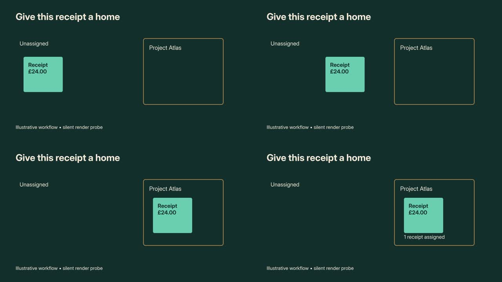

# HyperFrames integration research

**Researched:** October 20, 2026. **Comfyrizz baseline:** `ff5f013`.
**Upstream source:** [HyperFrames](https://github.com/heygen-com/hyperframes), pinned
for this review at [`6d357ff0d8dbb88b8d19fe689c15f0808724e52a`](https://github.com/heygen-com/hyperframes/tree/6d357ff0d8dbb88b8d19fe689c15f0808724e52a).
**Published package tested:** `hyperframes@0.8.181` on Node 22.19.0.

## Recommendation

Adopt **HyperFrames-inspired visual direction and diagnostics**, then add
**HyperFrames as an optional CPU scene-rendering worker**. Keep Comfyrizz's package,
measured timeline, narration, editor commands and final composition authoritative.

The strongest quality opportunity is a combination of:

1. A video-specific design contract and time-coded visual beats.
2. Reusable, parameterized scenes that show an action and its result.
3. Rendered layout, caption-space and motion assertions, with scene-specific repair.
4. An HTML/SVG/animation escape hatch for shots that exceed the six native recipes.

Changing render engines alone will not improve a weak script, unsupported product
claim, unsuitable generated shot, or poorly delivered narration. Comfyrizz already
renders from an integer-frame clock. HyperFrames expands the authoring vocabulary
and offers useful inspection machinery; it is not a missing determinism switch.

**Status:** source research plus a successful isolated compatibility experiment.
No HyperFrames dependency, new scene type, UI integration or production deployment
has been added to the application. The source fixture, evidence summary and this
report make the findings reproducible.

**Licensing follow-up:** [GSAP licensing options for Comfyrizz](GSAP_LICENSING_2026.md)
adds official clarification approving a preset-plus-parameters tool, a product-specific
inquiry draft, distribution requirements and a successful non-GSAP frame-source probe.

**Implementation follow-up:** the `feat/hyperframes-scenes` branch implements a
curated, non-GSAP source manifest, optional CPU worker and source-preserving export.
See [current composition authoring](../COMPOSITIONS.md). The investigation status
and experiments below describe the earlier research baseline, not the full branch.

## 1. What HyperFrames actually provides

| Surface | Verified in documentation/source | Relevance to Comfyrizz |
|---|---|---|
| HTML composition contract | Timing and tracks in `data-*` attributes; nested compositions; variables | Author complex scene geometry without adding a new React layout for every shot |
| Seek-driven animation | Paused GSAP timelines; browser-runtime support for CSS/WAAPI, Anime.js, Lottie, Three.js and TypeGPU | Richer diagrams, type, camera moves and authored 3D; each runtime still needs parity tests |
| CLI | `lint`, `check`, `snapshot`, `render`, previews, catalog operations | Practical isolated-worker interface and machine-readable diagnostics |
| Producer | `createRenderJob`, `executeRenderJob`, progress callback, cancellation | Longer-term Node integration behind Comfyrizz's process boundary |
| Engine | Exact-time browser capture, source-media extraction, encoding | Lower-level option only if Producer is too opinionated |
| Registry | Blocks and components with metadata, editable variables and some named sync points | Curated visual vocabulary rather than unrelated effect selection |
| Creative workflow | `frame.md`, storyboards, measured audio, per-scene briefs, blueprints | Better consistency, staging and timing of agent-authored output |
| Inspector/checks | Source lint, runtime readiness, sampled layout/motion/contrast findings | Catch visible defects before the full final render |
| Player/Studio | Embeddable player and HTML-oriented editor | Optional composition preview; integrating Studio would create substantial editing-contract work |
| Audio | FX chains, automation, groups and voice-dependent spectral carving | Possible later improvement over whole-band ducking, subject to listening tests |
| Output/infrastructure | MP4, transparent WebM/MOV, PNG sequence, HLS; local and distributed paths | Useful specialist exports; no cloud dependency for the proposed worker |

Sources: [Producer][producer], [Engine][engine], [frame adapters][adapters],
[Player][player], [registry example][chart], [creative design contract][design],
[CLI check implementation][check], [audio implementation][audio].

### Important qualifications

- The exported `FrameAdapter` interface is explicitly **experimental v0**. Pin an
  integration version and test upgrades; avoid tying the canonical package to it.
- `FrameAdapter` and `window.__hyperframes.registerFrameSource` are different
  surfaces. The latter drives a custom function of time inside the browser runtime
  and awaits readiness/render promises. Neither is a ready-made Comfyrizz adapter.
- The engine documentation acknowledges that Chrome, fonts, codecs and GPU behavior
  can change pixels. The tested capture used screenshots, not the `beginFrame`
  path described in some conceptual documentation.
- `check` is **sampled verification**, not a proof about every frame. Its motion
  grid targets 20 Hz but caps at 300 samples, so a whole long-form film is a poor
  unit for detecting short glitches. Prefer per-scene checks plus exact cue/seam frames.
- The standalone `@hyperframes/lint` package checks HyperFrames HTML. It does not
  automatically run browser layout/motion checks on Comfyrizz's React compositions.
- Render defaults include best-effort behavior. The probe explicitly used
  `--strict --no-best-effort`. Library callers need equivalent explicit policy;
  static lint and capture-readiness strictness are separate concerns.
- Their Remotion migration skill is a **one-way source-authoring workflow**, not a
  drop-in renderer replacement or a round-trip converter. Its documented blockers
  include React state patterns used by Comfyrizz's media components.

## 2. What Comfyrizz already has, and the actual gaps

| Existing capability | Current implementation | Useful addition |
|---|---|---|
| Integer-frame timing, narration floors, overlap math, cue provenance | `packages/planner/src/timeline.ts`, `measured.ts` | Feed the resolved scene span and cues into a richer scene worker |
| Six deterministic recipes and eight layouts | `apps/renderer/src/recipes/`, `components.tsx` | Semantic multi-step animations, arbitrary SVG geometry, camera journeys, custom text treatments |
| Geometry zones and aspect-aware layouts | `apps/renderer/src/layout-model.js` | Inspect actual rendered glyphs/elements and transient intersections, including custom scenes |
| Frame QA and contact sheets | `apps/renderer/scripts/frame-qa.mjs`, `apps/server/src/qa.mjs` | Element-attributed findings, intended-motion assertions, cue/seam sampling and repair receipts |
| Shared preview/export audio mix and ducking | `apps/renderer/src/audio-mix-model.js` | Optional voice-dependent spectral treatment with identical audition/export processing |
| Incremental render cache | `apps/renderer/scripts/render-incremental.mjs` | Include composition source, engine, font, timing and dependency hashes in derived-scene cache keys |
| Nine-stage isolated production | `apps/server/src/pipeline-worker.mjs` | Cancellable CPU composition materialization within the render stage |
| Rights-aware editable archive | `apps/server/src/export.mjs`, `packages/sources` | Export approved HTML/source dependencies and licenses as well as the baked plate |
| Four compact authoring skills | `packages/agent/src/skills/` | Retrieve one relevant blueprint/contract per scene; return structured visual review evidence |

Comfyrizz's existing frame QA already has black/static/flash, contrast and margin
heuristics. The incremental improvement is **what is wrong, on which element, at
which frame, against which declared intention**, rather than another generic QA pass.

The five-film collection already demonstrates the asset-worker approach: authored
SVG graphics were rendered on CPU and imported as video alongside LTX footage.
HyperFrames could generalize that campaign-specific work into reusable composition
workers. It would be especially useful for the exact clock face and fermentation
comparison inserts that needed authored geometry instead of generated footage.

## 3. Local feasibility experiment

Created an original silent scene: a teal receipt moves into Project Atlas, followed
by a visible assignment result. It uses local GSAP **3.13.0**, a local Inter font,
explicit timing and a four-second root duration. No hosted media service, LLM,
GPU generation, or Colab allocation was used.



Contact-sheet times, left to right/top to bottom: **0.5, 1.8, 2.7 and 3.5 seconds**.
This is a technical probe, not a finished film or a product screenshot.

| Experiment | Observed result |
|---|---|
| `hyperframes check --json` | Passed lint, runtime, layout, motion and contrast; no findings |
| Motion assertions | Receipt precedes result; result appears by 3.1s; receipt stays in frame; 81 motion samples |
| Contrast samples | 21 checks passed across four selected times |
| HyperFrames export | H.264, 1280×720, 30 fps, **120 decoded frames**, **4.000s**, 101,609 bytes |
| Render timing | Upstream telemetry reported **6.4s** for this one simple scene, one worker, software browser rendering |
| Existing Comfyrizz import | Valid v1 package using a ready video background, `media_only: true`, `speed: 1`, `loop: false` |
| Comfyrizz `renderPipeline` | H.264, 1280×720, 30 fps, **120 decoded frames**, **4.000s**, 62,176 bytes |
| Decoded-video comparison | FFmpeg SSIM **0.998191** across the 120 frames, after the second lossy encode |
| Negative control | Deliberately moved title off-canvas and changed result deadline to 1s; `check` exited **1**, reported `text_box_overflow`, `canvas_overflow`, `motion_appears_late` |

The bridge used the existing ready-video import path (`origin: "upload"`), not a
new supported HyperFrames generator. The probe proves the **opaque silent-plate
bridge** works. It does not prove narration sync, transparency, portrait reflow,
arbitrary-seek determinism, cancellation, cache invalidation, source round-tripping,
or long-form performance. SSIM measures fidelity through the bridge, not creative
quality. No comparative speed claim against native Remotion follows from 6.4s.

Environment: Node **22.19.0**, Chromium **157.0.8080.0**, FFmpeg **7.1.5**.
The composition's libraries and font were local; this was not an OS-level
network-isolation test. CLI telemetry was disabled for the check/render runs.

Machine-readable summary: [hyperframes-evidence-20261020.json](hyperframes-evidence-20261020.json).
Source: [receipt fixture](fixtures/hyperframes-receipt/index.html) and
[motion assertions](fixtures/hyperframes-receipt/index.motion.json).
Raw local evidence: `~/comfyrizz-gpu-tests/hyperframes-research-20261020/`.

## 4. Highest-value ideas to adopt

### A. A video-specific design contract

HyperFrames' `frame.md` separates machine-readable design tokens from creative
prose. Borrow that distinction while deriving palette/font values from Comfyrizz's
existing brand/theme model, rather than maintaining two conflicting brand stores.

Add a versioned visual-direction manifest describing:

- Type hierarchy and minimum readable label sizes per output aspect.
- Palette roles, strokes, material treatments and restrained effect choices.
- Caption/presenter keep-out regions derived from the actual composition.
- Recurring objects and their stable identifiers, colors and shapes.
- Allowed motion character, visual density and intentionally quiet beats.

Generate a human-readable `frame.md` from those structured values for authoring.
Treat brand tokens as fixed while allowing each scene a composition suited to its
meaning. A shared design system should not force every scene into the same card grid.

### B. Storytelling blueprints, not just entrance effects

Upstream has a substantial blueprint layer, including `camera-journey`,
`spatial-pan-stations`, `fixed-anchor-cycle`, `comparison-split`, and
`titlecard-reveal`. These describe a **shot developing over time**, not only a
fade-in. Many are product-marketing-oriented; adapt the method to explanatory and
narrative work rather than applying its hook/CTA taxonomy to every film.

Start with three Comfyrizz blueprints:

1. **Object transfer:** input → action → changed location/state → result hold.
2. **Mechanism journey:** one camera follows a cause to its observable consequence.
3. **Evidence reveal:** supplied chart/code/comparison builds to one exact finding.

Each blueprint needs real geometry, parameters, cue slots and an observable end
state. A `visual` description of a moving receipt is not executable geometry.
Reuse the current cue compiler; bind `action`, `result` and `inspection` beats to
resolved narration cues. Keep qualifiers and dataset provenance visible.

Do not reward continuous movement: an inspection hold or comic reaction pause is
a valid planned state. Upstream itself includes restrained title/hold blueprints.

### C. Visual assertions and a bounded repair loop

Use upstream `check` directly for HyperFrames scenes. For native scenes, add a
small browser inspection layer over the Remotion preview/render harness with
stable `data-scene-id` and `data-element-id` attributes.

Useful checks include rendered text clipping, label/caption collisions, contrast,
off-frame important content and reveal order. Borrow `appearsBy`, `before` and
`staysInFrame`; introduce a Comfyrizz-specific **not-before** assertion for punchlines
and a **hold-until** assertion for inspection beats. Those last two are proposed
extensions, not existing HyperFrames motion-spec kinds.

Return structured findings with scene ID, element ID, frame, bounding box,
severity, evidence image and relevant cue provenance. Use one bounded repair pass
by default; recheck the affected scene and adjacent transitions. Keep mechanical
findings separate from subjective direction notes. Do not automatically remove
caption access or eliminate deliberate stillness to make a check green.

### D. A curated registry with meaningful metadata

Start from `chart-story`, flowchart/code-diff patterns, editorial captions and a
small number of camera/text components. Upstream `chart-story` demonstrates
typed variables and a named `callout-landed` synchronization point.

For Comfyrizz, record component version, accepted inputs, required assets, license,
aspect support, duration range, cue slots, intentional holds, representative
previews and expected end state. Map chart values from the existing dataset,
not the catalog's demo numbers. Freeze reviewed component files locally.

Native ports are best for frequently used controls requiring instant editor
preview. External scene renders are best for visually complex, less frequent work.
Avoid putting the whole catalog or all 21 upstream skills into every model request.

### E. Audio polish as a separate, measured experiment

HyperFrames implements voiceover carving with spectral dips, level matching and
automation on the music bed. Its audio render uses an `OfflineAudioContext` and
shared graph builders with preview. This is worth studying for narration-heavy
films where whole-band ducking makes music collapse between phrases.

Comfyrizz already shares a mix model between preview/export. Preserve that
property: prototype a derived music stem or shared processing graph, invalidate it
when voice/music/timing changes, and compare against the existing ducking at matched
loudness. Choose by listening and intelligibility, not by the existence of more FX.
The current zero-lag narration check does not measure masking or pleasantness.

## 5. Recommended integration architecture

```text
Saved package revision + composition source manifest
                ↓
Existing narration/alignment → measured integer-frame timeline
                ↓
Resolve scene duration, aspect, assets and narration cue frames
                ↓
CPU composition worker: materialize local HTML → lint → sampled check → render
                ↓
Probe exact frames/dimensions → content-addressed derived video asset
                ↓
Existing Remotion composition: plates + captions + narration + music + transitions
                ↓
Existing technical verification + new visual evidence → rights-aware export
```

### Contract and ownership

- Keep `package.json` and compiled timeline authoritative. HTML is authored or
  compiled scene source, not a second master edit list.
- Begin with full-frame, opaque **silent** clips. Remotion continues to own final
  captions, narration, mix and scene-boundary transitions, preventing duplication.
- Materialize in the isolated run's work directory after timing and required media
  are ready, as a render subphase. This can preserve the current nine-stage public
  contract while reporting CPU composition progress separately from GPU progress.
- Use `N = timelineScene.durationInFrames`, `F = timeline.fps`, `duration = N/F`.
  Never infer a new duration from the animation library's last tween. Verify exactly
  N decoded frames; account explicitly for transition overlap and source trimming.
- Convert absolute cue frames to scene-local time using `(cueFrame - scene.from)/F`.
  Preserve explicit-cue precedence and estimated/forced-aligned provenance.
- Regenerate a composition after a narration-induced duration change. Stretching a
  baked four-second clip to fill six seconds does not preserve authored cue timing.
- Import using existing media-only/background behavior with explicit 1× playback
  and no loop. Missing output or a failed check must not silently become a stale plate.

### Proposed source/derived manifest

Keep source separate from the schema's existing ready-video asset, for example:

```text
compositions/manifest.json       # proposed versioned source/dependency registry
compositions/s_receipt/index.html
compositions/s_receipt/motion.json
compositions/s_receipt/assets/...
assets/derived/<content-hash>.mp4 # ordinary ready-video asset
```

The manifest would map scene ID → engine/version, entry file, component parameters,
local dependencies, source hash, derived asset ID, effective timing/cue hash and
verification report. This is a **proposed contract**, not a supported field today.
Hash source, params, dependency bytes, fonts, design values, dimensions, fps, scene
duration, cues, renderer/browser versions and encoding settings. Whole-package
changes should not invalidate every unrelated scene.

The editor should mark affected previews stale immediately and rebuild them through
the same command/autosave revision flow. Preserve current undo/redo, locked-scene
rules, three-way merges, trim floors, tail-transition clearing and save rejection.
For duration drags, an older baked preview may be shown as provisional; it must not
be accepted as the current final render.

### Concrete code touchpoints

| Proposed work | Existing integration location |
|---|---|
| Optional CPU worker adapter | New renderer worker module alongside `apps/renderer/scripts/render-pipeline.mjs` |
| Timing/asset materialization and cancellation | `apps/server/src/pipeline-worker.mjs`, `pipeline-process.mjs` |
| Source manifest validation and hashing | `packages/schema`, shared browser/server revision model; keep it versioned |
| Cue/duration inputs | `packages/planner/src/timeline.ts`, `measured.ts` |
| Ready plate playback | `apps/renderer/src/media.tsx`, `media-model.js`; explicit speed/loop settings |
| Native element-level visual checks | Renderer components/recipes, `frame-qa.mjs`, server QA evidence |
| Component authoring tools | `packages/agent/src/conversation*`, canonical skills and contract tests |
| Editable source export/import | `apps/server/src/export.mjs`, `packages/sources`, corresponding importer |

The current exporter collects declared asset files and known extras. An arbitrary
`compositions/` directory will **not automatically round-trip** in `package.zip`.
Add an explicit source-dependency allowlist, realpath checks, credits and dependency
licenses; test import/edit/re-render. Keep authored source outside the public player
unless deliberately published as an editable download.

### Preview and later formats

The cheapest preview is the baked clip in the existing player. A later live
composition preview can use `@hyperframes/player`, with playhead/cancellation
coordination and a clear parameter editing contract. Its iframe does not make
arbitrary animation code editable through Comfyrizz's existing inspector.

Transparent WebM/MOV or PNG layers are a later milestone. HyperFrames supports
them, but the complete Comfyrizz decode/composite/export path needs alpha tests,
edge/color checks and disk/CPU measurements. Do not assume every foreground video
behaves as an unframed, transparent overlay in the current renderer.

Portrait/square outputs need authored reflow and fresh checks. A landscape plate
with baked text must not be center-cropped and advertised as a responsive variant.

## 6. Adoption choices and tradeoffs

| Option | Benefit | Cost/limitation | Recommendation |
|---|---|---|---|
| Borrow design/blueprint/QA ideas, implement natively | Immediate benefit across current projects; native editability | More component work; inspect DOM through our own harness | **Start here** |
| HyperFrames CPU scene worker | Largest new visual range for modest pipeline disruption | Extra encode and materialization; source/derived lifecycle | **Pilot in parallel with native quality work** |
| Live HTML scenes inside existing preview/export | More interactive source editing | Two lifecycle/seek systems, async barriers and media/auth isolation | Defer until baked bridge and source contract are stable |
| Replace the full Remotion renderer | One HTML-native final compositor | Reimplement layouts, recipe parity, mix, transitions, editor preview and exports | Reconsider only after representative parity benchmarks |
| Embed HyperFrames Studio | Ready HTML editing surface | Second editing model; mapping its writes into EditorStore/merges | Not the first integration |
| Move rendering to HyperFrames Cloud/Lambda | Render throughput | Infrastructure, storage, operational/billing changes | Independent capacity decision, not a visual-quality prerequisite |

### Dependency and execution details

HyperFrames' repository license is **Apache-2.0**. Preserve notices and attribution
for any copied implementation. Registry fonts, media and dependencies have their
own terms; the upstream credits even identify some catalog textures whose origin
is still being confirmed.

**GSAP is not Apache/MIT or OSI-open-source.** The current Standard License allows
commercial use and explicitly allows AI-generated GSAP code, but restricts certain
no-code visual-animation builders competing with Webflow. That is directly relevant
to exposing GSAP animation editing in Comfyrizz. Resolve that scope before shipping
GSAP-backed visual-builder controls; native frame functions, CSS/WAAPI or separately
reviewed animation libraries are viable alternatives. HyperFrames itself supports
non-GSAP animation and registered frame sources.

The follow-up found an official public approval for a specific preset-plus-parameters
plugin, so visual controls alone do not establish a prohibited use. See the
[feature-by-feature licensing assessment](GSAP_LICENSING_2026.md) for the distinction
between curated controls and general animation authoring.

Producer/CLI require **Node 22+**; Comfyrizz still documents some Node 20 support.
A separate Node-22 worker avoids silently changing that application-wide promise.
Pin the package/dependency set and browser rather than invoking floating `npx` in
production. Upstream defaults and APIs move quickly at the reviewed pre-1.0 version.

HTML with scripts is an executable input, unlike Comfyrizz's sanitized SVG.
Run authored compositions in an isolated worker with only package-local resources,
bounded execution and no application credentials. Serve a live HTML preview on an
isolated origin. Keep asset resolution via copied local files for export; never
insert the server token into a composition or persist temporary media-ticket URLs.
Source lint is useful validation, not an execution sandbox.

Sources: [repository license][license], [third-party credits][credits],
[GSAP Standard License][gsap-license], [frame sources][frame-sources].

## 7. Implementation sequence and acceptance criteria

Effort below is relative engineering scope, not a delivery-time estimate.

### Phase 1 — native direction and visual evidence (medium)

- Add a derived video-design contract and three semantic scene blueprints.
- Promote full plate-coverage checks from demo scripts into production diagnostics.
- Add element IDs and sampled rendered checks at openings, action/result cues,
  final inspection frames and transition seams. Return actionable reports to the agent.
- Add explicit intentional-hold annotations; do not fail all static spans.

**Accept when:** planted clipping, caption collisions, missing result geometry,
wrong reveal order and footage shortfall are detected; intended holds pass; existing
editor/timing tests remain green. Demonstrate a repaired scene, not just a new rule.

### Phase 2 — production-ready HyperFrames scene worker (medium–large)

- Pin a CLI/Producer version; start with local opaque silent output.
- Add source manifest, content hashing, cancellation, failed/stale-result handling
  and source-preserving export/import.
- Map native component parameters and resolved cue frames into local scene files.
- Add three examples: mechanism diagram, supplied-data chart, code-diff reveal.

**Accept when:** exact frame/duration parity holds across supported fps/aspects;
random/reverse/repeated seeks reproduce sampled pixels; narration edits invalidate
only dependent scenes; cancellation leaves no owned process; missing fonts/assets
fail clearly; exported source can be imported, edited and rendered again.

### Phase 3 — quality comparison and selective expansion (medium, then optional)

Render the same scripts, narration bytes, dimensions and scene boundaries as:

1. Current native compositions.
2. Improved native blueprints/diagnostics.
3. Hybrid HyperFrames compositions.

Use a software-task explainer, a narrated scientific mechanism and a comedy reveal.
Include portrait variants and a longer multi-scene assembly. Evaluate blind where
possible: mechanism comprehension, phone-size readability, caption access, exact
reveal timing, continuity, motion artifacts, audio clarity and revision effort.
Record median render time over repeated runs, peak memory, artifact size and failed
jobs. Report technical quality and subjective preference separately.

Only then expand into transparent layers, Lottie/3D, spectral music treatment or a
live composition inspector. Require visible or measured benefit for each addition.

## 8. Reproduce the small HyperFrames probe

Run from the Comfyrizz repository with a **fresh external** directory:

```bash
SPIKE=/tmp/opencode/hyperframes-probe-reproduction
npm install --prefix "$SPIKE" --no-audit --no-fund --save-exact \
  hyperframes@0.8.181 gsap@3.13.0
mkdir -p "$SPIKE/project/assets"
cp docs/research/fixtures/hyperframes-receipt/index.* "$SPIKE/project/"
cp "$SPIKE/node_modules/gsap/dist/gsap.min.js" "$SPIKE/project/assets/"
cp apps/renderer/public/fonts/Inter-Variable.ttf "$SPIKE/project/assets/"
cp apps/renderer/public/fonts/OFL.txt "$SPIKE/project/assets/"
export HYPERFRAMES_NO_TELEMETRY=1
export HYPERFRAMES_BROWSER_PATH=/absolute/path/to/chrome-headless-shell
export TMPDIR=/tmp/opencode
"$SPIKE/node_modules/.bin/hyperframes" check "$SPIKE/project" \
  --json --at 0.5,1.5,2.5,3.5 --no-browser-gpu > "$SPIKE/check.json"
"$SPIKE/node_modules/.bin/hyperframes" render "$SPIKE/project" \
  --fps 30 --workers 1 --no-browser-gpu --strict --no-best-effort \
  --output "$SPIKE/probe.mp4"
ffprobe -v error -count_frames \
  -show_entries stream=width,height,r_frame_rate,nb_read_frames:format=duration \
  -of json "$SPIKE/probe.mp4"
```

For the negative control, copy the project; place `#title` at `left:1180px` with
`width:800px`, and change `appearsBy.bySec` from 3.1 to 1. The JSON check should
report the two intended defect classes and exit nonzero. The raw evidence includes
the separate Comfyrizz import/render script and decoded-frame comparison.

## Sources

All repository links below pin the reviewed revision. Upstream capabilities that
were not exercised locally are source-reviewed, not independently benchmarked.

[producer]: https://github.com/heygen-com/hyperframes/blob/6d357ff0d8dbb88b8d19fe689c15f0808724e52a/docs/packages/producer.mdx
[engine]: https://github.com/heygen-com/hyperframes/blob/6d357ff0d8dbb88b8d19fe689c15f0808724e52a/docs/packages/engine.mdx
[adapters]: https://github.com/heygen-com/hyperframes/blob/6d357ff0d8dbb88b8d19fe689c15f0808724e52a/docs/concepts/frame-adapters.mdx
[player]: https://github.com/heygen-com/hyperframes/blob/6d357ff0d8dbb88b8d19fe689c15f0808724e52a/docs/packages/player.mdx
[chart]: https://github.com/heygen-com/hyperframes/blob/6d357ff0d8dbb88b8d19fe689c15f0808724e52a/registry/components/chart-story/registry-item.json
[design]: https://github.com/heygen-com/hyperframes/blob/6d357ff0d8dbb88b8d19fe689c15f0808724e52a/skills/hyperframes-creative/references/design-spec.md
[check]: https://github.com/heygen-com/hyperframes/blob/6d357ff0d8dbb88b8d19fe689c15f0808724e52a/packages/cli/src/utils/checkPipeline.ts
[audio]: https://github.com/heygen-com/hyperframes/blob/6d357ff0d8dbb88b8d19fe689c15f0808724e52a/docs/reference/audio-effects.mdx
[license]: https://github.com/heygen-com/hyperframes/blob/6d357ff0d8dbb88b8d19fe689c15f0808724e52a/LICENSE
[credits]: https://github.com/heygen-com/hyperframes/blob/6d357ff0d8dbb88b8d19fe689c15f0808724e52a/CREDITS.md
[gsap-license]: https://gsap.com/community/standard-license/
[frame-sources]: https://github.com/heygen-com/hyperframes/blob/6d357ff0d8dbb88b8d19fe689c15f0808724e52a/docs/guides/frame-sources.md

Additional implementation references:

- [Motion assertion schema](https://github.com/heygen-com/hyperframes/blob/6d357ff0d8dbb88b8d19fe689c15f0808724e52a/packages/cli/src/utils/motionSpec.ts)
  and [evaluator](https://github.com/heygen-com/hyperframes/blob/6d357ff0d8dbb88b8d19fe689c15f0808724e52a/packages/cli/src/utils/motionAudit.ts).
- [Standalone linter](https://github.com/heygen-com/hyperframes/blob/6d357ff0d8dbb88b8d19fe689c15f0808724e52a/docs/packages/lint.mdx).
- [Shot blueprints](https://github.com/heygen-com/hyperframes/blob/6d357ff0d8dbb88b8d19fe689c15f0808724e52a/skills/hyperframes-animation/blueprints-index.md).
- [Faceless-explainer workflow](https://github.com/heygen-com/hyperframes/blob/6d357ff0d8dbb88b8d19fe689c15f0808724e52a/skills/faceless-explainer/SKILL.md).
- [Remotion migration scope](https://github.com/heygen-com/hyperframes/blob/6d357ff0d8dbb88b8d19fe689c15f0808724e52a/skills/remotion-to-hyperframes/SKILL.md).
- [Producer output/strictness configuration](https://github.com/heygen-com/hyperframes/blob/6d357ff0d8dbb88b8d19fe689c15f0808724e52a/packages/producer/src/services/renderOrchestrator.ts).
- [Voiceover carve](https://github.com/heygen-com/hyperframes/blob/6d357ff0d8dbb88b8d19fe689c15f0808724e52a/docs/studio/voiceover-carve.mdx).

Related Comfyrizz work: [animation pack](../ANIMATION_STORYTELLING.md),
[content-quality research](../CONTENT_QUALITY_RESEARCH.md),
[long-form production findings](../LONGFORM_COLLECTION.md),
[audio mix contract](../editor/AUDIO_MIX.md).
