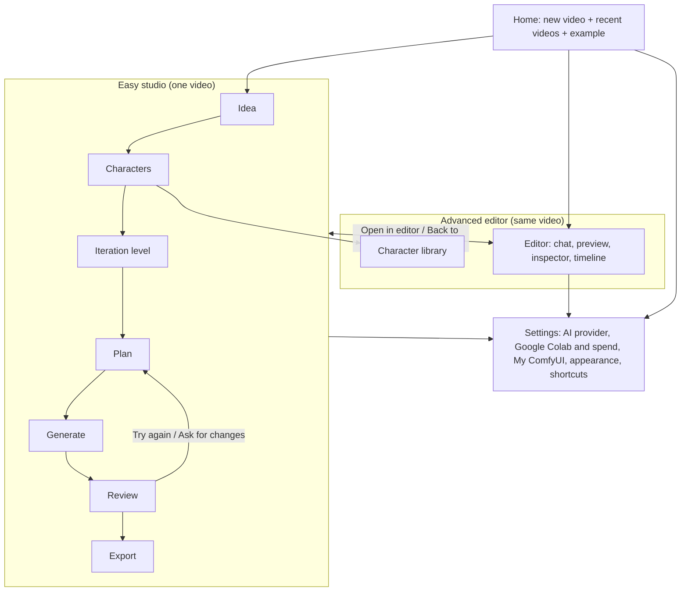
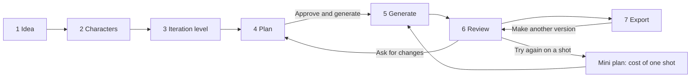

# Comfyrizz UI revamp: master specification

*Status: draft for Kyle's review, 2026-10-23. Scope: the whole web app (`apps/web`), Easy mode first. Evidence: [AUDIT.md](AUDIT.md). Tasks: [TASKS.md](TASKS.md). Related: [ITERATIVE_PRODUCTION_AGENT.md](../specs/ITERATIVE_PRODUCTION_AGENT.md), [CHARACTER_CREATOR.md](../specs/CHARACTER_CREATOR.md), iteration policy contract `apps/server/src/productions/iteration.mjs` (IL01). An independent Easy-flow audit is due at `docs/ui-revamp/easy-flow-sonnet.md`; differences get resolved in a follow-up revision of this file.*

## 0. Goals, non-goals, principles

**Goal.** A first-time user, with no setup, goes from an idea to a downloaded video through one obvious path, and can come back later to improve it. Video stays the centre of every screen from the moment there is something to watch.

**Non-goals.** No change to the package schema, the timeline compiler, the renderer or the paid executor (`pipeline.mjs` / `pipeline-worker.mjs`). No new workflow engine. No agent self-approval. Advanced keeps every capability it has today; it is reorganised, not cut.

**Principles.**

1. **One path in Easy.** Seven steps, always in the same order, each with exactly one primary button.
2. **One control per job.** If two controls do the same thing, one goes (AUDIT §3.5).
3. **Easy is its own shell, not a filter.** Easy renders a guided studio. Advanced renders the editor. They share one project and one store, and either can open the other at any point.
4. **Money is always explicit.** Every Google Colab spend shows "up to N Google Colab units" against the spend cap, and needs a click that cites the plan. Nothing paid starts from a step change, a reload or a keyboard shortcut.
5. **Every state is designed.** Each surface ships its empty, loading, error, pending-GPU and stale states (§8). No state is shown only in a hidden panel.
6. **Plain words.** No internal ids, model names or pipeline terms in Easy (§9).
7. **Keyboard first.** The primary action of every Easy step is at most 5 Tab stops from the step heading (§10).

**Revamp acceptance (measured by the e2e suites in TASKS.md):**

| Measure | Today | Target |
|---|---|---|
| Visible controls on an Easy step | 128 | ≤ 15 (Review ≤ 25) |
| Tab stops from step heading to primary action | 43 to the composer | ≤ 5 |
| Clicks from first open to a downloaded CPU video, accepting defaults | blocked (A01) | ≤ 8 |
| Entry points that export a video | 11 | Easy 1, Advanced 2 |
| Places that set the Google Colab spend cap | 3 inputs | 1 (shown read-only elsewhere) |
| Axe serious or critical violations on any Easy step | 0 on load | 0 on every step and dialog |

## 1. Vocabulary

One word per idea, used the same way in Easy, Advanced, docs and errors.

| Word in the UI | Means | Replaces |
|---|---|---|
| **Video** | A project: brief, characters, script, shots, versions, exports | package, project, production (in UI copy) |
| **Idea** | What the user typed plus length, shape and look | brief, prompt |
| **Character** | A reusable person, mascot or narrator from the library | cast entry, speaker |
| **Iteration level** | How many versions Comfyrizz tries and how often it asks you: Draft, Balanced, Director, Custom | iteration policy |
| **Plan** | The script, the shot list, what will be made, and the most it can cost | brief card, outline, action plan, plan card |
| **Shot** | One scene of the video, numbered from 1 | scene, clip, `s1_dawn` |
| **Version** | One generated attempt at a shot (or a voice, or a script) | take |
| **Keep** | Choose this version for the video | approve, select |
| **Try again** | Make another version of one shot | regenerate, redo |
| **Generate** | Make the planned shots | run on backend, start |
| **Export** | Make the final MP4 and files | render, export MP4 |
| **This computer** | Free CPU motion graphics, no network | CPU backend |
| **Google Colab** | Rented GPU for AI images, video and voices; uses Google Colab units | Colab, G4, GPU backend |
| **Spend cap** | The most Google Colab units this video may use | budget, compute-unit ceiling, allocation ceiling |
| **AI provider** | The service that writes scripts and chats | LLM, model, provider |

## 2. Information architecture

### 2.1 Site map



### 2.2 Routes

All routes are query parameters on `/` so the existing token bootstrap (`#token=`) and `?package=` keep working. The view mode stays in `localStorage['comfyrizz.ui'].mode`.

| URL | Shows |
|---|---|
| `/` | **Home** (Phase 3). In Phase 1, `/` with no `?package=` shows the Easy **Idea** step for a new video, with "Recent videos" and "Try the example" below the form. |
| `/?package=<id>` | That video in the last-used mode. Easy opens the step derived from the video's state (§3.9). |
| `/?package=<id>&step=<idea\|characters\|level\|plan\|generate\|review\|export>` | Easy at that step, if it is reachable; otherwise the furthest reachable step. |
| `/?package=<id>&view=editor` | Advanced editor (sets mode to `advanced`). |
| `/?settings=<section>` | Settings dialog over the current page. Sections: `ai`, `colab`, `comfyui`, `appearance`, `shortcuts`. |
| `/?library=characters` | Character library (Advanced and Home). |
| `/demo.html` | Unchanged demo page, not linked from the product. |
| `/ui-kit.html` | Dev only. |

Step changes use `history.pushState` so Back and Forward move between steps. Dialogs use `replaceState`.

### 2.3 Easy and Advanced

| | Easy studio | Advanced editor |
|---|---|---|
| Who | First-time and casual users | Editors who want every control |
| Layout | One step at a time, centred, preview on the right from Plan onward | Today's grid, cleaned up (§5) |
| Default | Yes, for a new user (existing `DEFAULT_MODE = 'easy'`) | Remembered per browser |
| Switch | Header button **Open in editor** | Top-bar button **Back to studio** |
| Data | Same video, same editor store, same server records | Same |

Switching never loses work: both read the same `editorStore` document and the same production snapshot. Edits made in Advanced that Easy cannot show (custom timing, transitions, motion) appear in Easy as a single read-only line on the Review step: "Edited in the editor: timing, transitions" with a link **Open in editor**.

## 3. Easy mode

### 3.1 The primary path



| # | Step | Primary button | Secondary | Writes | Leaves when |
|---|---|---|---|---|---|
| 1 | Idea | **Continue** | Answer up to 3 questions inline | Idea in Easy store; `POST /api/brief` for questions | Idea text ≥ 10 characters and questions answered or "Decide for me" |
| 2 | Characters | **Continue** | Add from your characters; Create a character; Narration on/off and voice | Project cast (`/api/chat/:id/cast`), narrator voice | Always (characters are optional) |
| 3 | Iteration level | **Write my plan** | Where to make it; spend cap | Iteration policy (IL command), compute choice, spend cap | A level is chosen; if Google Colab, signed in and a cap is set |
| 4 | Plan | **Approve and generate** | Edit a shot's words; Back | Package (`POST /api/agent`), production (`POST /api/productions`), plan proposal, `plan.approve` | Plan approved |
| 5 | Generate | (none while running) **Cancel** | Keep editing words | Run / actions | All shots have at least one version, or the user stops |
| 6 | Review | **Export video** | Keep, Try again, Compare versions, Ask for changes, edit words | Selections and verdicts | User presses Export video |
| 7 | Export | **Download MP4** (after done) | Download captions and extras; Make another version; Start a new video | Render + export | Done |

Each step is a full screen in the same shell (§3.2). The stepper lets the user go back to any completed step. Going back never discards versions; it can mark later steps "needs update" (§3.9).

### 3.2 Shell

```
┌──────────────────────────────────────────────────────────────────────────────────────────┐
│ ◆ Comfyrizz  │ Crumb & Co sourdough ✎                     Saved ✓   ? Help  ⚙ Settings  Open in editor │  header (56 px)
├──────────────────────────────────────────────────────────────────────────────────────────┤
│  ✓ Idea ── ✓ Characters ── ● Iteration level ── ○ Plan ── ○ Generate ── ○ Review ── ○ Export │  stepper (48 px)
├──────────────────────────────────────────────────────────────────────────────────────────┤
│                                                                                          │
│                         <h1> step heading </h1>                                          │
│                         one-line explanation                                             │
│                                                                                          │
│                         step content (max 880 px wide, or 2 columns from Plan on)        │
│                                                                                          │
├──────────────────────────────────────────────────────────────────────────────────────────┤
│ ← Back                                    status text (aria-live)        [ Primary  → ]  │  action bar (64 px, sticky)
└──────────────────────────────────────────────────────────────────────────────────────────┘
```

- Header: logo (goes Home), video name (inline rename, `aria-label="Video name"`), save status (one indicator for the whole app), Help (opens a short "How it works" sheet), Settings, **Open in editor**.
- Stepper: `<nav aria-label="Steps"><ol>`, each step a button. States: done (✓, clickable), current (`aria-current="step"`), available (clickable), locked (`aria-disabled="true"`, tooltip and screen-reader text say why, for example "Approve the plan first").
- Main: `<main id="easy-main" tabindex="-1">`. On every step change focus moves to the step `<h1>`, the document title becomes "Step name · Video name · Comfyrizz", and the live region announces "Step 3 of 7, Iteration level".
- Action bar: sticky at the bottom, always the same place. Left: **Back** (hidden on step 1). Right: one primary button. Between them a polite live status ("Saving…", "Up to 6 Google Colab units", "2 of 4 shots ready"). If the primary is unavailable it stays visible, disabled, with the reason as text next to it (not only a tooltip).
- Google Colab session banner: whenever a Google Colab session is starting, running or stopping, a slim banner under the stepper shows its state on every step (§3.6).

### 3.3 Step 1: Idea

```
┌──────────────────────────────────────────────────────────────────────────┐
│  What's your video about?                                                │  h1
│  Describe it in a sentence or two. You can change everything later.      │
│                                                                          │
│  ┌────────────────────────────────────────────────────────────────────┐  │
│  │ A 30-second video for my bakery, Crumb & Co, announcing our new    │  │  textarea, 4 rows
│  │ sourdough subscription. Warm and friendly.                         │  │
│  └────────────────────────────────────────────────────────────────────┘  │
│  Start from:  (Product launch) (Explainer) (Brand teaser) (Lesson recap)  │  template chips fill the box
│                                                                          │
│  Length   ( 15 s ) [ 30 s ] ( 60 s ) ( 90 s )                            │  radiogroup, default 30 s
│  Shape    [ Landscape 16:9 ] ( Vertical 9:16 ) ( Square 1:1 )            │  radiogroup, default 16:9
│                                                                          │
│  Look                                                                    │  radiogroup of 6 cards, 3 per row
│  ┌──────────┐ ┌──────────┐ ┌──────────┐                                  │
│  │  thumb   │ │  thumb   │ │  thumb   │                                  │
│  │ Clay   ✓ │ │ Glass    │ │ Editorial│                                  │
│  └──────────┘ └──────────┘ └──────────┘  … Isometric, Paper cut, Cinematic dark
│                                                                          │
│  ▸ More options                                                          │  disclosure, closed
│      Music and sound effects   [on]                                      │
│      Reference images (optional)  [ Add images ]  dawn-style.png ✕       │
│                                                                          │
│  ── after Continue, if the planner has questions ─────────────────────── │
│  A couple of quick questions                                             │  h2, appears inline, focus moves here
│  What should viewers do at the end?                                      │
│   ( Visit the website ) ( Subscribe ) ( Book a visit ) [ Decide for me ] │
│                                                                          │
│  Recent videos:  Pip's Night Shift · 2 days ago   ·  Try the example     │  only on a new video
├──────────────────────────────────────────────────────────────────────────┤
│                                                      [ Continue → ]      │
└──────────────────────────────────────────────────────────────────────────┘
```

Behaviour:

- **Continue** with fewer than 10 characters keeps focus in the textarea and shows "Tell us a bit more: at least 10 characters." under it (`aria-describedby`).
- First **Continue** posts `POST /api/brief {prompt, mode: 'plan'}`. If the reply has questions, they render inline, focus moves to the questions heading, and the button text becomes **Continue** again. "Decide for me" is preselected for every question. If the reply is complete, go straight to step 2.
- At most 3 questions. Questions must be relevant (TASKS UR12): the numbers question appears only when the idea mentions numbers, charts or data; CTA options are generic.
- Reference images use the existing references API. Each image gets one **Use it for** select (Style, Subject, Character, Background, Logo, Product, Other) and an optional note. No chip duplicates.
- The idea, length, shape, look and options are kept in the Easy store and autosaved; nothing is built yet and nothing costs money.

### 3.4 Step 2: Characters

```
┌──────────────────────────────────────────────────────────────────────────┐
│  Who's in it?                                                            │
│  Add the people or mascots that appear or speak. This is optional.       │
│                                                                          │
│  In this video                                                           │
│  ┌────────────────┐ ┌────────────────┐ ┌ ─ ─ ─ ─ ─ ─ ─ ─┐                │
│  │ [img]  Juno    │ │ [img]  Pip     │ │  + Add a        │               │
│  │ Main character │ │ Mascot         │ │    character    │               │
│  │ ▶ Voice: Bella │ │ ▶ Voice: none  │ └ ─ ─ ─ ─ ─ ─ ─ ─┘                │
│  │ Remove         │ │ Remove         │                                   │
│  └────────────────┘ └────────────────┘                                   │
│                                                                          │
│  Narration   [on]   Narrator voice [ Bella, warm ▾ ] ▶ Play  Compare two │
│                                                                          │
│  Empty state (no characters):                                            │
│   "No characters yet. Videos work fine without them."                    │
│   [ Add from your characters ]  [ Create a character ]                   │
├──────────────────────────────────────────────────────────────────────────┤
│ ← Back                                               [ Continue → ]      │
└──────────────────────────────────────────────────────────────────────────┘
```

**Add a character** opens a menu with two items: **From your characters** (library picker dialog: searchable list, thumbnail, name, role, Add) and **Create new** (quick dialog below).

```
┌ Create a character ───────────────────────────────── ✕ ┐
│ Name            [ Juno                    ]            │
│ Role            [ Main character ▾ ]                   │
│ What do they look like?                                │
│ [ Curly red hair, green apron, round glasses       ]   │
│ Picture (optional)   [ Add a picture ]                 │
│ Voice           [ Bella, warm ▾ ]  ▶ Play  Compare two │
│ [✓] This is a fictional character, not a real person.  │
│                                                        │
│ More details (wardrobe, personality…) open in editor ↗ │
│                          [ Cancel ]  [ Create character ]│
└────────────────────────────────────────────────────────┘
```

- **Create character** is disabled until Name is filled and the fictional box is ticked; the reason is shown under the button.
- **Compare two** opens the IL20 Voice A/B panel (`src/characters/audition-panel.ts`, not edited) in a dialog. Its **Keep** writes the chosen voice back to the field.
- The Characters step never shows the 30-field editor. The full editor stays in Advanced.
- AI presenter is not offered in Easy (off by default; §13 Q11).

### 3.5 Step 3: Iteration level

```
┌──────────────────────────────────────────────────────────────────────────┐
│  How many versions should we try?                                        │
│  More versions give you more to choose from and use more Google Colab.   │
│                                                                          │
│  ┌─ IL picker slot (owned by the IL "iteration level picker" task) ───┐  │
│  │ ( ) Draft       One version of everything. Fastest. Picked for you.│  │
│  │ (•) Balanced    2 voice options, 2 image options, 2 versions of    │  │
│  │                 each shot. You pick the best version.    Default   │  │
│  │ ( ) Director    2 scripts, 3 voice options, 3 image options, up to │  │
│  │                 6 versions of each shot over 2 rounds. You pick at │  │
│  │                 every stage.                                       │  │
│  │ Custom (set in the editor) shown read-only when the level is Custom│  │
│  └────────────────────────────────────────────────────────────────────┘  │
│                                                                          │
│  Where should we make it?                                                │
│  ┌───────────────────────────────┐ ┌───────────────────────────────────┐ │
│  │ (•) This computer             │ │ ( ) Google Colab                  │ │
│  │ Free. Motion graphics, charts │ │ AI images, video and voices.      │ │
│  │ and text. No AI video.        │ │ Uses Google Colab units.          │ │
│  └───────────────────────────────┘ │ Not connected · [ Connect ]       │ │
│                                    └───────────────────────────────────┘ │
│  Spend cap (Google Colab only)                                           │
│  Use at most [ 15 ] Google Colab units on this video.                    │
│  So far: 0 units. You approve every spend before it starts.              │
├──────────────────────────────────────────────────────────────────────────┤
│ ← Back                                            [ Write my plan → ]    │
└──────────────────────────────────────────────────────────────────────────┘
```

- The level cards are the IL picker. This step owns the slot (`<div data-il-slot="iteration-level-picker">`), the heading and the compute choice; it does not draw its own level cards. Copy above is the recommended Easy copy for the IL picker; numbers must come from `ITERATION_PRESETS`, never hard-coded.
- Default level: Balanced with Google Colab, Draft with This computer (§13 Q4).
- Google Colab is disabled until signed in; **Connect** opens Settings › Google Colab and returns here.
- The spend cap field appears only with Google Colab. It is the only editable spend cap in Easy and it writes the production ledger's user ceiling (TASKS UR19). Validation: a number from 0.5 to 500 in steps of 0.5; error "Enter a cap between 0.5 and 500 units."
- **Write my plan** saves the level and cap, then moves to step 4, which starts writing the script.

### 3.6 Step 4: Plan

Two states on one screen: writing (loading), then the plan.

```
┌──────────────────────────────────────────────────────────────────────────┐
│  Your plan                                                               │
│  Check the words and shots. Nothing is made until you approve.           │
│ ┌─ Shots ───────────────────────────────────────┐ ┌─ Preview ──────────┐ │
│ │ 1  Title       "Crumb & Co"                    │ │                    │ │
│ │    On screen [ Crumb & Co sourdough club     ] │ │  draft preview of  │ │
│ │    Narration [ Fresh bread at your door…     ] │ │  the selected shot │ │
│ │    Makes: 2 versions on Google Colab           │ │  (motion graphics, │ │
│ │ 2  Hero        "Hands knead dough"             │ │  placeholders for  │ │
│ │    …                                           │ │  AI shots)         │ │
│ │ 3  Offer       "€19 a month"                   │ │  ▶ 0:00 / 0:30     │ │
│ │ 4  Close       "Join the club"                 │ │                    │ │
│ └────────────────────────────────────────────────┘ └────────────────────┘ │
│ ┌─ What it costs ─────────────────────────────────────────────────────┐   │
│ │ Up to 6 Google Colab units (spend cap 15). 3 shots new, 1 reused.   │   │
│ │ You'll be asked to pick: shot versions.  Level: Balanced · change   │   │
│ └─────────────────────────────────────────────────────────────────────┘   │
├──────────────────────────────────────────────────────────────────────────┤
│ ← Back                    Up to 6 units        [ Approve and generate → ] │
└──────────────────────────────────────────────────────────────────────────┘
```

- On entry, if there is no script for the current idea, characters and level: show a skeleton list and "Writing your plan…" in the live region, then `POST /api/agent` with the idea serialised the way `briefToPrompt` does today plus cast handles. Then `POST /api/productions` (`production.create`, bound to the package) if no production exists, then request the plan proposal (TASKS UR22). Each call shows its own error state with **Try again**.
- The shot list reads the package scenes; the cost box reads only the plan card (`readPlanCard` from `src/productions/cards/plan-card.ts`). The cost shown is the server's reservation ceiling, labelled "Up to N Google Colab units". Never a client estimate.
- Editing a shot's words updates the package through the editor store and marks the plan stale; the cost box says "Words changed; the cost will be checked again" and **Approve and generate** re-proposes before approving.
- This computer: the cost box says "Free. Made on this computer." The primary button is **Generate** and no plan approval command is sent for spend (there is none); if the production still needs a `plan.approve` for audit, it is sent with a zero ceiling.
- Over the cap: the primary is disabled and the box says "This plan needs up to 18 units, more than your spend cap of 15. Raise the cap or pick a lower level." with **Change level** and **Raise cap** links back to step 3.
- Required decisions from the plan (for example "music") render as one question each, above the cost box, with a default preselected.
- **Approve and generate** sends `plan.approve` built by `approvePlan(card)`; a stale card cannot build the command (existing behaviour), so the button re-fetches and shows "The plan changed. Check it and approve again."

### 3.7 Step 5: Generate

```
┌──────────────────────────────────────────────────────────────────────────┐
│  Making your video                                                       │
│  This takes about 6 minutes. You can keep editing words while you wait.  │
│ ┌─ Google Colab ─────────────────────────────────────────────────────┐   │
│ │ ● Starting a Google Colab session… (about 2 minutes)  Used: 0.4/6  │   │  banner, aria-live polite
│ └────────────────────────────────────────────────────────────────────┘   │
│ ┌─ Shots ────────────────────────────┐ ┌─ Preview ────────────────────┐  │
│ │ 1 Title        ✓ Ready (motion)    │ │  plays what is ready; a      │  │
│ │ 2 Hero         ◌ Waiting for GPU   │ │  labelled placeholder for    │  │
│ │ 3 Offer        ◔ Making 1 of 2     │ │  shots not ready yet:        │  │
│ │ 4 Close        ✓ Ready (motion)    │ │  "Placeholder until made"    │  │
│ │ 2 of 4 shots ready                 │ │                              │  │
│ └────────────────────────────────────┘ └──────────────────────────────┘  │
├──────────────────────────────────────────────────────────────────────────┤
│ ← Back to plan       2 of 4 shots ready     [ Stop ]   [ Review → ] (disabled until all ready) │
└──────────────────────────────────────────────────────────────────────────┘
```

Shot states and their copy. The states are `SHOT_STATUSES` from `progress.ts`, plus one Easy-only state for the GPU wait. Exact strings are in TASKS Appendix A.

| State | Icon and text | Notes |
|---|---|---|
| planned, queued | ◌ Waiting | |
| queued while the session starts | ◌ Waiting for Google Colab | Pending GPU; the banner explains |
| generating | ◔ Making 1 of 2 | Counts versions from the level |
| review, approved | ✓ Ready | Motion-graphics shots on This computer are ready immediately |
| failed | ⚠ Couldn't make this shot. Try again | Per-shot **Try again** |
| stale | ⚠ Needs update | The words changed after the shot was made |
| rejected | – Not kept | |

"Collecting results" is a Google Colab session state, shown in the banner, not a shot state.

Google Colab banner states: Starting a session · Running (units used / spend cap) · Collecting results · Stopping the session · **Session stopped** (verified) · **We couldn't confirm the session stopped. Check Google Colab now.** (`stop_unconfirmed`, danger tone, stays until dismissed and links to Settings › Google Colab). "Video ready" never implies "session stopped" (SPEC §3.9 of the product spec).

- **Stop** asks in an in-app dialog: "Stop making shots? Shots already made are kept. Units already used are not refunded." [Keep going] [Stop].
- This computer: there is no Google Colab banner; the step shows "Putting your video together…" and finishes in seconds to minutes; when everything is ready it moves to Review automatically and announces "Your video is ready to review".
- Leaving the page is safe; on return Easy reopens this step and resumes from server state.

### 3.8 Step 6: Review

```
┌──────────────────────────────────────────────────────────────────────────┐
│  Review your video                                                       │
│ ┌─ Preview (16:9, largest element) ───────────────────────────────────┐  │
│ │                                                                     │  │
│ │                         Remotion Player                             │  │
│ │                                                                     │  │
│ │ ▶  ━━━━━━━━●━━━━━━━━━━━━━━━━━━━━━━━━  0:08 / 0:30   🔊  ⛶           │  │
│ └─────────────────────────────────────────────────────────────────────┘  │
│  Shots   ┌────────┐ ┌────────┐ ┌────────┐ ┌────────┐                     │  shot strip: IL asset thumbnails
│          │ 1 ✓    │ │ 2  •   │ │ 3 ✓    │ │ 4 ✓    │                     │
│          └────────┘ └────────┘ └────────┘ └────────┘                     │
│ ┌─ Shot 2 · Hands knead dough ───────────────────────────────────────┐   │
│ │ Version 2 of 2 ◀ ▶     [ Keep this version ]  [ Compare versions ] │   │
│ │ Try again:  (Warmer) (Calmer) (More detail) (Simpler) (Something else…) │
│ │ On screen [ Fresh every morning ]   Narration [ We bake at five… ] │   │
│ └────────────────────────────────────────────────────────────────────┘   │
│  [ Ask for changes ]  "Make shot 3 shorter", "Change the music"…          │
├──────────────────────────────────────────────────────────────────────────┤
│ ← Back       3 of 4 shots kept · Shot 2 needs a choice   [ Export video → ] │
└──────────────────────────────────────────────────────────────────────────┘
```

- Selecting a shot (click a thumbnail, or Left/Right in the strip) seeks the Player to that shot and opens its panel. The strip is a `role="listbox"`; the panel is labelled by the shot title.
- Versions: Left/Right arrows (or ◀ ▶) switch the previewed version (existing `previewTake`). **Keep this version** sends the selection and the user verdict. On Draft, every shot has one version and is kept automatically by the user's plan approval only if the server rule in UR31 allows it; otherwise the button says **Keep** and needs one click per shot, plus a **Keep all** button with an in-app confirmation.
- **Compare versions** opens the IL compare view (slot `data-il-slot="compare-view"`); its keep action returns here.
- **Try again** with a reason chip: on This computer it applies the existing scene edit chip (`POST /api/scene/chip`) and refreshes the preview; on Google Colab it opens a mini plan sheet "Try shot 2 again: up to 2 Google Colab units (4.4 of 15 left). [Cancel] [Approve and try again]" before anything is dispatched.
- "Something else…" opens **Ask for changes** with "Shot 2: " prefilled.
- **Ask for changes** opens a right-side drawer with the chat transcript and composer for this video. Proposals the agent makes render as cards with **Accept** / **Reject**; anything that costs units goes through a plan sheet. Without an AI provider the drawer says "Connect an AI provider to ask for changes in your own words. You can still edit words and use Try again." with **Connect**.
- Words: the On screen and Narration fields edit the package through `editorStore`; the preview updates on the next frame; a narration change marks the voice for that shot "needs update" and shows a **Make the voice again** link (free on This computer).
- The primary **Export video** is enabled when the render gate is satisfied. If it is not, the status text names the first shot that needs a choice and clicking it selects that shot. There is no override reason in Easy; overrides are Advanced only.

### 3.9 Step 7: Export

```
┌──────────────────────────────────────────────────────────────────────────┐
│  Export                                                                  │
│  Putting your video together… 40%                                        │  progress bar (role=progressbar)
│  ─── when done ───                                                       │
│  Your video is ready                                                     │  h1 changes, focus moves here
│ ┌────────────────────────────────────────────────┐                       │
│ │            player of the exported MP4           │  Crumb & Co · 0:30 · 16:9 · 3.0 MB │
│ └────────────────────────────────────────────────┘                       │
│  [ Download MP4 ]   Download captions and extras (ZIP)                   │
│  Quality check passed · 2 notes ▸                                        │
│  Google Colab session stopped ✓                                          │
│  Make another version ←   ·   Start a new video                          │
└──────────────────────────────────────────────────────────────────────────┘
```

- Entering the step starts the export (`POST /api/render` after saving the package with its base revision, as `exportMp4` does). The MP4 is not auto-downloaded; it is played in place and downloaded with **Download MP4**.
- "Captions and extras" is the existing export bundle (`/api/export`): video, captions, credits, social pack.
- Frame QA: "Quality check passed" or "Quality check found problems" with the notes in a disclosure. Never "QA pass · 4 findings" side by side.
- Failure: "We couldn't export your video. {reason}" with **Try again** and **Open in editor**.
- If the video changes after export, the done screen shows "This file is older than your latest changes. Export again." with **Export again**.

### 3.10 Resume rules and "needs update"

Easy derives the current step from saved state, in this order (first match wins):

1. No idea text: **Idea**.
2. No package for this idea: **Characters** if the idea is complete, else Idea.
3. No production plan, or the plan is stale: **Plan**.
4. Plan approved and any action queued, dispatching or running: **Generate**.
5. Any shot without a kept version, or the export is older than the package: **Review**.
6. Otherwise: **Export** (done screen).

Going back to an earlier step and changing something marks later steps: changing the idea, characters or level marks Plan "needs update" (stepper shows a dot and the Plan step shows "Your idea changed. Update the plan?" with **Update plan**). Kept versions are never deleted.

### 3.11 Mobile (≤ 640 px)

```
┌──────────────────────────┐
│ ◆  Crumb & Co ✎      ⚙   │
│ Step 3 of 7 · Level   ▾  │  stepper collapses to a select-like button
├──────────────────────────┤
│ How many versions…       │
│ ( ) Draft                │
│ (•) Balanced             │
│ ( ) Director             │
│ Where: (•) This computer │
│        ( ) Google Colab  │
├──────────────────────────┤
│ ← Back   [ Write my plan ]│  sticky action bar
└──────────────────────────┘
```

From Plan onward the preview stacks above the panel and stays in view (sticky, 16:9, full width). Easy supports 360 px and up; the editor shows "The editor works best on a larger screen" below 1024 px with **Back to studio**.

### 3.12 Errors and edge cases in Easy

| Situation | What the user sees |
|---|---|
| No session token | Full-page message: "Open Comfyrizz from the link the server printed. It contains your access key." |
| Server unreachable | Banner "Can't reach the Comfyrizz server. Retrying…" with **Retry now**; inputs stay editable; primary disabled with the same reason |
| No AI provider | Plan uses the offline planner. The Plan step shows an info banner: "Written by the offline planner. Connect an AI provider for a script written from your idea." **Connect** |
| Google Colab not signed in | Google Colab card disabled with **Connect**; This computer stays available |
| Over the spend cap | Plan primary disabled with the reason (§3.6) |
| Revision conflict (409) | "This video changed in another tab. Load the latest version?" **Load latest** (keeps the user's unsaved text in a "Your text" box to copy) |
| Bundled example missing cast or references | Hidden, not an error: the example has no cast; references without thumbnails show a file icon |

## 4. What is removed, merged or moved

"Easy" below means the new studio; "Editor" means Advanced. Task ids refer to [TASKS.md](TASKS.md).

| Today | Fate | Where it goes | Task |
|---|---|---|---|
| Easy actions bar (Generate, Preview, custom chips, Advanced settings) | **Remove** | Easy shell replaces it | UR40 |
| Static stepper "Brief · Storyboard · Takes · Render" | **Remove** from editor | Easy has a real stepper | UR41 |
| Chat / Express composer toggle | **Remove** | One composer; editor gets a "Skip questions" checkbox | UR44 |
| Plan-mode Brief card in the left column | **Merge** | Easy Idea (fields) and Plan (outline, cost) | UR45 |
| Project-chat "Build this project" | **Merge** | Easy Plan; editor chat keeps proposals only | UR45 |
| Production plan, script, progress cards (unmounted) | **Mount** | Easy Plan and Generate; editor Production tab | UR21, UR24, UR52 |
| Run on backend (top bar) | **Remove** | Easy: Approve and generate. Editor: Generate tab | UR43 |
| Render + Export ▸ Export MP4 | **Merge** | Easy: Export step. Editor: one **Export MP4** button and **More ▾ › Export bundle** | UR42 |
| Export bundle in the Run rail | **Remove** (duplicate) | Editor More menu | UR42 |
| Render changes, Re-render scene | **Move to editor only** | Easy preview updates on its own | UR40 |
| Regenerate media | **Rename and merge** | Easy: Try again. Editor: Try again in the shot inspector | UR28, UR47 |
| Scene edit chips (Warmer…) | **Move** | Easy Review "Try again" reasons; editor keeps them in the shot inspector | UR28 |
| Theme palette (4 colour inputs) | **Move to editor only**, named | Easy picks a Look | UR48 |
| AI presenter bar and "quick" presets | **Remove quick presets**; presenter editor only | Editor storyboard | UR47 |
| Sound design toggle | **Move** | Easy Idea › More options; editor Audio inspector | UR10 |
| Timeline dock | **Editor only** | | UR08 |
| Right rail (Run, Activity, Assets, GPU queue) | **Editor only**, renamed Activity, Files, Jobs | Easy shows state inline | UR53 |
| Review drawer override reason | **Editor only** | Easy never asks for an override | UR31, UR30 |
| Reference role chips (10 per reference) | **Remove** | Keep the single select | UR46 |
| Run settings popover (Backend, LLM, Model, Budget, Render location) | **Remove** | Settings › AI provider; Settings › Google Colab and spend; Easy step 3 | UR49, UR62 |
| Voice tab: Visual generation, compute ceilings, Final render, "Generate video" | **Move** | Settings › Google Colab and spend; editor Generate tab | UR43, UR49 |
| Agent settings dialog + Inspector Agent tab | **Merge** | Settings › AI provider | UR50, UR62 |
| Google Colab popover + runs drawer + Run-rail card + spend card + status estimate | **Merge** | One status-bar chip opening Settings › Google Colab and spend (sign-in, cap, history) | UR49, UR57 |
| Characters: top-bar button, cast-strip button, overlay empty-state button, New character | **Merge** | Easy step 2; editor: one **Characters** button that opens the library page | UR51 |
| Character editor (30 fields) | **Keep in editor**, sections collapsed | Easy uses the quick dialog | UR52 |
| Three "Saved" badges | **Merge** | One save status in the header | UR48 |
| Preview Play + scrub when the timeline is visible | **Remove** in editor | Timeline transport | UR54 |
| Status-bar telemetry (open weights, ctx, events, queued) | **Move** | Editor diagnostics popover | UR48 |
| Command palette (built, unmounted) | **Mount** | Editor, Ctrl/Cmd+K | UR56 |
| Frame QA "QA pass · N findings" | **Rename** | "Quality check passed · N notes" | UR55 |
| `/tts-expression/index.html` link | **Remove** | | UR64 |

## 5. Advanced editor (Phase 2)

The editor keeps today's grid. Changes:

```
┌───────────────────────────────────────────────────────────────────────────────────────────┐
│ ◆ │ Video name ✎ │                         Saved ✓   Characters   [ Export MP4 ] More ▾  ⚙  Back to studio │
├──────────────┬───────────────────────────────────────────────────────┬────────────────────┤
│ Chat         │ Preview (Player)                                      │ Activity │ Files │ Jobs │
│ transcript   │                                                       │                    │
│ proposals    ├───────────────────────────────────────────────────────┤ run log, errors,    │
│ references   │ Inspector: Shot · Voice · Motion · Generate · Production │ Google Colab state │
│ cast         │                                                       │                    │
│ [composer]   │                                                       │                    │
├──────────────┴───────────────────────────────────────────────────────┴────────────────────┤
│ Timeline (transport, tracks, clip inspector)                                              │
├───────────────────────────────────────────────────────────────────────────────────────────┤
│ status: AI provider · Google Colab: not connected · Diagnostics ▸                          │
└───────────────────────────────────────────────────────────────────────────────────────────┘
```

- Top bar: one **Export MP4** primary, a **More** menu (Export bundle, Duplicate video, Open in studio), **Characters** opens the library page, Settings, **Back to studio**. No Run settings, no Run on backend, no review chip (the review state moves into the Production tab and the Export button's disabled reason).
- Inspector tabs: **Shot** (today's Scene: words, chart values, presenter, motion chips), **Voice** (voice only), **Motion** (today's Animation), **Generate** (backend for this run, mini plan, Approve and generate; replaces Run on backend and the Voice tab pipeline group), **Production** (plan card, script card, progress card, review drawer list with override). The Agent tab goes to Settings.
- Right rail: Activity (with filters), Files (today's Assets), Jobs (today's GPU queue plus Google Colab run history).
- Status bar: AI provider status, Google Colab status chip, Diagnostics popover holding telemetry.
- Keyboard: Ctrl/Cmd+K command palette (mounted), `?` shortcut sheet, Ctrl/Cmd+Shift+A toggles studio/editor (existing shortcut).

## 6. Global (Phase 3)

- **Home**: "New video" (the Idea form), recent videos grid (thumbnail, name, length, last edited, Open), "Try the example". Needs `GET /api/packages` (TASKS UR60). Until then, recent videos come from `localStorage` (Phase 1, UR34).
- **Settings dialog** with left navigation: AI provider (today's Agent settings), Google Colab and spend (sign-in, test, default spend cap for new videos, run history, where the final MP4 is made), My ComfyUI (URL, test), Appearance (density, reduced motion), Keyboard shortcuts.
- **Character library page**: grid, search, filters by role, the full editor as a drawer with collapsed sections.
- **Toasts**: one notification component for events that today only reach Activity (run refused, render failed, export finished in the background).
- **Demo page**: unchanged and unlinked (§13 Q10).

## 7. Layout and component system

### 7.1 Grid and breakpoints

| Name | Width | Easy layout | Editor layout |
|---|---|---|---|
| sm | < 640 | single column, sticky action bar, stepper as "Step n of 7" | not supported (message) |
| md | 640–1023 | single column; preview above panel from Plan on | not supported (message) |
| lg | 1024–1439 | content max 880 px; two columns (7/5) from Plan on | today's grid, right rail collapsible |
| xl | ≥ 1440 | content max 1120 px; two columns (8/4) | today's grid |

Spacing, radius, colour and type come from `src/ui/tokens.css`. Easy uses `--space-*` only (no raw pixel margins) and the comfortable density.

### 7.2 Easy components

All Easy components live in `apps/web/src/easy/` as pure `render…(model): string` functions plus small `mount…(el, deps)` binders, the same pattern as `src/productions/cards/*.ts`. Each has unit tests on the HTML string.

| Component | Purpose | Key ARIA and states |
|---|---|---|
| `EasyShell` | Header, stepper, main, action bar, live region | landmarks `banner`, `navigation`, `main`, `contentinfo`; focus to h1 on step change |
| `Stepper` | Steps with done/current/available/locked | `nav` > `ol` > `button`; `aria-current="step"`; locked `aria-disabled` + reason |
| `ActionBar` | Back, status, one primary | primary disabled shows reason text; `aria-live="polite"` status |
| `ChoiceCards` | Radio cards (look, level fallback, compute) | `role="radiogroup"`, roving tabindex, arrows move, Space selects |
| `Segmented` | Length, shape | `role="radiogroup"` |
| `Chip` | Template, reason, question options | `button` with `aria-pressed` when it is a toggle |
| `Banner` | info / warn / danger / success | `role="status"` (info/success) or `role="alert"` (danger) |
| `EmptyState` | Icon, sentence, up to 2 actions | |
| `ErrorState` | What happened, what to do, Try again | `role="alert"` once, then static |
| `Skeleton` | Loading rows | `aria-busy="true"` on the container |
| `ShotList` | Plan and Generate rows | `ol`; each row has status text, not colour only |
| `ShotStrip` | Review thumbnails | `role="listbox"`, `aria-activedescendant`, arrows |
| `ShotPanel` | Versions, Keep, Try again, words | labelled by shot title |
| `CostBox` | "Up to N units (cap M)" | values in text; over-cap state uses text + icon |
| `GoogleColabBanner` | Google Colab session state | `role="status"`; `stop_unconfirmed` uses `role="alert"` |
| `Dialog` | Quick character, library picker, confirmations | native `<dialog>` with `showModal()`, focus trap, Esc closes, focus returns to opener |
| `Drawer` | Ask for changes | non-modal `<aside>` with a close button; focus moves into it on open |
| `ProgressBar` | Export | `role="progressbar"` with `aria-valuenow` |

Visual rules: one filled primary button per screen (`btn-primary`), secondary actions as `btn-secondary` or links; destructive actions are never primary; icons always have text or `aria-label`; status uses icon + text, never colour alone.

## 8. States catalogue

Every Easy component that loads data implements these, with this copy pattern:

| State | Pattern | Example |
|---|---|---|
| Empty | What is missing + why it's fine + action | "No characters yet. Videos work fine without them." [Add a character] |
| Loading | What is happening (verb -ing) + how long if known | "Writing your plan… usually under a minute" |
| Error | What failed + why if known + what to do | "We couldn't write your plan. The AI provider timed out. [Try again]" |
| Pending GPU | What is waiting + on what + it's expected | "Waiting for Google Colab. The session is starting (about 2 minutes)." |
| Stale | What changed + what to do | "Your words changed. The cost will be checked again." |
| Conflict | Another tab or agent changed it + choice | "This video changed in another tab. [Load latest]" |
| Offline | Can't reach the server + retrying | "Can't reach the Comfyrizz server. Retrying… [Retry now]" |
| Done | Outcome + next step | "Your video is ready. [Download MP4]" |

## 9. Copy guidelines

- **Voice**: friendly, short, second person ("your video"). Sentence case everywhere. No exclamation marks.
- **Buttons** start with a verb and say what happens: "Approve and generate", "Export video", "Create character". Never "OK", "Submit", "Run".
- **Google Colab** is always "Google Colab", never "Colab" alone, including in errors, tooltips and alt text. Units are "Google Colab units". Spend copy always says "up to" for estimates and limits: "Up to 6 Google Colab units".
- **Numbers**: seconds as "30 s" in controls and "0:30" in players; units to one decimal place.
- **No internal names in Easy**: no ids (`s1_dawn`, `a_svg_…`), layouts (`HERO · SPLIT`), model names (Kokoro, Qwen, FLUX, LTX), SKUs (G4), libraries (Remotion), or pipeline terms (package, revision, take, clip, backend, procedural, fallback, compiled). Voices are named by their display name and character ("Bella, warm").
- **Errors** follow "what happened · why · what to do" and offer one action. Never show raw server messages alone; show them in a "Details" disclosure.
- **Disabled buttons** always have a visible reason next to them.
- **Agent copy**: the agent "suggests"; the user "approves", "keeps" or "accepts". Never "the agent approved".
- Easy copy lives in one file (`apps/web/src/easy/copy.ts`, TASKS UR01) so it can be reviewed and tested for banned words.

Banned in Easy copy (checked by a unit test): `Colab` not preceded by `Google `, `package`, `revision`, `take`, `clip`, `backend`, `render` (use "export"), `LLM`, `GPU units`, `procedural`, `fallback`, `Kokoro`, `Qwen`, `Remotion`, `G4`, `BYO`.

## 10. Accessibility

Target: WCAG 2.2 AA for every Easy step, dialog and drawer; the editor keeps its current AA status and gains the fixes in Phase 2.

- **Structure**: one `h1` per step; landmarks (`header`, `nav[aria-label="Steps"]`, `main`, footer action bar as `contentinfo` region); dialogs use `<dialog>` with `aria-labelledby`.
- **Focus**: on step change, focus the step `h1` (`tabindex="-1"`); on dialog open, focus the first field; on close, return focus to the opener; on inline questions appearing, focus their heading; on export done, focus "Your video is ready". Visible focus ring from `--focus-ring` on every control.
- **Keyboard map (Easy)**:

| Key | Does |
|---|---|
| Tab / Shift+Tab | Move through the step; the primary action is ≤ 5 stops from the h1 |
| Enter on the primary | Activates it; Enter in a textarea inserts a newline (Ctrl/Cmd+Enter activates the primary) |
| Arrow keys | Move within radio cards, segmented controls, the shot strip and the version switcher |
| Space | Play/pause the Player when focus is not in a text field (existing behaviour) |
| Alt+← / Alt+→ | Previous / next step when available |
| Esc | Closes the open dialog or drawer |
| Ctrl/Cmd+Shift+A | Switch studio/editor (existing) |

- **Live regions**: one polite region in the action bar for status; one assertive region only for errors and `stop_unconfirmed`. Progress announcements are throttled to one every 5 s (`PROGRESS_ANNOUNCE_INTERVAL_MS`).
- **Contrast**: text 4.5:1, large text and icons 3:1, focus ring 3:1 against both neighbours; status never by colour alone.
- **Targets**: at least 24×24 CSS px (WCAG 2.2 2.5.8); primary buttons 44 px tall.
- **Motion**: respect `prefers-reduced-motion` (no auto-scrolling animations, the stepper does not animate).
- **Media**: the Player has labelled controls; captions on by default in the Review and Export players when the video has narration; the exported captions file is offered on the done screen.
- **Testing**: Axe on every Easy step and dialog in `e2e/easy-a11y.spec.ts` (fail on serious or critical); a keyboard-only Playwright run of the full CPU path; unit tests assert ARIA attributes in rendered HTML.

## 11. Iteration levels and other in-flight work

The IL plan document is not committed on this branch; only IL01/IL01F (`apps/server/src/productions/iteration.mjs`) and IL20 (Voice A/B in `src/characters/audition-panel.ts`) are. The revamp treats IL as the owner of these pieces and only provides places to mount them:

| IL work (in flight) | IL owns | UR provides | Conflict rule |
|---|---|---|---|
| Iteration level picker | The picker component, its copy source, the policy command (IL02+) | Slot `data-il-slot="iteration-level-picker"` in Easy step 3 (UR17) and in the editor Generate tab; recommended Easy copy (§3.5) | UR never draws level cards. If the picker is not merged when UR17 lands, the slot shows the current level as text and a link "Change in the editor". |
| Compare view | Version comparison UI | Slot `data-il-slot="compare-view"` opened from Easy Review (UR28) | UR28 only calls `openCompare(shotId)` supplied by deps. UR53 (review drawer labels) waits until compare view merges if it edits `takes/review-drawer.ts`. |
| Voice A/B (IL20, merged, unmounted) | `src/characters/audition-panel.ts`, its CSS in `characters.css` | Mount in Easy Characters (UR16) | UR does not edit `audition-panel.ts` or `characters.css`; any change requests go to IL as follow-ups. |
| Asset thumbnails and viewer | Thumbnail generation and the viewer | Easy Review shot strip and Plan list consume them (UR27, UR21) | UR uses whatever thumbnail URL the shot exposes; until IL lands, a numbered placeholder tile. UR does not edit `src/references/*` thumbnail code. |
| Iteration policy → plan actions | Expanding a level into per-shot takes | UR22 deterministic plan proposer | If IL owns this expansion, UR22 becomes a thin caller of the IL function. Decide before UR22 starts (§13 Q3). |

General rule for every UR task: before starting, run `git log origin/feat/iteration-levels --name-only -20`; any file touched by an open IL task is locked for UR until that task merges.

## 12. Changes that need Kyle's approval

These touch rendering, the paid executor, the render gate or spend. They are marked **[Kyle]** in TASKS.md and must not merge without an explicit approval:

1. UR19: a user-only HTTP command that sets the production spend cap (ledger `setCeiling`).
2. UR22: a deterministic plan proposer that turns a package and iteration level into `plan.proposed` actions (drives paid dispatch).
3. UR23: Easy **Approve and generate** dispatching approved actions and starting runs.
4. UR31: the render gate no longer counts CPU-made assets with no versions as needing review.
5. UR43: removing **Run on backend** and the Voice tab "Generate video" in favour of the Generate tab (changes how the pipeline is entered).
6. UR49: consolidating spend inputs (Budget, compute-unit ceiling, Qwen allocation ceiling) into the single spend cap.
7. UR12b: the offline planner writes scene copy from the user's idea instead of the fixed example scenes (changes package content that gets rendered).
8. UR67: the direction for the demo page.
9. Any task that would edit `apps/renderer/**`, `packages/planner/**`, `apps/server/src/pipeline*.mjs`, `apps/server/src/run.mjs`, `apps/server/src/export.mjs` or `packages/backends/**`. No Phase 1 task is allowed to.

## 13. Open questions (with recommended defaults)

| # | Question | Recommended default |
|---|---|---|
| Q1 | Where does a first-time user land? | The Easy Idea step for a new video, with "Try the example" below. The example no longer opens by default. |
| Q2 | Should the offline planner use the idea's words? | Yes: the scripted planner fills title, key message and call to action from the idea (UR12b), and Easy labels its output "Written by the offline planner". |
| Q3 | Who expands a level into plan actions? | IL, if its plan already covers it; otherwise UR22 with Kyle's approval. Decide before UR22 starts. |
| Q4 | Default level? | Balanced with Google Colab, Draft with This computer. |
| Q5 | Can Easy show or set Custom? | Show "Custom (set in the editor)" read-only, with **Use Balanced instead**. Editing Custom is editor only. |
| Q6 | Default spend cap? | The ledger has no default ceiling. Easy prefills 15 units (today's default budget) and the user confirms it as part of the plan approval. No Google Colab work without a cap. |
| Q7 | Do CPU-made shots need review before export? | No. Shots made on This computer with no versions do not block export (UR31, Kyle). Google Colab versions still need a Keep. |
| Q8 | Keep "Keep all" in Easy? | Yes, with an in-app confirmation listing the shots, never a native `confirm()`. |
| Q9 | Where does chat live in Easy? | Inline questions on Idea and the **Ask for changes** drawer on Review. Nowhere else. |
| Q10 | What happens to `demo.html`? | Keep as a separate demo surface, unlinked, out of scope. |
| Q11 | AI presenter in Easy? | Not in Easy v1; editor only. |
| Q12 | Sound design default? | On, with a toggle under Idea › More options. |
| Q13 | Mobile? | Easy from 360 px; the editor shows a "larger screen" message below 1024 px. |
| Q14 | Re-trying a paid shot from Review? | Inline mini plan sheet with its own approval (one approval per paid plan, invariant I7). |
| Q15 | Should the IL plan be committed? | Yes, to `docs/` on `feat/iteration-levels`, so UR tasks can check file ownership. Until then UR treats files touched by any open IL commit as locked. |
| Q16 | Should Advanced keep the Chat/Express distinction? | No toggle; a "Skip questions" checkbox in the editor composer. |
