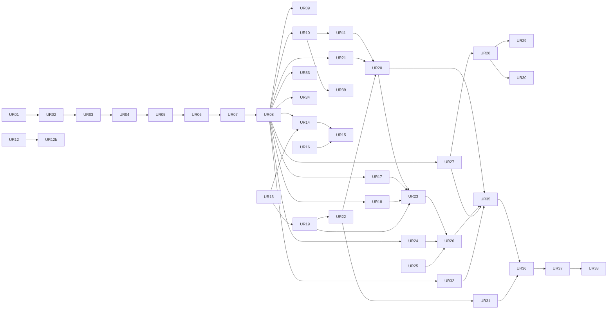

# UI revamp tasks (UR01–UR70)

*Status: draft for Kyle's review, 2026-10-23. Design: [SPEC.md](SPEC.md). Evidence: [AUDIT.md](AUDIT.md). Base branch: `feat/iteration-levels`.*

The tasks are small enough for a fast agent to build without design judgment. Every behaviour, string and test is written down here or in SPEC.md. If a card is silent on something, do the smallest thing that passes the tests, and leave a note in the PR. Don't invent new UI.

## 0. Rules for every UR task

1. **Read first.** Read your card, the SPEC sections it cites, [Appendix A](#appendix-a-easy-copy-catalogue) (copy) and [Appendix B](#appendix-b-shared-types-and-the-host-api) (types). Also read `docs/tasks/RULES.md`.
2. **Check the IL lock.** Run `git fetch origin feat/iteration-levels && git log origin/feat/iteration-levels --name-only -20`. If a file you own appears in an iteration-levels (IL) commit that has not merged into your base, stop and report that the task is blocked. See §5.
3. **Single-file ownership.** Only create or edit the files listed under **Owns**. If you need a change in another file, stop and report it; don't make it. Two tasks that own the same file never run at the same time. The lanes in §1 enforce this.
4. **Tests first.** Write the tests under **Tests first** and run them. They must fail, and the PR description must paste the failing output. Then implement until they pass. Keep the whole suite green: `pnpm -C apps/web test`, `pnpm -C apps/server test`, plus `pnpm -C packages/agent test` when you touch `packages/agent`.
5. **Test patterns.**
   - **Web unit tests** go in `apps/web/test/easy-<name>.test.ts`. They run through `node --experimental-strip-types --test`, so start each file with `// @ts-nocheck`, import from `node:test` and `node:assert/strict`, and import source files with the `.ts` extension. The existing glob `test/*.test.ts` picks them up.
   - **Render functions** return HTML strings. Test them as strings.
   - **Mount functions** are tested only when a fake DOM is not needed. Otherwise cover them with Playwright.
   - **Playwright** specs go in `apps/web/e2e/easy-*.spec.ts`. Run them with `pnpm -C apps/web test:e2e easy-<name>`. The harness `e2e/serve.mjs` starts the real server on CPU only.
6. **No CSS imports in testable modules.** Files that node tests import must not import `.css`. Put styles in a sibling `.css` file that your card owns. `easy/mount.ts` (UR08) loads every `apps/web/src/easy/**/*.css` file with `import.meta.glob('./**/*.css', { eager: true })`, so you never edit a shared stylesheet.
7. **Copy.** Use `COPY` from `apps/web/src/easy/copy.ts` (UR01, Appendix A). If a string you need is missing, define it as a `const` at the top of your own file; never edit `copy.ts` after UR01. The banned-word scanner (UR01) checks every string in `src/easy/`, including HTML templates, so class names and data attributes in Easy must not use banned words either: say `shot`, `version` and `export`, not `clip`, `take` and `render`. Always write "Google Colab", never "Colab" alone.
8. **Money.** Nothing you build may start paid work except through UR23. Never call `/api/run` with a Google Colab backend outside UR23. Never start a Google Colab runtime while testing; e2e tests use This computer or the harness's fake backend.
9. **Kyle approval.** Cards marked **[Kyle]** change rendering, the paid pipeline, the render gate or spend rules. Open the PR as a draft titled `[Kyle] URnn …` and don't merge it without Kyle's written approval. No task may edit `apps/renderer/**`, `packages/planner/**`, `apps/server/src/pipeline*.mjs`, `apps/server/src/run.mjs`, `apps/server/src/export.mjs` or `packages/backends/**`. If you think you must, stop and report it.
10. **Accessibility.** Every interactive element is a real `<button>`, `<a>`, `<input>`, `<select>` or `<textarea>` with a visible label or `aria-label`. Focus rings come from `--focus-ring`. Status is never shown by colour alone.

Card fields: **Tier** is `flash` (a fast agent can do it) or `S` (needs a stronger agent). **Lane** is the serialization group from §1. **Owns** lists the files you may create or edit. **Depends** lists tasks that must be merged first.

## 1. Lanes and order

Tasks in the same lane run one after another, in the order listed. Tasks in different lanes may run at the same time once their dependencies have merged.

| Lane | Files it serializes | Phase 1 order |
|---|---|---|
| `easy-core` | `src/easy/{copy,types,store,steps,api,components,dialog,stepper,shell}.ts` | UR01 → UR02 → UR03 → UR04 → UR05 → UR06 → UR07 |
| `app-shell` | `src/main.ts`, `index.html` | UR08 (Phase 1 has no other task here) |
| `legacy-e2e` | `e2e/density.spec.ts`, `default-project.spec.ts`, `editor.spec.ts`, `screens.spec.ts` | UR09 |
| `easy-steps` | one new file per task under `src/easy/` | UR10, UR11, UR39, UR14, UR15, UR16, UR17, UR18, UR21, UR24, UR25, UR26, UR27, UR28, UR29, UR32, UR33, UR34 run in parallel (each owns its own files); UR20, UR23, UR30 and UR35 come after the ones they depend on |
| `agent` | `packages/agent/src/brief.ts`, `package.ts` | UR12 → UR12b |
| `server` | `apps/server/src/routes/productions.mjs`, `productions/commands.mjs`, `app.mjs`, `takes/gate.mjs` | UR13 → UR19 → UR22 → UR31 |
| `easy-e2e` | `e2e/easy-*.spec.ts`, `e2e/easy-helpers.ts` | UR36 → UR37 → UR38 |
| `editor-shell` (Phase 2) | `src/main.ts`, `index.html`, `src/ui/topbar.css`, `src/ui/statusbar.css` | UR40 → UR41 → UR42 → UR44 → UR47 → UR48 → UR54 → UR55 → UR43 → UR45 → UR56 → UR57 → UR53 |



Server tasks do not depend on the web scaffold and can start on day zero: UR12, UR13 and the `server` lane.

## 2. Phase 1: Easy mode

Phase 1 replaces the CSS-filter Easy mode with the Easy studio of SPEC §3. Advanced mode keeps working unchanged, apart from the hook in UR08.

### UR01 · Easy copy catalogue and banned-word scanner

- **Tier** flash · **Lane** easy-core · **Depends** none
- **Owns**: `apps/web/src/easy/copy.ts` (new), `apps/web/test/easy-copy.test.ts` (new)
- **Build**: export `const COPY` exactly as in Appendix A, wrapped in `Object.freeze`. Also export `fill(template, values)`, which replaces `{name}` placeholders and leaves unknown placeholders as they are, and `BANNED_EASY_WORDS`, the list in SPEC §9.
- **Tests first** (`easy-copy.test.ts`):
  1. Flatten every string in `COPY`. None matches the banned list, all matched case-insensitively and on word boundaries (`\bpackage\b`, `\btakes?\b`, `\bclips?\b`, `\brender\w*\b`, `\bbackend\b`, `\bLLM\b`, `\bGPU units\b`, `\bprocedural\b`, `\bfallback\b`, `\bKokoro\b`, `\bQwen\b`, `\bRemotion\b`, `\bG4\b`, `\bBYO\b`, `\brevision\b`). Also check that `Colab` is always preceded by `Google `.
  2. The scanner reads every `.ts` file under `apps/web/src/easy/` with `readdirSync(..., { recursive: true })`. It strips `//` line comments and `/* */` block comments, then extracts quoted literals with `/(['"`])((?:\\.|(?!\1).)*)\1/g`. It checks only literals that contain a space or start with an uppercase letter, and skips literals that start with `/`, `.`, `#`, `data-`, `aria-` or `http`. No checked literal contains a banned word. The test ignores `copy.test`, and lines containing `banned-ok` are allowed. Use that marker only in `copy.ts`'s own `BANNED_EASY_WORDS`.
  3. `fill('Up to {n} units', { n: 6 })` returns `'Up to 6 units'`, and `fill('{a}', {})` returns `'{a}'`.
- **Done when** the tests pass and the scanner reports 0 findings.

### UR02 · Easy state types and store

- **Tier** flash · **Lane** easy-core · **Depends** UR01
- **Owns**: `apps/web/src/easy/types.ts` (new), `apps/web/src/easy/store.ts` (new), `apps/web/test/easy-store.test.ts` (new)
- **Build**:
  - `types.ts` holds exactly the types in Appendix B (`StepId`, `EasyState` and the rest).
  - `store.ts` exports:
    - `defaultEasyState()`, with the defaults from Appendix B.
    - `normalizeEasyState(raw)`, which rejects unknown shapes field by field and falls back to the defaults. A wrong `version` returns `defaultEasyState()`.
    - `createEasyStore({ storage = localStorage, key })`, returning `{ get, patch, replace, reset, subscribe }`. `patch` shallow-merges top-level fields and deep-merges `idea`, `narration`, `plan`, `generate`, `review` and `exported`. It writes JSON to `storage` under `key`, and calls subscribers with `(next, previous)`. Writes are throttled with a 300 ms trailing debounce, and `flush()` writes now.
    - `storageKey(packageId)`, which returns `comfyrizz.easy.<packageId>` or `comfyrizz.easy.new`.
    - `planInputsHash(state)`, a stable string hash (FNV-1a over `JSON.stringify` of `idea`, `answers`, cast ids, `narration`, `level`, `compute` with sorted keys).
    - `markPlanStaleIfInputsChanged(state)`. If `plan.status === 'ready'` and `state.planHash !== planInputsHash(state)`, it returns the state with `plan.status = 'stale'`; otherwise it returns the state unchanged.
- **Tests first**:
  1. The defaults equal Appendix B.
  2. `normalizeEasyState({ version: 2 })` deep-equals the defaults.
  3. `normalizeEasyState({ version: 1, idea: { lengthS: 45 } })` keeps the default `lengthS: 30`.
  4. `patch({ idea: { text: 'x' } })` keeps the other idea fields.
  5. A subscriber receives the previous and next state.
  6. Storage holds the JSON after `flush()`.
  7. Changing `level` after `plan.status = 'ready'` makes `markPlanStaleIfInputsChanged` return `stale`.
  8. `storageKey(null)` returns `'comfyrizz.easy.new'`.

### UR03 · Step model, resume rules and URL

- **Tier** flash · **Lane** easy-core · **Depends** UR02
- **Owns**: `apps/web/src/easy/steps.ts` (new), `apps/web/test/easy-steps.test.ts` (new)
- **Build** (SPEC §2.2, §3.1, §3.10):
  - `STEPS: readonly StepId[]`, in the order idea, characters, level, plan, generate, review, export.
  - `stepIndex(id)`.
  - `deriveStep(state, facts)`, where `facts = { hasPackage, planApproved, actionsActive, allShotsKept, exportCurrent }`. It applies the six rules of SPEC §3.10 in order. Rule 1: `idea.text.trim().length < 10` returns `idea`. Rule 2: `!hasPackage` returns `characters` when `questionsAsked || questions.length === 0`, else `idea`. Rule 3: `!planApproved` or `plan.status === 'stale'` returns `plan`. Rule 4: `actionsActive` returns `generate`. Rule 5: `!allShotsKept || !exportCurrent` returns `review`. Rule 6: otherwise `export`.
  - `reachable(step, state, facts)`. A step is reachable when it comes at or before the derived step, or when it is `characters`/`level` once the idea is complete. `review` and `export` require `planApproved`.
  - `lockReason(step, state, facts)` returns the matching `COPY.stepper.locked.*` string, or `null`.
  - `readStepFromUrl(search)` returns the `step` value when it is one of `STEPS`, else `null`.
  - `writeStepToUrl(search, step)` returns a search string with `step=` set and every other parameter (`package`, `chat`) kept.
- **Tests first**: one test per resume rule (6). `reachable('review')` is false before approval. `lockReason('plan')` returns `COPY.stepper.locked.plan` before the idea is complete. URL round trip: `writeStepToUrl('?package=p1', 'level')` returns `'?package=p1&step=level'`. `readStepFromUrl('?step=bogus')` returns `null`.

### UR04 · Easy API client

- **Tier** flash · **Lane** easy-core · **Depends** UR02
- **Owns**: `apps/web/src/easy/api.ts` (new), `apps/web/test/easy-api.test.ts` (new)
- **Build**: `createEasyApi(fetchImpl)`. In the app, `fetchImpl` is `apiFetch` from `src/editor/api.ts`. Every method parses JSON. On a non-2xx response it throws `EasyApiError { status, code, message, details }`, where `code` is `body.code ?? body.error ?? 'HTTP_' + status`. On a network failure it throws with `code: 'OFFLINE'`. Methods:
  - `planBrief(prompt, decisions?)`: `POST /api/brief { prompt, mode: 'plan', decisions }`.
  - `buildVideo({ brief, provider? })`: `POST /api/agent`.
  - `createConversation()`: `POST /api/conversations` (UR13), returns `{ chatId }`.
  - `createProduction({ conversationId, packageId })`: `POST /api/productions` with the envelope shown in `e2e/production-spine.spec.ts` (`commandId` and `idempotencyKey` are `crypto.randomUUID()`, `expected: { productionRevision: 0 }`).
  - `getProduction(id)`.
  - `sendCommand(id, envelope)`: `POST /api/productions/:id/commands`.
  - `proposeEasyPlan(id, { level, compute })`: `POST /api/productions/:id/easy-plan` (UR22).
  - `setSpendCap(id, { ceiling, expected })`: `POST /api/productions/:id/spend-cap` (UR19).
  - `dispatchAction(id, body)`: `POST /api/productions/:id/actions`.
  - `startRun(body)`: `POST /api/run`.
  - `listClips(packageId)`: the `clipsPath` helper from `takes/api.ts`.
  - `sceneChip(body)`: `POST /api/scene/chip`.
  - `voiceOptions()`: `GET /api/voice-options`.
  - `colabStatus()`: `GET /api/colab/status`.
  - `exportBundle(body)`: `POST /api/export`.
  - `qa(renderId)`: `GET /api/qa?renderId=`.
- **Tests first**: with a fake `fetchImpl` that records calls:
  1. Each method calls the right method, path and body (one assertion each).
  2. A 409 `{ error: 'conflict' }` throws `EasyApiError` with `status 409` and `code 'conflict'`.
  3. A rejected fetch throws `code 'OFFLINE'`.
  4. `createProduction` sends `kind: 'production.create'` and the payload `{ conversationId, packageId }`.

### UR05 · Easy components and dialog

- **Tier** flash · **Lane** easy-core · **Depends** UR01
- **Owns**: `apps/web/src/easy/components.ts` (new), `apps/web/src/easy/dialog.ts` (new), `apps/web/src/easy/components.css` (new), `apps/web/test/easy-components.test.ts` (new)
- **Build**: every render function HTML-escapes its text and is pure (SPEC §7.2).
  - `renderBanner({ tone: 'info'|'warn'|'danger'|'success', text, actions? })`: `role="alert"` for danger, `role="status"` otherwise.
  - `renderEmptyState({ text, actions })`.
  - `renderErrorState({ what, why?, action })`: `role="alert"`; `why` goes inside `<details><summary>Details</summary>`.
  - `renderSkeleton(rows)`: `aria-busy="true"` and `aria-label` set to the loading text passed in.
  - `renderChoiceCards({ name, legend, options: [{ value, title, body, disabled?, extra? }], value })`: a `<fieldset>` with a `<legend>` and native radio inputs styled as cards. Native radios give arrow-key behaviour without any script.
  - `renderSegmented({ name, legend, options, value })`: the same, as a pill row.
  - `renderChip({ label, pressed?, data })`: a `<button>` with `aria-pressed` only when `pressed` is a boolean.
  - `renderProgressBar({ label, value })`: `role="progressbar"`, `aria-valuemin="0"`, `aria-valuemax="100"`, `aria-valuenow`.
  - `renderButton({ label, kind: 'primary'|'secondary'|'link'|'danger', data, disabled?, reasonId? })`: `aria-describedby=reasonId` when disabled.
  - `dialog.ts`: `openDialog({ title, bodyHtml, actions: [{ label, value, kind }], opener })`. It builds a native `<dialog>` with `aria-labelledby` and calls `showModal()`. It resolves to the clicked action's `value`, or `null` on Esc. It removes the element on close and returns focus to `opener`.
  - `confirmDialog({ title, text, confirmLabel, cancelLabel, opener })` resolves to a boolean. It is the replacement for every native `confirm()`.
- **Tests first**: string tests for each renderer: role attributes, escaping of `<script>`, a disabled button with a reason gets `aria-describedby`, and choice cards render one `checked` input. `dialog.ts` gets one Playwright test, written in UR37.

### UR06 · Stepper

- **Tier** flash · **Lane** easy-core · **Depends** UR03, UR05
- **Owns**: `apps/web/src/easy/stepper.ts` (new), `apps/web/src/easy/stepper.css` (new), `apps/web/test/easy-stepper.test.ts` (new)
- **Build**:
  - `renderStepper({ current, state, facts, needsUpdate: StepId[] })` returns `<nav aria-label="Steps"><ol>`. Each step is an `<li>` containing a `<button data-step="id">` with the label from `COPY.steps`.
  - The current step gets `aria-current="step"`. A done step's button text starts with a visually hidden "Done: ". A locked step gets `aria-disabled="true"` and a visually hidden `<span>` with `lockReason`. A step in `needsUpdate` gets a dot plus the hidden text "Needs update".
  - Below 640 px the CSS hides the list and shows `<button class="stepper-compact">`, reading `fill(COPY.stepper.compact, { n, total: 7, name })`. That button toggles the list open.
  - `mountStepper(el, { onSelect })`: a click on a reachable step calls `onSelect(id)`; clicks on locked steps do nothing.
- **Tests first**:
  1. Seven buttons, in order.
  2. Exactly one `aria-current="step"`.
  3. A locked step has `aria-disabled="true"` and its reason text.
  4. A done step contains "Done: ".
  5. The compact label reads `Step 3 of 7 · Iteration level`.

### UR07 · Easy shell

- **Tier** flash · **Lane** easy-core · **Depends** UR06
- **Owns**: `apps/web/src/easy/shell.ts` (new), `apps/web/src/easy/easy.css` (new), `apps/web/test/easy-shell.test.ts` (new)
- **Build** (SPEC §3.2, §10):
  - `renderShell({ videoName, saveStatus })` returns:
    - `<header>`: logo link (`href="/"`), video name host `[data-easy-name]`, save status `[data-easy-save]` with `aria-live="polite"`, then the **Help**, **Settings** and **Open in editor** buttons.
    - `<div data-easy-stepper>`.
    - `<div data-easy-banner>`, where the Google Colab banner goes.
    - `<main id="easy-main" tabindex="-1">` containing `<div data-easy-step>`.
    - `<footer data-easy-actions>` with **Back**, `<p data-easy-status aria-live="polite">`, `<p data-easy-reason>` and the primary button.
    - A visually hidden `<div data-easy-alert aria-live="assertive">`.
  - `mountShell(root, { onBack, onPrimary, onHelp, onSettings, onOpenEditor })` returns a controller with:
    - `setStep({ id, heading, intro, bodyHtml })`. It replaces the step body, sets the `<h1>` (`tabindex="-1"`) and focuses it. It sets `document.title` to `${COPY.steps[id]} · ${videoName} · Comfyrizz` and announces `fill(COPY.shell.stepAnnounce, { n, total: 7, name })` in the polite region.
    - `setPrimary({ label, disabled, reason })`. When disabled, the reason is shown as text in `[data-easy-reason]` and linked with `aria-describedby`.
    - `setBack(visible)`, `setStatus(text)`, `alert(text)` and `setBanner(html)`.
  - Keyboard: Ctrl/Cmd+Enter anywhere in the shell calls `onPrimary` when the primary is enabled. Alt+← calls `onBack`, and Alt+→ goes to the next reachable step through a callback.
  - **Help** opens `openDialog` with `COPY.help.title` and the four `COPY.help.lines`.
  - CSS: header 56 px, stepper 48 px, sticky footer 64 px, main max-width 880 px (1120 px at ≥ 1440 px). Two-column helper class `.easy-two-col` (7/5 at lg, 8/4 at xl, stacked below 1024 px). Spacing only from `--space-*` tokens. Primary buttons are 44 px tall.
- **Tests first**:
  1. The shell HTML has exactly one `<main>`, one `<header>`, one `<footer>` and one `nav` host.
  2. The primary renders with `aria-describedby` when it is given a reason.
  3. The step announcement text uses `fill`.

### UR08 · Mount the Easy studio in the app **(S)**

- **Tier** S · **Lane** app-shell · **Depends** UR07
- **Owns**: `apps/web/src/easy/mount.ts` (new), `apps/web/src/easy/preview-slot.ts` (new), `apps/web/src/easy/router.ts` (new), `apps/web/src/main.ts`, `apps/web/index.html`, `apps/web/test/easy-router.test.ts` (new)
- **Build**:
  1. `index.html`: add `<div id="easy-root" hidden></div>` as a sibling after `#app`. No other edits.
  2. `main.ts`: build an `EasyHost` object (Appendix B) from existing functions. Map each host method to existing code:
     - `adoptBuiltPackage` is the success branch of `runBrief`, lines ~2167–2181, extracted into a function that `runBrief` also calls.
     - `renderMp4` is `exportMp4` split in two. `renderExportBlob(overrideReason?)` does the save and `/api/render` and returns `{ blob, revision }`. The old `exportMp4` calls it and then does the download, so Advanced behaviour is unchanged.
     - `seekToScene` uses the Player ref and the scene start frame from `timeline.scenes`.
     - `previewTake`, `refreshClips` and `clipGate` (`clipStore.gate()`) map to the existing functions.
     - `applySceneChip(sceneId, chip)` is `applySceneChipFlow`.
     - `openEditor` calls `setMode('advanced')` from `ui/mode.ts`.
     - `playerElement` returns `$('player')`.

     Call `mountEasyStudio(document.getElementById('easy-root'), host)` from `init()`, after the preview mounts. Add no other logic to `main.ts`.
  3. `mount.ts`:
     - Import `./**/*.css` eagerly, plus `easy.css`.
     - Subscribe to the mode. In Easy mode, set `html[data-shell="easy"]`, unhide `#easy-root`, set `#app` to `hidden` and `inert`, and mount the shell. In Advanced mode, do the reverse. Don't unmount `#app`; Advanced state must survive.
     - Hold a registry `steps: Record<StepId, EasyStepModule>` (Appendix B). Each step task registers itself in `apps/web/src/easy/steps/index.ts`; see the note below.
     - On boot, pick the step with `router.ts`, and fall back to `idea` while step modules are missing (they render `COPY.shell.comingSoon`).
  4. `router.ts`, pure: `initialRoute(search, state, facts)` returns `{ step, view }`, and `nextUrl(search, step)` uses `history.pushState` semantics. Back/Forward (`popstate`) re-renders the step.
  5. `preview-slot.ts`: `adoptPlayer(slot, player)` moves the existing `#player` element into `slot` and remembers its original parent. `releasePlayer()` moves it back. React keeps its root because the container element is the same node.
  6. Step registry file: create `apps/web/src/easy/steps/index.ts` with the comment-free line `export const STEP_MODULES = import.meta.glob('./*.ts', { eager: true });`. `mount.ts` picks modules that export `step` with an `id`. Step tasks only add their own file; none edits `index.ts`.
- **Tests first**:
  - `easy-router.test.ts`: `initialRoute('?package=p&step=review', state, { planApproved: false, ... })` returns `plan`. `initialRoute('?view=editor', …)` returns `{ view: 'editor' }`. A new user with no state gets `idea`.
  - One Playwright test in UR09 confirms that Easy shows `#easy-root` and hides `#app`.
- **Note**: this is the only Phase 1 task that touches `main.ts` or `index.html`. Keep the diff in those two files under 120 lines.

### UR09 · Move the legacy Easy-mode e2e tests onto the new shell

- **Tier** flash · **Lane** legacy-e2e · **Depends** UR08
- **Owns**: `apps/web/e2e/density.spec.ts`, `apps/web/e2e/default-project.spec.ts`, `apps/web/e2e/editor.spec.ts`, `apps/web/e2e/screens.spec.ts`
- **Build**:
  - Tests that drive the editor must first set Advanced. Add `await page.addInitScript(() => localStorage.setItem('comfyrizz.ui', JSON.stringify({ mode: 'advanced', density: 'compact' })))` before `goto`.
  - Replace assertions on `#easy-actions` and on "Easy hides X" with the following:
    - In Easy, `#easy-root` is visible and `#app` has the `hidden` attribute.
    - The toggle back to Easy from Advanced still persists the mode.
  - In `screens.spec.ts` (DN10), replace the Easy screenshot with one of the Easy Idea step.
- **Tests first**: run the four specs against UR08 and confirm they fail on `#easy-actions`. Afterwards all four pass.

### UR10 · Step 1: Idea

- **Tier** flash · **Lane** easy-steps · **Depends** UR08
- **Owns**: `apps/web/src/easy/steps/idea.ts` (new), `apps/web/src/easy/steps/idea.css` (new), `apps/web/src/easy/idea-prompt.ts` (new), `apps/web/test/easy-idea.test.ts` (new)
- **Build** (SPEC §3.3):
  - Export `step: EasyStepModule` with `id: 'idea'`, `heading: COPY.idea.heading`, `intro: COPY.idea.intro`, `render(state)` and `bind(el, ctx)`.
  - Fields:
    - A `<textarea id="easy-idea" rows="4">` with a `<label>`.
    - Template chips from `COPY.idea.templates`. Clicking one replaces the text only if the box is empty; otherwise it asks via `confirmDialog(COPY.idea.replaceTitle…)`.
    - Length segmented (15/30/60/90, default 30) and Shape segmented (16:9, 9:16, 1:1).
    - Look choice cards for the six presets in `STYLE_PRESETS` order, with labels from `COPY.idea.looks`. Thumbnails come from `GET /api/brief/presets`, the same source the Brief card uses at `main.ts:1887`. While loading, a card shows an empty tile.
  - A `<details>` **More options** holding the Sound toggle (`COPY.idea.sound`, default on) and the references host `[data-easy-references]`, which UR39 fills.
  - Primary **Continue**:
    - Under 10 characters: show `COPY.idea.tooShort` linked by `aria-describedby`, and focus the textarea.
    - Otherwise: if `questionsAsked` is false, call `ctx.api.planBrief(ideaPrompt(state))` and store `questions` (at most 3) and `questionsAsked = true`. If the reply has questions, `ctx.rerender()` shows them through UR11's block, mounted at `[data-easy-questions]`. If not, go to `characters`.
    - If `questionsAsked` is true, go to `characters`.
    - On error: render `renderErrorState` with `COPY.errors.brief` and **Try again**.
  - `idea-prompt.ts`: `ideaPrompt(state)` builds the same sentence order as `briefToPrompt` in `main.ts:1778`: the idea text, then `Length: about N seconds.`, `Aspect: X.`, `Look: preset.`, `Music: …` or `No music.`, and for each answer `"<question prompt> <answer>"` (skipping `__decide__`).
- **Tests first**:
  1. The render has one `textarea` with a label, 4 template chips, length options with 30 checked, 3 shape options, and 6 look cards.
  2. `ideaPrompt` for a fixed state equals an exact expected string.
  3. A short idea yields the `tooShort` message id in the HTML when rendered with `error: 'tooShort'`.

### UR11 · Inline questions on the Idea step

- **Tier** flash · **Lane** easy-steps · **Depends** UR10
- **Owns**: `apps/web/src/easy/steps/questions.ts` (new), `apps/web/test/easy-questions.test.ts` (new)
- **Build**:
  - `renderQuestions(questions, answers)` returns `<section aria-labelledby="easy-q-h">`, with an `<h2 id="easy-q-h" tabindex="-1">` reading `COPY.questions.heading`. Each question is a `<fieldset>` with a `<legend>` (the prompt) and a radio for each option plus `COPY.questions.decide`. The decide radio is checked by default (value `__decide__`).
  - The server's option labels are shown with their first letter capitalised. The option `none` is shown as `COPY.questions.none`.
  - `bindQuestions(el, { onChange })` writes `answers[id]`.
  - `answersToDecisions(questions, answers)` maps to the `decisions` shape that `POST /api/brief` takes: `{ [question.field]: value }`, skipping `__decide__`.
  - When the block first appears, focus its `h2`.
- **Tests first**:
  1. Three questions render 3 fieldsets with the decide radio checked.
  2. `answersToDecisions` skips decide answers and maps `field`.
  3. The legend text is escaped.

### UR12 · Relevant planner questions and generic calls to action

- **Tier** flash · **Lane** agent · **Depends** none
- **Owns**: `packages/agent/src/brief.ts`, `packages/agent/test/brief.test.ts`, `apps/server/test/brief.test.mjs`
- **Build** (AUDIT A04):
  1. In `missingQuestions`, ask `data` only when the prompt or draft mentions numbers. Add `mentionsNumbers(draft)`, true when the key message or the original prompt (pass it through `draft.source_prompt` if present) matches `/\d|\b(numbers?|data|chart|graph|stats?|statistics|percent|metrics?|growth|revenue)\b|%/i`.
  2. Change the `cta` chips to `['visit the website', 'sign up', 'get in touch', 'none']` and its `decide` to `'none'`.
  3. Change the `audience` chips to `['customers', 'developers', 'investors', 'students', 'internal team']`, keeping `decide: 'developers'` unchanged so packages built from old briefs stay identical.
  4. Leave the extraction regex at `brief.ts:312` unchanged.
- **Tests first**:
  1. `missingQuestions(extractBrief('A 30 second video for my bakery announcing a sourdough subscription'))` contains no `data` question.
  2. The same call with `'… revenue grew 40%'` does contain one.
  3. The `cta` chips do not include `star the repo`.
  4. Server test: `POST /api/brief` with the bakery prompt returns no question with `id: 'data'`.

### UR12b · The offline planner uses the idea's words **(S) [Kyle]**

- **Tier** S · **Lane** agent · **Depends** UR12 · **[Kyle]**: changes what the offline planner puts in a package, which then gets rendered
- **Owns**: `packages/agent/src/package.ts`, `packages/agent/test/offline-idea.test.ts` (new)
- **Build**: `defaultCpuScenes(brief)` currently returns the fixed "CPU time for this slice" and "Where the example minutes went" scenes.
  - Build the scene copy from the brief instead, with the same scene count, layouts, ids and asset slots:
    - The title scene's headline comes from `titleFor(brief)`.
    - The middle scenes' headlines are the first two key messages from `draftKeyMessages(brief, 2)`.
    - The closing scene's headline is the CTA, or "Thanks for watching".
  - Keep the chart scene only when `mentionsNumbers` (UR12) is true. Otherwise make it a text scene with the same id and duration.
  - Don't change the package schema, the timeline, the asset ids or the renderer inputs beyond copy strings and the chart's presence.
- **Tests first**:
  1. A bakery brief produces no scene headline containing "CPU time" or "example minutes".
  2. The title contains "Crumb & Co" when the brief does.
  3. The scene ids and count equal those of today's output.
  4. A numeric brief still contains the chart scene.

### UR13 · Server: create an empty conversation **(S)**

- **Tier** S · **Lane** server · **Depends** none
- **Owns**: `apps/server/src/routes/conversations.mjs` (new), `apps/server/src/app.mjs` (one import and one dispatch line), `apps/server/test/conversations.test.mjs` (new)
- **Build**: `POST /api/conversations` takes `{ packageId? }`.
  - It creates a conversation session through the same session store that `characters/routes.mjs` reads (`sessionStore().read`). The new session is `{ id: 'chat_' + randomUUID(), messages: [], createdAt, packageId }`.
  - It returns `201 { chatId }`. The usual session-token check applies.
  - This lets Easy add cast members and references before any chat turn (AUDIT A11, SPEC §3.4).
- **Tests first**:
  1. POST returns 201 with an id matching `^chat_`.
  2. `GET /api/chat/:id/cast` then returns 200 with an empty cast, not 404.
  3. A request without a token returns 401.

### UR14 · Step 2: Characters

- **Tier** flash · **Lane** easy-steps · **Depends** UR08, UR13
- **Owns**: `apps/web/src/easy/steps/characters.ts` (new), `apps/web/src/easy/dialogs/library-picker.ts` (new), `apps/web/src/easy/steps/characters.css` (new), `apps/web/test/easy-characters.test.ts` (new)
- **Build** (SPEC §3.4):
  - On entry, ensure `state.chatId`: call `api.createConversation()` if it is null and store the id.
  - List the cast with `createCharacterApi({ apiFetch }).listCast(chatId)`. Use the method names from `characters/api.ts` and `castPath`.
  - Each cast card shows the image, name, role label (`COPY.characters.roles[role]`), the voice line and a **Remove** button. The voice line uses `voicePickLine` from UR16, or `COPY.characters.noVoice`.
  - The add tile **Add a character** opens a menu with two items. **From your characters** opens `library-picker.ts`: a dialog with a search box and a list of characters (thumbnail, name, role, **Add**). **Create new** opens UR15's dialog. The step reads it from `ctx.dialogs.quickCharacter`, so UR14 doesn't import UR15.
  - Narration row: a toggle (`COPY.characters.narration`) and the UR16 voice picker host `[data-easy-voice="narrator"]`.
  - Empty state: `COPY.characters.empty` with two buttons. A 404 or `NOT_FOUND` on the cast list renders the empty state, not an error.
  - The primary is **Continue** and is always enabled.
- **Tests first**:
  1. Empty cast renders the empty-state text and 2 actions.
  2. Two cast members render 2 cards, each with a Remove button whose `aria-label` names the character.
  3. A 404 error object renders the empty state.
  4. The library picker filters by name, case-insensitively, in its pure `filterCharacters` function.

### UR15 · Quick character dialog

- **Tier** flash · **Lane** easy-steps · **Depends** UR14, UR16
- **Owns**: `apps/web/src/easy/dialogs/quick-character.ts` (new), `apps/web/src/easy/dialogs/quick-character.css` (new), `apps/web/test/easy-quick-character.test.ts` (new)
- **Build**:
  - `openQuickCharacter({ api, chatId, opener })` opens a dialog with these fields:
    - Name (required).
    - Role select, with the values from `CharacterRole` and labels from `COPY.characters.roles`.
    - Look (textarea).
    - Picture (file input, optional, uploaded with the character API's image upload method).
    - Voice (UR16 picker).
    - The fictional checkbox (`COPY.quickCharacter.fictional`), which is required.
    - A link `COPY.quickCharacter.more` that opens the editor library.
  - **Create character** is disabled until Name and the fictional box are set, with the reason shown as text. On create, call `api.create(...)` and then add the character to the cast for `chatId`. Resolve with the cast entry and return focus to the opener.
  - On a server error, show it inline with `role="alert"` and keep the field values.
  - Pure helper: `quickCharacterPayload(form)` builds the create payload. `kind: 'fictional'` is always set.
- **Tests first**:
  1. `quickCharacterPayload` builds the right payload.
  2. A disabled-reason string is produced when the name is empty or the fictional box is unticked.
  3. The rendered form has a label for every field.

### UR16 · Voice picker with Voice A/B

- **Tier** flash · **Lane** easy-steps · **Depends** UR08 · **IL conflict**: mounts IL20; must not edit `src/characters/audition-panel.ts` or `characters.css`
- **Owns**: `apps/web/src/easy/voice-pick.ts` (new), `apps/web/src/easy/voice-pick.css` (new), `apps/web/test/easy-voice-pick.test.ts` (new)
- **Build**:
  - `renderVoicePick({ id, label, voices, value })` renders a `<select>` of voices, plus **Play** (`aria-label` set to `fill(COPY.voice.playLabel, { name })`) and **Compare two**.
  - Voice names come from `GET /api/voice-options`, displayed as `"<display name>, <character>"`. No engine names.
  - `voicePickLine(voice)` returns the cast card line `Voice: <name>`.
  - **Play** plays the voice's preview URL through an `<audio>` element. It fetches the URL with `apiFetch`, makes a blob URL and stops any other playing preview.
  - **Compare two** opens `openDialog` containing a host. In it, call `mountAuditionPanel(host, options)` from `src/characters/audition-panel.ts` with the two selected voices as candidates. The panel's keep action resolves the dialog with the kept voice id, which this module writes back to the select.
  - When the panel module throws (for example, no auditions are available), show `COPY.voice.compareUnavailable` instead.
- **Tests first**:
  1. The render has a labelled select and two buttons with accessible names.
  2. The label format is `"Bella, warm"`.
  3. `voicePickLine` output is correct.
  4. No engine name (`kokoro`, `qwen`) appears in the HTML for a fixture voice list.

### UR17 · Step 3: Iteration level (IL picker slot)

- **Tier** flash · **Lane** easy-steps · **Depends** UR08 · **IL conflict**: the IL picker owns the level cards
- **Owns**: `apps/web/src/easy/steps/level.ts` (new), `apps/web/src/easy/level-copy.ts` (new), `apps/web/src/easy/steps/level.css` (new), `apps/web/test/easy-level.test.ts` (new)
- **Build** (SPEC §3.5, §11):
  - The step renders `COPY.level.heading` and `COPY.level.intro`, then `<div data-il-slot="iteration-level-picker">`, then the compute host `[data-easy-compute]` that UR18 fills.
  - When `ctx.il?.mountLevelPicker` exists, call `mountLevelPicker(slot, { value: state.level, compute: state.compute, onChange(level) })`. This is the contract proposed to IL; see §5.
  - Otherwise render the fallback: `fill(COPY.level.fallback, { level: COPY.level.names[level], summary })` and an **Open in editor** link.
  - `level-copy.ts`: `describeLevel(preset)` builds the one-line summary from `ITERATION_PRESETS`. Import them with `import { ITERATION_PRESETS } from '../../../server/src/productions/iteration.mjs'`; the module is pure (see its header). The algorithm, with `s = preset.stages`:
    1. If every stage has `takes 1, rounds 1, auditions 0, pick 'auto'`, return `'One version of everything. Fastest. Picked for you.'`
    2. Otherwise build `parts` in this order:
       - When `s.script.takes > 1`: `` `${s.script.takes} scripts` ``.
       - When `s.voice.auditions > 0`: `` `${s.voice.auditions} voice options` ``.
       - When `s.keyframe.auditions > 0`: `` `${s.keyframe.auditions} image options` ``.
       - When `s.video.takes * s.video.rounds > 1`: if `rounds > 1`, `` `up to ${takes * rounds} versions of each shot over ${rounds} rounds` ``, else `` `${takes} versions of each shot` ``.
    3. Join `parts` with `', '` and append `'.'`.
    4. Let `ask` be the number of stages with `pick === 'ask'`. Append `' Picked for you.'` when `ask === 0`, `' You pick at every stage.'` when `ask === 4`, and `' You pick the best version.'` otherwise.
    5. `COPY.level.summaries` is the test oracle, not the source.
  - Default level (SPEC §13 Q4): if `!state.levelTouched`, use `balanced` when `compute === 'colab'` and `draft` otherwise.
  - The primary is **Write my plan**. It is disabled with a reason when `compute === 'colab'` and Google Colab is not signed in or the spend cap is invalid; UR18 exposes `computeBlockReason(state, colabStatus)`.
- **Tests first**:
  1. `describeLevel(ITERATION_PRESETS.balanced)` equals `COPY.level.summaries.balanced`, and the same for draft and director.
  2. The fallback renders when no picker is supplied, and the slot element always exists.
  3. The default level follows compute until `levelTouched`.

### UR18 · Where to make it, and the spend cap

- **Tier** flash · **Lane** easy-steps · **Depends** UR08
- **Owns**: `apps/web/src/easy/compute-choice.ts` (new), `apps/web/src/easy/compute-choice.css` (new), `apps/web/test/easy-compute.test.ts` (new)
- **Build**:
  - `renderCompute({ compute, colabStatus, spendCap, spent })` renders choice cards **This computer** and **Google Colab** with the `COPY.compute.*` bodies. Google Colab is disabled when `colabStatus.signedIn !== true` and shows `COPY.compute.notConnected` with a **Connect** button.
  - With Google Colab selected, show the spend cap: `<label for="easy-cap">`, an `<input type="number" min="0.5" max="500" step="0.5" inputmode="decimal">` (default 15) and the so-far line `fill(COPY.compute.soFar, { spent })`.
  - `validateCap(value)` returns `null` or `COPY.compute.capError`.
  - `computeBlockReason(state, colabStatus)` returns `null`, `COPY.compute.blockNotConnected` or `COPY.compute.capError`.
  - **Connect** opens `openDialog`. Its body hosts `mountSettingsCard(host, apiFetch)` from `src/colab-card.ts`, the existing Google Colab sign-in card, unchanged. On close, re-read `api.colabStatus()`.
  - The cap value is stored in `state.spendCap`; UR23 sends it to the server.
- **Tests first**:
  1. `validateCap` rejects 0, 0.3, 501, 'abc' and 1.25, and accepts 0.5, 15 and 500.
  2. Google Colab is disabled when not signed in.
  3. The cap input exists only when compute is `colab`.
  4. The text says "Google Colab units", never "GPU units".

### UR19 · Server: user-only spend cap command **(S) [Kyle]**

- **Tier** S · **Lane** server · **Depends** UR13 · **[Kyle]**: spend authorization
- **Owns**: `apps/server/src/routes/productions.mjs`, `apps/server/src/productions/commands.mjs`, `apps/server/test/productions/spend-cap.test.mjs` (new)
- **Build**:
  - Add the command kind `budget.set_ceiling` to `APPROVAL_COMMANDS` in `commands.mjs`, so the agent can never send it. Give it the event type `budget.ceiling_set` and no state change in `applyCommand`.
  - Add `POST /api/productions/:id/spend-cap` with body `{ ceiling: number|null, commandId, idempotencyKey, expected: { productionRevision } }`. It does the following:
    1. Records the command through the command handler with `actor: 'user'`.
    2. Calls `ledgerFor(production).setCeiling({ actor: 'user', userEventId: <recorded event id>, ceiling, idempotencyKey })`.
    3. Returns `200 { ceiling, ledgerRevision, revision }`.
  - Reject an agent actor with 403 (`AGENT_CANNOT_SET_CEILING`). Map ledger errors to 400 or 409 the way the other routes do.
  - Don't change `ledger.mjs`.
- **Tests first**:
  1. A user request sets the ceiling, and a reservation above it is then refused with the existing ledger error.
  2. An agent-actor request returns 403.
  3. A retry with the same idempotency key does not append twice.
  4. `budget.set_ceiling` is in `APPROVAL_COMMANDS`.

### UR20 · Plan writer (idea to package to production to plan) **(S)**

- **Tier** S · **Lane** easy-steps · **Depends** UR10, UR11, UR14, UR17, UR21, UR22
- **Owns**: `apps/web/src/easy/plan-writer.ts` (new), `apps/web/test/easy-plan-writer.test.ts` (new)
- **Build**: `writePlan(state, { api, host, store })` is an async state machine. Each phase writes `plan.status` and, on failure, `plan.error` and `plan.errorAt`.
  1. **writing**: `api.buildVideo({ brief: ideaPrompt(state) + castLine(state) })`. `castLine` is `" Characters: Juno (main character), Pip (mascot)."` or an empty string. Pass the AI provider selection only when one is connected; read it from `host.aiSelection()` (UR08 adds it to the host if missing, otherwise use none). Then call `host.adoptBuiltPackage(body)` and store `packageId` and `offline: body.live !== true`.
  2. **building**: if `!state.productionId`, call `api.createProduction({ conversationId: state.chatId, packageId })` and store `productionId`.
  3. **proposing**: `api.proposeEasyPlan(productionId, { level, compute })` (UR22).
  4. **ready**: store `planHash = planInputsHash(state)`.

  Re-entering with `plan.status === 'ready'` and an unchanged hash does nothing. A `stale` plan reruns from step 3 if only the words changed; otherwise it reruns from step 1. Words-only staleness is signalled by `plan.wordsChanged`.
- **Tests first**, with fakes:
  1. The happy path calls the three APIs in order and ends `ready`.
  2. A failure in step 2 leaves the package adopted, sets `errorAt: 'production'`, and a retry starts at step 2.
  3. An unchanged hash makes no calls.
  4. The offline flag is set when `live` is false.

### UR21 · Step 4: Plan view

- **Tier** flash · **Lane** easy-steps · **Depends** UR08 · **IL conflict**: shot thumbnails come from IL asset thumbnails when present
- **Owns**: `apps/web/src/easy/steps/plan.ts` (new), `apps/web/src/easy/steps/plan.css` (new), `apps/web/test/easy-plan-view.test.ts` (new)
- **Build** (SPEC §3.6):
  - The `bind` function calls `ctx.writePlan()` (UR20, injected through ctx) on entry.
  - While `plan.status` is writing, building or proposing: show `renderSkeleton(4)` with `COPY.plan.writing`, `COPY.plan.building` and `COPY.plan.proposing` in the live status.
  - On `error`: `renderErrorState` with `COPY.errors.plan[errorAt]` and **Try again**.
  - On `ready`, two columns:
    - **Shots**: an `<ol>` of `host.getPackage().scenes`. Each row shows "Shot n", the scene title from `copy.headline`, and two inputs, **On screen** (headline) and **Narration**. Edits go through `host.editorStore` commands `SetSceneCopy` and `SetNarrationText` and set `plan.wordsChanged = true`. Each row also has a "Makes:" line from the plan card action for that shot (`fill(COPY.plan.makes, { n, where })`), or `COPY.plan.madeHere` on This computer.
    - **Preview**: the Player slot, adopted with `preview-slot.ts`.
  - Cost box, from `readPlanCard(snapshot)` only:
    - Google Colab: `fill(COPY.plan.cost, { n: ceiling, cap: spendCap })`, then `planImpactSummary(card)` and `fill(COPY.plan.picks, { stages })`.
    - This computer: `COPY.plan.free`.
    - Over the cap: `COPY.plan.overCap` with **Change level** and **Raise cap** links to the `level` step, and the primary disabled.
    - Stale: `COPY.plan.stale`.
  - Required decisions from the plan card each render as one fieldset with the default checked.
  - Offline banner (info) when `offline`: `COPY.plan.offline` with **Connect**, which opens `?settings=ai` in Phase 3 and the Agent settings dialog in Phase 1 through `host.openAgentSettings()`.
  - Primary: **Approve and generate** (Google Colab) or **Generate** (This computer). The action is `ctx.approveAndGenerate()`, injected from UR23.
- **Tests first** (render with fixture states):
  1. Loading shows `aria-busy`.
  2. Error shows `role="alert"` and the retry button.
  3. Ready Google Colab shows "Up to 6 Google Colab units (spend cap 15)".
  4. Over-cap disables the primary and shows both links.
  5. This computer shows "Free. Made on this computer." and the primary label "Generate".
  6. Shot rows have labelled inputs.

### UR22 · Server: deterministic Easy plan proposer **(S) [Kyle]**

- **Tier** S · **Lane** server · **Depends** UR19 · **[Kyle]**: drives paid dispatch · **IL conflict**: if IL ships a level-to-actions expansion, call it instead (SPEC §13 Q3)
- **Owns**: `apps/server/src/productions/plan-from-package.mjs` (new), `apps/server/src/routes/productions.mjs`, `apps/server/test/productions/plan-from-package.test.mjs` (new)
- **Build**: `planFromPackage({ pkg, level, compute, productionId, revision })` is pure.
  - For each scene whose assets need GPU work (`pendingGpu` semantics: an asset with `gen.generator` that is not a CPU generator), it emits one action `{ id: 'act_<sceneId>', kind: 'shot.generate', targetId: sceneId, upperBound, reuse: false, effectiveInputHash, seed }`.
  - `upperBound` uses the existing per-generator unit estimate that `/api/run` budgeting already uses. Find it with `rg "estimate" apps/server/src`, and reuse it; don't copy it.
  - Takes per action come from `effectivePolicyForShot(ITERATION_PRESETS[level], sceneId).stages.video.takes × rounds`.
  - The reservation ceiling is the sum of the upper bounds. `requiredDecisions` is an empty list.
  - With `compute === 'cpu'`, it returns zero actions and a ceiling of 0.

  An optional `onlyShotIds` limits the actions to those scenes; this is the Try again mini plan.

  Route `POST /api/productions/:id/easy-plan { level, compute, onlyShotIds?, chip? }` builds the plan and submits it through the same code path as `POST /api/productions/:id/action-plans`. Plan identity stays server-owned. It returns the snapshot.
- **Tests first**:
  1. A fixture package with 2 GPU scenes at balanced gives 2 actions, each with takes 2.
  2. Draft gives takes 1.
  3. CPU compute gives zero actions and ceiling 0.
  4. The route stores a `plan.proposed` event whose plan id was minted by the server.
  5. The same inputs give the same `effectiveInputHash`.
  6. `onlyShotIds: ['s2']` gives exactly one action.

### UR23 · Approve and generate **(S) [Kyle]**

- **Tier** S · **Lane** easy-steps · **Depends** UR17, UR18, UR19, UR20 · **[Kyle]**: starts paid runs
- **Owns**: `apps/web/src/easy/approve-generate.ts` (new), `apps/web/test/easy-approve-generate.test.ts` (new)
- **Build**: `approveAndGenerate(state, { api, store, snapshot })`:
  1. If `compute === 'colab'`, first call `api.setSpendCap(productionId, { ceiling: state.spendCap })`.
  2. `const result = approvePlan(readPlanCard(snapshot), context)` from `plan-card.ts`. A stale result re-fetches, sets `plan.status = 'stale'`, and returns `COPY.plan.changed`.
  3. `sendPlanApproval(...)`.
  4. For each approved action, `api.dispatchAction(productionId, { payload: { planId, planRevision, actionId } })`.
  5. For each dispatched action, `api.startRun({ packageId, backendId, mode: 'take', budgetUnits: state.spendCap, authority: { productionId, planId, planHash, actionId }, expected })`. The body has the shape used in `e2e/production-spine.spec.ts`. `backendId` comes from `/api/colab/status`.
  6. Set `generate.status = 'running'` and go to the `generate` step.

  On This computer, skip steps 1, 4 and 5. Send `plan.approve` only if the card has a plan (ceiling 0), then go to `generate`, where UR26 takes over.

  No step runs twice: keep an in-flight lock, and the button shows `COPY.plan.approving`.

  Also export `retryShot(state, { api, store }, shotId, chip?)`. It calls `api.proposeEasyPlan(productionId, { level, compute, onlyShotIds: [shotId], chip })`. UR22 accepts `onlyShotIds`, and `chip` is passed into the action note. It then shows the mini plan from UR28 and, on approval, runs steps 2 to 5 for that single plan. One approval covers one paid plan (invariant I7).
- **Tests first**, with fakes:
  1. The Google Colab call order is spend-cap, approve, dispatch × N, run × N.
  2. A stale card makes no dispatch.
  3. CPU makes no run call.
  4. A double click makes one approval.
  5. `budgetUnits` equals the cap.
  6. `retryShot` proposes with `onlyShotIds` and does not dispatch before its own approval.

### UR24 · Step 5: Generate view and Google Colab banner

- **Tier** flash · **Lane** easy-steps · **Depends** UR08
- **Owns**: `apps/web/src/easy/steps/generate.ts` (new), `apps/web/src/easy/colab-banner.ts` (new), `apps/web/src/easy/steps/generate.css` (new), `apps/web/test/easy-generate.test.ts` (new)
- **Build** (SPEC §3.7):
  - Shot list (`<ol>`): one row per shot, with the icon and the text `COPY.generate.status[key]`. Statuses come from `normalizeShots(snapshot)` in `progress.ts`, whose `SHOT_STATUSES` are planned, queued, generating, review, approved, rejected, failed and stale. The key is the status itself, with two exceptions:
    - `queued` while the Google Colab session is starting becomes `waiting_gpu`.
    - `generating` without take counts becomes `generatingUnknown`.

    Icons: ◌ for planned, queued and waiting_gpu; ◔ for generating; ✓ for review and approved; ⚠ for failed and stale; – for rejected. A per-shot **Try again** on `failed` calls `ctx.retryShot(id)`.
  - Counter: `fill(COPY.generate.count, { ready, total })`. Announce it through `createProgressAnnouncer`, at most once every `PROGRESS_ANNOUNCE_INTERVAL_MS`.
  - The preview slot shows the Player; shots that aren't ready are labelled `COPY.generate.placeholder` in an overlay caption under the player.
  - **Stop** calls `confirmDialog(COPY.generate.stopTitle, COPY.generate.stopText, COPY.generate.stopConfirm, COPY.generate.keepGoing)`. On confirm it sends `production.cancel` through `buildProgressControlCommand` and `sendProgressControl`.
  - The primary **Review** is disabled while any shot is planned, queued or generating, with the reason `fill(COPY.generate.notReady, { left })`. This is the only place SPEC §3.7's "ready" is defined for code.
  - `colab-banner.ts`: `renderColabBanner(teardown, usage)` maps the states starting, running, collecting, stopping, stopped and `stop_unconfirmed` to the `COPY.colab.*` texts. Running shows `fill(COPY.colab.running, { used, cap })`. `stop_unconfirmed` uses tone danger and `role="alert"`, shows a dismiss button, and links to the Google Colab connect dialog. It returns `''` when no Google Colab session exists. The shell puts it in `[data-easy-banner]` on every step.
- **Tests first**:
  1. Each of the 8 `SHOT_STATUSES`, plus `waiting_gpu`, maps to its text and icon.
  2. The counter reads "2 of 4 shots ready", where review and approved count as ready.
  3. `stop_unconfirmed` renders `role="alert"` and the exact text "We couldn't confirm the session stopped. Check Google Colab now."
  4. No Google Colab session renders `''`.
  5. The Review primary is disabled with the reason while shots are running.

### UR25 · Live production events

- **Tier** flash · **Lane** easy-steps · **Depends** UR04
- **Owns**: `apps/web/src/easy/events.ts` (new), `apps/web/test/easy-events.test.ts` (new)
- **Build**: `watchProduction({ productionId, fetchImpl, onState, intervalMs = 2000 })` wraps `createProductionClient` from `src/productions/client.ts`.
  - It reads the snapshot once, then follows the events endpoint. Use whatever `client.ts` supports; if it only polls, poll every `intervalMs`, and back off to 10 s while `document.hidden`.
  - It calls `onState(state)` with the merged `ProductionState`, and returns `stop()`.
  - On `ProductionClientError` it calls `onState` with `error` set, and keeps retrying with backoff of 2, 4, 8 and 16 s, then every 30 s.
- **Tests first**, with a fake fetch and a fake timer passed in via options:
  1. The first snapshot arrives through `onState`.
  2. Event batches are merged, so the revision increases.
  3. An error triggers a retry with backoff.
  4. `stop()` halts the calls.

### UR26 · This computer path

- **Tier** flash · **Lane** easy-steps · **Depends** UR23, UR24, UR25
- **Owns**: `apps/web/src/easy/cpu-path.ts` (new), `apps/web/test/easy-cpu-path.test.ts` (new)
- **Build**: `runCpuGenerate({ host, store, go })`.
  - With `compute === 'cpu'`, the Generate step shows `COPY.generate.cpuWorking`, calls `host.refreshClips()` and waits until the preview has compiled. Wait on `host.editorStore` derived state, with a 60 s timeout that shows `COPY.errors.cpuTimeout`.
  - It then sets `generate.status = 'done'`, announces `COPY.generate.cpuReady` and calls `go('review')`.
  - Nothing is dispatched and `/api/run` is never called.
- **Tests first**:
  1. With fakes, the CPU path ends in `review` and makes zero `startRun` calls.
  2. The timeout shows the error text.

### UR27 · Step 6: Review

- **Tier** flash · **Lane** easy-steps · **Depends** UR08 · **IL conflict**: the shot strip uses IL asset thumbnails when present
- **Owns**: `apps/web/src/easy/steps/review.ts` (new), `apps/web/src/easy/shot-strip.ts` (new), `apps/web/src/easy/steps/review.css` (new), `apps/web/test/easy-review.test.ts` (new)
- **Build** (SPEC §3.8):
  - Layout: the large Player slot on top, then the shot strip, the shot panel host `[data-easy-shot]` (filled by UR28) and the **Ask for changes** button (UR30).
  - `renderShotStrip(shots, selectedId)` renders a `role="listbox"` with `aria-label="Shots"` and `aria-activedescendant`. Each option (`role="option"`, `id="shot-<id>"`) shows "n", a thumbnail (`shot.thumbnailUrl`, or a numbered tile), and a state icon with hidden text: `COPY.review.kept`, `COPY.review.needsChoice` or `COPY.review.ready`.
  - Left and Right move the selection, Home and End jump. Selecting calls `host.seekToScene(sceneId)` and writes `review.shotId`.
  - Render gate: `host.clipGate()`. The status shows `fill(COPY.review.status, { kept, total })` and, when blocked, `fill(COPY.review.firstNeeds, { n })`. Clicking the status selects that shot.
  - The primary **Export video** is disabled while the gate is blocked, with the reason `COPY.review.blocked`.
  - A read-only line `COPY.review.editedInEditor` (with **Open in editor**) shows when the package has custom timing, transitions or motion. Use `editorStore` derived flags; if there are none, check `scene.transitionOut`, `scene.motion` and `editor.preferredFrames`.
- **Tests first**:
  1. The strip has `role=listbox`, 4 options and `aria-activedescendant` set.
  2. The status text for 3 of 4 kept is "3 of 4 shots kept · Shot 2 needs a choice".
  3. The primary is disabled with the reason when blocked.
  4. No asset id (`a_svg_`) appears in the HTML for a fixture.

### UR28 · Shot panel: versions, Keep, Try again, Compare

- **Tier** flash · **Lane** easy-steps · **Depends** UR27 · **IL conflict**: the compare view is IL's; this task only opens it through a slot
- **Owns**: `apps/web/src/easy/shot-card.ts` (new), `apps/web/src/easy/shot-card.css` (new), `apps/web/test/easy-shot-card.test.ts` (new)
- **Build**:
  - `renderShotCard({ shot, versions, selectedVersionId, compute, colabLeft })` renders:
    - A `<section aria-labelledby>` titled `fill(COPY.review.shotTitle, { n, title })`.
    - The version switcher: ◀ and ▶ buttons with `aria-label`s and the text `fill(COPY.review.version, { i, count })`. It's hidden when there is one version.
    - **Keep this version**, or `COPY.review.keptLabel` once kept, and **Compare versions** when there are two or more versions.
    - The **Try again** chips. Map `COPY.review.retryChips` to the existing chip ids `warmer`, `calmer-motion`, `more-depth` and `less-busy` (the agent's `SCENE_CHIPS`). Labels: Warmer, Calmer, More detail, Simpler. Add **Something else…**.
    - The `[data-easy-words]` host, which UR29 fills.
  - Behaviour:
    - The switcher calls `host.previewTake(clipId, takeId)`.
    - **Keep** sends the existing take selection and user verdict. Use the functions in `src/takes/api.ts` (`select` plus `verdict`, the same calls `review-drawer.ts` makes) and then `host.refreshClips()`.
    - **Compare versions** calls `ctx.il?.openCompare?.(shotId)` and opens `<div data-il-slot="compare-view">` in a dialog. Without IL it is hidden.
    - On This computer, a chip calls `host.applySceneChip(sceneId, chipId)`. On Google Colab it opens a mini plan `confirmDialog` with `fill(COPY.review.retryCost, { n, cost, left, cap })` before calling `ctx.retryShot(shotId, chipId)`. `retryShot` comes from UR23's module; it proposes a single-shot plan via `easy-plan` with the same rules and needs its own approval (SPEC §13 Q14).
    - **Something else…** calls `ctx.openAsk(fill(COPY.ask.prefill, { n }))`.
  - **Keep all** button on the Review step when more than one shot needs a choice: `confirmDialog(COPY.review.keepAllTitle, list of shot names)`, then keep the selected version of each shot. Never a native `confirm()`.
- **Tests first**:
  1. One version hides the switcher.
  2. Two versions show "Version 2 of 2" and Compare.
  3. The chip labels and ids map exactly.
  4. The Google Colab chip path produces the cost text "Try shot 2 again: up to 2 Google Colab units (4.4 of 15 left)."
  5. No `confirm(` call exists in `src/easy/` (a grep test).

### UR29 · Shot words (On screen and Narration)

- **Tier** flash · **Lane** easy-steps · **Depends** UR28
- **Owns**: `apps/web/src/easy/shot-text.ts` (new), `apps/web/test/easy-shot-text.test.ts` (new)
- **Build**: `renderShotText(scene)` renders two labelled inputs: **On screen** (`copy.headline`, max 80 characters) and **Narration** (a textarea, `narration.text`).
  - `bindShotText(el, { host, sceneId })` sends `SetSceneCopy` with `{ headline }` on input, debounced by 400 ms, and `SetNarrationText` on change. It uses the existing `editorStore` dispatch method; see `editor/store.ts`.
  - After a narration change, show `COPY.review.voiceNeedsUpdate` with **Make the voice again**. That calls the editor's existing narration refresh if available (find it with `rg "narration" src/editor/audio`); otherwise it only shows the note.
- **Tests first**:
  1. Labels exist and the maxlength is 80.
  2. Escaping works.
  3. The command builder `shotTextCommands(sceneId, { headline })` returns `[{ type: 'SetSceneCopy', sceneId, copy: { headline } }]`.

### UR30 · Ask for changes drawer **(S)**

- **Tier** S · **Lane** easy-steps · **Depends** UR28
- **Owns**: `apps/web/src/easy/ask-drawer.ts` (new), `apps/web/src/easy/ask-drawer.css` (new), `apps/web/test/easy-ask-drawer.test.ts` (new)
- **Build** (SPEC §3.8):
  - A non-modal `<aside aria-labelledby>` on the right (a bottom sheet below 640 px) with a close button. Esc closes it and returns focus.
  - It hosts the existing project chat for `state.chatId` by calling `createProjectChat` from `src/project-chat.ts` with a host element. If `project-chat.ts` does not expose a host-mountable factory, stop and report it; don't edit `project-chat.ts` in Phase 1.
  - Agent proposals render with that module's existing Accept and Reject controls.
  - Without an AI provider, show `COPY.ask.noProvider` with **Connect** and don't mount the chat.
  - Prefill text from `openAsk(text)` goes into the composer.
  - Anything that costs units must go through the plan flow (UR23); the drawer itself never dispatches.
- **Tests first**:
  1. Render without a provider shows the no-provider text and no textarea.
  2. Render with a provider has a labelled composer.
  3. The drawer has `aria-labelledby` and a close button.

### UR31 · Server: work made on this computer doesn't block export **(S) [Kyle]**

- **Tier** S · **Lane** server · **Depends** UR22 · **[Kyle]**: render gate rule (AUDIT A01, SPEC §13 Q7)
- **Owns**: `apps/server/src/takes/gate.mjs`, `apps/server/test/final-gate.test.mjs`
- **Build**:
  - In `finalGate`, a clip whose asset was generated on CPU and that has zero takes counts as approved. Generated on CPU means `asset.gen.generator` is in `CPU_GENERATORS`, a new exported `Set`.
  - Start the set with `'llm-svg'`. Add every other generator that runs without a GPU, found with `rg "generator: '" packages/agent/src`, and list them in the PR for Kyle.
  - Add `autoApproved: n` to the return value.
  - A CPU clip that does have takes is judged as today. GPU clips are unchanged.
  - Don't change `deriveClipState`, `clips.mjs` or the render route.
- **Tests first**:
  1. A package with 4 `llm-svg` assets and no takes gives `ok: true` and `autoApproved: 4`.
  2. A `flux3-klein` asset with no takes still blocks.
  3. An `llm-svg` asset with a rejected take still blocks.

### UR32 · Step 7: Export

- **Tier** flash · **Lane** easy-steps · **Depends** UR08
- **Owns**: `apps/web/src/easy/steps/export.ts` (new), `apps/web/src/easy/steps/export.css` (new), `apps/web/test/easy-export.test.ts` (new)
- **Build** (SPEC §3.9):
  - On entry, call `host.renderMp4()`. Show `renderProgressBar` with `COPY.export.working`, an indeterminate bar that steps at 10 % every 9 s up to 90 %, because the server reports no progress.
  - On success:
    - The heading becomes `COPY.export.doneHeading` and gets focus.
    - A `<video controls>` plays the blob URL, with a captions track when the package has narration. Its src is the export bundle's captions file if available.
    - A meta line shows `name · 0:30 · 16:9 · 3.0 MB`.
    - **Download MP4** is an `<a download="<video-name>.mp4">` link to the blob URL.
    - **Download captions and extras** calls `api.exportBundle({ packageId })` and downloads the ZIP the same way.
    - The QA line comes from `api.qa(renderId)` if the render returns an id: `COPY.export.qaPass`, or `fill(COPY.export.qaNotes, { n })` in a `<details>`.
    - The Google Colab line `COPY.colab.stopped` shows only if a session existed and teardown is `stopped`.
    - Links **Make another version** (go to `review`) and **Start a new video**, which resets the store and goes to `/`.
    - Store `exported.revision`.
  - The blob URL is revoked when the user leaves the step.
  - Error: `fill(COPY.export.failed, { reason })` with **Try again** and **Open in editor**.
  - Stale: when `pkg.revision > exported.revision`, show `COPY.export.stale` with **Export again**.
- **Tests first** (pure render functions):
  1. The working state has a progressbar.
  2. The done state has the heading, a video element, the Download link with the correct `download` name, and the QA text.
  3. The failure has `role=alert`.
  4. The stale text shows when the revision is newer.
  5. The file name is slugified ("Crumb & Co" becomes `crumb-co.mp4`).

### UR33 · Video name in the header

- **Tier** flash · **Lane** easy-steps · **Depends** UR08
- **Owns**: `apps/web/src/easy/project-name.ts` (new), `apps/web/test/easy-project-name.test.ts` (new)
- **Build**: `mountProjectName(el, { host })` shows the package title as a button (`aria-label` from `COPY.shell.renameLabel`). Clicking turns it into an `<input aria-label="Video name">`. Enter or blur saves, and Esc cancels.
  - Save through the editor store's title command if one exists. Otherwise `PATCH /api/package/:id` with `baseRevision`, as `exportMp4` does, and adopt the result.
  - An empty value restores the old one. Max 80 characters.
  - The display falls back to `COPY.shell.untitled`.
- **Tests first**: `normalizeName('  ')` returns `null`, `normalizeName('x'.repeat(90))` has length 80, and the render has an accessible name.

### UR34 · Recent videos and Try the example

- **Tier** flash · **Lane** easy-steps · **Depends** UR08
- **Owns**: `apps/web/src/easy/recent.ts` (new), `apps/web/test/easy-recent.test.ts` (new)
- **Build**:
  - `localStorage['comfyrizz.recent']` holds an array of `{ packageId, title, updatedAt }`, newest first, at most 8.
  - `rememberVideo(pkg)` is called by mount when a package is adopted (through the store subscription; no edit to `mount.ts` is needed if the step calls it).
  - `renderRecent(list, now)` shows `fill(COPY.recent.item, { title, ago })` links to `?package=<id>`, plus **Try the example** linking to `?package=pkg_pipnightshift01&step=review` (`DEFAULT_PACKAGE_ID`).
  - It renders on the Idea step for a new video at `[data-easy-recent]`.
  - `timeAgo(ms)` returns "just now", "N minutes ago", "N hours ago" or "N days ago".
- **Tests first**: dedupe by `packageId`, the cap of 8, `timeAgo` boundaries (59 s, 61 s, 25 h), and the example link URL.

### UR35 · Resume on boot

- **Tier** flash · **Lane** easy-steps · **Depends** UR20, UR26, UR27, UR32
- **Owns**: `apps/web/src/easy/resume.ts` (new), `apps/web/test/easy-resume.test.ts` (new)
- **Build**: `resumeFacts({ api, host, state })` gathers the facts for `deriveStep`:
  - `hasPackage`: the package id is in state and the loaded package matches.
  - `planApproved`: from the production snapshot's `plan.approved` event.
  - `actionsActive`: any action queued, dispatching or running.
  - `allShotsKept`: `host.clipGate().ok`.
  - `exportCurrent`: `exported.revision === pkg.revision`.

  It returns facts that default to false when a call fails, and never throws. Mount calls it on boot and on `popstate`. While it loads, show `COPY.shell.loading`.
- **Tests first**: with fakes, each fact is derived correctly, and a failing production call yields `planApproved: false`.

### UR36 · Easy end-to-end flow on This computer

- **Tier** flash · **Lane** easy-e2e · **Depends** UR35, UR31
- **Owns**: `apps/web/e2e/easy-flow.spec.ts` (new), `apps/web/e2e/easy-helpers.ts` (new)
- **Build**: `easy-helpers.ts` copies `loadEnv`, `resetProject` and `api` from `editor.spec.ts`, and adds `openEasyNew(page)`, which clears localStorage and goes to `/#token=…`.

  Tests:
  1. **Click budget.** Count clicks from first open to the Download link, accepting defaults:
     - Type the idea.
     - Continue.
     - Continue (questions defaulted).
     - Continue (characters).
     - Write my plan.
     - Generate.
     - Export video.
     - Download MP4.

     That is at most 8 clicks. Assert that the download event fires with a `.mp4` name.
  2. **Keyboard only.** The same path with only Tab, Shift+Tab, Enter, Space and the arrow keys. Assert the primary is at most 5 Tab presses from the `h1` on every step.
  3. **Back keeps work.** Go back from Review to Idea and change the text. The stepper shows "Needs update" on Plan, and the versions are still listed when returning to Review.
  4. **Resume.** Reload on Review and land on Review.
  5. **No paid calls.** Fail the test if any request goes to `/api/run` or carries a `colab:` backend id.
- **Tests first**: they fail before UR35; they pass after.

### UR37 · Easy accessibility suite

- **Tier** flash · **Lane** easy-e2e · **Depends** UR36
- **Owns**: `apps/web/e2e/easy-a11y.spec.ts` (new)
- **Build**:
  - Axe with the tags `wcag2a`, `wcag2aa`, `wcag21aa` and `wcag22aa` on every step and on every dialog: quick character, library picker, Compare two, Stop, Keep all and Help. Fail on serious or critical violations.
  - Focus tests:
    - The step `h1` is focused after each step change.
    - A dialog returns focus to its opener.
    - The questions heading is focused when it appears.
    - Esc closes the ask drawer.
  - Visible controls on each step are 15 or fewer (25 on Review), counted as visible `button, a[href], input, select, textarea` inside `#easy-root`.
- **Tests first**: run them before the step tasks merge (they fail), and after (they pass).

### UR38 · Easy on small screens

- **Tier** flash · **Lane** easy-e2e · **Depends** UR37
- **Owns**: `apps/web/src/easy/easy-mobile.css` (new), `apps/web/e2e/easy-mobile.spec.ts` (new)
- **Build** (SPEC §3.11):
  - At 640 px and below: the stepper becomes compact, the action bar is sticky with the primary visible, and choice cards are one per row.
  - From Plan onward the Player is sticky at the top, at 16:9 and full width.
  - No horizontal scroll from 360 px up. Targets are at least 24 × 24 px.
- **Tests first**, at 360 × 740 and 390 × 844:
  1. `document.documentElement.scrollWidth <= innerWidth` on every step.
  2. The primary is in the viewport without scrolling.
  3. Every visible control's bounding box is at least 24 × 24.

### UR39 · Reference images on the Idea step

- **Tier** flash · **Lane** easy-steps · **Depends** UR10, UR13 · **IL conflict**: don't edit `src/references/*`; thumbnails come from IL
- **Owns**: `apps/web/src/easy/steps/references.ts` (new), `apps/web/test/easy-references.test.ts` (new)
- **Build**:
  - Inside Idea › More options, add **Add images** (a file input, multiple, images only), which uploads through `createReferenceApi({ apiFetch })` for `state.chatId`. Create the conversation first via `api.createConversation()` if needed.
  - Each reference row shows a thumbnail (the IL thumbnail URL if present, else a file icon), the file name, one `<select>` **Use it for** with `COPY.references.roles`, an optional note input and **Remove**.
  - Remove asks through `confirmDialog`. There are no role chips.
- **Tests first**:
  1. One select per reference and zero chip buttons.
  2. Every key of `COPY.references.roles` is in `ROLES` from `src/references/panel.ts`. Import it in the test only; the Easy module hard-codes the 7 ids.
  3. A missing thumbnail renders the icon with `alt=""` and the file name as text.

## 3. Phase 2: Advanced editor

Phase 2 cleans up the editor (SPEC §5). Most tasks touch `main.ts` or `index.html` and run in the `editor-shell` lane, one at a time. Each task deletes code; tests assert the absence of the removed control and the presence of its replacement.

### UR40 · Remove the old Easy actions bar

- **Tier** flash · **Lane** editor-shell · **Depends** UR09
- **Owns**: `apps/web/src/main.ts`, `apps/web/index.html`, `apps/web/e2e/editor-cleanup.spec.ts` (new; later Phase 2 tasks append to it in lane order)
- **Build**:
  - Delete `mountEasyActions`, `renderModeSummary`, `modeSummaryLabels` and the `#easy-actions` markup.
  - Delete the Render changes and Re-render scene buttons from the storyboard. They stay reachable as timeline actions; leave those alone.
  - Delete `[data-adv]` CSS-filter rules only if no remaining node uses them.
- **Tests first** (`editor-cleanup.spec.ts`): in Advanced, there is no `#easy-actions`, no button named "Render changes" and no button named "Re-render scene".

### UR41 · Remove the static stepper

- **Tier** flash · **Lane** editor-shell · **Depends** UR40
- **Owns**: `apps/web/index.html`, `apps/web/src/ui/topbar.css`, `apps/web/e2e/editor-cleanup.spec.ts`
- **Build**: delete the "Brief · Storyboard · Takes · Render" markup and its CSS (AUDIT A16).
- **Tests first**: the top bar contains no text "Storyboard".

### UR42 · One Export MP4 button and a More menu

- **Tier** flash · **Lane** editor-shell · **Depends** UR41
- **Owns**: `apps/web/index.html`, `apps/web/src/main.ts`, `apps/web/e2e/editor-cleanup.spec.ts`
- **Build**:
  - Rename Render to **Export MP4**.
  - Replace the Export ▾ menu with **More ▾**, containing Export bundle, Duplicate video (hidden until UR60) and Open in studio.
  - Remove Export bundle from the Run rail.
  - Remove the "N/M approved" chip from the top bar. Its state shows as the Export MP4 disabled reason, and the drawer opens from the Production tab (UR52).
- **Tests first**: exactly one button named "Export MP4", More contains "Export bundle", and the rail has no "Export bundle".

### UR43 · The Generate tab replaces Run on backend **(S) [Kyle]**

- **Tier** S · **Lane** editor-shell · **Depends** UR23, UR55 · **[Kyle]**: changes how the pipeline is entered from the editor
- **Owns**: `apps/web/src/main.ts`, `apps/web/index.html`, `apps/web/src/editor/inspector/generate.ts` (new), `apps/web/src/voice-settings.ts`, `apps/web/test/inspector-generate.test.ts` (new)
- **Build**:
  - A new inspector tab **Generate** contains:
    - Where to make it: UR18's `renderCompute`, reused.
    - The IL picker slot `data-il-slot="iteration-level-picker"`.
    - The mini plan: UR21's cost box.
    - **Approve and generate**: UR23's `approveAndGenerate`.
  - Remove **Run on backend** and `runOnBackend`.
  - Remove the Voice tab's Visual generation group, "Generate video" and "Approve ceiling & generate".
- **Tests first**:
  1. The inspector has a Generate tab.
  2. No button named "Run on backend".
  3. The Voice tab has no "Generate video".
  4. The Generate tab primary calls `approveAndGenerate` (unit test with fakes).

### UR44 · One composer, with Skip questions

- **Tier** flash · **Lane** editor-shell · **Depends** UR42
- **Owns**: `apps/web/src/main.ts`, `apps/web/index.html`, `apps/web/e2e/editor-cleanup.spec.ts`
- **Build**: remove the Chat/Express segmented toggle and add a checkbox **Skip questions** (unchecked by default). When it is checked, `briefMode = 'express'`.
- **Tests first**: there is no button named "Express", and the checkbox is labelled.

### UR45 · One way to start a video in the editor **(S)**

- **Tier** S · **Lane** editor-shell · **Depends** UR44, UR20
- **Owns**: `apps/web/src/main.ts`, `apps/web/index.html`, `apps/web/e2e/editor-cleanup.spec.ts`
- **Build**:
  - The editor composer sends to the project chat when an AI provider is connected.
  - Without one, it runs `planBriefFlow`, but the Brief card is removed. Questions render inline in the chat as UR11 blocks, then the build uses `ideaPrompt` from `easy/idea-prompt.ts`. Delete `briefToPrompt`, `renderBriefCard`, `readBriefCard` and `buildFromCard`.
  - Brand kit fields move to Settings in UR62. Until then, keep `brandCard` behind a **Brand kit** disclosure in the composer.
- **Tests first**: there is no `[data-brief-card]`, and the scripted build from the composer still produces a package that uses the idea's words (asserting UR12b).

### UR46 · Remove reference role chips

- **Tier** flash · **Lane** (own) · **Depends** none · **IL conflict**: check the IL lock on `src/references/panel.ts` first
- **Owns**: `apps/web/src/references/panel.ts`, `apps/web/src/references/panel.test.ts`
- **Build**: delete the ten role chip buttons per reference and keep the select. Change the `confirm()` on delete to `confirmDialog` from `easy/dialog.ts`.
- **Tests first**: the panel render has zero `[data-role-chip]` and one select per reference, and `panel.ts` contains no `confirm(`.

### UR47 · Presenter controls and Try again in the storyboard

- **Tier** flash · **Lane** editor-shell · **Depends** UR44
- **Owns**: `apps/web/src/main.ts`, `apps/web/e2e/editor-cleanup.spec.ts`
- **Build**:
  - Delete `WEB_PRESENTER_PRESETS` and the "quick" chips; keep the coverage chips and the per-scene select.
  - Rename **Regenerate media** to **Try again**. Rename the chip labels to Warmer, Calmer, More detail and Simpler, keeping the ids.
- **Tests first**: no "Intro/outro" chip, no button named "Regenerate media", and chip ids unchanged.

### UR48 · Status bar, save badge and theme

- **Tier** flash · **Lane** editor-shell · **Depends** UR47
- **Owns**: `apps/web/index.html`, `apps/web/src/main.ts`, `apps/web/src/ui/statusbar.css`, `apps/web/e2e/editor-cleanup.spec.ts`
- **Build**:
  - Keep one save status, in the top bar. Remove the timeline toolbar Saved and the inspector Saved through the timeline's existing hide hook. If the timeline has no hook, leave the timeline one and record it for UR63.
  - Move open weights, `ctx`, EVENTS and QUEUED into a **Diagnostics** popover.
  - Rename Theme to **Colours**, and Palette 1–4 to Background, Accent, Text and Highlight (keep the same input order).
- **Tests first**: exactly one element with text "Saved" in the top bar and status bar; the status bar has no "ctx" text until Diagnostics is opened.

### UR49 · One spend cap and one Google Colab place **(S) [Kyle]**

- **Tier** S · **Lane** (own; starts after UR43) · **Depends** UR43, UR19 · **[Kyle]**: spend inputs
- **Owns**: `apps/web/src/voice-settings.ts`, `apps/web/src/voice-settings.css`, `apps/web/src/colab-card.ts`, `apps/web/test/spend-consolidation.test.ts` (new)
- **Build**:
  - Remove Total compute-unit ceiling, Qwen allocation ceiling and the second Final render select from the Voice tab.
  - The only editable cap is the production spend cap (UR19), shown in the Generate tab. The Google Colab card shows the cap read-only.
  - The Run settings Budget input is removed in UR62. Until then, make it read-only with the text "Set the spend cap in Generate".
- **Tests first**: the voice settings render has no "ceiling" input, and the Google Colab card render shows the cap as text.

### UR50 · Fix the Agent settings dialog leak

- **Tier** flash · **Lane** (own) · **Depends** none
- **Owns**: `apps/web/src/agent-settings.ts`, `apps/web/src/agent-settings.css`, `apps/web/test/agent-settings-dialog.test.ts` (new)
- **Build**: open with `showModal()` and close with `close()`. Never render the dialog open-but-offscreen. The closed dialog has no tabbable descendants.
- **Tests first**: the closed-state HTML has no `open` attribute, and the mount uses `showModal` (a fake dialog records the call).

### UR51 · One way into Characters in the editor

- **Tier** flash · **Lane** (own) · **Depends** none · **IL conflict**: don't edit `characters.css`
- **Owns**: `apps/web/src/characters/mount.ts`, `apps/web/src/characters/cast-strip.ts`, `apps/web/test/characters-entry.test.ts` (new)
- **Build**:
  - The top bar **Characters** opens the library.
  - The cast strip's **Create character** opens the same library with the editor drawer open on a new character. It must do something visible (AUDIT A10).
  - The overlay never shows the empty state and the editor at the same time.
  - A cast 404 renders the empty state, not an error.
- **Tests first**: the cast strip render with a `NOT_FOUND` error shows the empty text, and the overlay render with the editor open hides the empty state.

### UR52 · Character editor sections, and the Production tab **(S)**

- **Tier** S · **Lane** (own) · **Depends** UR51 · **IL conflict**: characters CSS
- **Owns**: `apps/web/src/characters/editor.ts`, `apps/web/src/editor/inspector/production.ts` (new), `apps/web/test/characters-editor-sections.test.ts` (new), `apps/web/test/inspector-production.test.ts` (new)
- **Build**:
  - Character editor: wrap Identity, Look, Wardrobe, Expressions, Voice and Bible in `<details>`, with only Identity open.
  - New inspector tab module **Production**: renders `renderPlanCard`, `renderScriptCard`, `renderProgressCard` and the review drawer list, using `watchProduction` (UR25).
  - Mounting the tab in the inspector is done in UR53 (main.ts lane).
- **Tests first**: the editor render has 6 `details` elements with one open, and the production tab render contains `[data-plan-card]` for a fixture snapshot.

### UR53 · Review drawer wording, rail names and the Production tab mount

- **Tier** flash · **Lane** editor-shell (last) · **Depends** UR52, plus the IL compare view merged · **IL conflict**: `src/takes/review-drawer.ts`
- **Owns**: `apps/web/src/takes/review-drawer.ts`, `apps/web/src/main.ts`, `apps/web/index.html`, `apps/web/test/review-drawer.test.ts`
- **Build**:
  - Review rows show "Shot n · title" instead of the asset id.
  - Replace `confirm()` at `review-drawer.ts:1127` with `confirmDialog`.
  - Rename the rail tabs to Activity, Files and Jobs (Run plus Activity merge into Activity).
  - Mount the Production tab (UR52) in the inspector.
- **Tests first**: row text contains no `a_svg_`, there is no `confirm(` in `review-drawer.ts`, and the rail tab names are exact.

### UR54 · One transport in the editor

- **Tier** flash · **Lane** editor-shell · **Depends** UR48
- **Owns**: `apps/web/index.html`, `apps/web/src/main.ts`, `apps/web/e2e/editor-cleanup.spec.ts`
- **Build**: hide the preview's Play, scrub and time readout while the timeline dock is visible; the timeline transport is the one control. Both read the same frame.
- **Tests first**: with the timeline visible, one Play button is visible.

### UR55 · Frame QA wording

- **Tier** flash · **Lane** editor-shell · **Depends** UR54
- **Owns**: `apps/web/src/main.ts`, `apps/web/e2e/editor-cleanup.spec.ts`
- **Build**: `renderQaPanel` shows "Quality check passed · N notes" or "Quality check found problems · N notes" instead of "QA pass · N findings".
- **Tests first**: the text matches after a fixture render.

### UR56 · Mount the command palette

- **Tier** flash · **Lane** editor-shell · **Depends** UR45
- **Owns**: `apps/web/src/main.ts`, `apps/web/test/palette-mount.test.ts` (new)
- **Build**: mount `src/ui/palette.ts` in the editor. Ctrl/Cmd+K opens it and `?` opens the shortcut sheet. Commands: Export MP4, Open in studio, Characters, Settings, Generate tab and the rail tabs.
- **Tests first**: the command list includes those names, plus a Playwright check that Ctrl+K opens a dialog named "Commands".

### UR57 · Mount Google Colab run history in Jobs

- **Tier** flash · **Lane** editor-shell · **Depends** UR56
- **Owns**: `apps/web/src/main.ts`, `apps/web/index.html`
- **Build**: mount `src/colab-history.ts` in the Jobs tab, below the GPU queue. Remove the status-bar Google Colab runs drawer button; the status-bar chip opens the Google Colab card.
- **Tests first**: an `editor-cleanup.spec.ts` assertion that the status bar has one Google Colab control. Append it to the spec after UR56.

### UR58 · Open in studio and Back to studio

- **Tier** flash · **Lane** (own) · **Depends** UR08
- **Owns**: `apps/web/src/ui/mode.ts`, `apps/web/test/ui-mode-labels.test.ts` (new)
- **Build**: `MODE_LABELS` reads `easy: 'Studio'` and `advanced: 'Editor'`. The toggle button reads **Back to studio** in Advanced and **Open in editor** in Easy. Keep the shortcut and the live text "Editor view. All controls are visible." / "Studio view."
- **Tests first**: the labels are exact.

### UR59 · Cast strip error copy in the editor

- **Tier** flash · **Lane** (own) · **Depends** UR51
- **Owns**: `apps/web/src/characters/cast-strip.ts`, `apps/web/test/characters-cast.test.ts`
- **Build**: raw server errors go into a Details disclosure. The headline is "Couldn't load the characters for this video. Try again." with a **Try again** button.
- **Tests first**: an error render has the headline and a `details` element containing the raw message.

## 4. Phase 3: Global

### UR60 · Server: list videos **(S)**

- **Tier** S · **Lane** server · **Depends** UR31
- **Owns**: `apps/server/src/routes/packages.mjs` (new), `apps/server/src/app.mjs`, `apps/server/test/packages-list.test.mjs` (new)
- **Build**: `GET /api/packages` returns `[{ id, title, durationS, aspect, updatedAt, thumbnail: null }]` from the packages directory, sorted newest first, with a limit of 50. It needs the session token.
- **Tests first**: two stored packages list in order, and a request without a token gets 401.

### UR61 · Home

- **Tier** flash · **Lane** easy-steps · **Depends** UR60, UR34
- **Owns**: `apps/web/src/easy/home.ts` (new), `apps/web/src/easy/home.css` (new), `apps/web/test/easy-home.test.ts` (new)
- **Build**: `/` with no `?package=` shows Home:
  - **New video**, which goes to the Idea step.
  - A grid of recent videos from `GET /api/packages`, falling back to `recent.ts`.
  - **Try the example**.
  - Empty state: "No videos yet. Start your first one." with **New video**.
- **Tests first**: grid render from a fixture, the empty state, and links.

### UR62 · Settings dialog **(S)**

- **Tier** S · **Lane** (own) · **Depends** UR49, UR50
- **Owns**: `apps/web/src/settings/dialog.ts` (new), `apps/web/src/settings/sections.ts` (new), `apps/web/src/settings/settings.css` (new), `apps/web/test/settings-dialog.test.ts` (new)
- **Build**: a dialog with a left navigation for the sections in SPEC §6:
  - AI provider: mounts the Agent settings content.
  - Google Colab and spend: `mountSettingsCard`, a default spend cap for new videos, `colab-history`, and the final MP4 location.
  - My ComfyUI.
  - Appearance: density and reduced motion.
  - Keyboard shortcuts.

  It opens from `?settings=<section>` and from every Settings button. Removing the Run settings popover markup is a follow-up line in the `editor-shell` lane, recorded in the PR.
- **Tests first**: five nav items, `?settings=colab` opens that section, and every section has an `h2`.

### UR63 · Tokens and components clean-up

- **Tier** flash · **Lane** (own) · **Depends** UR38
- **Owns**: `apps/web/src/ui/tokens.css`, `apps/web/src/ui/components.css`, `apps/web/test/brand-contrast.test.mjs`
- **Build**: move the Easy button, card, chip and banner styles that are used in both shells into `components.css`. Make the focus ring meet 3:1 against both neighbours.
- **Tests first**: extend `brand-contrast.test.mjs` with the focus-ring pairs.

### UR64 · Copy sweep and dead link

- **Tier** flash · **Lane** (own) · **Depends** UR62
- **Owns**: `apps/web/src/voice-settings.ts`, `apps/web/test/copy-sweep.test.ts` (new)
- **Build**:
  - Remove the `/tts-expression/index.html` link.
  - Replace "BYO ComfyUI" with "My ComfyUI", "LLM" with "AI provider", and "Google Colab G4" with "Google Colab".
  - Replace the pane hints from AUDIT A35 that live in this file. List any others for owners of other files.
- **Tests first**: the voice settings render contains none of those strings.

### UR65 · Notifications

- **Tier** flash · **Lane** editor-shell · **Depends** UR57
- **Owns**: `apps/web/src/ui/toast.ts` (new), `apps/web/src/main.ts`, `apps/web/test/toast.test.ts` (new)
- **Build**: `toast({ tone, text, action? })` in a `role="status"` region, with danger toasts in `role="alert"`. Danger toasts stay until dismissed; others auto-dismiss after 6 s. Use it for run refused, export failed and export finished.
- **Tests first**: render roles, and danger toasts don't auto-dismiss (fake timer).

### UR66 · Editor on smaller screens

- **Tier** flash · **Lane** (own) · **Depends** UR65
- **Owns**: `apps/web/src/ui/shell.css`, `apps/web/e2e/editor-responsive.spec.ts` (new)
- **Build**:
  - Below 1024 px, the editor shows "The editor works best on a larger screen." with **Back to studio**.
  - From 1024 to 1279 px, the right rail collapses to icons and the top bar wraps nothing.
- **Tests first**: at 1024 px nothing in the top bar is clipped (bounding boxes stay within the viewport), and at 800 px the message shows.

### UR67 · Demo page decision [Kyle]

- **Tier** flash · **Depends** Kyle's answer to SPEC §13 Q10 · **[Kyle]**
- **Owns**: none until decided
- **Build**: the default is no change (the demo page stays unlinked). If Kyle chooses to align it, a follow-up card is written then.

### UR68 · Google Colab naming in the demo page

- **Tier** flash · **Lane** (own) · **Depends** none
- **Owns**: `apps/web/src/demo/activity-panel.mjs`, `apps/web/test/demo-activity-panel.test.mjs`
- **Build**: change "allocating a Colab session" at line 221 to "allocating a Google Colab session". Also fix any other "Colab" in this file that is not preceded by "Google".
- **Tests first**: a test that reads the file and finds no `/(?<!Google )Colab/` in string literals.

### UR69 · Repo-wide Google Colab naming check

- **Tier** flash · **Lane** (own) · **Depends** UR68, UR64
- **Owns**: `apps/web/test/google-colab-naming.test.ts` (new)
- **Build**: a test that scans the string literals of `apps/web/src/**/*.{ts,mjs}` and `apps/web/index.html` for "Colab" not preceded by "Google ". The allow-list covers identifiers only: `colab-`, `colab:`, `colabStatus` and other camelCase names. If it finds offenders in files owned by other tasks, it lists them, and the task opens one follow-up card per file instead of editing them.
- **Tests first**: the test fails today (at least `demo/activity-panel.mjs` before UR68, and any found offenders).

### UR70 · Documentation and dead modules

- **Tier** flash · **Lane** (own) · **Depends** all Phase 2
- **Owns**: `docs/ui/README.md`, `docs/SPEC.md` (§3 only), `apps/web/src/animation-settings.ts`, `apps/web/src/animation-settings.css`
- **Build**:
  - Update the UI docs to the studio/editor vocabulary (SPEC §1).
  - Delete `animation-settings.ts` and its CSS, after `rg "animation-settings" apps/web` shows no imports other than its own.
- **Tests first**: `pnpm -C apps/web typecheck` and the suite pass after deletion.

## 5. Conflicts with in-flight IL work

Only IL01, IL01F and IL20 are committed on `feat/iteration-levels`; the IL plan itself is not in the repo (SPEC §13 Q15). UR tasks treat any file in an unmerged IL commit as locked.

| IL work | Files IL owns | UR tasks affected | Rule |
|---|---|---|---|
| Iteration level picker (IL02+) | The picker component and the policy command | UR17, UR43 | UR renders `<div data-il-slot="iteration-level-picker">` and calls `ctx.il.mountLevelPicker(el, { value, compute, onChange })` when present. **Proposed contract for IL**: `mountLevelPicker(el, { value: Level, compute: 'cpu'|'colab', onChange(level: Level): void }): { destroy(): void }`. Until IL merges, UR17 shows the text fallback. UR never draws level cards. |
| Policy command | Server command that sets the iteration policy | UR20, UR22 | UR22 takes `level` in its request until IL's command exists. Once IL's command exists, UR17 calls it on change, and UR22 reads the stored policy instead of the request field (follow-up card). |
| Compare view | Version comparison UI | UR28, UR53 | UR28 opens `data-il-slot="compare-view"` through `ctx.il.openCompare(shotId)`. UR53 edits `takes/review-drawer.ts` only after the compare view merges. |
| Voice A/B (IL20, merged) | `src/characters/audition-panel.ts`, `characters.css` | UR16, UR51, UR52 | UR mounts the panel and edits neither file. UR51 and UR52 don't touch `characters.css`. |
| Asset thumbnails and viewer | Thumbnail generation and viewer, `src/references/*` thumbnail code | UR21, UR27, UR39, UR46 | UR reads `thumbnailUrl` when present and shows a numbered tile or a file icon otherwise. UR46 checks the lock on `references/panel.ts` first. |
| Level to plan actions | Expanding a level into per-shot takes | UR22 | If IL's plan covers this, UR22 becomes a thin caller of IL's function. Kyle decides before UR22 starts (SPEC §13 Q3). |

The `ctx.il` object is assembled in `easy/mount.ts` (UR08) from optional dynamic imports. When IL merges, its task adds one import there; that is the only shared edit.

## 6. Changes that need Kyle's approval

| Task | Why |
|---|---|
| UR12b | Changes the offline planner's package content, which gets rendered |
| UR19 | New user-only spend cap command on the production ledger |
| UR22 | Deterministic plan proposer that drives paid dispatch |
| UR23 | Easy Approve and generate dispatches actions and starts runs |
| UR31 | Render gate: work made on this computer with no versions no longer blocks export |
| UR43 | Removes Run on backend and the Voice tab Generate video; changes how the pipeline is entered |
| UR49 | Consolidates spend inputs into the single spend cap |
| UR67 | Demo page direction |

No task may edit `apps/renderer/**`, `packages/planner/**`, `apps/server/src/pipeline*.mjs`, `apps/server/src/run.mjs`, `apps/server/src/export.mjs` or `packages/backends/**`.

## 7. Counts

| Phase | Tasks | flash | S | [Kyle] |
|---|---|---|---|---|
| 1 · Easy | 40 (UR01–UR39 and UR12b) | 31 | 9: UR08, UR12b, UR13, UR19, UR20, UR22, UR23, UR30, UR31 | 5: UR12b, UR19, UR22, UR23, UR31 |
| 2 · Advanced | 20 (UR40–UR59) | 16 | 4: UR43, UR45, UR49, UR52 | 2: UR43, UR49 |
| 3 · Global | 11 (UR60–UR70) | 9 | 2: UR60, UR62 | 1: UR67 |
| **Total** | **71** | **56** | **15** | **8** |

Phase 1 can start in three places at once: the `easy-core` lane (UR01), the `agent` lane (UR12) and the `server` lane (UR13). Five Phase 1 tasks wait on Kyle. Until he approves them, the This computer path still works end to end, except that export stays blocked by the gate until UR31 lands.

## Appendix A: Easy copy catalogue

`apps/web/src/easy/copy.ts` exports this object, frozen. Placeholders use `{name}`. UR01 owns it; no later task edits it.

```ts
export const COPY = {
  steps: { idea: 'Idea', characters: 'Characters', level: 'Iteration level', plan: 'Plan', generate: 'Generate', review: 'Review', export: 'Export' },
  stepper: {
    compact: 'Step {n} of {total} · {name}',
    done: 'Done: ',
    needsUpdate: 'Needs update',
    locked: {
      characters: 'Describe your idea first',
      level: 'Describe your idea first',
      plan: 'Describe your idea first',
      generate: 'Approve the plan first',
      review: 'Approve the plan first',
      export: 'Keep a version of every shot first',
    },
  },
  shell: {
    back: 'Back',
    help: 'Help',
    settings: 'Settings',
    openEditor: 'Open in editor',
    renameLabel: 'Rename video',
    untitled: 'Untitled video',
    stepAnnounce: 'Step {n} of {total}, {name}',
    loading: 'Opening your video…',
    comingSoon: 'This step is on its way. Use Open in editor for now.',
    saved: 'Saved',
    saving: 'Saving…',
    offline: "Can't reach the Comfyrizz server. Retrying…",
    retryNow: 'Retry now',
    noToken: 'Open Comfyrizz from the link the server printed. It contains your access key.',
    conflict: 'This video changed in another tab. Load the latest version?',
    loadLatest: 'Load latest',
    yourText: 'Your text',
  },
  help: {
    title: 'How it works',
    lines: [
      'Describe your video, add characters if you like, and choose how many versions to try.',
      'Comfyrizz writes a plan. Nothing is made until you approve it.',
      'Review each shot, keep the versions you like, and try again where you want something different.',
      'Export when you are happy. Made on this computer is free; Google Colab uses Google Colab units, up to your spend cap.',
    ],
  },
  idea: {
    heading: "What's your video about?",
    intro: 'Describe it in a sentence or two. You can change everything later.',
    label: 'Your idea',
    placeholder: 'A 30-second video for my bakery announcing our new sourdough subscription. Warm and friendly.',
    templatesLabel: 'Start from',
    templates: [
      { id: 'launch', label: 'Product launch', text: 'A 30-second launch video for {product}. Show what it does, who it is for, and how to get it.' },
      { id: 'explain', label: 'Explainer', text: 'A 60-second explainer of how {topic} works, in three simple steps.' },
      { id: 'teaser', label: 'Brand teaser', text: 'A 15-second teaser for {brand} that sets the mood and ends on the logo.' },
      { id: 'recap', label: 'Lesson recap', text: 'A 60-second recap of the key points from {lesson}.' },
    ],
    replaceTitle: 'Replace your idea?',
    replaceText: 'This replaces what you typed with the template.',
    replaceConfirm: 'Replace',
    keep: 'Keep my text',
    length: 'Length',
    lengths: { 15: '15 s', 30: '30 s', 60: '60 s', 90: '90 s' },
    shape: 'Shape',
    shapes: { '16:9': 'Landscape 16:9', '9:16': 'Vertical 9:16', '1:1': 'Square 1:1' },
    look: 'Look',
    looks: { clay: 'Clay', glass: 'Glass', 'editorial-flat': 'Editorial', 'isometric-tech': 'Isometric', 'paper-cut': 'Paper cut', 'cinematic-dark': 'Cinematic dark' },
    more: 'More options',
    sound: 'Music and sound effects',
    tooShort: 'Tell us a bit more: at least 10 characters.',
    continue: 'Continue',
  },
  questions: {
    heading: 'A couple of quick questions',
    decide: 'Decide for me',
    none: 'None',
  },
  characters: {
    heading: "Who's in it?",
    intro: 'Add the people or mascots that appear or speak. This is optional.',
    inVideo: 'In this video',
    add: 'Add a character',
    fromLibrary: 'From your characters',
    createNew: 'Create new',
    remove: 'Remove',
    removeLabel: 'Remove {name} from this video',
    noVoice: 'Voice: none',
    voiceLine: 'Voice: {name}',
    narration: 'Narration',
    narratorVoice: 'Narrator voice',
    empty: 'No characters yet. Videos work fine without them.',
    emptyAddLibrary: 'Add from your characters',
    emptyCreate: 'Create a character',
    pickerTitle: 'Your characters',
    pickerSearch: 'Search characters',
    pickerEmpty: 'No characters match.',
    pickerAdd: 'Add',
    roles: { protagonist: 'Main character', supporting: 'Supporting', mascot: 'Mascot', narrator: 'Narrator', presenter: 'Presenter', extra: 'Extra' },
    continue: 'Continue',
  },
  quickCharacter: {
    title: 'Create a character',
    name: 'Name',
    role: 'Role',
    look: 'What do they look like?',
    picture: 'Picture (optional)',
    addPicture: 'Add a picture',
    voice: 'Voice',
    fictional: 'This is a fictional character, not a real person.',
    more: 'More details (wardrobe, personality…) open in editor',
    cancel: 'Cancel',
    create: 'Create character',
    needName: 'Add a name first.',
    needFictional: 'Confirm this is a fictional character.',
  },
  voice: {
    play: 'Play',
    playLabel: 'Play {name}',
    stop: 'Stop',
    compare: 'Compare two',
    compareTitle: 'Compare two voices',
    compareUnavailable: "Voice comparison isn't available for these voices yet.",
  },
  level: {
    heading: 'How many versions should we try?',
    intro: 'More versions give you more to choose from and use more Google Colab.',
    names: { draft: 'Draft', balanced: 'Balanced', director: 'Director', custom: 'Custom' },
    summaries: {
      draft: 'One version of everything. Fastest. Picked for you.',
      balanced: '2 voice options, 2 image options, 2 versions of each shot. You pick the best version.',
      director: '2 scripts, 3 voice options, 3 image options, up to 6 versions of each shot over 2 rounds. You pick at every stage.',
      custom: 'Custom (set in the editor).',
    },
    fallback: 'Iteration level: {level}. {summary}',
    useBalanced: 'Use Balanced instead',
    writePlan: 'Write my plan',
  },
  compute: {
    legend: 'Where should we make it?',
    cpuTitle: 'This computer',
    cpuBody: 'Free. Motion graphics, charts and text. No AI video.',
    colabTitle: 'Google Colab',
    colabBody: 'AI images, video and voices. Uses Google Colab units.',
    notConnected: 'Not connected',
    connect: 'Connect',
    connectTitle: 'Connect Google Colab',
    capLegend: 'Spend cap (Google Colab only)',
    capLabel: 'Use at most this many Google Colab units on this video',
    capSuffix: 'Google Colab units',
    soFar: 'So far: {spent} units. You approve every spend before it starts.',
    capError: 'Enter a cap between 0.5 and 500 units.',
    blockNotConnected: 'Connect Google Colab or choose This computer.',
  },
  plan: {
    heading: 'Your plan',
    intro: 'Check the words and shots. Nothing is made until you approve.',
    writing: 'Writing your plan… usually under a minute',
    building: 'Setting up your video…',
    proposing: 'Working out what it costs…',
    shots: 'Shots',
    shot: 'Shot {n}',
    onScreen: 'On screen',
    narration: 'Narration',
    makes: 'Makes: {n} versions on {where}',
    madeHere: 'Made on this computer',
    costTitle: 'What it costs',
    cost: 'Up to {n} Google Colab units (spend cap {cap}).',
    free: 'Free. Made on this computer.',
    picks: "You'll be asked to pick: {stages}.",
    levelLine: 'Level: {level}',
    change: 'change',
    overCap: 'This plan needs up to {n} units, more than your spend cap of {cap}. Raise the cap or pick a lower level.',
    changeLevel: 'Change level',
    raiseCap: 'Raise cap',
    stale: 'Words changed; the cost will be checked again.',
    changed: 'The plan changed. Check it and approve again.',
    ideaChanged: 'Your idea changed. Update the plan?',
    updatePlan: 'Update plan',
    offline: 'Written by the offline planner. Connect an AI provider for a script written from your idea.',
    connect: 'Connect',
    approve: 'Approve and generate',
    generate: 'Generate',
    approving: 'Approving…',
  },
  generate: {
    heading: 'Making your video',
    intro: 'You can keep editing words while you wait.',
    count: '{ready} of {total} shots ready',
    status: {
      planned: 'Waiting',
      queued: 'Waiting',
      waiting_gpu: 'Waiting for Google Colab',
      generating: 'Making {i} of {count}',
      generatingUnknown: 'Making',
      review: 'Ready',
      approved: 'Ready',
      rejected: 'Not kept',
      failed: "Couldn't make this shot. Try again",
      stale: 'Needs update',
    },
    placeholder: 'Placeholder until made',
    retry: 'Try again',
    stop: 'Stop',
    stopTitle: 'Stop making shots?',
    stopText: 'Shots already made are kept. Units already used are not refunded.',
    stopConfirm: 'Stop',
    keepGoing: 'Keep going',
    review: 'Review',
    notReady: '{left} shots still being made',
    backToPlan: 'Back to plan',
    cpuWorking: 'Putting your video together…',
    cpuReady: 'Your video is ready to review',
  },
  colab: {
    starting: 'Starting a Google Colab session… (about 2 minutes)',
    running: 'Google Colab is making your shots. Used {used} of {cap} units.',
    collecting: 'Collecting results from Google Colab…',
    stopping: 'Stopping the Google Colab session…',
    stopped: 'Google Colab session stopped',
    stopUnconfirmed: "We couldn't confirm the session stopped. Check Google Colab now.",
    dismiss: 'Dismiss',
    open: 'Open Google Colab settings',
  },
  review: {
    heading: 'Review your video',
    shots: 'Shots',
    shotTitle: 'Shot {n} · {title}',
    version: 'Version {i} of {count}',
    prevVersion: 'Previous version',
    nextVersion: 'Next version',
    keep: 'Keep this version',
    keptLabel: 'Kept',
    keepAll: 'Keep all',
    keepAllTitle: 'Keep the current version of these shots?',
    compare: 'Compare versions',
    retryLabel: 'Try again:',
    retryChips: { warmer: 'Warmer', 'calmer-motion': 'Calmer', 'more-depth': 'More detail', 'less-busy': 'Simpler' },
    somethingElse: 'Something else…',
    retryTitle: 'Try this shot again?',
    retryCost: 'Try shot {n} again: up to {cost} Google Colab units ({left} of {cap} left).',
    retryApprove: 'Approve and try again',
    cancel: 'Cancel',
    kept: 'Kept',
    needsChoice: 'Needs a choice',
    ready: 'Ready',
    status: '{kept} of {total} shots kept',
    firstNeeds: 'Shot {n} needs a choice',
    blocked: 'Keep a version of every shot first',
    editedInEditor: 'Edited in the editor: {what}',
    voiceNeedsUpdate: 'The voice for this shot needs updating.',
    remakeVoice: 'Make the voice again',
    ask: 'Ask for changes',
    askHint: '"Make shot 3 shorter", "Change the music"…',
    export: 'Export video',
  },
  ask: {
    title: 'Ask for changes',
    close: 'Close',
    prefill: 'Shot {n}: ',
    noProvider: 'Connect an AI provider to ask for changes in your own words. You can still edit words and use Try again.',
    connect: 'Connect',
    accept: 'Accept',
    reject: 'Reject',
  },
  export: {
    heading: 'Export',
    working: 'Putting your video together…',
    doneHeading: 'Your video is ready',
    meta: '{name} · {duration} · {aspect} · {size}',
    download: 'Download MP4',
    extras: 'Download captions and extras (ZIP)',
    qaPass: 'Quality check passed',
    qaNotes: 'Quality check found {n} notes',
    another: 'Make another version',
    newVideo: 'Start a new video',
    failed: "We couldn't export your video. {reason}",
    retry: 'Try again',
    stale: 'This file is older than your latest changes. Export again.',
    again: 'Export again',
  },
  recent: {
    heading: 'Recent videos',
    item: '{title} · {ago}',
    example: 'Try the example',
  },
  references: {
    heading: 'Reference images (optional)',
    add: 'Add images',
    useFor: 'Use it for',
    roles: { style: 'Style', subject: 'Subject', character: 'Character', background: 'Background', logo: 'Logo', product: 'Product', other: 'Other' },
    note: 'Note (optional)',
    remove: 'Remove',
    removeTitle: 'Remove this image?',
  },
  errors: {
    brief: "We couldn't check your idea. Try again.",
    plan: {
      agent: "We couldn't write your plan. Try again.",
      production: "We couldn't set up your video. Try again.",
      proposal: "We couldn't work out the cost. Try again.",
    },
    cpuTimeout: 'This is taking longer than usual. Try again or open the editor.',
    details: 'Details',
    tryAgain: 'Try again',
  },
};
```

The keys of `COPY.references.roles` are a subset of `ROLES` in `src/references/panel.ts`. Easy hides motion, palette and composition, which stay in the editor. The keys of `COPY.characters.roles` equal `CharacterRole` in `src/characters/api.ts`.

## Appendix B: shared types and the host API

`apps/web/src/easy/types.ts` (UR02):

```ts
export type StepId = 'idea' | 'characters' | 'level' | 'plan' | 'generate' | 'review' | 'export';
export type Level = 'draft' | 'balanced' | 'director' | 'custom';
export type Compute = 'cpu' | 'colab';
export type Look = 'clay' | 'glass' | 'editorial-flat' | 'isometric-tech' | 'paper-cut' | 'cinematic-dark';

export interface EasyIdea { text: string; lengthS: 15 | 30 | 60 | 90; aspect: '16:9' | '9:16' | '1:1'; look: Look; sound: boolean }
export interface EasyQuestion { id: string; field: string; prompt: string; options: string[]; decide: string }
export interface EasyCastMember { castId: string; characterId: string; name: string; role: string; voiceId: string | null; voiceLabel: string | null; imageUrl: string | null }

export interface EasyState {
  version: 1;
  packageId: string | null;
  chatId: string | null;
  productionId: string | null;
  offline: boolean;
  idea: EasyIdea;
  questions: EasyQuestion[];
  questionsAsked: boolean;
  answers: Record<string, string>;            // question id -> option, or '__decide__'
  cast: EasyCastMember[];
  narration: { on: boolean; voiceId: string | null };
  level: Level;
  levelTouched: boolean;
  compute: Compute;
  spendCap: number;                            // Google Colab units
  planHash: string | null;
  plan: { status: 'none' | 'writing' | 'building' | 'proposing' | 'ready' | 'stale' | 'error'; error: string | null; errorAt: 'agent' | 'production' | 'proposal' | null; wordsChanged: boolean };
  generate: { status: 'idle' | 'running' | 'stopping' | 'done' | 'stopped' | 'error' };
  review: { shotId: string | null };
  exported: { revision: number | null; at: string | null };
}

export interface StepFacts { hasPackage: boolean; planApproved: boolean; actionsActive: boolean; allShotsKept: boolean; exportCurrent: boolean }

export interface EasyStepContext {
  state: EasyState;
  store: { get(): EasyState; patch(p: Partial<EasyState>): void };
  api: ReturnType<typeof import('./api.ts').createEasyApi>;
  host: EasyHost;
  shell: { setPrimary(o: { label: string; disabled?: boolean; reason?: string | null }): void; setStatus(t: string): void; alert(t: string): void; setBanner(html: string): void };
  go(step: StepId): void;
  rerender(): void;
  dialogs: { quickCharacter?: (o: { opener: HTMLElement }) => Promise<EasyCastMember | null> };
  il?: { mountLevelPicker?: Function; openCompare?: (shotId: string) => void };
  writePlan?: () => Promise<void>;
  approveAndGenerate?: () => Promise<void>;
  retryShot?: (shotId: string, chip?: string) => Promise<void>;
  openAsk?: (prefill?: string) => void;
}

export interface EasyStepModule {
  id: StepId;
  heading: string;
  intro: string;
  primaryLabel(state: EasyState): string;
  render(state: EasyState, facts: StepFacts): string;
  bind(el: HTMLElement, ctx: EasyStepContext): () => void;   // returns cleanup
  onPrimary(ctx: EasyStepContext): Promise<void> | void;
}

export interface EasyHost {
  apiFetch(input: RequestInfo | URL, init?: RequestInit): Promise<Response>;
  hasToken(): boolean;
  editorStore: import('../editor/store.ts').EditorStore;
  getPackage(): any;                                   // PackageV1
  adoptBuiltPackage(body: any): void;                  // the /api/agent response
  renderMp4(): Promise<{ blob: Blob; revision: number; renderId?: string }>;
  seekToScene(sceneId: string): void;
  previewTake(clipId: string, takeId: string | null): Promise<void>;
  refreshClips(): Promise<void>;
  clipGate(): { ok: boolean; approved: number; total: number; blocking: Array<{ clipId: string; state: string }> };
  applySceneChip(sceneId: string, chip: string): Promise<void>;
  aiSelection(): Promise<{ provider: string; model?: string }>;
  openAgentSettings(): void;
  openEditor(): void;
  playerElement(): HTMLElement;
}
```

Defaults from `defaultEasyState()`:
- `idea`: `{ text: '', lengthS: 30, aspect: '16:9', look: 'clay', sound: true }`.
- `narration`: `{ on: true, voiceId: null }`.
- `level`: `'draft'`, `levelTouched: false`, `compute: 'cpu'`, `spendCap: 15`.
- `plan`: `{ status: 'none', error: null, errorAt: null, wordsChanged: false }`.
- `generate`: `{ status: 'idle' }`, `review`: `{ shotId: null }`, `exported`: `{ revision: null, at: null }`.
- Every other field is `null`, `false`, `[]` or `{}` by type.

Step modules live in `apps/web/src/easy/steps/<id>.ts` and export `step: EasyStepModule`. `idea.ts`, `characters.ts`, `level.ts`, `plan.ts`, `generate.ts`, `review.ts` and `export.ts` map one to one onto `StepId`. `references.ts` and `questions.ts` are blocks and export no `step`.
